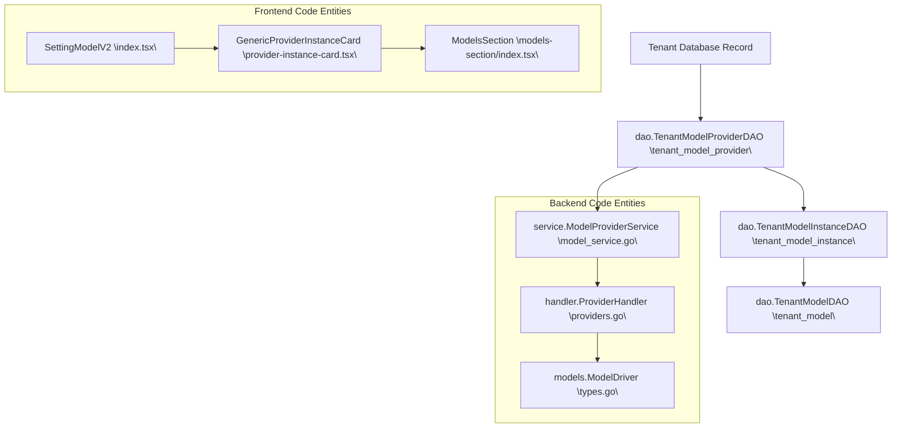
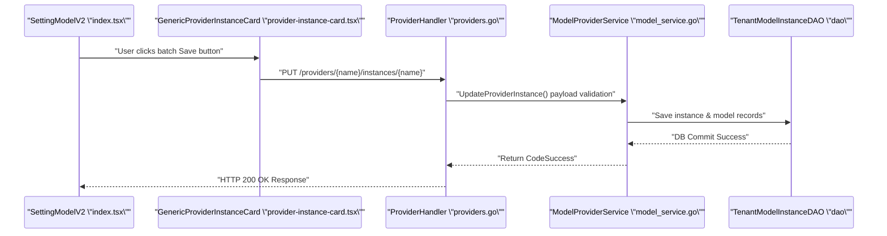

<!-- source: DeepWiki mcp.deepwiki.com · repo infiniflow/ragflow · page 5.4 Tenant Configuration and Model Management · fetched 2026-10-29 -->

# Tenant Configuration and Model Management

<details>
<summary>Relevant source files</summary>

The following files were used as context for generating this wiki page:

- [conf/models/aliyun.json](conf/models/aliyun.json)
- [internal/agent/component/model_driver_test.go](internal/agent/component/model_driver_test.go)
- [internal/entity/models/aliyun.go](internal/entity/models/aliyun.go)
- [internal/entity/models/aliyun_test.go](internal/entity/models/aliyun_test.go)
- [internal/entity/models/azure_openai.go](internal/entity/models/azure_openai.go)
- [internal/entity/models/azure_openai_test.go](internal/entity/models/azure_openai_test.go)
- [internal/entity/models/deepseek.go](internal/entity/models/deepseek.go)
- [internal/entity/models/dummy.go](internal/entity/models/dummy.go)
- [internal/entity/models/gitee.go](internal/entity/models/gitee.go)
- [internal/entity/models/lmstudio.go](internal/entity/models/lmstudio.go)
- [internal/entity/models/minimax.go](internal/entity/models/minimax.go)
- [internal/entity/models/minimax_test.go](internal/entity/models/minimax_test.go)
- [internal/entity/models/moonshot.go](internal/entity/models/moonshot.go)
- [internal/entity/models/ollama.go](internal/entity/models/ollama.go)
- [internal/entity/models/siliconflow.go](internal/entity/models/siliconflow.go)
- [internal/entity/models/types.go](internal/entity/models/types.go)
- [internal/entity/models/vllm.go](internal/entity/models/vllm.go)
- [internal/entity/models/volcengine.go](internal/entity/models/volcengine.go)
- [internal/entity/models/xai.go](internal/entity/models/xai.go)
- [internal/entity/models/zhipu-ai.go](internal/entity/models/zhipu-ai.go)
- [internal/handler/chat_audio_wav.go](internal/handler/chat_audio_wav.go)
- [internal/handler/chat_audio_wav_test.go](internal/handler/chat_audio_wav_test.go)
- [internal/handler/providers.go](internal/handler/providers.go)
- [internal/handler/providers_test.go](internal/handler/providers_test.go)
- [internal/service/model_service.go](internal/service/model_service.go)
- [internal/service/model_service_test.go](internal/service/model_service_test.go)
- [web/src/components/layout-recognize-form-field.tsx](web/src/components/layout-recognize-form-field.tsx)
- [web/src/components/linkify-text.tsx](web/src/components/linkify-text.tsx)
- [web/src/components/mineru-options-form-field.tsx](web/src/components/mineru-options-form-field.tsx)
- [web/src/components/ui/input-select.tsx](web/src/components/ui/input-select.tsx)
- [web/src/components/ui/tooltip.tsx](web/src/components/ui/tooltip.tsx)
- [web/src/hooks/use-llm-request.tsx](web/src/hooks/use-llm-request.tsx)
- [web/src/interfaces/database/llm.ts](web/src/interfaces/database/llm.ts)
- [web/src/interfaces/request/llm.ts](web/src/interfaces/request/llm.ts)
- [web/src/pages/user-setting/setting-model/hooks.tsx](web/src/pages/user-setting/setting-model/hooks.tsx)
- [web/src/pages/user-setting/setting-model/index.tsx](web/src/pages/user-setting/setting-model/index.tsx)
- [web/src/pages/user-setting/setting-model/instance-card/add-custom-model-dialog.tsx](web/src/pages/user-setting/setting-model/instance-card/add-custom-model-dialog.tsx)
- [web/src/pages/user-setting/setting-model/instance-card/bedrock-instance-card.tsx](web/src/pages/user-setting/setting-model/instance-card/bedrock-instance-card.tsx)
- [web/src/pages/user-setting/setting-model/instance-card/components/draft-mode-card.tsx](web/src/pages/user-setting/setting-model/instance-card/components/draft-mode-card.tsx)
- [web/src/pages/user-setting/setting-model/instance-card/components/saved-mode-card.tsx](web/src/pages/user-setting/setting-model/instance-card/components/saved-mode-card.tsx)
- [web/src/pages/user-setting/setting-model/instance-card/hooks.tsx](web/src/pages/user-setting/setting-model/instance-card/hooks.tsx)
- [web/src/pages/user-setting/setting-model/instance-card/interface.ts](web/src/pages/user-setting/setting-model/instance-card/interface.ts)
- [web/src/pages/user-setting/setting-model/instance-card/models-section/components/model-row.tsx](web/src/pages/user-setting/setting-model/instance-card/models-section/components/model-row.tsx)
- [web/src/pages/user-setting/setting-model/instance-card/models-section/hooks.test.tsx](web/src/pages/user-setting/setting-model/instance-card/models-section/hooks.test.tsx)
- [web/src/pages/user-setting/setting-model/instance-card/models-section/hooks.ts](web/src/pages/user-setting/setting-model/instance-card/models-section/hooks.ts)
- [web/src/pages/user-setting/setting-model/instance-card/models-section/index.tsx](web/src/pages/user-setting/setting-model/instance-card/models-section/index.tsx)
- [web/src/pages/user-setting/setting-model/instance-card/models-section/interface.ts](web/src/pages/user-setting/setting-model/instance-card/models-section/interface.ts)
- [web/src/pages/user-setting/setting-model/instance-card/provider-instance-card.tsx](web/src/pages/user-setting/setting-model/instance-card/provider-instance-card.tsx)
- [web/src/pages/user-setting/setting-model/layout/system-setting.tsx](web/src/pages/user-setting/setting-model/layout/system-setting.tsx)
- [web/src/pages/user-setting/setting-model/provider-schema/constants.ts](web/src/pages/user-setting/setting-model/provider-schema/constants.ts)
- [web/src/pages/user-setting/setting-model/provider-schema/field-config/generic-api-key-config.test.ts](web/src/pages/user-setting/setting-model/provider-schema/field-config/generic-api-key-config.test.ts)
- [web/src/pages/user-setting/setting-model/provider-schema/field-config/generic-api-key-config.ts](web/src/pages/user-setting/setting-model/provider-schema/field-config/generic-api-key-config.ts)
- [web/src/pages/user-setting/setting-model/provider-schema/field-config/index.ts](web/src/pages/user-setting/setting-model/provider-schema/field-config/index.ts)
- [web/src/pages/user-setting/setting-model/provider-schema/field-config/local-llm-configs.ts](web/src/pages/user-setting/setting-model/provider-schema/field-config/local-llm-configs.ts)
- [web/src/pages/user-setting/setting-model/provider-schema/field-config/provider-config-map.test.ts](web/src/pages/user-setting/setting-model/provider-schema/field-config/provider-config-map.test.ts)
- [web/src/pages/user-setting/setting-model/provider-schema/field-config/provider-config-map.ts](web/src/pages/user-setting/setting-model/provider-schema/field-config/provider-config-map.ts)
- [web/src/pages/user-setting/setting-model/provider-schema/field-config/utils.ts](web/src/pages/user-setting/setting-model/provider-schema/field-config/utils.ts)
- [web/src/pages/user-setting/setting-model/provider-schema/hooks/use-list-models-picker.ts](web/src/pages/user-setting/setting-model/provider-schema/hooks/use-list-models-picker.ts)
- [web/src/pages/user-setting/setting-model/provider-schema/hooks/use-provider-fields.tsx](web/src/pages/user-setting/setting-model/provider-schema/hooks/use-provider-fields.tsx)
- [web/src/pages/user-setting/setting-model/provider-schema/types.ts](web/src/pages/user-setting/setting-model/provider-schema/types.ts)
- [web/src/utils/llm-util.ts](web/src/utils/llm-util.ts)

</details>


## Purpose and Scope

This document describes RAGFlow's multi-tenant model management system that allows each tenant to independently configure and manage their LLM models through a structured hierarchy of providers, instances, and models. It covers:

- Tenant-scoped model configuration stored in relational tables (`tenant_model_provider`, `tenant_model_instance`, and `tenant_model`).
- Backend REST API endpoints and services (`ProviderHandler`, `ModelProviderService`) responsible for adding, updating, verifying, and listing model configurations.
- Provider-specific credential parsing and unwrapping implementations across model drivers (such as `MiniMaxModel` and `VolcEngine`).
- The React-based tenant UI for configuring provider instances and their models, including dynamic forms, instance cards (`SettingModelV2`, `GenericProviderInstanceCard`, `DraftModeCard`, `SavedModeCard`, and `ModelsSection`), and hook-based state resolution (`useResolveCreds`, `useModelsCatalog`).

Sources: [internal/service/model_service.go:80-87](), [internal/handler/providers.go:58-63](), [web/src/pages/user-setting/setting-model/index.tsx:37-60](), [web/src/hooks/use-llm-request.tsx:17-90]()

---

## Architecture Overview

### Tenant Model Configuration Hierarchy

RAGFlow organizes tenant-scoped LLM configurations via a three-tier hierarchy for flexible multi-tenant isolation and management:

1. **Model Provider**  
   - Represents an LLM provider or factory type (e.g., `AzureOpenAI`, `VolcEngine`, `GoogleCloud`, `Ollama`), referenced via constants like `LLMFactory` [web/src/pages/user-setting/setting-model/provider-schema/field-config/provider-config-map.ts:18]().  
   - Stored in the `tenant_model_provider` table, defined by ID, user ID, provider name, and tenant ID (`entity.TenantModelProvider`) [internal/service/model_service.go:128-133]().

2. **Provider Instance**  
   - Represents tenant-specific deployments or instances of a provider (`IProviderInstance`) [web/src/interfaces/database/llm.ts:25]().  
   - Contains instance-specific API keys, base URLs, region information, and credential bundles (`api_key` can be a string or structured object via `buildApiKeyValue` / `unwrapApiKey`) [web/src/pages/user-setting/setting-model/instance-card/hooks.tsx:47-94]().  
   - Stored in the `tenant_model_instance` table, linking to the `tenant_model_provider` record.

3. **Model (Instance Model)**  
   - Represents an actual model configured within a provider instance (`IInstanceModel`) [web/src/interfaces/database/llm.ts:23]().  
   - Includes model name, type (`model_type`), max tokens, and extra flags such as `is_tools` for function calling support (`IModelInfo`) [web/src/interfaces/request/llm.ts:13-23]().  
   - Stored in the `tenant_model` table.

Sources: [internal/service/model_service.go:128-133](), [web/src/interfaces/database/llm.ts:1-30](), [web/src/interfaces/request/llm.ts:1-24](), [web/src/pages/user-setting/setting-model/instance-card/hooks.tsx:47-94]()

### Composite Model Identification

Models are uniquely identified by composite keys or model IDs:
```
model_name@instance_name@provider_name
```
Utility functions like `parseModelValue` and `buildModelValue` (`web/src/utils/llm-util.ts`) parse and construct these references across frontend components and request payloads [web/src/hooks/use-llm-request.tsx:48-52]().

### Tenant Configuration & Code Entity Mapping



Sources: [internal/service/model_service.go:69-87](), [internal/handler/providers.go:58-73](), [web/src/pages/user-setting/setting-model/index.tsx:61-80](), [web/src/pages/user-setting/setting-model/instance-card/provider-instance-card.tsx:70-76]()

---

## Backend API Endpoints and Services

### Service Layer: `ModelProviderService`

Managed by `ModelProviderService` (`internal/service/model_service.go`), tenant provider operations coordinate database interactions across multiple DAOs [internal/service/model_service.go:69-87]():
- `AddModelProvider`: Validates feature permissions, checks for existing provider bindings, and inserts records into `tenant_model_provider` using a generated token ID [internal/service/model_service.go:106-139]().
- `ListProvidersOfTenant`: Filters tenant-owned providers through the database permission checker (`permission.NewDatabaseChecker`), stripping system-excluded or stale factory names [internal/service/model_service.go:141-190]().

Sources: [internal/service/model_service.go:69-190]()

### HTTP Handler Layer: `ProviderHandler`

The REST endpoints are exposed via `ProviderHandler` (`internal/handler/providers.go`), handling provider listing, addition, deletion, and model probing [internal/handler/providers.go:58-73]():
- `ListProviders`: Supports querying available system factory pools (`?available=true`) or tenant-specific configured providers [internal/handler/providers.go:75-114]().
- `AddProvider`: Binds a new provider name to the current user's tenant [internal/handler/providers.go:120-138]().
- `ListModels`: Fetches supported models for a specific provider instance, incorporating credentials or falling back to bundled catalogs [internal/handler/providers.go:174-213]().

Sources: [internal/handler/providers.go:58-213]()

### Specialized Credential Handling in Drivers

Certain providers store compound credentials as JSON structures rather than flat API keys. Driver implementations unwrap these structures during configuration checks and API calls:
- **MiniMax (`minimaxCredentials`)**: Extracts `api_key` and `group_id` when the stored credential is a JSON bundle (`{"api_key": "...", "group_id": "..."}`) [internal/entity/models/minimax.go:38-63]().
- **VolcEngine (`getAPIKey`)**: Extracts `ark_api_key` from stored Ark endpoint configuration payloads [internal/entity/models/volcengine.go:54-72]().

Sources: [internal/entity/models/minimax.go:38-63](), [internal/entity/models/volcengine.go:54-72]()

---

## Frontend Tenant Model Configuration UI

### Sidebar and Main View: `SettingModelV2`

The primary settings page component is `SettingModelV2` (`web/src/pages/user-setting/setting-model/index.tsx`), which renders a sidebar-driven layout [web/src/pages/user-setting/setting-model/index.tsx:37-61]():
- **Sidebar**: Manages provider selections and default models view (`Sidebar`, `SidebarSelection`) [web/src/pages/user-setting/setting-model/layout/sidebar.tsx]().
- **Content Panel**: Displays either `SystemSetting` or a list of `ProviderInstanceCard` components grouped under a sticky `ProviderHeaderBar` [web/src/pages/user-setting/setting-model/index.tsx:41-48]().
- **Draft Management**: Supports adding draft instance cards dynamically (`addDraft`, `draftIds`) and executing a batch save flow that validates all visible cards through imperative refs (`cardRefs`) [web/src/pages/user-setting/setting-model/index.tsx:64-163]().

Sources: [web/src/pages/user-setting/setting-model/index.tsx:37-163]()

### Provider Instance Cards: Draft vs. Saved Modes

Provider instances are rendered via `GenericProviderInstanceCard` (`web/src/pages/user-setting/setting-model/instance-card/provider-instance-card.tsx`), supporting two visual states:
1. **Draft Mode (`DraftModeCard`)**: Used for unsaved instances. Features an inline instance name input section (`InstanceNameSection`) and editable form fields without locks [web/src/pages/user-setting/setting-model/instance-card/components/draft-mode-card.tsx:26-36]().
2. **Saved Mode (`SavedModeCard`)**: Renders a collapsible container with an expandable header, inline renaming support (`renaming`, `commitRename`), and a delete action dialog (`ConfirmDeleteDialog`) [web/src/pages/user-setting/setting-model/instance-card/components/saved-mode-card.tsx:43-128]().

Sources: [web/src/pages/user-setting/setting-model/instance-card/provider-instance-card.tsx:51-76](), [web/src/pages/user-setting/setting-model/instance-card/components/saved-mode-card.tsx:43-60](), [web/src/pages/user-setting/setting-model/instance-card/components/draft-mode-card.tsx:26-36]()

### Models Section and Catalog Management

Contained within each instance card, `ModelsSection` (`web/src/pages/user-setting/setting-model/instance-card/models-section/index.tsx`) manages model associations:
- Fetches per-instance saved models via `useFetchInstanceModels` [web/src/pages/user-setting/setting-model/instance-card/models-section/index.tsx:82-86]().
- Resolves credentials via `useResolveCreds` and queries upstream provider catalogs via `useModelsCatalog` [web/src/pages/user-setting/setting-model/instance-card/models-section/index.tsx:72-154]().
- Handles local draft model additions, removals, and batch configurations (`addDraftModel`, `removeDraftModel`, `applyDraftModelsList`) [web/src/pages/user-setting/setting-model/instance-card/models-section/index.tsx:109-186]().

Sources: [web/src/pages/user-setting/setting-model/instance-card/models-section/index.tsx:49-186](), [web/src/pages/user-setting/setting-model/instance-card/models-section/hooks.ts:112-184]()

### Provider Schema and Field Configuration

Provider-specific fields and transformation rules are defined in `ProviderConfigMap` (`web/src/pages/user-setting/setting-model/provider-schema/field-config/provider-config-map.ts`):
- Maps each `LLMFactory` key to its `ProviderConfig`, specifying form fields (text, password, inputSelect), `verifyTransform`, `submitTransform`, and `echoTransform` [web/src/pages/user-setting/setting-model/provider-schema/field-config/provider-config-map.ts:36-99]().
- Handles specialized payloads such as Azure OpenAI API versions [web/src/pages/user-setting/setting-model/provider-schema/field-config/provider-config-map.ts:74-98](), Google Cloud service account keys [web/src/pages/user-setting/setting-model/provider-schema/field-config/provider-config-map.ts:140-202](), and VolcEngine API keys [web/src/pages/user-setting/setting-model/provider-schema/field-config/provider-config-map.ts:102-137]().

Sources: [web/src/pages/user-setting/setting-model/provider-schema/field-config/provider-config-map.ts:1-207]()

---

## Data Flow: Provider Persistence and Verification



Sources: [web/src/pages/user-setting/setting-model/index.tsx:61-163](), [internal/handler/providers.go:120-138](), [internal/service/model_service.go:106-139]()

---

## Connection Check and Verification

Credential verification is handled prior to persistence:
- The `useVerifyConnection` hook (`web/src/pages/user-setting/setting-model/hooks.tsx`) calls `verifyProviderConnection` with resolved API keys, base URLs, and model lists [web/src/pages/user-setting/setting-model/hooks.tsx:111-144]().
- `VerifyButton` triggers `handleVerify`, utilizing `verifyTransform` from `ProviderConfigMap` to format credentials correctly [web/src/pages/user-setting/setting-model/instance-card/verify-button.tsx]().
- On the backend, `CheckConnectionRequest` carries credentials and instance info to probe connectivity using the corresponding `ModelDriver` implementation [internal/service/model_service.go:91-104]().

Sources: [internal/service/model_service.go:91-104](), [web/src/pages/user-setting/setting-model/hooks.tsx:111-144](), [web/src/pages/user-setting/setting-model/provider-schema/field-config/provider-config-map.ts:82-86]()

---

## Summary

RAGFlow's tenant configuration and model management subsystem provides a robust, multi-tenant architecture:
- Backend services (`ModelProviderService`, `ProviderHandler`) coordinate persistent storage and credential unwrapping across heterogeneous AI providers.
- React components (`SettingModelV2`, `GenericProviderInstanceCard`, `ModelsSection`) deliver an interactive UI for provider, instance, and model administration.
- Custom hooks and configuration maps ensure seamless validation, connection verification, and batch persistence.

Sources: [internal/service/model_service.go:69-87](), [internal/handler/providers.go:58-73](), [web/src/pages/user-setting/setting-model/index.tsx:37-163](), [web/src/pages/user-setting/setting-model/provider-schema/field-config/provider-config-map.ts:36-99]()

---

