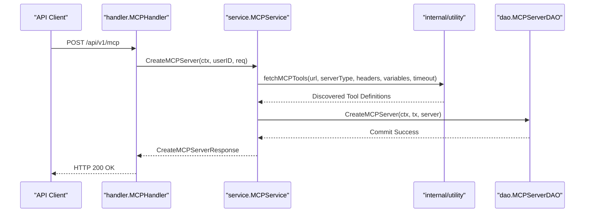

<!-- source: DeepWiki mcp.deepwiki.com · repo infiniflow/ragflow · page 5.5 Tool Calling and MCP Integration · fetched 2026-10-29 -->

# Tool Calling and MCP Integration

<details>
<summary>Relevant source files</summary>

The following files were used as context for generating this wiki page:

- [docs/develop/mcp/_category_.json](docs/develop/mcp/_category_.json)
- [docs/develop/mcp/connect_external_mcp_servers.md](docs/develop/mcp/connect_external_mcp_servers.md)
- [docs/develop/mcp/launch_mcp_server.md](docs/develop/mcp/launch_mcp_server.md)
- [docs/develop/mcp/mcp_client_example.md](docs/develop/mcp/mcp_client_example.md)
- [docs/develop/mcp/mcp_tools.md](docs/develop/mcp/mcp_tools.md)
- [docs/develop/mcp/native_go_mcp.md](docs/develop/mcp/native_go_mcp.md)
- [docs/develop/mcp/overview.md](docs/develop/mcp/overview.md)
- [docs/develop/mcp/use_ragflow_as_mcp_server.md](docs/develop/mcp/use_ragflow_as_mcp_server.md)
- [docs/develop/switch_doc_engine.md](docs/develop/switch_doc_engine.md)
- [example/mcp/parallel_search.json](example/mcp/parallel_search.json)
- [internal/dao/mcp.go](internal/dao/mcp.go)
- [internal/dao/mcp_test.go](internal/dao/mcp_test.go)
- [internal/handler/mcp.go](internal/handler/mcp.go)
- [internal/handler/mcp_retrieval.go](internal/handler/mcp_retrieval.go)
- [internal/handler/mcp_test.go](internal/handler/mcp_test.go)
- [internal/mcp/connector.go](internal/mcp/connector.go)
- [internal/mcp/http.go](internal/mcp/http.go)
- [internal/mcp/http_test.go](internal/mcp/http_test.go)
- [internal/mcp/server.go](internal/mcp/server.go)
- [internal/mcp/tools.json](internal/mcp/tools.json)
- [internal/service/mcp.go](internal/service/mcp.go)
- [internal/service/mcp_export.go](internal/service/mcp_export.go)
- [internal/service/mcp_export_test.go](internal/service/mcp_export_test.go)
- [internal/service/mcp_test.go](internal/service/mcp_test.go)
- [web/src/hooks/use-mcp-request.ts](web/src/hooks/use-mcp-request.ts)
- [web/src/interfaces/database/mcp.ts](web/src/interfaces/database/mcp.ts)
- [web/src/interfaces/request/mcp.ts](web/src/interfaces/request/mcp.ts)
- [web/src/pages/user-setting/mcp/edit-mcp-dialog.tsx](web/src/pages/user-setting/mcp/edit-mcp-dialog.tsx)
- [web/src/services/mcp-server-service.ts](web/src/services/mcp-server-service.ts)

</details>


This page provides an in-depth technical explanation of RAGFlow's tool calling system and the integration of the Model Context Protocol (MCP). It covers the function schema binding mechanism for LLMs, the management and client-side handling of MCP servers (`internal/service/mcp.go`, `internal/handler/mcp.go`), the native Go MCP server implementation (`internal/mcp/`), and how agents invoke external tools.

---

## Purpose and Scope

RAGFlow's tool calling and MCP integration subsystem enables Large Language Models (LLMs) to call external tools and functions at runtime. The scope includes:
- **Function Schema Binding**: Attaching tool schemas and execution bindings to LLM instances for function execution during chat and agent reasoning loops.
- **MCP Client and Management**: Managing remote MCP servers (`sse`, `streamable-http`), persisting credentials securely, and discovering tool sets [internal/service/mcp.go:40-48]().
- **Native Go MCP Server**: Exposing RAGFlow's internal retrieval, dataset listing, and chat listing capabilities via the official Model Context Protocol Go SDK (`internal/mcp/server.go`) [internal/mcp/server.go:1-19]().

Sources:
- `internal/service/mcp.go:40-48`
- `internal/mcp/server.go:1-19`

---

## Architecture and Data Flow

The following diagrams bridge the Natural Language Space to the Code Entity Space, explicitly mapping high-level user actions to concrete Go packages, structs, and methods.

### Natural Language to Code Entity: Management and Client Flow

```mermaid
graph TB
    subgraph NaturalLanguageSpace["Natural Language Space"]
        UserAddServer["User Registers Remote MCP Server"]
        UserChatPrompt["User Asks Question Requiring Tools"]
    end

    subgraph CodeEntitySpace["Code Entity Space"]
        Handler["handler.MCPHandler\ninternal/handler/mcp.go"]
        Service["service.MCPService\ninternal/service/mcp.go"]
        DAO["dao.MCPServerDAO\ninternal/dao/mcp.go"]
        ClientUtility["utility.fetchMCPTools()\ninternal/utility/mcp_client.go"]
    end

    UserAddServer --> Handler
    Handler -->|CreateMCPServer()| Service
    Service -->|fetchMCPTools()| ClientUtility
    Service -->|CreateMCPServer()| DAO
    UserChatPrompt --> AgentLoop["react.Agent\ninternal/agent/component"]
```
Sources:
- `internal/handler/mcp.go:45-70`
- `internal/service/mcp.go:50-60`
- `internal/dao/mcp.go:1-30`

### Natural Language to Code Entity: Native MCP Server Execution

```mermaid
graph TB
    subgraph NaturalLanguageSpace["Natural Language Space"]
        NLQuery["External Agent Sends Retrieval Prompt"]
        DatasetQuery["External Agent Lists Datasets"]
    end

    subgraph CodeEntitySpace["Code Entity Space"]
        MCPServer["mcp.Connector\ninternal/mcp/server.go"]
        RetrievalHandler["handler.mcpRetrieval()\ninternal/handler/mcp_retrieval.go"]
        DatasetSearch["dataset.DatasetService.SearchDatasets()\ninternal/service/dataset/"]
        SDKServer["sdk.Server\ngithub.com/modelcontextprotocol/go-sdk/mcp"]
    end

    NLQuery --> SDKServer
    SDKServer -->|CallTool| MCPServer
    MCPServer -->|Retrieval()| RetrievalHandler
    RetrievalHandler -->|SearchDatasets()| DatasetSearch
    DatasetQuery --> SDKServer
    SDKServer -->|ListDatasets()| MCPServer
```
Sources:
- `internal/mcp/server.go:14-19`
- `internal/handler/mcp_retrieval.go:39-43`

---

## MCP Server Management and REST API

The `MCPService` struct in `internal/service/mcp.go` manages the lifecycle of MCP servers within tenant boundaries. It coordinates server registration, validation, tool discovery, and database persistence [internal/service/mcp.go:50-183]().

### Key Server Operations and Validations

- **Server Types**: Validated against `sse` and `streamable-http` [internal/service/mcp.go:40-42]() via `isValidMCPServerType()`.
- **Timeouts**: Bounded between `0` and `60` seconds (`maxMCPFetchTimeoutSec`) [internal/service/mcp.go:107-113]().
- **Tool Discovery**: During creation or update, `fetchMCPTools` connects to the target endpoint, queries available tools, and caches them inside the `variables["tools"]` JSON map [internal/service/mcp.go:147-151]().


Sources:
- `internal/service/mcp.go:110-183`
- `internal/handler/mcp.go:71-93`

---

## Native Go MCP Server Implementation (`internal/mcp`)

RAGFlow also operates as an MCP server using the official Model Context Protocol Go SDK (`github.com/modelcontextprotocol/go-sdk/mcp`) [internal/mcp/server.go:11](). This allows external MCP clients to securely query RAGFlow's native knowledge bases and chats.

### Exposed MCP Tools

Defined in `internal/mcp/tools.json` and registered in `internal/mcp/server.go`, the server exposes three core primitives:
1. `ragflow_retrieval`: Executes hybrid vector/BM25 retrieval over user datasets [internal/mcp/server.go:52-55]().
2. `ragflow_list_datasets`: Paginates through authorized dataset collections [internal/mcp/server.go:56-63]().
3. `ragflow_list_chats`: Paginates through chat assistant instances [internal/mcp/server.go:64-67]().

```go
// Connector is the service boundary shared by both MCP transports.
type Connector interface {
	ListDatasets(context.Context, int, int, string, bool) (string, error)
	ListChats(context.Context, int, int, string, bool) (string, error)
	Retrieval(context.Context, RetrievalRequest) (string, error)
}
```
*Cited from [internal/mcp/server.go:14-19]()*

### Request Translation and Retrieval Window Validation

The `mcpRetrieval` function in `internal/handler/mcp_retrieval.go` translates incoming MCP retrieval inputs into RAGFlow's standard `service.SearchDatasetsRequest` [internal/handler/mcp_retrieval.go:39-42](). It enforces strict window bounds to protect downstream engines against overflow attacks [internal/handler/mcp_retrieval.go:26-37]().

Sources:
- `internal/mcp/server.go:1-114`
- `internal/handler/mcp_retrieval.go:26-106`

---

## Frontend Management (`web/src`)

The web UI provides administration dialogs and React hooks to configure, test, and inspect connected MCP servers.

- **React Hooks**: `useListMcpServer`, `useGetMcpServer`, `useCreateMcpServer`, and `useTestMcpServer` manage server state via `@tanstack/react-query` [web/src/hooks/use-mcp-request.ts:55-156]().
- **Dialogs**: `EditMcpDialog` provides interactive form validation using Zod schemas and displays live tool inspection cards [web/src/pages/user-setting/mcp/edit-mcp-dialog.tsx:62-197]().

Sources:
- `web/src/hooks/use-mcp-request.ts:55-221`
- `web/src/pages/user-setting/mcp/edit-mcp-dialog.tsx:62-197`

---

