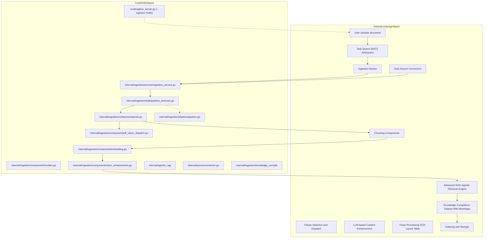
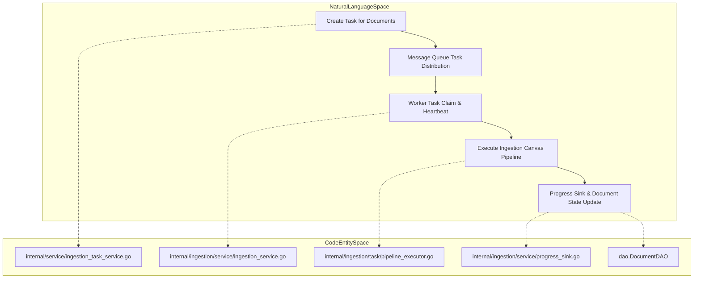

<!-- source: DeepWiki mcp.deepwiki.com · repo infiniflow/ragflow · page 6 Document Processing Pipeline · fetched 2026-10-29 -->

# Document Processing Pipeline

Relevant source files

The following files were used as context for generating this wiki page:

- [internal/ingestion/component/chunker/pdf_postprocess_test.go](internal/ingestion/component/chunker/pdf_postprocess_test.go)
- [internal/ingestion/component/chunker/pdfcrop_progress_cgo_test.go](internal/ingestion/component/chunker/pdfcrop_progress_cgo_test.go)
- [internal/ingestion/component/media_dispatch.go](internal/ingestion/component/media_dispatch.go)
- [internal/ingestion/component/media_dispatch_test.go](internal/ingestion/component/media_dispatch_test.go)
- [internal/ingestion/component/parser.go](internal/ingestion/component/parser.go)
- [internal/ingestion/component/parser_dispatch.go](internal/ingestion/component/parser_dispatch.go)
- [internal/ingestion/component/parser_dispatch_progress_test.go](internal/ingestion/component/parser_dispatch_progress_test.go)
- [internal/ingestion/component/parser_dispatch_test.go](internal/ingestion/component/parser_dispatch_test.go)
- [internal/ingestion/component/pdf_postprocess_test.go](internal/ingestion/component/pdf_postprocess_test.go)
- [internal/ingestion/component/pdf_vision_dispatch.go](internal/ingestion/component/pdf_vision_dispatch.go)
- [internal/ingestion/component/pdf_vision_dispatch_test.go](internal/ingestion/component/pdf_vision_dispatch_test.go)
- [internal/ingestion/component/svg_text.go](internal/ingestion/component/svg_text.go)
- [internal/ingestion/component/svg_text_test.go](internal/ingestion/component/svg_text_test.go)
- [internal/ingestion/component/testdata/picture_text.svg](internal/ingestion/component/testdata/picture_text.svg)
- [internal/ingestion/component/vision_enhancement.go](internal/ingestion/component/vision_enhancement.go)
- [internal/ingestion/component/vision_enhancement_progress_test.go](internal/ingestion/component/vision_enhancement_progress_test.go)
- [internal/ingestion/component/vision_enhancement_test.go](internal/ingestion/component/vision_enhancement_test.go)
- [internal/parser/parser/doc_parser.go](internal/parser/parser/doc_parser.go)
- [internal/parser/parser/doc_parser_doc_table_test.go](internal/parser/parser/doc_parser_doc_table_test.go)
- [internal/parser/parser/doc_parser_synth_test.go](internal/parser/parser/doc_parser_synth_test.go)
- [internal/parser/parser/email_parser.go](internal/parser/parser/email_parser.go)
- [internal/parser/parser/email_parser_test.go](internal/parser/parser/email_parser_test.go)
- [internal/parser/parser/html_parser.go](internal/parser/parser/html_parser.go)
- [internal/parser/parser/html_parser_test.go](internal/parser/parser/html_parser_test.go)
- [internal/parser/parser/parse_result.go](internal/parser/parser/parse_result.go)
- [internal/parser/parser/parse_result_test.go](internal/parser/parser/parse_result_test.go)
- [internal/service/file/file_content.go](internal/service/file/file_content.go)
- [internal/service/file/file_test.go](internal/service/file/file_test.go)

## Purpose and Scope

The Document Processing Pipeline in RAGFlow orchestrates the end-to-end transformation of user-uploaded documents into indexed, semantically rich, and retrievable content. It covers the lifecycle from document upload, parsing of various file formats via `internal/ingestion/component/parser.go` [internal/ingestion/component/parser.go:1-76](), chunking of textual and table data, semantic content enhancement using LLMs, advanced vision-based OCR and layout recognition via `internal/ingestion/component/pdf_vision_dispatch.go` [internal/ingestion/component/pdf_vision_dispatch.go:1-76](), all the way to indexing and knowledge compilation.

This page serves as a high-level overview of these processing stages and how they integrate with RAGFlow's system architecture. Detailed discussions and implementation specifics are provided in the child pages:

- [Document Parsing Strategies](#6.1) — Parser selection, dispatch, and supported formats (`internal/parser`, `internal/ingestion/component/parser.go`).
- [Chunking Methods](#6.2) — Chunker implementations, delimiters, overlap, and PDF position cropping.
- [Content Enhancement and Embedding](#6.3) — LLM-based extractors, tokenizers, and embedding generation.
- [DeepDoc: OCR, Layout and Table Recognition](#6.4) — ONNX .ort models, PDF layout analysis, OCR detect/recognize, and table recognition.
- [Advanced RAG: Agentic Retrieval and Knowledge Graphs](#6.5) — Multi-step question decomposition, graph retrieval, mindmaps, and RAPTOR-style summarization (`internal/agentic_rag`).
- [Data Source Connectors](#6.6) — Connector registry with 30+ sources and the syncer service (`internal/syncer`).
- [Knowledge Compilation and Dataset Artifacts](#6.7) — Structure extraction, wiki/mindmap generation, and compilation templates (`internal/ingestion/knowledge_compile`).
- [Ingestion Pipeline Execution](#6.8) — Ingestion service, task consumption from NATS, pipeline params, component graphs, and indexing (`internal/ingestion/task`, `internal/ingestion/service`).

Sources:
- internal/ingestion/component/parser.go:1-76 [()...]()
- internal/ingestion/component/pdf_vision_dispatch.go:1-76 [()...]()

---

## Pipeline Architecture Overview

The document processing pipeline is implemented as an asynchronous, multi-stage series of components that collectively convert raw documents into enriched knowledge units. When a document is uploaded, a corresponding ingestion task is enqueued in the system. Background workers consume tasks, apply format-specific parsers (`internal/ingestion/component/parser_dispatch.go` [internal/ingestion/component/parser_dispatch.go:77-112]()), chunk the extracted content, optionally perform semantic enhancement via large language models (LLMs), and index the resulting data.

This flow is augmented by vision components for scanned or image-based documents that perform OCR and layout recognition (`internal/ingestion/component/media_dispatch.go` [internal/ingestion/component/media_dispatch.go:81-140]()). The pipeline supports advanced RAG techniques such as hierarchical summarization and knowledge graphs, and integrates with external data connectors and compilation systems for dataset-wide knowledge artifacts.

### Diagram: Document Processing Pipeline Architecture & Code Entity Mapping

Sources:  
- internal/ingestion/component/parser_dispatch.go:77-112 [()...]()
- internal/ingestion/component/media_dispatch.go:81-140 [()...]()

---

## Task Lifecycle and Ingestion Execution

Ingestion tasks are generated upon document upload and managed through a lifecycle managed by the ingestion task service (`internal/service/ingestion_task_service.go`). Tasks transit through well-defined statuses such as `CREATED`, `SCHEDULED`, `RUNNING`, and finally to terminal states like `COMPLETED`, `FAILED`, or `STOPPED`.

The ingestion service (`internal/ingestion/service/ingestion_service.go`) orchestrates task dispatch, concurrency control, heartbeat renewal for message acknowledgment, and cancellation handling. Workers execute ingestion tasks by invoking the pipeline executor (`internal/ingestion/task/pipeline_executor.go`), which runs the ingestion canvas pipeline.

For details on the task execution graph, progress sinks (`internal/ingestion/service/progress_sink.go`), and chunk caching, see [Ingestion Pipeline Execution](#6.8).

### Diagram: Ingestion Execution and Task Lifecycle Mapping

Sources:
- internal/service/file/file_content.go:18-30 [()...]()

---

## Document Parsing Strategies (6.1)

RAGFlow selects parsers based on document file suffixes and configured parsing setups (`internal/ingestion/component/parser_dispatch.go` [internal/ingestion/component/parser_dispatch.go:41-76]()). Supported formats include PDF, DOCX, Excel, Markdown, EPUB, HTML (`internal/parser/parser/html_parser.go` [internal/parser/parser/html_parser.go:29-56]()), email (EML/MBOX via `internal/parser/parser/email_parser.go` [internal/parser/parser/email_parser.go:44-74]()), and images. Parsers emit JSON-formatted items encapsulating document structure and content.

For parser selection rules, parameter schemas, and UI integration, see [Document Parsing Strategies](#6.1).

Sources:
- internal/ingestion/component/parser_dispatch.go:41-76 [()...]()
- internal/parser/parser/html_parser.go:29-56 [()...]()
- internal/parser/parser/email_parser.go:44-74 [()...]()

---

## Chunking Methods (6.2)

After parsing, document content is split into chunks suitable for indexing and retrieval. Chunker variants include token-length chunkers, title-based, general text chunking, table chunkers, and domain-specific chunkers tuned for Q&A, spreadsheets, presentations, and academic papers.

For a comprehensive explanation of chunking strategies, schema, and configuration, see [Chunking Methods](#6.2).

Sources:
- internal/ingestion/component/parser.go:114-167 [()...]()

---

## Content Enhancement and Embedding (6.3)

Following chunking, chunks are enhanced semantically by LLM-powered extractors providing keyword extraction, question generation, metadata tags, and other annotations. The tokenizer component enforces token limits suitable for embedding models.

For detailed coverage of extraction models, tokenizer usage, and embedding generation, see [Content Enhancement and Embedding](#6.3).

Sources:
- internal/ingestion/component/media_dispatch.go:48-77 [()...]()

---

## DeepDoc: OCR, Layout and Table Recognition (6.4)

To support scanned PDFs and images, the DeepDoc backend provides OCR, layout analysis, and table structure recognition through ONNX runtime models (`internal/ingestion/component/pdf_vision_dispatch.go` [internal/ingestion/component/pdf_vision_dispatch.go:111-174]()). It operates either as an embedded local process or via an HTTP remote server.

For technical details, ONNX model usage, concurrency management, and integration points, see [DeepDoc: OCR, Layout and Table Recognition](#6.4).

Sources:
- internal/ingestion/component/pdf_vision_dispatch.go:111-174 [()...]()

---

## Advanced RAG: Agentic Retrieval and Knowledge Graphs (6.5)

RAGFlow extends basic document retrieval with multi-step question decomposition, agentic reasoning modes, retrieval graphs, hierarchical summarization via RAPTOR-style algorithms, and mindmaps.

For agentic retrieval algorithms, knowledge graph support, and summarization techniques, see [Advanced RAG: Agentic Retrieval and Knowledge Graphs](#6.5).

Sources:
- internal/ingestion/component/pdf_vision_dispatch.go:68-110 [()...]()

---

## Data Source Connectors (6.6)

RAGFlow supports direct ingestion from over 30 external data sources such as Confluence, Jira, Google Drive, S3, WebDAV, Outlook, Teams, and Airtable through a modular connector registry. The syncer service manages incremental sync operations and credential refreshes.

For information on supported connectors, API design, and UI, see [Data Source Connectors](#6.6).

Sources:
- internal/service/file/file_content.go:114-162 [()...]()

---

## Knowledge Compilation and Dataset Artifacts (6.7)

Beyond per-document ingestion, RAGFlow supports dataset-level knowledge compilation, aggregating extracted structures into navigable artifacts such as wikis, mindmaps, and clustered document navigation trees using MAP-REDUCE-PLAN-REFINE style merges.

See [Knowledge Compilation and Dataset Artifacts](#6.7) for details on architecture, merge strategies, and artifact types.

Sources:
- internal/ingestion/component/parser.go:34-75 [()...]()

---

## Ingestion Pipeline Execution (6.8)

The ingestion pipeline executor acts as the runtime engine for executing ingestion tasks. It consumes tasks from NATS JetStream, loads the configured canvas DSL, and runs the component graph to completion.

For an in-depth technical exploration of the executor lifecycle, state management, and indexing, see [Ingestion Pipeline Execution](#6.8).

Sources:
- internal/ingestion/component/parser_dispatch.go:77-112 [()...]()

---

## Summary

This parent-level overview captures the broad spectrum of document processing functionalities in RAGFlow, from user upload through parsing, chunking, enhancement, vision analysis, advanced retrieval techniques, external data syncing, knowledge compilation, and ingestion pipeline execution. Consult the linked child pages for implementation details.

---

