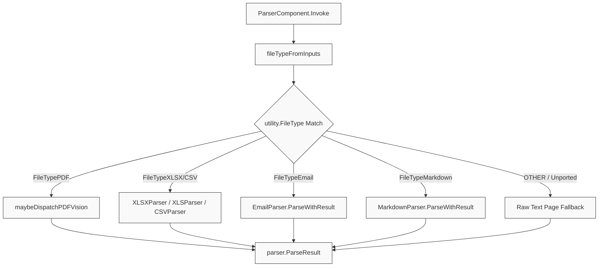
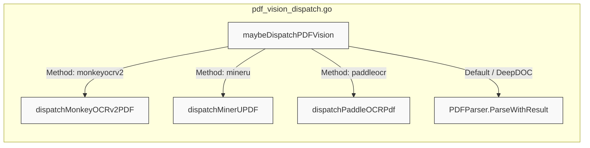

<!-- source: DeepWiki mcp.deepwiki.com · repo infiniflow/ragflow · page 6.1 Document Parsing Strategies · fetched 2026-10-29 -->

# Document Parsing Strategies

Relevant source files

The following files were used as context for generating this wiki page:

- [internal/ingestion/component/chunker/pdf_postprocess_test.go](internal/ingestion/component/chunker/pdf_postprocess_test.go)
- [internal/ingestion/component/chunker/pdfcrop_progress_cgo_test.go](internal/ingestion/component/chunker/pdfcrop_progress_cgo_test.go)
- [internal/ingestion/component/media_dispatch.go](internal/ingestion/component/media_dispatch.go)
- [internal/ingestion/component/media_dispatch_test.go](internal/ingestion/component/media_dispatch_test.go)
- [internal/ingestion/component/parser.go](internal/ingestion/component/parser.go)
- [internal/ingestion/component/parser_dispatch.go](internal/ingestion/component/parser_dispatch.go)
- [internal/ingestion/component/parser_dispatch_progress_test.go](internal/ingestion/component/parser_dispatch_progress_test.go)
- [internal/ingestion/component/parser_dispatch_test.go](internal/ingestion/component/parser_dispatch_test.go)
- [internal/ingestion/component/pdf_postprocess_test.go](internal/ingestion/component/pdf_postprocess_test.go)
- [internal/ingestion/component/pdf_vision_dispatch.go](internal/ingestion/component/pdf_vision_dispatch.go)
- [internal/ingestion/component/pdf_vision_dispatch_test.go](internal/ingestion/component/pdf_vision_dispatch_test.go)
- [internal/ingestion/component/svg_text.go](internal/ingestion/component/svg_text.go)
- [internal/ingestion/component/svg_text_test.go](internal/ingestion/component/svg_text_test.go)
- [internal/ingestion/component/testdata/picture_text.svg](internal/ingestion/component/testdata/picture_text.svg)
- [internal/ingestion/component/vision_enhancement.go](internal/ingestion/component/vision_enhancement.go)
- [internal/ingestion/component/vision_enhancement_progress_test.go](internal/ingestion/component/vision_enhancement_progress_test.go)
- [internal/ingestion/component/vision_enhancement_test.go](internal/ingestion/component/vision_enhancement_test.go)
- [internal/parser/parser/doc_element_text_test.go](internal/parser/parser/doc_element_text_test.go)
- [internal/parser/parser/doc_flatten.go](internal/parser/parser/doc_flatten.go)
- [internal/parser/parser/doc_flatten_test.go](internal/parser/parser/doc_flatten_test.go)
- [internal/parser/parser/doc_parser.go](internal/parser/parser/doc_parser.go)
- [internal/parser/parser/doc_parser_doc_table_test.go](internal/parser/parser/doc_parser_doc_table_test.go)
- [internal/parser/parser/doc_parser_synth_test.go](internal/parser/parser/doc_parser_synth_test.go)
- [internal/parser/parser/docx_caption_cgo_test.go](internal/parser/parser/docx_caption_cgo_test.go)
- [internal/parser/parser/docx_caption_scan.go](internal/parser/parser/docx_caption_scan.go)
- [internal/parser/parser/docx_caption_scan_test.go](internal/parser/parser/docx_caption_scan_test.go)
- [internal/parser/parser/docx_caption_test.go](internal/parser/parser/docx_caption_test.go)
- [internal/parser/parser/docx_ir.go](internal/parser/parser/docx_ir.go)
- [internal/parser/parser/docx_ir_test.go](internal/parser/parser/docx_ir_test.go)
- [internal/parser/parser/docx_parser.go](internal/parser/parser/docx_parser.go)
- [internal/parser/parser/docx_parser_test.go](internal/parser/parser/docx_parser_test.go)
- [internal/parser/parser/email_parser.go](internal/parser/parser/email_parser.go)
- [internal/parser/parser/email_parser_test.go](internal/parser/parser/email_parser_test.go)
- [internal/parser/parser/html_parser.go](internal/parser/parser/html_parser.go)
- [internal/parser/parser/html_parser_test.go](internal/parser/parser/html_parser_test.go)
- [internal/parser/parser/markdown_parser.go](internal/parser/parser/markdown_parser.go)
- [internal/parser/parser/markdown_parser_test.go](internal/parser/parser/markdown_parser_test.go)
- [internal/parser/parser/parse_result.go](internal/parser/parser/parse_result.go)
- [internal/parser/parser/parse_result_test.go](internal/parser/parser/parse_result_test.go)
- [internal/parser/parser/pdf_parser_common.go](internal/parser/parser/pdf_parser_common.go)
- [internal/parser/parser/pdf_parser_opendataloader.go](internal/parser/parser/pdf_parser_opendataloader.go)
- [internal/parser/parser/pdf_parser_opendataloader_cgo.go](internal/parser/parser/pdf_parser_opendataloader_cgo.go)
- [internal/parser/parser/pdf_parser_opendataloader_cgo_test.go](internal/parser/parser/pdf_parser_opendataloader_cgo_test.go)
- [internal/parser/parser/pdf_parser_opendataloader_nocgo.go](internal/parser/parser/pdf_parser_opendataloader_nocgo.go)
- [internal/parser/parser/pdf_parser_opendataloader_nocgo_test.go](internal/parser/parser/pdf_parser_opendataloader_nocgo_test.go)
- [internal/parser/parser/pdf_parser_opendataloader_positions_test.go](internal/parser/parser/pdf_parser_opendataloader_positions_test.go)
- [internal/parser/parser/pdf_parser_opendataloader_test.go](internal/parser/parser/pdf_parser_opendataloader_test.go)
- [internal/parser/parser/pdf_parser_remote_common.go](internal/parser/parser/pdf_parser_remote_common.go)
- [internal/parser/parser/pdf_parser_table_contract_test.go](internal/parser/parser/pdf_parser_table_contract_test.go)
- [internal/parser/parser/pdf_parser_tcadp.go](internal/parser/parser/pdf_parser_tcadp.go)
- [internal/parser/parser/pdf_parser_tcadp_test.go](internal/parser/parser/pdf_parser_tcadp_test.go)
- [internal/parser/parser/pdf_table_no_html_text_test.go](internal/parser/parser/pdf_table_no_html_text_test.go)
- [internal/parser/parser/ppt_parser_cgo_test.go](internal/parser/parser/ppt_parser_cgo_test.go)
- [internal/parser/parser/pptx_ir.go](internal/parser/parser/pptx_ir.go)
- [internal/parser/parser/pptx_ir_test.go](internal/parser/parser/pptx_ir_test.go)
- [internal/parser/parser/pptx_parser.go](internal/parser/parser/pptx_parser.go)
- [internal/parser/parser/testdata/table.doc](internal/parser/parser/testdata/table.doc)
- [internal/parser/parser/text_toc.go](internal/parser/parser/text_toc.go)
- [internal/parser/parser/text_toc_test.go](internal/parser/parser/text_toc_test.go)
- [internal/service/file/file_content.go](internal/service/file/file_content.go)
- [internal/service/file/file_test.go](internal/service/file/file_test.go)
- [web/src/pages/agent/constant/pipeline.tsx](web/src/pages/agent/constant/pipeline.tsx)
- [web/src/pages/agent/form/extractor-form/index.tsx](web/src/pages/agent/form/extractor-form/index.tsx)
- [web/src/pages/agent/form/parser-form/audio-form-fields.tsx](web/src/pages/agent/form/parser-form/audio-form-fields.tsx)
- [web/src/pages/agent/form/parser-form/common-form-fields.tsx](web/src/pages/agent/form/parser-form/common-form-fields.tsx)
- [web/src/pages/agent/form/parser-form/index.tsx](web/src/pages/agent/form/parser-form/index.tsx)
- [web/src/pages/agent/form/parser-form/pdf-form-fields.tsx](web/src/pages/agent/form/parser-form/pdf-form-fields.tsx)
- [web/src/pages/agent/form/parser-form/ppt-form-fields.tsx](web/src/pages/agent/form/parser-form/ppt-form-fields.tsx)
- [web/src/pages/agent/form/parser-form/schema.test.ts](web/src/pages/agent/form/parser-form/schema.test.ts)
- [web/src/pages/agent/form/parser-form/schema.ts](web/src/pages/agent/form/parser-form/schema.ts)
- [web/src/pages/agent/form/parser-form/spreadsheet-form-fields.tsx](web/src/pages/agent/form/parser-form/spreadsheet-form-fields.tsx)
- [web/src/pages/agent/form/parser-form/utils.test.ts](web/src/pages/agent/form/parser-form/utils.test.ts)
- [web/src/pages/agent/form/parser-form/utils.ts](web/src/pages/agent/form/parser-form/utils.ts)
- [web/src/pages/agent/form/parser-form/word-form-fields.tsx](web/src/pages/agent/form/parser-form/word-form-fields.tsx)
- [web/src/pages/agent/utils.test.ts](web/src/pages/agent/utils.test.ts)
- [web/src/pages/agent/utils.ts](web/src/pages/agent/utils.ts)
- [web/src/utils/__tests__/pipeline-operator.test.ts](web/src/utils/__tests__/pipeline-operator.test.ts)
- [web/src/utils/pipeline-operator.ts](web/src/utils/pipeline-operator.ts)

## Purpose and Scope

This wiki page provides a detailed technical overview of the document parsing strategies implemented in the RAGFlow Go backend. It covers parser selection and dispatch mechanics within `internal/ingestion/component/parser.go` [internal/ingestion/component/parser.go:1-76]() and `internal/ingestion/component/parser_dispatch.go` [internal/ingestion/component/parser_dispatch.go:1-115](), supported file format families (PDF, DOCX, Excel/Spreadsheet, Markdown, EPUB, HTML, Email, and Images) via `internal/parser/` modules, and explains parser parameter forms in the React UI (`web/src/pages/agent/form/parser-form/`).

---

## 1. Parser Selection and Dispatch in Go Ingestion Component

### ParserComponent Lifecycle and Dispatch

The primary ingestion parser component is `ParserComponent`, implemented in `internal/ingestion/component/parser.go` [internal/ingestion/component/parser.go:114-118](). It implements the ingestion pipeline's component lifecycle contract:

- **Construction (`NewParserComponent`)**: Instantiated with a DSL parameter map, it loads default parser setups via `defaultSetups()` and flattens legacy structures (`schema.FlattenLegacyParserSetups`) [internal/ingestion/component/parser.go:148-155](). It normalizes outputs to a single structured JSON payload schema across all file types.
- **Invocation (`Invoke`)**: Extracts the file type and binary payload from execution inputs, calls `dispatchParse()`, and structures the emitted parser items [internal/ingestion/component/parser_dispatch.go:1-115]().
- **Fallback Behavior**: For unported or unknown file families, it falls back to a raw text-page reader that segments bytes on ASCII form-feed characters (`\f`) [internal/ingestion/component/parser.go:53-60]().

Diagram 1 bridges the natural language concept of parser dispatch to concrete code entities in `parser.go` and `parser_dispatch.go`.

Sources: 
- [internal/ingestion/component/parser.go:97-173]()
- [internal/ingestion/component/parser_dispatch.go:64-115]()

---

## 2. Supported Document Formats and Corresponding Parsers

RAGFlow maps input file types to specialized parser instances via `parser.GetParser()` [internal/ingestion/component/parser_dispatch.go:1-115]() and format-specific handlers:

| File Family | Extension | Code Entity / Parser Struct | Core Logic & Features |
| :--- | :--- | :--- | :--- |
| **PDF** | `.pdf` | `parser.PDFParser` [internal/parser/parser/pdf_parser_common.go:57-113]() | DeepDOC, MinerU, PaddleOCR, MonkeyOCRv2, TCADP multi-engine dispatch. |
| **Spreadsheet** | `.xlsx`, `.xls`, `.csv` | `parser.XLSXParser`, `parser.XLSParser`, `parser.CSVParser` | Segmented HTML table rendering, row positioning tuples [internal/parser/parser/office_table_render.go:76-121](). |
| **Email** | `.eml`, `.msg` | `parser.EmailParser` [internal/parser/parser/email_parser.go:44-46]() | Parses RFC 5322 (`.eml`) and OLE2/CFB (`.msg`) via `gomsg.Decode`, extracting fields and re-parsing attachments [internal/parser/parser/email_parser.go:83-134](). |
| **Markdown** | `.md`, `.markdown` | `parser.MarkdownParser` | Converts Markdown headings and blocks to structured `DocItem` arrays without resolving remote URIs [internal/parser/parser/markdown_parser_test.go:1-40](). |
| **Office** | `.docx`, `.doc` | `parser.DocxParser`, `parser.DocParser` | Structured paragraphs, tables, and media extraction. |
| **HTML/EPUB** | `.html`, `.epub` | `parser.HTMLParser`, `parser.EpubParser` [internal/parser/parser/html_parser.go:29-32]() | Charset conversion and DOM-to-item normalization [internal/parser/parser/html_parser.go:59-101](). |
| **Image** | `.png`, `.jpg`, `.svg` | `maybeDispatchImage()` [internal/ingestion/component/media_dispatch.go:81-91]() | Local OCR, selected OCR model resolution, and optional vision enhancement. |

Sources:
- [internal/ingestion/component/parser_dispatch.go:1-115]()
- [internal/parser/parser/email_parser.go:42-83]()
- [internal/parser/parser/pdf_parser_common.go:57-113]()
- [internal/parser/parser/html_parser.go:29-101]()
- [internal/ingestion/component/media_dispatch.go:81-140]()

---

## 3. PDF Multi-Engine Vision Dispatch

PDF processing routes through `maybeDispatchPDFVision()` in `internal/ingestion/component/pdf_vision_dispatch.go` [internal/ingestion/component/pdf_vision_dispatch.go:67-108](). It inspects the parser setup's `parse_method` and `layout_recognizer` fields to dispatch specialized OCR and layout models:

- **MonkeyOCRv2**: Dispatched via `dispatchMonkeyOCRv2PDF()` when requested by method or layout UUID lookup (`isMonkeyOCRv2LayoutModelID`) [internal/ingestion/component/pdf_vision_dispatch.go:119-135]().
- **MinerU**: Dispatched via `dispatchMinerUPDF()` for advanced table and figure understanding [internal/ingestion/component/pdf_vision_dispatch.go:141-173]().
- **PaddleOCR**: Dispatched via `dispatchPaddleOCRPdf()` for lightweight layout and text extraction [internal/ingestion/component/pdf_vision_dispatch.go:182-186]().
- **DeepDOC (Default)**: Uses the native in-process layout analyzer (`pdf.DocAnalyzer`) with `pdf_oxide` [internal/parser/parser/pdf_parser_common.go:57-65](). In-flight progress is reported via `attachPDFPageProgress` [internal/ingestion/component/parser_dispatch.go:1-150]().

Diagram 2 maps the PDF vision dispatch router to its underlying backend functions in `pdf_vision_dispatch.go`.

Sources:
- [internal/ingestion/component/pdf_vision_dispatch.go:63-194]()
- [internal/parser/parser/pdf_parser_common.go:57-65]()
- [internal/ingestion/component/parser_dispatch.go:1-150]()

---

## 4. Spreadsheet and Office Table Rendering

Spreadsheet parsers (`XLSXParser`, `XLSParser`, `CSVParser`) convert tabular records into structured HTML representations and row-aligned position metadata without pre-splitting row chunks [internal/parser/parser/office_table_render.go:1-140]().

- `buildSheetItems()` extracts sheet headers and data rows, computing exact coordinate tuples `[sheetIndex, rowStart, rowEnd, colStart, colEnd]` for traceability [internal/parser/parser/office_table_render.go:76-121]().
- Unsupported control characters are scrubbed via `tableIllegalCharsRe` [internal/parser/parser/office_table_render.go:30-40]().
- BIFF8 binary `.xls` files are opened via `excel.OpenXLS` and translated into standard row records [internal/parser/parser/xls_parser.go:101-146]().

Sources:
- [internal/parser/parser/office_table_render.go:30-140]()
- [internal/parser/parser/xls_parser.go:101-146]()

---

## 5. Email and Attachment Parsing

`EmailParser` handles RFC 5322 `.eml` and OLE2/CFB `.msg` payloads [internal/parser/parser/email_parser.go:41-45]().

- **Extraction**: `parseEMLWithError()` and `parseMSG()` extract headers (`from`, `to`, `cc`, `bcc`, `date`, `subject`) and body parts (`text_plain`, `text_html`) [internal/parser/parser/email_parser.go:83-116]().
- **Attachment Re-chunking**: `rechunkEmailAttachments()` recursively passes email attachments to the general parser registry, turning binary attachments into searchable text items while discarding raw payloads from the parent JSON record [internal/parser/parser/email_parser.go:123-134]().

Sources:
- [internal/parser/parser/email_parser.go:41-210]()

---

## 6. HTML, Markdown, and Media Parsing

`HTMLParser`, `MarkdownParser`, and media handlers process web markups, documents, and visual inputs:

- **HTML Parsing**: `HTMLParser.ParseWithResult()` decodes character sets via `decodeHTMLToUTF8()`, strips header/footer elements if `RemoveHeaderFooter` is enabled, and walks DOM blocks via `walkHTMLBlocksWithState()` [internal/parser/parser/html_parser.go:59-101]().
- **Markdown Parsing**: `MarkdownParser` processes structural headers, paragraphs, and list boundaries while preserving item numbers and markdown table cells [internal/parser/parser/markdown_parser_test.go:1-184]().
- **Image/Media Dispatch**: `maybeDispatchImage()` extracts text via local OCR or selected OCR model IDs (`ocr_model_id`), handles SVG text extraction, and conditionally invokes VLM-based vision enhancement [internal/ingestion/component/media_dispatch.go:81-180]().

Sources:
- [internal/parser/parser/html_parser.go:42-101]()
- [internal/parser/parser/markdown_parser_test.go:1-184]()
- [internal/ingestion/component/media_dispatch.go:81-180]()

---

## 7. Frontend Parser Configuration Forms

The React frontend under `web/src/pages/agent/form/parser-form/` provides modular form components for each file format, initialized via `initialParserValues` [web/src/pages/agent/constant/pipeline.tsx:99-169]().

- **Form Fields & Widgets**: `ParserForm` maps specific file format widgets (`FileFormatWidgetMap`) such as `PdfFormFields`, `SpreadsheetFormFields`, `WordFormFields`, and `EmailFormFields` to configure parameters like `parse_method`, `remove_header_footer`, and VLM settings [web/src/pages/agent/form/parser-form/index.tsx:44-54]().
- **Normalization**: Frontend utility functions such as `normalizeParserFormValues` and `transformParserConfigSetups` normalize legacy output formats and nest configurations to match backend ingestion schema requirements [web/src/utils/pipeline-operator.ts:59-100]().

Sources:
- [web/src/pages/agent/constant/pipeline.tsx:99-169]()
- [web/src/pages/agent/form/parser-form/index.tsx:44-54]()
- [web/src/utils/pipeline-operator.ts:59-100]()

---

