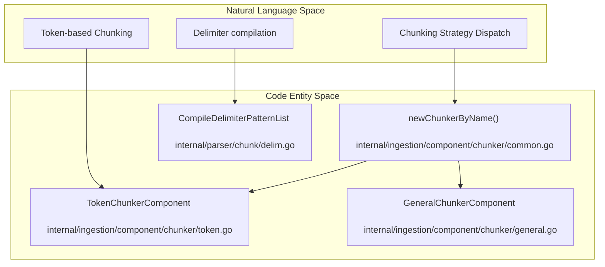
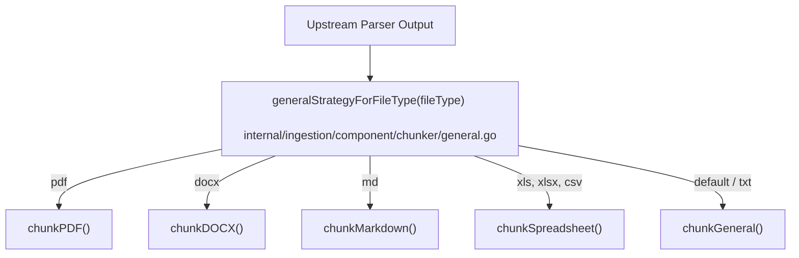
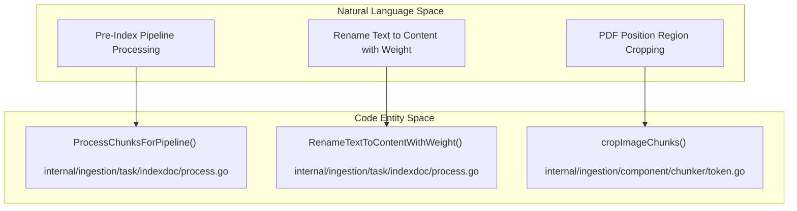
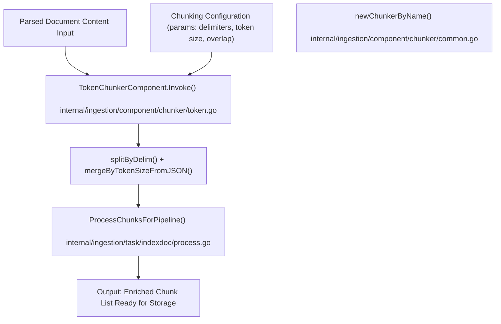

<!-- source: DeepWiki mcp.deepwiki.com · repo infiniflow/ragflow · page 6.2 Chunking Methods · fetched 2026-10-29 -->

# Chunking Methods

Relevant source files

The following files were used as context for generating this wiki page:

- [internal/entity/table.go](internal/entity/table.go)
- [internal/ingestion/component/chunker/a1a2_regression_test.go](internal/ingestion/component/chunker/a1a2_regression_test.go)
- [internal/ingestion/component/chunker/bare_delimiter_test.go](internal/ingestion/component/chunker/bare_delimiter_test.go)
- [internal/ingestion/component/chunker/block_kind.go](internal/ingestion/component/chunker/block_kind.go)
- [internal/ingestion/component/chunker/common.go](internal/ingestion/component/chunker/common.go)
- [internal/ingestion/component/chunker/coverage_blind_spots_test.go](internal/ingestion/component/chunker/coverage_blind_spots_test.go)
- [internal/ingestion/component/chunker/custom_delim_test.go](internal/ingestion/component/chunker/custom_delim_test.go)
- [internal/ingestion/component/chunker/delimiter_case_sensitive_test.go](internal/ingestion/component/chunker/delimiter_case_sensitive_test.go)
- [internal/ingestion/component/chunker/general.go](internal/ingestion/component/chunker/general.go)
- [internal/ingestion/component/chunker/general_block_delimiter_test.go](internal/ingestion/component/chunker/general_block_delimiter_test.go)
- [internal/ingestion/component/chunker/general_context_regression_test.go](internal/ingestion/component/chunker/general_context_regression_test.go)
- [internal/ingestion/component/chunker/general_delimiter_test.go](internal/ingestion/component/chunker/general_delimiter_test.go)
- [internal/ingestion/component/chunker/general_merge_test.go](internal/ingestion/component/chunker/general_merge_test.go)
- [internal/ingestion/component/chunker/general_test.go](internal/ingestion/component/chunker/general_test.go)
- [internal/ingestion/component/chunker/group.go](internal/ingestion/component/chunker/group.go)
- [internal/ingestion/component/chunker/group_test.go](internal/ingestion/component/chunker/group_test.go)
- [internal/ingestion/component/chunker/hierarchy.go](internal/ingestion/component/chunker/hierarchy.go)
- [internal/ingestion/component/chunker/manual.go](internal/ingestion/component/chunker/manual.go)
- [internal/ingestion/component/chunker/manual_pdf_cgo_test.go](internal/ingestion/component/chunker/manual_pdf_cgo_test.go)
- [internal/ingestion/component/chunker/manual_test.go](internal/ingestion/component/chunker/manual_test.go)
- [internal/ingestion/component/chunker/one_tag_test.go](internal/ingestion/component/chunker/one_tag_test.go)
- [internal/ingestion/component/chunker/qa.go](internal/ingestion/component/chunker/qa.go)
- [internal/ingestion/component/chunker/qa_table_test.go](internal/ingestion/component/chunker/qa_table_test.go)
- [internal/ingestion/component/chunker/register.go](internal/ingestion/component/chunker/register.go)
- [internal/ingestion/component/chunker/table.go](internal/ingestion/component/chunker/table.go)
- [internal/ingestion/component/chunker/table_html_coverage_test.go](internal/ingestion/component/chunker/table_html_coverage_test.go)
- [internal/ingestion/component/chunker/table_html_text_test.go](internal/ingestion/component/chunker/table_html_text_test.go)
- [internal/ingestion/component/chunker/table_split.go](internal/ingestion/component/chunker/table_split.go)
- [internal/ingestion/component/chunker/table_split_test.go](internal/ingestion/component/chunker/table_split_test.go)
- [internal/ingestion/component/chunker/table_struct_test.go](internal/ingestion/component/chunker/table_struct_test.go)
- [internal/ingestion/component/chunker/table_test.go](internal/ingestion/component/chunker/table_test.go)
- [internal/ingestion/component/chunker/title.go](internal/ingestion/component/chunker/title.go)
- [internal/ingestion/component/chunker/title_cap.go](internal/ingestion/component/chunker/title_cap.go)
- [internal/ingestion/component/chunker/title_structured_media_test.go](internal/ingestion/component/chunker/title_structured_media_test.go)
- [internal/ingestion/component/chunker/title_test.go](internal/ingestion/component/chunker/title_test.go)
- [internal/ingestion/component/chunker/title_token_cap_test.go](internal/ingestion/component/chunker/title_token_cap_test.go)
- [internal/ingestion/component/chunker/token.go](internal/ingestion/component/chunker/token.go)
- [internal/ingestion/component/chunker/token_batch1_test.go](internal/ingestion/component/chunker/token_batch1_test.go)
- [internal/ingestion/component/chunker/token_children_delim_test.go](internal/ingestion/component/chunker/token_children_delim_test.go)
- [internal/ingestion/component/chunker/token_delim_contract_test.go](internal/ingestion/component/chunker/token_delim_contract_test.go)
- [internal/ingestion/component/chunker/token_delim_lossless_boundary_test.go](internal/ingestion/component/chunker/token_delim_lossless_boundary_test.go)
- [internal/ingestion/component/chunker/token_delim_lossless_followup_test.go](internal/ingestion/component/chunker/token_delim_lossless_followup_test.go)
- [internal/ingestion/component/chunker/token_delim_lossless_test.go](internal/ingestion/component/chunker/token_delim_lossless_test.go)
- [internal/ingestion/component/chunker/token_encoder_missing_test.go](internal/ingestion/component/chunker/token_encoder_missing_test.go)
- [internal/ingestion/component/chunker/token_helpers_test.go](internal/ingestion/component/chunker/token_helpers_test.go)
- [internal/ingestion/component/chunker/token_invariant_test.go](internal/ingestion/component/chunker/token_invariant_test.go)
- [internal/ingestion/component/chunker/token_json_overlap_test.go](internal/ingestion/component/chunker/token_json_overlap_test.go)
- [internal/ingestion/component/chunker/token_merge_parity_test.go](internal/ingestion/component/chunker/token_merge_parity_test.go)
- [internal/ingestion/component/chunker/token_merge_units_test.go](internal/ingestion/component/chunker/token_merge_units_test.go)
- [internal/ingestion/component/chunker/token_overlap_test.go](internal/ingestion/component/chunker/token_overlap_test.go)
- [internal/ingestion/component/chunker/token_oversize_split_test.go](internal/ingestion/component/chunker/token_oversize_split_test.go)
- [internal/ingestion/component/chunker/token_pdfpos_test.go](internal/ingestion/component/chunker/token_pdfpos_test.go)
- [internal/ingestion/component/chunker/token_perf_test.go](internal/ingestion/component/chunker/token_perf_test.go)
- [internal/ingestion/component/chunker/token_strict_cap_test.go](internal/ingestion/component/chunker/token_strict_cap_test.go)
- [internal/ingestion/component/chunker/token_test.go](internal/ingestion/component/chunker/token_test.go)
- [internal/ingestion/component/chunker/xlsx_qa_regression_test.go](internal/ingestion/component/chunker/xlsx_qa_regression_test.go)
- [internal/ingestion/component/parser_test.go](internal/ingestion/component/parser_test.go)
- [internal/ingestion/component/schema/chunker.go](internal/ingestion/component/schema/chunker.go)
- [internal/ingestion/component/schema/parser.go](internal/ingestion/component/schema/parser.go)
- [internal/ingestion/component/schema/schema_test.go](internal/ingestion/component/schema/schema_test.go)
- [internal/parser/chunk/delim.go](internal/parser/chunk/delim.go)
- [internal/parser/chunk/delim_test.go](internal/parser/chunk/delim_test.go)
- [internal/parser/parser/csv_parser.go](internal/parser/parser/csv_parser.go)
- [internal/parser/parser/csv_parser_test.go](internal/parser/parser/csv_parser_test.go)
- [internal/parser/parser/office_table_render.go](internal/parser/parser/office_table_render.go)
- [internal/parser/parser/office_table_render_test.go](internal/parser/parser/office_table_render_test.go)
- [internal/parser/parser/xls_parser.go](internal/parser/parser/xls_parser.go)
- [internal/parser/parser/xls_parser_test.go](internal/parser/parser/xls_parser_test.go)
- [internal/parser/parser/xls_tcadp_test.go](internal/parser/parser/xls_tcadp_test.go)
- [internal/parser/parser/xlsx_parse_method_test.go](internal/parser/parser/xlsx_parse_method_test.go)
- [internal/parser/parser/xlsx_parser.go](internal/parser/parser/xlsx_parser.go)
- [internal/parser/tableutil/table_html.go](internal/parser/tableutil/table_html.go)
- [internal/parser/tableutil/table_html_test.go](internal/parser/tableutil/table_html_test.go)

## Purpose and Scope

This page documents the technical implementation and architecture of chunking strategies in RAGFlow. Chunking segments parsed document content into semantically meaningful units for indexing or retrieval. RAGFlow supports multiple chunking methods specialized for diverse document layouts such as textual articles, academic papers, legal documents, spreadsheets, question-answer pairs, and presentations. Chunking logic exists as native Go ingestion components under `internal/ingestion/component/chunker/`.

For context on document parsing preceding chunking, see [6.1 Document Parsing Strategies](). For embedding generation and content enhancement after chunking, see [6.3 Content Enhancement and Embedding]().

Sources: [internal/ingestion/component/chunker/token.go:1-69](), [internal/ingestion/component/chunker/common.go:1-72]().

---

## Chunking Methods Overview

RAGFlow organizes its chunking modes along distinct implementations, each targeting specific document types or chunking semantics:

| Chunking Mode           | Location / Component                                   | Primary Use Case                 | Key Characteristics                                                                                             |
|------------------------|--------------------------------------------------------|---------------------------------|---------------------------------------------------------------------------------------------------------------|
| **Naive / TokenChunker**| `internal/ingestion/component/chunker/token.go`        | General documents               | Token-aware splitting, delimiter based, handles mixed formats including PDF, DOCX, TXT, Markdown, HTML          |
| **GeneralChunker**      | `internal/ingestion/component/chunker/general.go`      | Format-aware general documents  | Selects format-specific strategy from parser file type (PDF, DOCX, Markdown, Spreadsheet, text)               |
| **Manual**              | `internal/ingestion/component/chunker/manual.go`       | Hierarchical structured docs     | Preserves section hierarchy using bullet and heading detection                                                |
| **Q&A**                 | `internal/ingestion/component/chunker/qa.go`           | Question-Answer pairs             | Regex-based question detection, bounding-box verification, pairs Q&A text                                     |
| **Table**               | `internal/ingestion/component/chunker/table.go`        | Tabular and spreadsheet data      | Row-based chunking, supports multi-level headers, image extraction inside sheets                               |
| **Hierarchy / Group**   | `internal/ingestion/component/chunker/group.go`        | Long-form content / Headings     | Hierarchical grouping and section tree traversal (`GroupTitleChunker`)                                       |
| **Presentation**        | `internal/ingestion/component/chunker/page.go`         | Slide deck / presentation chunking | One chunk per page with visual context preview                                                                |
| **One**                 | `internal/ingestion/component/chunker/one.go`          | Single chunk encompassing entire document | No splitting; aggregates full content                                                                        |

Sources: [internal/ingestion/component/chunker/common.go:34-71](), [internal/ingestion/component/chunker/token.go:1-69](), [internal/ingestion/component/chunker/qa.go:17-48](), [internal/ingestion/component/chunker/general.go:117-122]().

---

## Chunking Architecture and Code Mapping

Chunking uses a component factory dispatch (`newChunkerByName`) implemented in Go in `internal/ingestion/component/chunker/common.go` which maps string names to typed Go `runtime.Component` constructors. These components implement chunking logic under standardized inputs and outputs, enabling pipeline integration.

The ingestion pipeline traverses the document parsing stage, then dispatches to chunking components, which produce a chunk list enriched with metadata, token counts, positions, and optionally cropped preview images.

**Diagram 1: Natural Language Concept to Code Entities (Dispatch & Token Chunker)**

Sources: [internal/ingestion/component/chunker/common.go:34-71](), [internal/ingestion/component/chunker/token.go:135-155](), [internal/parser/chunk/delim.go:1-50]().

---

## Naive Chunking and Go TokenChunker Implementation

### Overview

Naive chunking is the default, versatile chunking mode for documents across various formats like PDF, DOCX, TXT, Markdown, and HTML. It is implemented as the `TokenChunkerComponent` in Go, providing concurrency and strict token-budget adherence.

### Key Parameters and Configuration

Behavior depends on a parameter set in `tokenChunkerParam`:

- `chunk_token_size`: Target token count per chunk.
- `delimiter_mode`: `"token_size"` for split-then-merge based on token budgets, or `"delimiter"` mode where split segments become independent chunks.
- `delimiters`: Array of regex or backtick-escaped delimiters to split on.
- `overlapped_percent`: Fraction or percentage of tokens to overlap between consecutive chunks for semantic continuity.
- `children_delimiters`: Secondary split delimiters to produce hierarchical or nested chunks.
- `table_context_size`, `image_context_size`: Number of tokens of textual context appended around tables or images within chunks.

These are set and validated in `tokenChunkerParam.Update()` and `TokenChunkerParam.Validate()` [internal/ingestion/component/chunker/token.go:99-158]().

### Token-Aware Splitting and Merging

The chunker first splits raw text according to compiled delimiter regexes with the function `splitByDelim()`, which preserves delimiters attached to preceding segments to maintain text integrity [internal/ingestion/component/chunker/common.go:101-158]().

After splitting, segments are merged into chunks respecting token budgets via `mergeByTokenSizeFromJSON()`:

- It employs a hard cap invariant: No chunk exceeds `chunk_token_size` tokens [internal/ingestion/component/chunker/token.go:57-68]().
- Overlapping tokens from the preceding chunk are prepended cleanly to next chunks by `computeOverlapPrefix()`, ensuring no parser tag leakage [internal/ingestion/component/chunker/token_batch1_test.go:52-119]().
- Segments too large individually are further token-split into smaller units to maintain the cap.
- Merging preserves and extends positional metadata such as PDF bounding boxes for later rendering and highlighting [internal/ingestion/component/chunker/token_pdfpos_test.go:35-74]().

### Invocation and Concurrency

The `TokenChunkerComponent` exposes `Invoke()`:

- Capable of handling raw text or structured JSON input payloads.
- Fans out splitting and merging operations over multiple goroutines for efficient parallel chunking.
- Ensures output chunk order matches input order deterministically.
- Returns outputs including chunk list, error strings, and chunk metadata.

Sources: [internal/ingestion/component/chunker/token.go:71-170](), [internal/ingestion/component/chunker/common.go:101-158]().

---

## General Chunker Strategy Dispatch

The `GeneralChunkerComponent` owns the general ingestion chunking policy and selects its format-specific execution strategy based on the parser's canonical file type (`file_type`) [internal/ingestion/component/chunker/general.go:117-122]().

Sources: [internal/ingestion/component/chunker/general.go:143-200]().

---

## Title, Hierarchy, and Group Chunkers

These chunkers segment documents by identifying titles or headings and grouping content hierarchically:

- `GroupTitleChunker`: Aggregates adjacent text records into chunks that span multiple body records while staying inside one heading section. Implements section ID building (`buildSectionIDs`) and group token boundaries (`minGroupTokens`, `maxGroupTokens`) [internal/ingestion/component/chunker/group.go:17-62]().
- `HierarchyTitleChunker`: Builds tree structures over headings for recursive retrieval workflows.

Sources: [internal/ingestion/component/chunker/common.go:34-71](), [internal/ingestion/component/chunker/group.go:17-62]().

---

## Q&A Chunking

Specialized chunking for documents containing question-answer pairs:

- Implemented via `QAChunkerComponent` (`internal/ingestion/component/chunker/qa.go`) [internal/ingestion/component/chunker/qa.go:67-82]().
- Uses regex patterns and prefixes (`Question:` / `Answer:` or Chinese equivalents) to extract and format pairs.
- Generates chunks pairing questions with their respective answers for accurate retrieval.

Sources: [internal/ingestion/component/chunker/qa.go:17-110]().

---

## Table and Spreadsheet Chunking

Focuses on tabular data such as Excel spreadsheets and HTML tables:

- Identifies multi-level headers and merged cells.
- Converts row data and headers to HTML/text table representations for chunk contents via `tableutil` helpers.
- Preserves sheet boundaries, cell structures, and row numbers (`row_start`, `row_end`) as seen in spreadsheet segment tests [internal/ingestion/component/chunker/general_test.go:43-86]().

Sources: [internal/ingestion/component/chunker/common.go:34-71](), [internal/ingestion/component/chunker/general_test.go:43-86]().

---

## Chunk Schema Types and Pre-Index Processing

Chunks conform to schemas defined in Go at `internal/ingestion/component/schema/chunker.go` and are processed for pipeline indexing via `indexdoc` package functions:

- `ChunkDoc` struct models a chunk with fields: `Text string`, `DocType string`, `CKType` (chunk type string), `TKNums` (token count), and position metadata (`PDFPositions`, `Positions`).
- `ProcessChunksForPipeline()` in `internal/ingestion/task/indexdoc/process.go` stamps document identifiers (`doc_id`, `docnm_kwd`), hashes chunk IDs (`common.ChunkID`), cleans up consumed metadata, strips internal pipeline-only fields, and renames `text` to `content_with_weight` [internal/ingestion/task/indexdoc/process.go:56-106]().

Sources: [internal/ingestion/component/schema/chunker.go:1-263](), [internal/ingestion/task/indexdoc/process.go:28-106]().

---

## Delimiters, Overlap, and PDF Position Cropping

- Delimiters are compiled regex patterns (`compileDelimPattern`) defining chunk boundaries [internal/ingestion/component/chunker/common.go:101-103]().
- `"delimiter"` mode: each split segment forms a standalone chunk.
- `"token_size"` mode: split segments are greedily merged respecting token count limits and overlap percentage.
- Overlap prefix is stripped of parser tags/tokens for clean repeated context via `computeOverlapPrefix()` [internal/ingestion/component/chunker/token_batch1_test.go:52-119]().
- **PDF Position Cropping**: Text chunks carrying PDF positions can trigger on-demand preview generation (`cropImageChunks`), cropping the text region into a preview image uploaded to `img_id` [internal/ingestion/component/chunker/token.go:52-56]().

**Diagram 2: Natural Language Concept to Code Entities (Pipeline Processing & Cropping)**

Sources: [internal/ingestion/component/chunker/token.go:52-56](), [internal/ingestion/task/indexdoc/process.go:28-37](), [internal/ingestion/task/indexdoc/process.go:56-106]().

---

## Summary Pipeline Diagram

Sources: [internal/ingestion/component/chunker/common.go:34-71](), [internal/ingestion/component/chunker/token.go:1-69](), [internal/ingestion/task/indexdoc/process.go:56-106]().

---

## References (Key Files)

- `internal/ingestion/component/chunker/token.go:1-170`
- `internal/ingestion/component/chunker/common.go:34-71`
- `internal/ingestion/component/chunker/general.go:117-200`
- `internal/ingestion/component/chunker/qa.go:17-110`
- `internal/ingestion/component/chunker/group.go:17-62`
- `internal/ingestion/task/indexdoc/process.go:28-106`
- `internal/ingestion/component/schema/chunker.go:1-263`

Sources: All above.

---

