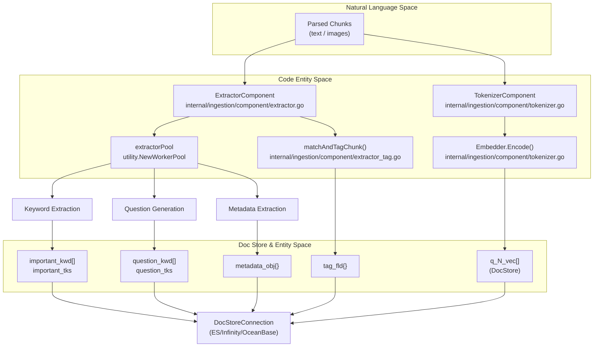
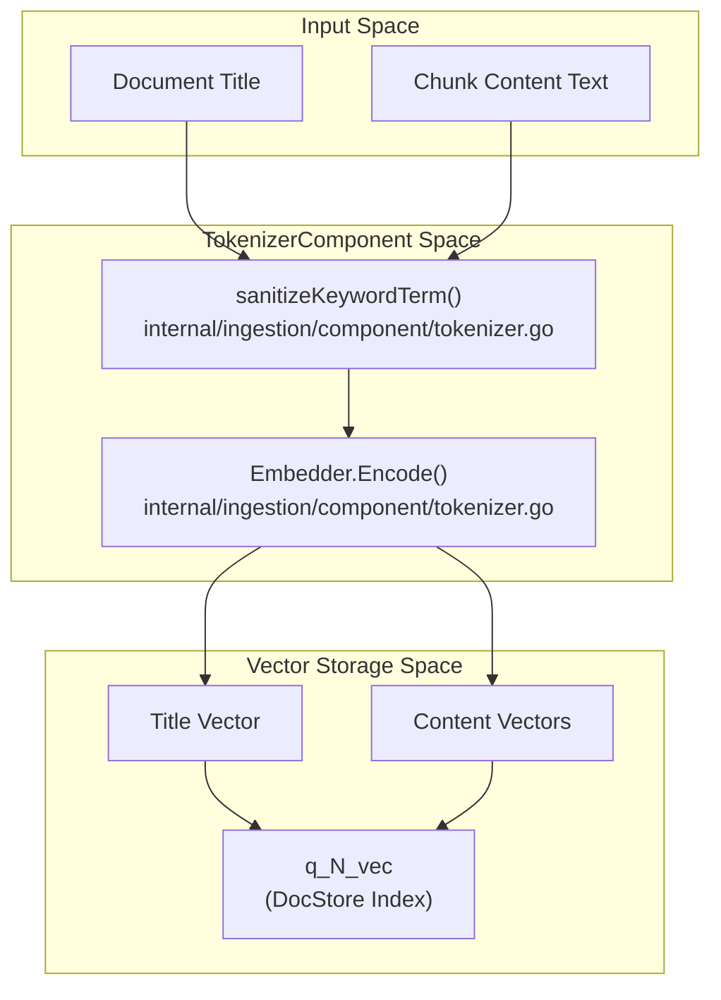

<!-- source: DeepWiki mcp.deepwiki.com · repo infiniflow/ragflow · page 6.3 Content Enhancement and Embedding · fetched 2026-10-29 -->

# Content Enhancement and Embedding

<details>
<summary>Relevant source files</summary>

The following files were used as context for generating this wiki page:

- [internal/dao/document.go](internal/dao/document.go)
- [internal/dao/document_test.go](internal/dao/document_test.go)
- [internal/handler/document.go](internal/handler/document.go)
- [internal/handler/document_test.go](internal/handler/document_test.go)
- [internal/ingestion/component/extractor.go](internal/ingestion/component/extractor.go)
- [internal/ingestion/component/extractor_call_timeout_test.go](internal/ingestion/component/extractor_call_timeout_test.go)
- [internal/ingestion/component/extractor_tag.go](internal/ingestion/component/extractor_tag.go)
- [internal/ingestion/component/extractor_tag_test.go](internal/ingestion/component/extractor_tag_test.go)
- [internal/ingestion/component/extractor_test.go](internal/ingestion/component/extractor_test.go)
- [internal/ingestion/component/schema/extractor.go](internal/ingestion/component/schema/extractor.go)
- [internal/ingestion/component/tag_biff8_test.go](internal/ingestion/component/tag_biff8_test.go)
- [internal/ingestion/component/tag_query.go](internal/ingestion/component/tag_query.go)
- [internal/ingestion/component/tag_source.go](internal/ingestion/component/tag_source.go)
- [internal/ingestion/component/tag_source_test.go](internal/ingestion/component/tag_source_test.go)
- [internal/ingestion/component/tokenizer.go](internal/ingestion/component/tokenizer.go)
- [internal/ingestion/component/tokenizer_clean_embed_text_test.go](internal/ingestion/component/tokenizer_clean_embed_text_test.go)
- [internal/ingestion/component/tokenizer_embed_batch_guard_test.go](internal/ingestion/component/tokenizer_embed_batch_guard_test.go)
- [internal/ingestion/component/tokenizer_table_tag_test.go](internal/ingestion/component/tokenizer_table_tag_test.go)
- [internal/ingestion/component/tokenizer_test.go](internal/ingestion/component/tokenizer_test.go)
- [internal/ingestion/component/tokenizer_unit_test.go](internal/ingestion/component/tokenizer_unit_test.go)
- [internal/rag/prompts/templates.go](internal/rag/prompts/templates.go)
- [internal/rag/prompts/templates_test.go](internal/rag/prompts/templates_test.go)
- [internal/service/dataset/ingestion_summary_test.go](internal/service/dataset/ingestion_summary_test.go)
- [internal/service/dataset/service.go](internal/service/dataset/service.go)
- [internal/service/dataset/tags.go](internal/service/dataset/tags.go)
- [internal/service/dataset/tags_aggregate_test.go](internal/service/dataset/tags_aggregate_test.go)
- [internal/service/document/wiki_refresh.go](internal/service/document/wiki_refresh.go)
- [internal/service/tag.go](internal/service/tag.go)
- [internal/utility/split.go](internal/utility/split.go)
- [internal/utility/split_test.go](internal/utility/split_test.go)
- [web/src/pages/dataset/dataset-overview/__tests__/utils.test.ts](web/src/pages/dataset/dataset-overview/__tests__/utils.test.ts)

</details>


## Purpose and Scope

This document details the content enhancement and embedding phase of the RAGFlow document processing pipeline. After documents are parsed and chunked (see [internal/ingestion/component/extractor.go:17-35](), [internal/ingestion/component/tokenizer.go:17-78](), [6.1]() Document Parsing Strategies and [6.2]() Chunking Methods), each text chunk undergoes optional LLM-based content enhancement to extract keywords, questions, structured metadata, and descriptive tags. Following enhancement, chunks are tokenized and converted into dense vectors using configured embedding models, crucial for efficient retrieval.

The scope covers the core Go-native ingestion pipeline components responsible for these steps: the `ExtractorComponent` for LLM-driven content extraction, and the `TokenizerComponent` for token counting and embedding vector generation. LLM-based extraction uses concurrent, rate-limited invocations and provides rich chunk-level annotations. The embedding system calculates token counts and batches vector encoding calls, respecting provider token limits.

For more advanced enhancement around agentic retrieval and knowledge graphs, see [6.5](), while the retrieval subsystem utilizing these vectors and tokens is described in section [9]().

---

## Architecture Overview

The content enhancement and embedding pipeline is organized as a set of modular components working sequentially on chunked document data. It transforms natural language text into enhanced, vector-indexed entries, suitable for storage and retrieval.



In summary, the pipeline:

- Performs LLM-based extraction of keywords, questions, and metadata concurrently per chunk under a shared concurrency rate limit.
- Runs a local lexical tag matcher with optional LLM fallback for chunk tags.
- Invokes tokenizers and batch embedding calls for vector representations.
- Outputs annotated chunks with enhanced fields to the document store.

Sources:  
[internal/ingestion/component/extractor.go:17-138]()  
[internal/ingestion/component/extractor_tag.go:1-251]()  
[internal/ingestion/component/tokenizer.go:17-166]()


---

## LLM-Based Enhancement Features

The `ExtractorComponent` implements LLM-based chunk-level content enhancement. It is provider-agnostic and dispatches calls through the unified LLM model interface in `internal/entity/models` [internal/ingestion/component/extractor.go:17-35](). Concurrency is globally rate-limited by the process-wide `extractorPool` worker pool, defaulting to 10 parallel calls configurable via the environment variable `MAX_CONCURRENT_CHATS` [internal/ingestion/component/extractor.go:62-117]().  

Each extraction request is timeout-bounded to 180 seconds (`extractorChatTimeout`) to avoid pipeline stalls [internal/ingestion/component/extractor.go:75-87]().

### 1. Keyword Extraction

- **Purpose:** Identify the most important keywords or phrases in a chunk.
- **Implementation:** Constructs an LLM prompt (`autoKeywordPrompt`) with the dynamic placeholder `{{ topn }}` replaced by the configured number of requested keywords [internal/ingestion/component/extractor.go:140-157]().
- **Output:** Extracted keywords are stored in fields like `important_kwd` (keywords list) and `important_tks` (tokenized terms) for BM25-style full-text search.

### 2. Question Generation

- **Purpose:** Generate distinct, relevant questions based on the chunk content, useful for query enrichment.
- **Implementation:** Uses an analogous LLM prompt (`autoQuestionPrompt`) dynamically configured for the number of questions [internal/ingestion/component/extractor.go:173-180]().
- **Processing:** Generated question strings are split by newline and tokenized similarly to keywords for consistent storage via utility splitters.
- **Output:** Populates fields `question_kwd` and `question_tks`.

### 3. Metadata Extraction

- **Goal:** Extracts structured metadata fields strictly adhering to a provided schema, with exact literal evidence from chunk text.
- **Config:** Configured via `MetadataExtractConfig`, storing definitions in `metadata` and `built_in_metadata` fields [internal/ingestion/component/schema/extractor.go:110-118]().
- **Filtering:** Downstream retrieval can filter on extracted metadata fields using structured definitions.

### 4. Tagging

The system supports both local and LLM-based content tagging for assigning descriptive labels to chunks [internal/ingestion/component/extractor_tag.go:1-251]().

- **Local Matching:** The function `matchAndTagChunk` performs fast lookups using an in-memory inverted index built from tag source files. It calculates asymmetric coverage scores and term frequency weighting to identify relevant tags [internal/ingestion/component/extractor_tag.go:143-231]().
- **LLM Fallback:** When local signal is insufficient for tag assignment, the component may concurrently call an LLM to produce tag relevance scores via a prompt template (`taggerPromptTmpl`), supplying example tags and text context [internal/ingestion/component/extractor_tag.go:65-90]().
- **Concurrency:** Tagger calls use a separate concurrency bound (`taggerLLMConcurrency`, default 8) with a 60-second timeout [internal/ingestion/component/extractor_tag.go:61-63]().
- **Filtering:** Tags below configured relevance or coverage thresholds are pruned from final output.

Sources:  
[internal/ingestion/component/extractor.go:62-157]()  
[internal/ingestion/component/extractor_tag.go:61-90]()  
[internal/ingestion/component/extractor_tag.go:143-251]()  
[internal/ingestion/component/schema/extractor.go:110-118]()

---

## Embedding Process and Tokenization

The `TokenizerComponent` handles token counting and vector embedding generation for document chunks and titles. The implementation is a port from the Python pipeline with additional Go-specific injection patterns for embedder resolution [internal/ingestion/component/tokenizer.go:17-78]().

### Token Counting

- Uses the `internal/tokenizer` package that calls into the native C++ RAGAnalyzer component via `internal/binding` when initialized [internal/ingestion/component/tokenizer.go:23-37]().
- Produces tokenized fields including:
  - `content_ltks` — main chunk text tokenization for full-text indexing.
  - `content_sm_ltks` — fine-grained variant of content tokens.
  - `title_tks` and `title_sm_tks` — tokenization for document titles.
- Sanitizes keyword tokens to comply with Elasticsearch length limits (max 32766 bytes), truncating tokens at UTF-8 boundaries via `sanitizeKeywordTerm` [internal/ingestion/component/tokenizer.go:115-140]().

### Embedding Vector Generation

- The embedding model is resolved via an injected `Embedder` interface [internal/ingestion/component/tokenizer.go:147-152]():
  ```go
  type Embedder interface {
    MaxTokens() int          // maximum tokens accepted by the model
    BatchSize() int          // max batch size per encode call
    Encode(ctx context.Context, texts []string) ([]EmbeddingResult, error)  // batched encoding
  }
  ```
- The component collects all chunk texts and sends batched `Encode` calls to optimize provider API usage [internal/ingestion/component/tokenizer.go:56-63]().
- Embedding results include vectors and their reported token counts for precise usage tracking (`EmbeddingResult`) [internal/ingestion/component/tokenizer.go:142-145]().



Sources:  
[internal/ingestion/component/tokenizer.go:17-78]()  
[internal/ingestion/component/tokenizer.go:115-152]()  


---

## Token Limits and Calibration

Token counting and input size control are critical for robust interactions with embedding and chat providers.

- RAGFlow implements embedding model trimmers via the optional `EmbedderTrimmer` interface [internal/ingestion/component/tokenizer.go:157-164]():
  ```go
  type EmbedderTrimmer interface {
    Trim(text string) (trimmed string, tokens int)
  }
  ```
- When present, the component uses the embedder's native tokenizer (or calibrated upper bound) for truncation instead of generic counters. This prevents minor tokenizer discrepancies (e.g., between `cl100k_base` and model-specific tokenizers) from triggering provider 400 errors and document drops [internal/ingestion/component/tokenizer.go:157-161]().

Sources:  
[internal/ingestion/component/tokenizer.go:157-164]()

---

## Vector Field Naming and Storage

Generated embedding vectors are stored dynamically in vector fields named by the embedding dimension:

- Field naming follows the pattern `q_<dim>_vec`, e.g., `q_1536_vec` for 1536-dimensional vectors [internal/ingestion/component/tokenizer_test.go:96-104]().
- This convention allows the retrieval and search subsystems to dynamically select the correct vector column for indexing and similarity search.
- This pattern is consistent across supported DocEngines like Elasticsearch, Infinity, OceanBase, and SereneDB.

Sources:  
[internal/ingestion/component/tokenizer_test.go:96-104]()

---

# Sources

- [internal/ingestion/component/extractor.go:17-157]()  
- [internal/ingestion/component/extractor_tag.go:61-90]()  
- [internal/ingestion/component/extractor_tag.go:143-251]()  
- [internal/ingestion/component/tokenizer.go:17-164]()  
- [internal/ingestion/component/tokenizer_test.go:96-104]()  
- [internal/ingestion/component/schema/extractor.go:110-118]()

---

