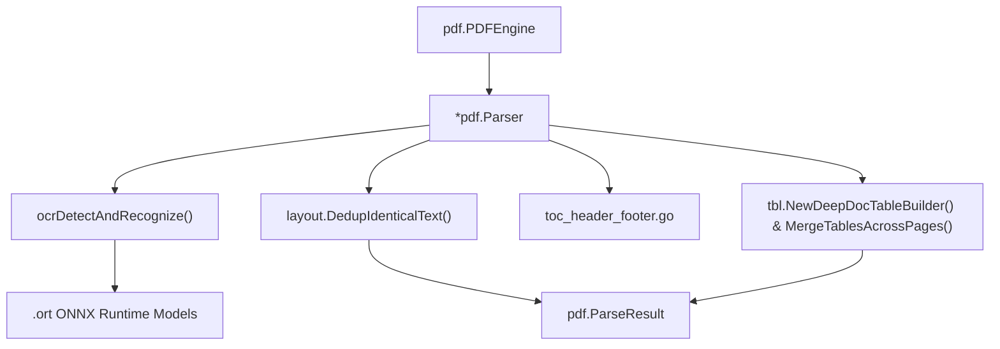
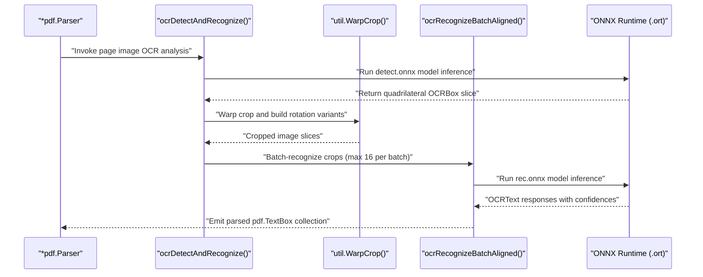
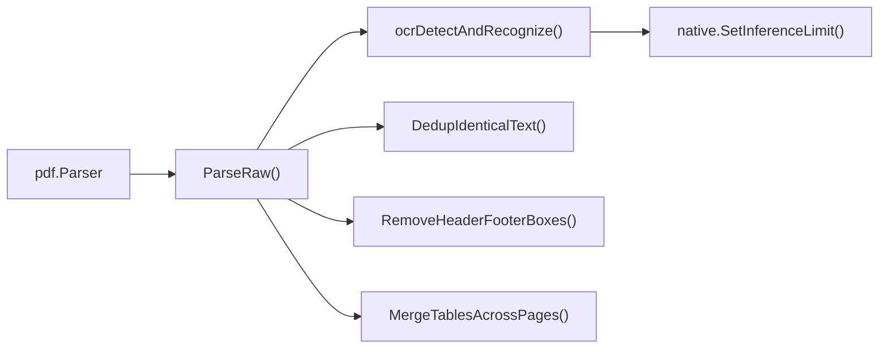

<!-- source: DeepWiki mcp.deepwiki.com · repo infiniflow/ragflow · page 6.4 DeepDoc: OCR, Layout and Table Recognition · fetched 2026-10-29 -->

# DeepDoc: OCR, Layout and Table Recognition

Relevant source files

The following files were used as context for generating this wiki page:

- [internal/agent/canvas/terminal_resume_test.go](internal/agent/canvas/terminal_resume_test.go)
- [internal/deepdoc/parser/pdf/figure_bounds_integration_test.go](internal/deepdoc/parser/pdf/figure_bounds_integration_test.go)
- [internal/deepdoc/parser/pdf/figure_bounds_test.go](internal/deepdoc/parser/pdf/figure_bounds_test.go)
- [internal/deepdoc/parser/pdf/layout/boxes_sections.go](internal/deepdoc/parser/pdf/layout/boxes_sections.go)
- [internal/deepdoc/parser/pdf/layout/chars_boxes.go](internal/deepdoc/parser/pdf/layout/chars_boxes.go)
- [internal/deepdoc/parser/pdf/layout/chars_boxes_test.go](internal/deepdoc/parser/pdf/layout/chars_boxes_test.go)
- [internal/deepdoc/parser/pdf/layout/combined_column_majority_test.go](internal/deepdoc/parser/pdf/layout/combined_column_majority_test.go)
- [internal/deepdoc/parser/pdf/layout/dedup_test.go](internal/deepdoc/parser/pdf/layout/dedup_test.go)
- [internal/deepdoc/parser/pdf/layout/layout.go](internal/deepdoc/parser/pdf/layout/layout.go)
- [internal/deepdoc/parser/pdf/layout/layout_test.go](internal/deepdoc/parser/pdf/layout/layout_test.go)
- [internal/deepdoc/parser/pdf/layout/toc_header_footer.go](internal/deepdoc/parser/pdf/layout/toc_header_footer.go)
- [internal/deepdoc/parser/pdf/layout/toc_header_footer_test.go](internal/deepdoc/parser/pdf/layout/toc_header_footer_test.go)
- [internal/deepdoc/parser/pdf/match_chars_test.go](internal/deepdoc/parser/pdf/match_chars_test.go)
- [internal/deepdoc/parser/pdf/native_text_test.go](internal/deepdoc/parser/pdf/native_text_test.go)
- [internal/deepdoc/parser/pdf/one_pdf_colspan_e2e_test.go](internal/deepdoc/parser/pdf/one_pdf_colspan_e2e_test.go)
- [internal/deepdoc/parser/pdf/parity_lock.go](internal/deepdoc/parser/pdf/parity_lock.go)
- [internal/deepdoc/parser/pdf/parity_lock_test.go](internal/deepdoc/parser/pdf/parity_lock_test.go)
- [internal/deepdoc/parser/pdf/parser.go](internal/deepdoc/parser/pdf/parser.go)
- [internal/deepdoc/parser/pdf/parser_concurrency.go](internal/deepdoc/parser/pdf/parser_concurrency.go)
- [internal/deepdoc/parser/pdf/parser_concurrency_test.go](internal/deepdoc/parser/pdf/parser_concurrency_test.go)
- [internal/deepdoc/parser/pdf/parser_mock_test.go](internal/deepdoc/parser/pdf/parser_mock_test.go)
- [internal/deepdoc/parser/pdf/parser_ocr.go](internal/deepdoc/parser/pdf/parser_ocr.go)
- [internal/deepdoc/parser/pdf/parser_ocr_test.go](internal/deepdoc/parser/pdf/parser_ocr_test.go)
- [internal/deepdoc/parser/pdf/parser_ocr_warp_test.go](internal/deepdoc/parser/pdf/parser_ocr_warp_test.go)
- [internal/deepdoc/parser/pdf/parser_parallel_test.go](internal/deepdoc/parser/pdf/parser_parallel_test.go)
- [internal/deepdoc/parser/pdf/parser_pipeline_integration_test.go](internal/deepdoc/parser/pdf/parser_pipeline_integration_test.go)
- [internal/deepdoc/parser/pdf/parser_pipeline_manual_test.go](internal/deepdoc/parser/pdf/parser_pipeline_manual_test.go)
- [internal/deepdoc/parser/pdf/parser_test.go](internal/deepdoc/parser/pdf/parser_test.go)
- [internal/deepdoc/parser/pdf/pipeline_parity_14_interleaved_test.go](internal/deepdoc/parser/pdf/pipeline_parity_14_interleaved_test.go)
- [internal/deepdoc/parser/pdf/pipeline_parity_bond_18688_test.go](internal/deepdoc/parser/pdf/pipeline_parity_bond_18688_test.go)
- [internal/deepdoc/parser/pdf/pipeline_parity_test.go](internal/deepdoc/parser/pdf/pipeline_parity_test.go)
- [internal/deepdoc/parser/pdf/snapshot_test.go](internal/deepdoc/parser/pdf/snapshot_test.go)
- [internal/deepdoc/parser/pdf/table/annotate_span_coords_test.go](internal/deepdoc/parser/pdf/table/annotate_span_coords_test.go)
- [internal/deepdoc/parser/pdf/table/annotate_span_test.go](internal/deepdoc/parser/pdf/table/annotate_span_test.go)
- [internal/deepdoc/parser/pdf/table/box_overlap_page_test.go](internal/deepdoc/parser/pdf/table/box_overlap_page_test.go)
- [internal/deepdoc/parser/pdf/table/caption_kind_test.go](internal/deepdoc/parser/pdf/table/caption_kind_test.go)
- [internal/deepdoc/parser/pdf/table/deepdoc_table_builder.go](internal/deepdoc/parser/pdf/table/deepdoc_table_builder.go)
- [internal/deepdoc/parser/pdf/table/deepdoc_table_builder_test.go](internal/deepdoc/parser/pdf/table/deepdoc_table_builder_test.go)
- [internal/deepdoc/parser/pdf/table/group_boxes.go](internal/deepdoc/parser/pdf/table/group_boxes.go)
- [internal/deepdoc/parser/pdf/table/group_boxes_test.go](internal/deepdoc/parser/pdf/table/group_boxes_test.go)
- [internal/deepdoc/parser/pdf/table/merge_captions.go](internal/deepdoc/parser/pdf/table/merge_captions.go)
- [internal/deepdoc/parser/pdf/table/merge_captions_caption_test.go](internal/deepdoc/parser/pdf/table/merge_captions_caption_test.go)
- [internal/deepdoc/parser/pdf/table/merge_captions_test.go](internal/deepdoc/parser/pdf/table/merge_captions_test.go)
- [internal/deepdoc/parser/pdf/table/parity/orphan_row_extra_test.go](internal/deepdoc/parser/pdf/table/parity/orphan_row_extra_test.go)
- [internal/deepdoc/parser/pdf/table/parity/orphan_row_test.go](internal/deepdoc/parser/pdf/table/parity/orphan_row_test.go)
- [internal/deepdoc/parser/pdf/table/span_grid_fill_test.go](internal/deepdoc/parser/pdf/table/span_grid_fill_test.go)
- [internal/deepdoc/parser/pdf/table/span_row0_cellcount_test.go](internal/deepdoc/parser/pdf/table/span_row0_cellcount_test.go)
- [internal/deepdoc/parser/pdf/table/table_annotate.go](internal/deepdoc/parser/pdf/table/table_annotate.go)
- [internal/deepdoc/parser/pdf/table/table_annotate_parity_test.go](internal/deepdoc/parser/pdf/table/table_annotate_parity_test.go)
- [internal/deepdoc/parser/pdf/table/table_annotate_test.go](internal/deepdoc/parser/pdf/table/table_annotate_test.go)
- [internal/deepdoc/parser/pdf/table/table_cell_spatial_test.go](internal/deepdoc/parser/pdf/table/table_cell_spatial_test.go)
- [internal/deepdoc/parser/pdf/table/table_cells.go](internal/deepdoc/parser/pdf/table/table_cells.go)
- [internal/deepdoc/parser/pdf/table/table_construct.go](internal/deepdoc/parser/pdf/table/table_construct.go)
- [internal/deepdoc/parser/pdf/table/table_construct_test.go](internal/deepdoc/parser/pdf/table/table_construct_test.go)
- [internal/deepdoc/parser/pdf/table/table_header_divergence_test.go](internal/deepdoc/parser/pdf/table/table_header_divergence_test.go)
- [internal/deepdoc/parser/pdf/table/table_header_parity_test.go](internal/deepdoc/parser/pdf/table/table_header_parity_test.go)
- [internal/deepdoc/parser/pdf/table/table_html.go](internal/deepdoc/parser/pdf/table/table_html.go)
- [internal/deepdoc/parser/pdf/table/table_html_test.go](internal/deepdoc/parser/pdf/table/table_html_test.go)
- [internal/deepdoc/parser/pdf/table/table_layout.go](internal/deepdoc/parser/pdf/table/table_layout.go)
- [internal/deepdoc/parser/pdf/table/table_merge.go](internal/deepdoc/parser/pdf/table/table_merge.go)
- [internal/deepdoc/parser/pdf/table/table_merge_test.go](internal/deepdoc/parser/pdf/table/table_merge_test.go)
- [internal/deepdoc/parser/pdf/table/table_merge_top_table_test.go](internal/deepdoc/parser/pdf/table/table_merge_top_table_test.go)
- [internal/deepdoc/parser/pdf/table/table_orient.go](internal/deepdoc/parser/pdf/table/table_orient.go)
- [internal/deepdoc/parser/pdf/table/table_orient_ocr_mode_test.go](internal/deepdoc/parser/pdf/table/table_orient_ocr_mode_test.go)
- [internal/deepdoc/parser/pdf/table/table_orient_parity_test.go](internal/deepdoc/parser/pdf/table/table_orient_parity_test.go)
- [internal/deepdoc/parser/pdf/table/table_orient_test.go](internal/deepdoc/parser/pdf/table/table_orient_test.go)
- [internal/deepdoc/parser/pdf/table/table_post.go](internal/deepdoc/parser/pdf/table/table_post.go)
- [internal/deepdoc/parser/pdf/table/table_post_test.go](internal/deepdoc/parser/pdf/table/table_post_test.go)
- [internal/deepdoc/parser/pdf/table/table_replace_bench_test.go](internal/deepdoc/parser/pdf/table/table_replace_bench_test.go)
- [internal/deepdoc/parser/pdf/table/table_replace_opt_test.go](internal/deepdoc/parser/pdf/table/table_replace_opt_test.go)
- [internal/deepdoc/parser/pdf/table/table_span_inject_test.go](internal/deepdoc/parser/pdf/table/table_span_inject_test.go)
- [internal/deepdoc/parser/pdf/table/table_spans.go](internal/deepdoc/parser/pdf/table/table_spans.go)
- [internal/deepdoc/parser/pdf/table/table_spans_test.go](internal/deepdoc/parser/pdf/table/table_spans_test.go)
- [internal/deepdoc/parser/pdf/table/table_todata.go](internal/deepdoc/parser/pdf/table/table_todata.go)
- [internal/deepdoc/parser/pdf/table/table_todata_test.go](internal/deepdoc/parser/pdf/table/table_todata_test.go)
- [internal/deepdoc/parser/pdf/table/testdata/parity/known_diffs.json](internal/deepdoc/parser/pdf/table/testdata/parity/known_diffs.json)
- [internal/deepdoc/parser/pdf/table_crop_ab_manual_test.go](internal/deepdoc/parser/pdf/table_crop_ab_manual_test.go)
- [internal/deepdoc/parser/pdf/table_extract.go](internal/deepdoc/parser/pdf/table_extract.go)
- [internal/deepdoc/parser/pdf/table_extract_test.go](internal/deepdoc/parser/pdf/table_extract_test.go)
- [internal/deepdoc/parser/pdf/toc_box_removal_test.go](internal/deepdoc/parser/pdf/toc_box_removal_test.go)
- [internal/deepdoc/parser/pdf/tool/types.go](internal/deepdoc/parser/pdf/tool/types.go)
- [internal/deepdoc/parser/pdf/util/garbled.go](internal/deepdoc/parser/pdf/util/garbled.go)
- [internal/deepdoc/parser/pdf/util/garbled_ocr_test.go](internal/deepdoc/parser/pdf/util/garbled_ocr_test.go)
- [internal/deepdoc/parser/pdf/util/image_utils.go](internal/deepdoc/parser/pdf/util/image_utils.go)
- [internal/deepdoc/parser/pdf/util/image_utils_test.go](internal/deepdoc/parser/pdf/util/image_utils_test.go)
- [internal/deepdoc/parser/type/types.go](internal/deepdoc/parser/type/types.go)
- [internal/parser/parser/pdf_parser_common_test.go](internal/parser/parser/pdf_parser_common_test.go)

## Purpose and Scope

This page details the in-process DeepDoc backend within RAGFlow, covering the Go-native implementation supporting Optical Character Recognition (OCR), PDF layout analysis, table structure recognition (TSR), cross-page table merging, and the management of concurrency budgets for inference and page processing. The goal is to provide a high-throughput and memory-efficient pipeline for extracting structured content from PDFs, including text, semantic layout blocks, and tables.

RAGFlow's DeepDoc backend replaces legacy Python components by porting core functionality, integrating ONNX Runtime (`.ort`) models for OCR detection and recognition, and implementing layout and table parsing logic in Go. This page explains internal structure, data flow, key functions, and concurrency controls essential for scalable ingestion.

Sources: [internal/deepdoc/parser/pdf/parser.go:21-64](), [internal/deepdoc/parser/pdf/parser_ocr.go:1-181]()

---

## Architecture Overview

### Key Components and Data Flow

- `internal/deepdoc/parser/pdf/parser.go` — Core PDF parser orchestrating character extraction (`ExtractChars`), OCR invocation (`processPage`), layout analysis, and eventual assembly of text, tables, and layout regions [internal/deepdoc/parser/pdf/parser.go:21-179]().
- `internal/deepdoc/parser/pdf/parser_ocr.go` — OCR engine support: detection via `inferOCRDetect()` and batched recognition using ONNX Runtime inference sessions; implements image cropping, rotation handling, and text box generation [internal/deepdoc/parser/pdf/parser_ocr.go:30-181]().
- `internal/deepdoc/parser/pdf/layout/layout.go` — Performs layout analysis on extracted text boxes, assigns columns, removes duplicates (`DedupIdenticalText`, `DedupSubstringOverlaps`), and merges text snippets based on spatial heuristics [internal/deepdoc/parser/pdf/layout/layout.go:24-175]().
- `internal/deepdoc/parser/pdf/layout/toc_header_footer.go` — Identifies and removes headers, footers, and table-of-contents (TOC) pages using pattern matching and box-length criteria [internal/deepdoc/parser/pdf/layout/toc_header_footer.go:19-119]().
- `internal/deepdoc/parser/pdf/table/table_cells.go` & `table_merge.go` — Table Structure Recognition (TSR) utilities for grouping cells (`GroupCells`), assigning text to grid cells (`FillCellTextFromBoxes`), and merging tables across page boundaries (`MergeTablesAcrossPages`) [internal/deepdoc/parser/pdf/table/table_merge.go:10-144]().

### Diagram: DeepDoc Pipeline Architecture (Natural Language to Code Entity Space)

Sources: [internal/deepdoc/parser/pdf/parser.go:21-89](), [internal/deepdoc/parser/pdf/parser_ocr.go:30-181](), [internal/deepdoc/parser/pdf/layout/layout.go:24-124](), [internal/deepdoc/parser/pdf/table/table_merge.go:10-25]()

---

## OCR: Detection and Recognition Pipeline

### OCR Model Invocation and Processing

The OCR system detects text regions and performs recognition on cropped regions using ONNX `.ort` models. The detection model outputs quadrilateral bounding boxes of text regions (`OCRBox`), which are de-skewed via `util.WarpCrop()` and cropped from page images [internal/deepdoc/parser/pdf/parser_ocr.go:78-83](). For tall regions ($height \ge 1.5 \times width$), rotated variants ($0^\circ$, $+90^\circ$, $-90^\circ$) are generated to handle vertical text correctly [internal/deepdoc/parser/pdf/parser_ocr.go:105-115]().

Recognition is performed in batches grouped by aspect ratio to align with the expected input shapes of the ONNX model [internal/deepdoc/parser/pdf/parser_ocr.go:126-137]().

- **Batch limit (`recBatchNum`):** Maximum of 16 crops are recognized in one ONNX run (`recBatchNum = 16`), matching the Python reference implementation for sub-batch shape distribution [internal/deepdoc/parser/pdf/parser_ocr.go:25-25]().
- **Rotation candidates:** The highest confidence score among rotated candidate crops determines the selected text line (`ocrBestScore()`) [internal/deepdoc/parser/pdf/parser_ocr.go:157-165]().
- **Coordinate scaling:** Detection bounding boxes are converted from image pixel coordinates to PDF point coordinates by dividing by the per-page zoom scale (`ocrCoordinateScale()`) [internal/deepdoc/parser/pdf/parser_ocr.go:48-50]().
- **Recovery policy:** OCR detection or recognition failures are recoverable; failed pages fall back to using character-extracted boxes (`charsToBoxes`) without failing the document parse [internal/deepdoc/parser/pdf/parser.go:33-41]().

### Diagram: OCR Processing Sequence

Sources: [internal/deepdoc/parser/pdf/parser_ocr.go:30-181]()

---

## Layout Analysis and Text Processing

### Layout Recognition and Text Deduplication

Once OCR text boxes are produced, layout analysis structures the document content:

- **Column assignment:** Combines gap heuristics and KMeans clustering (`combined_column.go`) to assign text boxes into columns [internal/deepdoc/parser/pdf/layout/layout.go:19-21]().
- **Identical text deduplication (`DedupIdenticalText`):** Collapses OCR boxes that share byte-identical text at disjoint vertical positions on the same page, provided they form a rolling-stride chain of at least `pseudoDupChainMin` (5) boxes [internal/deepdoc/parser/pdf/layout/layout.go:25-43](). Short texts (< 20 runes) or non-OCR boxes are preserved to prevent data loss [internal/deepdoc/parser/pdf/layout/layout.go:53-78]().
- **Substring overlap removal (`DedupSubstringOverlaps`):** Uses an optimized bucket index (`dedupBucket`) grouped by `[page, column]` to drop boxes whose text is a contiguous whitespace-normalized substring of another containing box and whose geometry is fully enclosed within it [internal/deepdoc/parser/pdf/layout/layout.go:134-175]().
- **Header, footer, and TOC filtering (`toc_header_footer.go`):** Scans pages for repeated running headers/footers and isolates Table of Contents (TOC) pages based on leader-dot patterns (`tocEntryRunPattern`), chapter markers (`chapterEntryPattern`), and minimum entry counts (`tocMinEntries`) [internal/deepdoc/parser/pdf/layout/toc_header_footer.go:73-109]().

Sources: [internal/deepdoc/parser/pdf/layout/layout.go:24-175](), [internal/deepdoc/parser/pdf/layout/toc_header_footer.go:19-119]()

---

## Table Structure Recognition (TSR) and Cross-Page Merging

### Cell Grouping and Text Assignment

Table parsing extracts grid structures and maps text into cells:

- **Row grouping & sorting:** TSR cells are grouped into rows by vertical proximity (half median cell height) and sorted left-to-right [internal/deepdoc/parser/pdf/table/table_merge.go:10-25]().
- **Cell text assignment (`FillCellTextFromBoxes`):** OCR text boxes are mapped to rows via vertical-overlap ratio $\ge 0.3$, then assigned to the tightest horizontal column fit [internal/deepdoc/parser/pdf/table/testdata/parity/known_diffs.json:30-49]().
- **Cross-page table merging (`MergeTablesAcrossPages`):** Tables split across consecutive pages are merged when their horizontal bounding boxes overlap (`ap.Right >= bp.Left && bp.Right >= ap.Left`) and their vertical gap distance is within $mh \times 23$ [internal/deepdoc/parser/pdf/table/table_merge.go:10-123](). A page-absolute frame check prevents false over-merging of independent tables starting near the top of consecutive pages [internal/deepdoc/parser/pdf/table/table_merge.go:115-139]().

Sources: [internal/deepdoc/parser/pdf/table/table_merge.go:10-180](), [internal/deepdoc/parser/pdf/table/testdata/parity/known_diffs.json:1-50]()

---

## Concurrency and Resource Management

### Inference Budget and Page-Level Parallelism

To prevent CPU and memory exhaustion during ONNX inference and heavy PDF rasterization, DeepDoc uses explicit concurrency limits:

- **Inference Concurrency (`DeepDocConcurrency`):** Configured via CLI flags (`--deepdoc-inference-concurrency`), environment variables, or `service_conf.yaml`. Each ONNX Runtime session enforces single-threaded execution (`intraOpThreads = 1`), synchronized globally via `native.SetInferenceLimit()` [cmd/ragflow_server.go:79-103]().
- **Page Parallelism (`PageConcurrency`):** Managed via `utility.WorkerPool[pageTask, pageResult]` to process multiple PDF pages concurrently. Default page worker concurrency is set to 2, decoupling page rendering overhead from model inference limits [internal/deepdoc/parser/pdf/parser.go:28-59]().

Sources: [cmd/ragflow_server.go:79-103](), [internal/deepdoc/parser/pdf/parser.go:28-59]()

---

## Appendix: Key Code Entities Mapping

### Diagram: Code Entity Reference Map

Sources: [internal/deepdoc/parser/pdf/parser.go:21-89](), [internal/deepdoc/parser/pdf/parser_ocr.go:30-181](), [internal/deepdoc/parser/pdf/layout/layout.go:24-43](), [internal/deepdoc/parser/pdf/layout/toc_header_footer.go:19-25](), [internal/deepdoc/parser/pdf/table/table_merge.go:10-19]()

---

## References

- `internal/deepdoc/parser/pdf/parser.go`
- `internal/deepdoc/parser/pdf/parser_ocr.go`
- `internal/deepdoc/parser/pdf/layout/layout.go`
- `internal/deepdoc/parser/pdf/layout/toc_header_footer.go`
- `internal/deepdoc/parser/pdf/table/table_merge.go`
- `internal/deepdoc/parser/pdf/table/table_cells.go`
- `cmd/ragflow_server.go`

Sources: [internal/deepdoc/parser/pdf/parser.go:1-193](), [internal/deepdoc/parser/pdf/parser_ocr.go:1-181](), [internal/deepdoc/parser/pdf/layout/layout.go:1-124](), [internal/deepdoc/parser/pdf/layout/toc_header_footer.go:1-123](), [internal/deepdoc/parser/pdf/table/table_merge.go:1-191](), [cmd/ragflow_server.go:79-104]()

---

