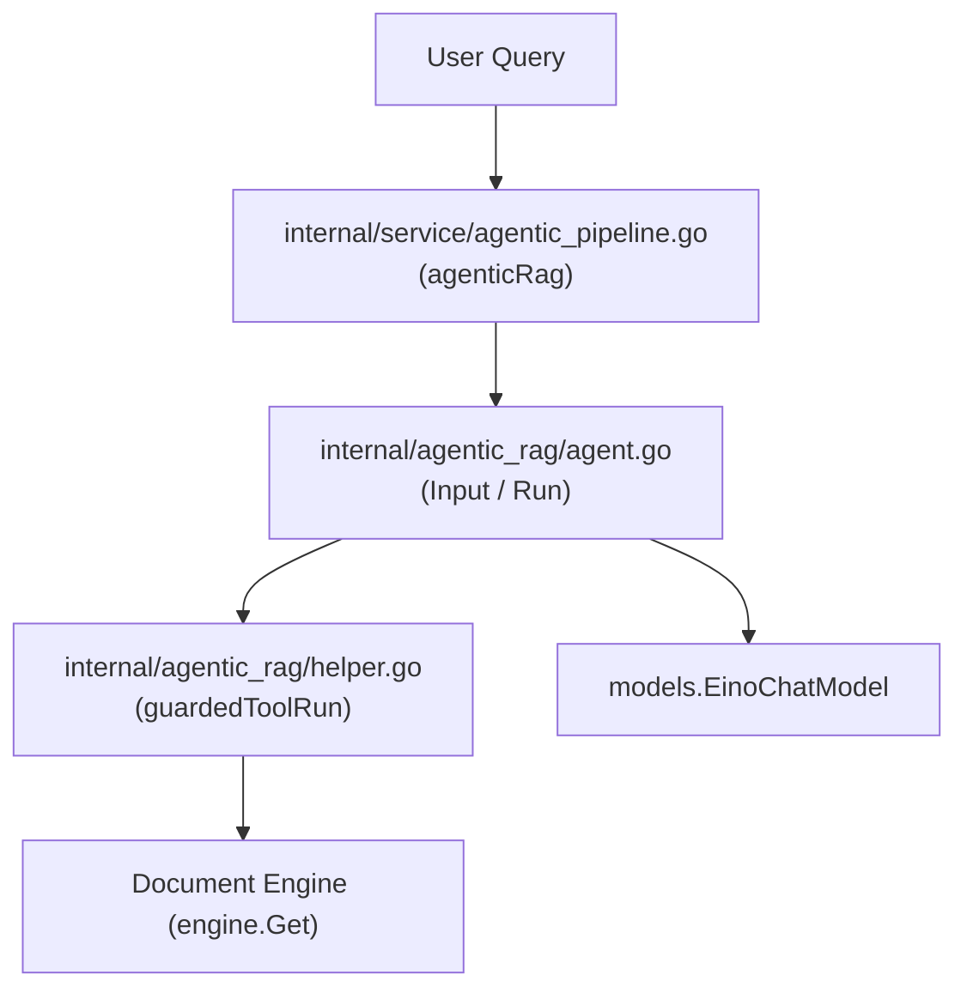
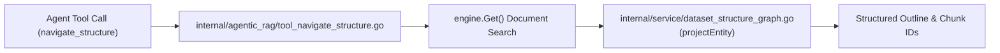
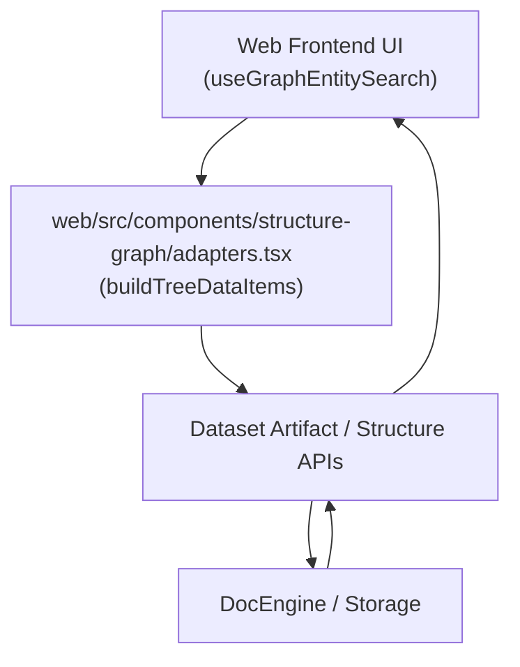
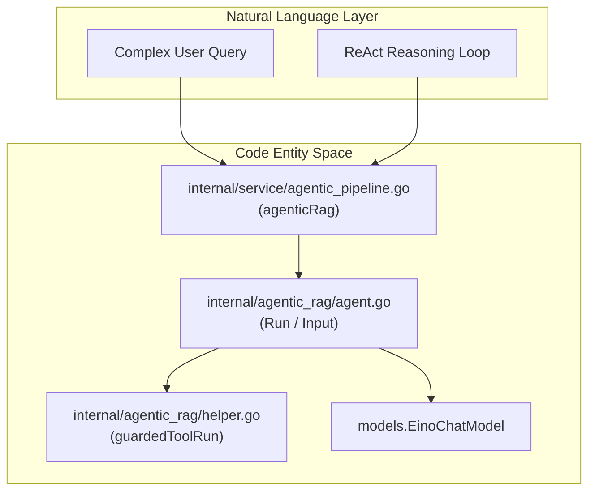
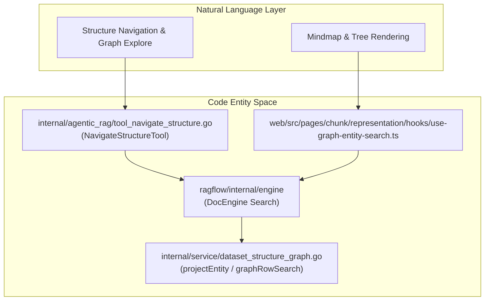

<!-- source: DeepWiki mcp.deepwiki.com · repo infiniflow/ragflow · page 6.5 Advanced RAG: Agentic Retrieval and Knowledge Graphs · fetched 2026-10-29 -->

# Advanced RAG: Agentic Retrieval and Knowledge Graphs

Relevant source files

The following files were used as context for generating this wiki page:

- [conf/agentic_rag.yaml](conf/agentic_rag.yaml)
- [internal/agentic_rag/agent.go](internal/agentic_rag/agent.go)
- [internal/agentic_rag/citation_paradigm_compare_test.go](internal/agentic_rag/citation_paradigm_compare_test.go)
- [internal/agentic_rag/citations.go](internal/agentic_rag/citations.go)
- [internal/agentic_rag/citations_test.go](internal/agentic_rag/citations_test.go)
- [internal/agentic_rag/claim_filter_live_manual_test.go](internal/agentic_rag/claim_filter_live_manual_test.go)
- [internal/agentic_rag/compiled_evidence.go](internal/agentic_rag/compiled_evidence.go)
- [internal/agentic_rag/compiled_evidence_test.go](internal/agentic_rag/compiled_evidence_test.go)
- [internal/agentic_rag/compiled_knowledge.go](internal/agentic_rag/compiled_knowledge.go)
- [internal/agentic_rag/compiled_knowledge_test.go](internal/agentic_rag/compiled_knowledge_test.go)
- [internal/agentic_rag/compiled_serve.go](internal/agentic_rag/compiled_serve.go)
- [internal/agentic_rag/compiled_serve_smoke_manual_test.go](internal/agentic_rag/compiled_serve_smoke_manual_test.go)
- [internal/agentic_rag/compiled_serve_test.go](internal/agentic_rag/compiled_serve_test.go)
- [internal/agentic_rag/config.go](internal/agentic_rag/config.go)
- [internal/agentic_rag/config_test.go](internal/agentic_rag/config_test.go)
- [internal/agentic_rag/decision_filter.go](internal/agentic_rag/decision_filter.go)
- [internal/agentic_rag/decision_filter_test.go](internal/agentic_rag/decision_filter_test.go)
- [internal/agentic_rag/evidence_registry.go](internal/agentic_rag/evidence_registry.go)
- [internal/agentic_rag/evidence_registry_test.go](internal/agentic_rag/evidence_registry_test.go)
- [internal/agentic_rag/helper.go](internal/agentic_rag/helper.go)
- [internal/agentic_rag/kg_service.go](internal/agentic_rag/kg_service.go)
- [internal/agentic_rag/tool_graph_explore.go](internal/agentic_rag/tool_graph_explore.go)
- [internal/agentic_rag/tool_graph_explore_test.go](internal/agentic_rag/tool_graph_explore_test.go)
- [internal/agentic_rag/tool_list_chunks.go](internal/agentic_rag/tool_list_chunks.go)
- [internal/agentic_rag/tool_navigate_structure.go](internal/agentic_rag/tool_navigate_structure.go)
- [internal/agentic_rag/tool_navigate_structure_test.go](internal/agentic_rag/tool_navigate_structure_test.go)
- [internal/agentic_rag/tool_navigate_tree.go](internal/agentic_rag/tool_navigate_tree.go)
- [internal/agentic_rag/tool_navigate_tree_test.go](internal/agentic_rag/tool_navigate_tree_test.go)
- [internal/service/agentic_pipeline.go](internal/service/agentic_pipeline.go)
- [internal/service/dataset_structure_graph.go](internal/service/dataset_structure_graph.go)
- [internal/service/dataset_structure_graph_test.go](internal/service/dataset_structure_graph_test.go)
- [web/src/components/structure-graph/adapters.test.ts](web/src/components/structure-graph/adapters.test.ts)
- [web/src/components/structure-graph/adapters.tsx](web/src/components/structure-graph/adapters.tsx)
- [web/src/components/structure-graph/mindmap-g6-graph/index.tsx](web/src/components/structure-graph/mindmap-g6-graph/index.tsx)
- [web/src/components/structure-graph/timeline-x6-graph/hooks/use-x6-graph.ts](web/src/components/structure-graph/timeline-x6-graph/hooks/use-x6-graph.ts)
- [web/src/pages/chunk/representation/hooks/use-graph-entity-search.test.ts](web/src/pages/chunk/representation/hooks/use-graph-entity-search.test.ts)
- [web/src/pages/chunk/representation/hooks/use-graph-entity-search.ts](web/src/pages/chunk/representation/hooks/use-graph-entity-search.ts)
- [web/src/pages/chunk/representation/hooks/use-selected-template.ts](web/src/pages/chunk/representation/hooks/use-selected-template.ts)
- [web/src/pages/dataset/compilation/utils/skill-tree.ts](web/src/pages/dataset/compilation/utils/skill-tree.ts)

This page provides a technical overview of the advanced Retrieval-Augmented Generation (RAG) capabilities implemented in RAGFlow, focusing on agentic retrieval, multi-step question decomposition, graph retrieval, structure navigation, mindmaps, and hierarchical summarization. These capabilities are primarily implemented in the Go backend under `internal/agentic_rag` and `internal/service`, alongside frontend rendering components in `web/src/components/structure-graph` and `web/src/pages/chunk/representation`.

---

## 1. Multi-Step Question Decomposition and Agentic Modes

Agentic RAG in RAGFlow decomposes complex user queries into sequential reasoning steps using configurable agent templates loaded from configuration files and executed via the agent harness.

- The `Input` struct defines parameters for a one-shot ReAct conversation turn, accepting a tool-calling chat model (`models.EinoChatModel`), history, tenant ID, dataset IDs, and toolsets `[internal/agentic_rag/agent.go:43-122]()`.
- The ReAct loop iteration cap is resolved via `agenticMaxIterations()`, defaulting to 120 iterations to handle complex multi-hop reasoning steps while being guarded by duplicate retrieval prevention `[internal/agentic_rag/agent.go:127-143]()`.

Sources:  
`[internal/agentic_rag/agent.go:43-143]()`

---

## 2. Agentic RAG Harness and Orchestration

The chat pipeline service dispatches execution turns through `agenticRag()` in `internal/service/agentic_pipeline.go`, initializing runtime states, token budgets, and evidence registries `[internal/service/agentic_pipeline.go:75-148]()`.

- Tool failures do not abort the ReAct loop; instead, they are intercepted by `guardedToolRun()` and converted into model-readable `<tool_error>` XML notices so the LLM can adapt its arguments or switch tools `[internal/agentic_rag/helper.go:87-95]()`.
- Run context carries an evidence registry that stamps retrieved passages with citation handles, resolved later by citation builders `[internal/service/agentic_pipeline.go:110-116]()`.

Sources:  
`[internal/service/agentic_pipeline.go:75-148]`,  
`[internal/agentic_rag/helper.go:87-95]()`

---

## 3. Graph Retrieval and Knowledge Graphs

Documents compiled into structural representations are queried using structure graph services (`internal/service/dataset_structure_graph.go`).

- `projectEntity()` parses row payloads (`content_with_weight`), extracting entity names, types, aliases, descriptions, and source chunk IDs `[internal/service/dataset_structure_graph.go:128-188]()`.
- `navigate_structure` allows agents to drill into compiled document outlines using keyword relevance beams, returning XML structures with chunk pointers suitable for deep reading `[internal/agentic_rag/tool_navigate_structure.go:52-65]()`.

Sources:  
`[internal/service/dataset_structure_graph.go:128-188]`,  
`[internal/agentic_rag/tool_navigate_structure.go:52-65]()`

---

## 4. Mindmap Generation, Structure Artifacts, and Navigation

Frontend components render structural compilation artifacts, mindmaps, and knowledge graphs via specialized adapters and hooks.

- `useGraphEntitySearch` coordinates fetching document structure graphs and handles node selections, keywords, and template switching `[web/src/pages/chunk/representation/hooks/use-graph-entity-search.ts:13-35]()`.
- Structure adapters normalize entities and relations, mapping them into tree items and claim badges for UI renderers `[web/src/components/structure-graph/adapters.tsx:41-66]()`.

Sources:  
`[web/src/pages/chunk/representation/hooks/use-graph-entity-search.ts:13-35]`,  
`[web/src/components/structure-graph/adapters.tsx:41-66]()`

---

## 5. RAPTOR-Style Hierarchical Summarization and Compiled Knowledge

- `datasetsHaveCompiledKnowledge()` verifies whether bound datasets contain compiled knowledge artifacts (`compile_kwd`) before injecting specialized navigation and structure tools `[internal/agentic_rag/compiled_knowledge.go:61-92]()`.
- `ListChunksTool` (`list_chunks`) provides a constrained deep-read runtime, reading full original text or compiled statements of selected chunks in reading order `[internal/agentic_rag/tool_list_chunks.go:34-54]()`.

Sources:  
`[internal/agentic_rag/compiled_knowledge.go:61-92]`,  
`[internal/agentic_rag/tool_list_chunks.go:34-54]()`

---

## 6. Summary Diagrams: Natural Language Space to Code Entity Space

### Diagram A: Agentic Execution Space

Sources:  
`[internal/service/agentic_pipeline.go:75-148]`,  
`[internal/agentic_rag/agent.go:43-122]`,  
`[internal/agentic_rag/helper.go:87-95]()`

### Diagram B: Knowledge Graph & Structure Space

Sources:  
`[internal/service/dataset_structure_graph.go:62-188]`,  
`[internal/agentic_rag/tool_navigate_structure.go:52-65]`,  
`[web/src/pages/chunk/representation/hooks/use-graph-entity-search.ts:13-35]()`

---

## 7. Code Components and Packages Reference

| Component / Package | Description | Notable Files / Types |
| :--- | :--- | :--- |
| **Agentic Harnes & Loop** | Manages multi-turn ReAct loops, token budgets, and input structures. | `[internal/agentic_rag/agent.go]`: `Input` |
| **Agentic Pipeline Service** | Orchestrates turn execution, context setup, and stream handling in chat. | `[internal/service/agentic_pipeline.go]`: `agenticRag()` |
| **Structure Graph Service** | Projects and parses graph entities, aliases, and relations from doc engine rows. | `[internal/service/dataset_structure_graph.go]`: `projectEntity()` |
| **Structure Navigation Tool** | Drills into documents' compiled structure and outputs query-focused outlines. | `[internal/agentic_rag/tool_navigate_structure.go]`: `NavigateStructureTool` |
| **Deep Read Tool** | Reads full original text or compiled statements of selected chunks in reading order. | `[internal/agentic_rag/tool_list_chunks.go]`: `ListChunksTool` |
| **Frontend Graph Adapters** | Normalizes structure graph entities and relations for tree views and UI badges. | `[web/src/components/structure-graph/adapters.tsx]()` |

Sources:  
`[internal/agentic_rag/agent.go:43-122]`,  
`[internal/service/agentic_pipeline.go:75-148]`,  
`[internal/service/dataset_structure_graph.go:128-188]`,  
`[internal/agentic_rag/tool_navigate_structure.go:52-65]`,  
`[internal/agentic_rag/tool_list_chunks.go:34-54]`,  
`[web/src/components/structure-graph/adapters.tsx:41-66]()`

---

