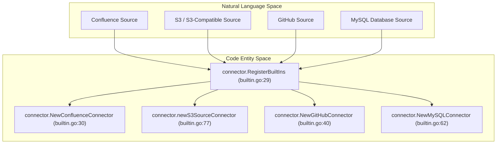
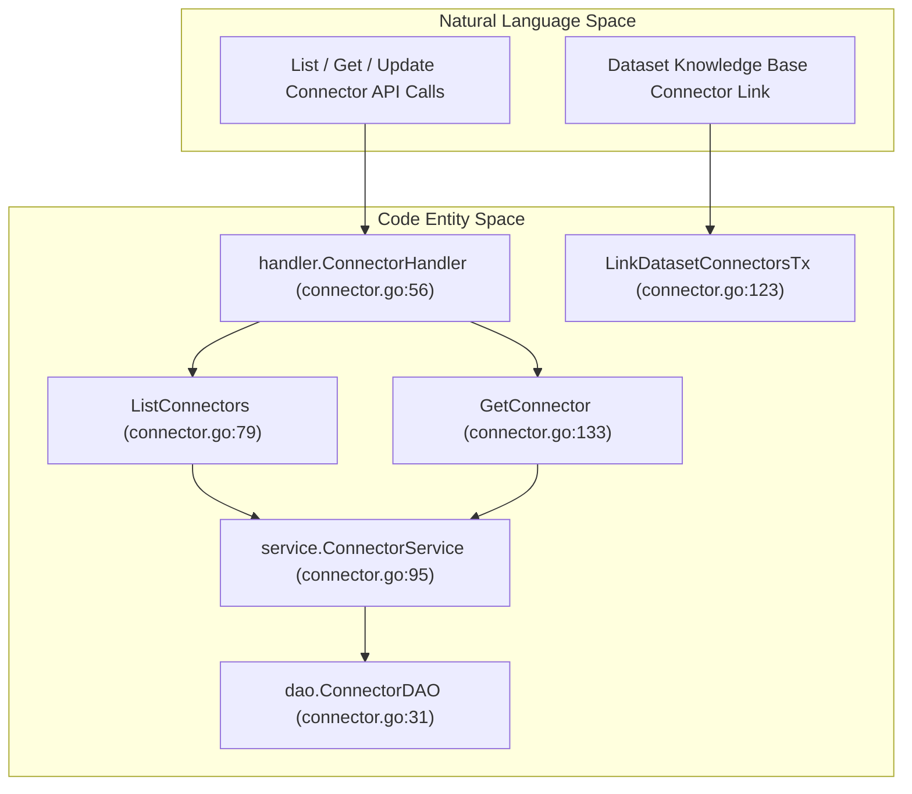
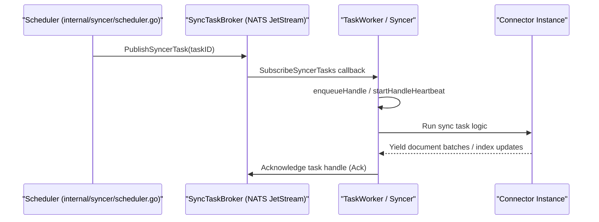

<!-- source: DeepWiki mcp.deepwiki.com · repo infiniflow/ragflow · page 6.6 Data Source Connectors · fetched 2026-10-29 -->

# Data Source Connectors

Relevant source files

The following files were used as context for generating this wiki page:

- [docs/guides/data_source/_category_.json](docs/guides/data_source/_category_.json)
- [docs/guides/data_source/add_to_knowledge_base_and_sync.md](docs/guides/data_source/add_to_knowledge_base_and_sync.md)
- [docs/guides/data_source/data_source_categories_and_selection.md](docs/guides/data_source/data_source_categories_and_selection.md)
- [docs/guides/data_source/data_source_configuration.md](docs/guides/data_source/data_source_configuration.md)
- [docs/guides/data_source/overview_and_page_management.md](docs/guides/data_source/overview_and_page_management.md)
- [internal/dao/connector.go](internal/dao/connector.go)
- [internal/dao/connector_test.go](internal/dao/connector_test.go)
- [internal/dao/sync_task.go](internal/dao/sync_task.go)
- [internal/dao/sync_task_test.go](internal/dao/sync_task_test.go)
- [internal/engine/kvrocks/redis.go](internal/engine/kvrocks/redis.go)
- [internal/engine/kvrocks/redis_test.go](internal/engine/kvrocks/redis_test.go)
- [internal/engine/oceanbase/schema.go](internal/engine/oceanbase/schema.go)
- [internal/engine/vastbase/schema.go](internal/engine/vastbase/schema.go)
- [internal/entity/connector.go](internal/entity/connector.go)
- [internal/entity/document.go](internal/entity/document.go)
- [internal/entity/llm.go](internal/entity/llm.go)
- [internal/entity/tenant.go](internal/entity/tenant.go)
- [internal/entity/tenant_langfuse.go](internal/entity/tenant_langfuse.go)
- [internal/entity/tenant_llm.go](internal/entity/tenant_llm.go)
- [internal/entity/user.go](internal/entity/user.go)
- [internal/handler/connector.go](internal/handler/connector.go)
- [internal/handler/connector_test.go](internal/handler/connector_test.go)
- [internal/server/variable.go](internal/server/variable.go)
- [internal/server/variable_test.go](internal/server/variable_test.go)
- [internal/service/connector.go](internal/service/connector.go)
- [internal/service/connector_logs_test.go](internal/service/connector_logs_test.go)
- [internal/service/connector_test_connection_test.go](internal/service/connector_test_connection_test.go)
- [internal/service/sync_task_service.go](internal/service/sync_task_service.go)
- [internal/syncer/connector/airtable.go](internal/syncer/connector/airtable.go)
- [internal/syncer/connector/airtable_test.go](internal/syncer/connector/airtable_test.go)
- [internal/syncer/connector/builtin.go](internal/syncer/connector/builtin.go)
- [internal/syncer/connector/outlook.go](internal/syncer/connector/outlook.go)
- [internal/syncer/connector/outlook_test.go](internal/syncer/connector/outlook_test.go)
- [internal/syncer/connector/registry.go](internal/syncer/connector/registry.go)
- [internal/syncer/connector/registry_test.go](internal/syncer/connector/registry_test.go)
- [internal/syncer/connector/teams.go](internal/syncer/connector/teams.go)
- [internal/syncer/connector/teams_test.go](internal/syncer/connector/teams_test.go)
- [internal/syncer/connector/webdav.go](internal/syncer/connector/webdav.go)
- [internal/syncer/connector/webdav_test.go](internal/syncer/connector/webdav_test.go)
- [internal/syncer/connector_lock.go](internal/syncer/connector_lock.go)
- [internal/syncer/prune_runner.go](internal/syncer/prune_runner.go)
- [internal/syncer/scheduler.go](internal/syncer/scheduler.go)
- [internal/syncer/scheduler_timer_test.go](internal/syncer/scheduler_timer_test.go)
- [internal/syncer/sync_runner.go](internal/syncer/sync_runner.go)
- [internal/syncer/syncer.go](internal/syncer/syncer.go)
- [internal/syncer/syncer_test.go](internal/syncer/syncer_test.go)
- [internal/syncer/task_coordinator.go](internal/syncer/task_coordinator.go)
- [internal/syncer/task_worker.go](internal/syncer/task_worker.go)
- [web/src/pages/user-setting/data-source/constant/index.test.tsx](web/src/pages/user-setting/data-source/constant/index.test.tsx)
- [web/src/pages/user-setting/data-source/constant/index.tsx](web/src/pages/user-setting/data-source/constant/index.tsx)

RAGFlow features a Go-native external data source connector subsystem designed to automatically ingest and synchronize documents from over 30 external platforms into internal knowledge bases. This architecture spans a Go-native connector registry, a background `Syncer` orchestration service, RESTful connector APIs, and a dynamic React-based configuration UI.

---

## 1. Supported Sources and Enumeration

RAGFlow supports 30+ external data sources across storage, collaboration, communication, development, database, and web categories. These sources are identified across the frontend and backend by the `DataSourceKey` enumeration [web/src/pages/user-setting/data-source/constant/index.tsx:40-81]().

| Category          | Supported Sources (`DataSourceKey`) |
|-------------------|-----------------------------------|
| Storage           | S3, Google Cloud Storage, Oracle Storage (`OCI_STORAGE`), R2, Dropbox, Box, Seafile, WebDAV, OneDrive, Azure Blob |
| Collaboration     | Notion, Confluence, Jira, Airtable, Asana, Zendesk, Moodle, SharePoint, Salesforce |
| Communication     | Slack, Discord, Gmail, IMAP, Outlook, Teams |
| Development       | GitHub, GitLab, Bitbucket, Azure DevOps, Xquik |
| Databases         | MySQL, PostgreSQL, BigQuery, DingTalk AI Table |
| Web               | RSS, REST API, Sitemap            |

Each source defines specific field constraints and default configuration values used by the frontend dynamic form generator [web/src/pages/user-setting/data-source/constant/index.tsx:40-81]().

Sources:
[web/src/pages/user-setting/data-source/constant/index.tsx:40-81]()

---

## 2. Go-Native Connector Registry and Built-ins

The backend connector registry (`internal/syncer/connector/registry.go`) manages factory functions for instantiating source adapters. All built-in connectors are registered during server bootstrap via `RegisterBuiltIns` [internal/syncer/connector/builtin.go:29-72]().

The registry supports dual factory registration:
1. **Runtime Task Factory**: Instantiates connectors with full `dao.SyncTaskContext` payloads during active synchronization jobs [internal/syncer/connector/builtin.go:88-90]().
2. **Config Factory**: Instantiates connectors from raw configuration maps for validation and test-connection endpoints [internal/syncer/connector/builtin.go:85-87]().

Sources:
[internal/syncer/connector/builtin.go:29-91]()

---

## 3. Connector APIs and Service Layer

The connector subsystem exposes RESTful endpoints via `ConnectorHandler` (`internal/handler/connector.go`), backed by `ConnectorService` (`internal/service/connector.go`) and data access objects (`internal/dao/connector.go`).

- **`ConnectorService`**: Coordinates CRUD operations, tenant-scoped ownership verification, knowledge base linking (`connector2kb`), and OAuth authorization flows [internal/service/connector.go:95-137]().
- **`ConnectorDAO`**: Manages GORM interactions with the `connector`, `connector2kb`, and `sync_log` tables, handling transaction safety and automated task scheduling when connectors link to knowledge bases [internal/dao/connector.go:63-197]().
- **`ConnectorHandler`**: Translates HTTP requests and maps sentinel service errors (e.g., `ErrConnectorNotFound`, `ErrConnectorIDRequired`) to standard HTTP status codes [internal/handler/connector.go:104-123]().

Sources:
[internal/handler/connector.go:56-147](), [internal/service/connector.go:95-137](), [internal/dao/connector.go:31-197]()

---

## 4. Syncer Service, Scheduler, and Background Execution

Asynchronous synchronization is managed by the Go-native `Syncer` service (`internal/syncer/syncer.go`), which coordinates task distribution, scheduling, and execution workers.

- **`Scheduler`**: Discovers due work from the database during startup and manages dynamic timers or NATS JetStream message distribution [internal/syncer/scheduler.go:58-104]().
- **`TaskEnvelope`**: Passes task references, cancellation contexts, and heartbeat callbacks through the internal queue [internal/syncer/scheduler.go:34-38]().
- **`TaskWorker`**: Consumes task envelopes, checks execution claims via `SyncTaskService.Claim`, acquires distributed connector locks using `ConnectorLocker`, and executes coordinator task pipelines [internal/syncer/task_worker.go:32-115]().

Sources:
[internal/syncer/syncer.go:36-104](), [internal/syncer/task_worker.go:32-115](), [internal/dao/sync_task.go:60-172]()

---

## 5. Frontend Configuration UI and Dynamic Forms

The React frontend provides a management interface for configuring data sources, viewing sync logs, and executing test connections [web/src/pages/user-setting/data-source/index.tsx:77-164]().

- **`DataSourceKey`**: Centralized TypeScript enum defining identifiers for all 30+ sources [web/src/pages/user-setting/data-source/constant/index.tsx:40-81]().
- **Dynamic Forms**: `SourceDetailPage` and `AddDataSourceModal` combine base fields with source-specific parameter definitions via `getDataSourceFieldsWithExtras`, rendering appropriate input primitives based on configuration schemas [web/src/pages/user-setting/data-source/data-source-detail-page/index.tsx:50-148](), [web/src/pages/user-setting/data-source/add-datasource-modal.tsx:38-60]().

Sources:
[web/src/pages/user-setting/data-source/constant/index.tsx:40-81]()

---

## 6. Security and SSRF Protections

To prevent Server-Side Request Forgery (SSRF) when connecting to external APIs, web hooks, or self-hosted databases (such as MySQL or PostgreSQL connectors), RAGFlow enforces strict URL and host validation rules.

- **`ResolveAndValidate`**: Parses destination URLs, performs DNS lookups, and rejects loopback, link-local, private, or metadata service IP ranges [internal/agent/tool/ssrf.go:54-144]().
- **`ValidateDBHost`**: Validates database connection hosts against private-IP blocklists and pins connections to safely resolved IP addresses [internal/agent/tool/ssrf.go:176-182]().

Sources:
[internal/agent/tool/ssrf.go:54-182]()

---

