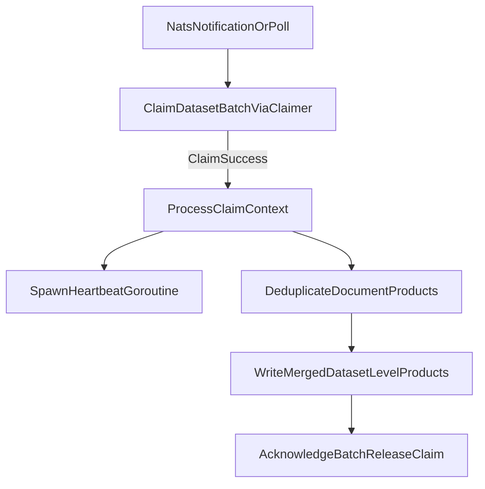
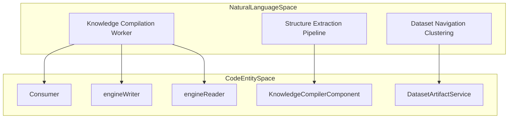
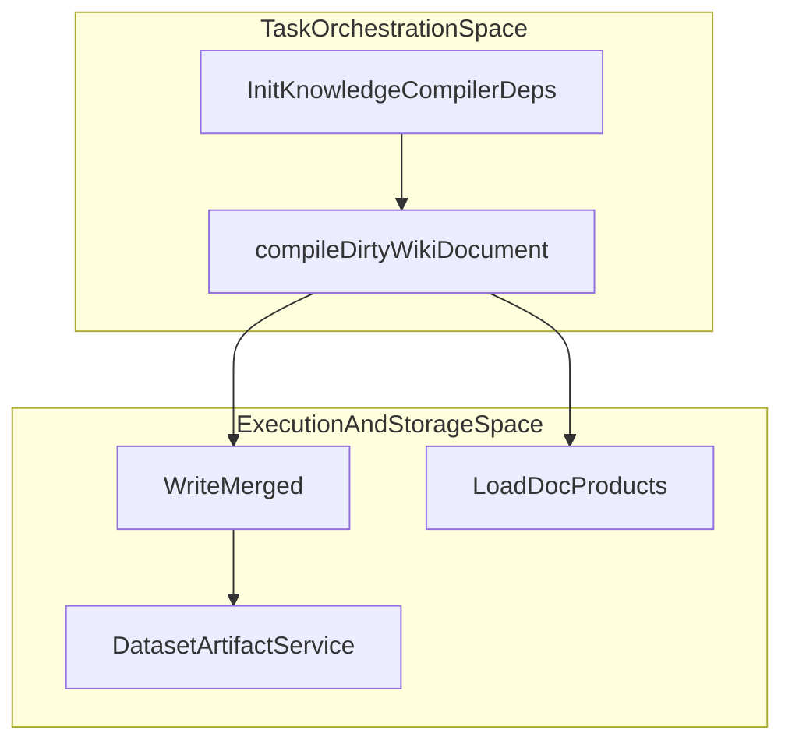

<!-- source: DeepWiki mcp.deepwiki.com · repo infiniflow/ragflow · page 6.7 Knowledge Compilation and Dataset Artifacts · fetched 2026-10-29 -->

# Knowledge Compilation and Dataset Artifacts

Relevant source files

The following files were used as context for generating this wiki page:

- [internal/ingestion/component/knowledge_compiler/component.go](internal/ingestion/component/knowledge_compiler/component.go)
- [internal/ingestion/component/knowledge_compiler/component_test.go](internal/ingestion/component/knowledge_compiler/component_test.go)
- [internal/ingestion/component/knowledge_compiler/mindmap/mindmap.go](internal/ingestion/component/knowledge_compiler/mindmap/mindmap.go)
- [internal/ingestion/component/knowledge_compiler/mindmap/mindmap_test.go](internal/ingestion/component/knowledge_compiler/mindmap/mindmap_test.go)
- [internal/ingestion/component/knowledge_compiler/storage_test.go](internal/ingestion/component/knowledge_compiler/storage_test.go)
- [internal/ingestion/knowledge_compile/consumer.go](internal/ingestion/knowledge_compile/consumer.go)
- [internal/ingestion/knowledge_compile/fake_engine_test.go](internal/ingestion/knowledge_compile/fake_engine_test.go)
- [internal/ingestion/knowledge_compile/reader.go](internal/ingestion/knowledge_compile/reader.go)
- [internal/ingestion/knowledge_compile/structure_merge_test.go](internal/ingestion/knowledge_compile/structure_merge_test.go)
- [internal/ingestion/knowledge_compile/writer.go](internal/ingestion/knowledge_compile/writer.go)
- [internal/ingestion/knowledge_compile/writer_test.go](internal/ingestion/knowledge_compile/writer_test.go)
- [internal/ingestion/task/knowledge_compiler_wiring.go](internal/ingestion/task/knowledge_compiler_wiring.go)
- [internal/service/dataset_artifact_service.go](internal/service/dataset_artifact_service.go)
- [web/src/components/compilation-template-form-field.tsx](web/src/components/compilation-template-form-field.tsx)
- [web/src/components/edit-tag/__tests__/index.test.tsx](web/src/components/edit-tag/__tests__/index.test.tsx)
- [web/src/components/edit-tag/index.tsx](web/src/components/edit-tag/index.tsx)
- [web/src/components/file-status-badge.tsx](web/src/components/file-status-badge.tsx)
- [web/src/components/list-filter-bar/use-handle-filter-submit.ts](web/src/components/list-filter-bar/use-handle-filter-submit.ts)
- [web/src/components/llm-select/llm-label.tsx](web/src/components/llm-select/llm-label.tsx)
- [web/src/components/ragflow-form.tsx](web/src/components/ragflow-form.tsx)
- [web/src/components/shared-badge.tsx](web/src/components/shared-badge.tsx)
- [web/src/constants/compilation.ts](web/src/constants/compilation.ts)
- [web/src/constants/knowledge.ts](web/src/constants/knowledge.ts)
- [web/src/constants/permission.ts](web/src/constants/permission.ts)
- [web/src/hooks/use-compilation-template-group-request.ts](web/src/hooks/use-compilation-template-group-request.ts)
- [web/src/lib/editor/plugins/floating-selection-toolbar.tsx](web/src/lib/editor/plugins/floating-selection-toolbar.tsx)
- [web/src/pages/agent/canvas/node/card.tsx](web/src/pages/agent/canvas/node/card.tsx)
- [web/src/pages/agent/canvas/node/chunker-node.tsx](web/src/pages/agent/canvas/node/chunker-node.tsx)
- [web/src/pages/agent/form/compilation-form/index.tsx](web/src/pages/agent/form/compilation-form/index.tsx)
- [web/src/pages/agent/hooks/use-export-json.ts](web/src/pages/agent/hooks/use-export-json.ts)
- [web/src/pages/agents/compilation-template-card.tsx](web/src/pages/agents/compilation-template-card.tsx)
- [web/src/pages/agents/constant.ts](web/src/pages/agents/constant.ts)
- [web/src/pages/agents/hooks/use-create-agent.test.ts](web/src/pages/agents/hooks/use-create-agent.test.ts)
- [web/src/pages/agents/hooks/use-create-agent.ts](web/src/pages/agents/hooks/use-create-agent.ts)
- [web/src/pages/agents/name-form-field.tsx](web/src/pages/agents/name-form-field.tsx)
- [web/src/pages/agents/upload-agent-dialog/index.tsx](web/src/pages/agents/upload-agent-dialog/index.tsx)
- [web/src/pages/agents/upload-agent-dialog/upload-agent-form.tsx](web/src/pages/agents/upload-agent-dialog/upload-agent-form.tsx)
- [web/src/pages/agents/use-import-json.ts](web/src/pages/agents/use-import-json.ts)
- [web/src/pages/chunk/representation/components/representation-select.tsx](web/src/pages/chunk/representation/components/representation-select.tsx)
- [web/src/pages/dataflow-result/__tests__/query-key.test.ts](web/src/pages/dataflow-result/__tests__/query-key.test.ts)
- [web/src/pages/dataflow-result/components/parse-editer/index.tsx](web/src/pages/dataflow-result/components/parse-editer/index.tsx)
- [web/src/pages/dataflow-result/components/parse-editer/interface.ts](web/src/pages/dataflow-result/components/parse-editer/interface.ts)
- [web/src/pages/dataflow-result/components/parse-editer/json-parser.tsx](web/src/pages/dataflow-result/components/parse-editer/json-parser.tsx)
- [web/src/pages/dataflow-result/components/time-line/index.tsx](web/src/pages/dataflow-result/components/time-line/index.tsx)
- [web/src/pages/dataflow-result/constant.ts](web/src/pages/dataflow-result/constant.ts)
- [web/src/pages/dataflow-result/hooks.ts](web/src/pages/dataflow-result/hooks.ts)
- [web/src/pages/dataflow-result/index.tsx](web/src/pages/dataflow-result/index.tsx)
- [web/src/pages/dataflow-result/interface.ts](web/src/pages/dataflow-result/interface.ts)
- [web/src/pages/dataflow-result/parser.tsx](web/src/pages/dataflow-result/parser.tsx)
- [web/src/pages/dataflow-result/query-key.ts](web/src/pages/dataflow-result/query-key.ts)
- [web/src/pages/dataset/dataset-overview/index.tsx](web/src/pages/dataset/dataset-overview/index.tsx)
- [web/src/pages/dataset/dataset-overview/interface.ts](web/src/pages/dataset/dataset-overview/interface.ts)
- [web/src/pages/next-chats/chat/llm-select-form.tsx](web/src/pages/next-chats/chat/llm-select-form.tsx)
- [web/src/pages/user-setting/compilation-templates/edit-next/index.tsx](web/src/pages/user-setting/compilation-templates/edit-next/index.tsx)
- [web/src/pages/user-setting/compilation-templates/edit-next/utils.ts](web/src/pages/user-setting/compilation-templates/edit-next/utils.ts)

## Purpose and Scope

This page details the Knowledge Compilation subsystem within RAGFlow, focusing on the post-ingestion processing that extracts structured knowledge from ingested documents and consolidates it into integrated dataset artifacts. It covers structure extraction, wiki/mindmap artifact generation, dataset navigation clustering, compilation templates, and the compilation UI. The primary Go components reside in `internal/ingestion/knowledge_compile/`, `internal/ingestion/component/knowledge_compiler/`, and service layers in `internal/service/`.

---

## 1. Overview of the Knowledge Compilation Subsystem

The Knowledge Compilation subsystem acts as a post-ingestion dataset-level processor that merges knowledge from document chunks into structured artifacts such as wiki pages, knowledge graphs, and dataset navigation clusters.

### Key Components

| Component | Description |
|-----------|-------------|
| **`Consumer`** | Long-running worker that claims ingestion batches, performs incremental merges, and handles rebuilds [internal/ingestion/knowledge_compile/consumer.go:51-72](). |
| **`Reader` / `Writer`** | Abstractions to read per-document compiled products and write merged dataset-level artifacts [internal/ingestion/knowledge_compile/writer.go:42-90](), [internal/ingestion/knowledge_compile/reader.go:45-58](). |
| **`KnowledgeCompilerComponent`** | Runtime component dispatches to compilation variants (structure/wiki/tree/mindmap) [internal/ingestion/component/knowledge_compiler/component.go:56-69](). |
| **`DatasetArtifactService`** | Reads knowledge-compilation artifacts (wiki pages, graphs, structures, navigation, skills) from the document engine [internal/service/dataset_artifact_service.go:51-57](). |

Sources:  
[internal/ingestion/knowledge_compile/consumer.go:51-72]()  
[internal/ingestion/knowledge_compile/writer.go:42-90]()  
[internal/ingestion/knowledge_compile/reader.go:45-58]()  
[internal/ingestion/component/knowledge_compiler/component.go:56-69]()  
[internal/service/dataset_artifact_service.go:51-57]()

---

## 2. Knowledge Compilation Consumer: Architecture and Data Flow

The cornerstone of dataset-level knowledge compilation is the `Consumer` [internal/ingestion/knowledge_compile/consumer.go:51-72](). It is a concurrency-safe worker that claims closed ingestion batches from a MySQL-backed scheduler and merges compiled document products into dataset-level artifacts.

### Consumer Responsibilities

- Claim closed ingestion batches for datasets using MySQL row-based leasing via the `Claimer` interface [internal/ingestion/knowledge_compile/consumer.go:51-72]().
- Load per-document compiled products via the `Reader` interface [internal/ingestion/knowledge_compile/reader.go:45-49]().
- Deduplicate and merge products using similarity thresholds (`mergeThreshold`) [internal/ingestion/knowledge_compile/consumer.go:54-72]().
- Write merged dataset-level products via the `Writer` interface [internal/ingestion/knowledge_compile/writer.go:43-90]().
- Manage heartbeats to maintain claim leases and handle crash recovery [internal/ingestion/knowledge_compile/consumer.go:68-71]().

### Worker Loop and Claim Lifecycle

`Consumer.Run(ctx)` implements the main event loop that subscribes to NATS notifications, periodically polls, and sweeps expired leases [internal/ingestion/knowledge_compile/consumer.go:163-166]().

Diagram: Consumer Claim and Processing Flow

Sources:  
[internal/ingestion/knowledge_compile/consumer.go:51-166]()

---

## 3. Reading and Writing Compiled Products

### Reader and Writer Interfaces

- **`Reader`**: Encapsulates loading document-level compiled products (`LoadDocProducts`) and performing approximate KNN searches for duplicates (`SearchSimilar`) [internal/ingestion/knowledge_compile/reader.go:45-58]().
- **`Writer`**: Manages persistence and cleanup of dataset-level merged products (`WriteMerged`, `DeleteDocLevelForDocs`, `StripMergedSources`, `ProjectWikiGraph`, `DeleteMerged`) [internal/ingestion/knowledge_compile/writer.go:43-91]().

### StructureBucket Data Model

`StructureBucket` aggregates merged structured items [internal/ingestion/knowledge_compile/writer.go:97-120]():

| Field | Description |
|-------|-------------|
| `CompileKwd` | Canonical knowledge compilation kind [internal/ingestion/knowledge_compile/writer.go:108]() |
| `Name` | Entity name [internal/ingestion/knowledge_compile/writer.go:98]() |
| `Type` | Entity or relation type [internal/ingestion/knowledge_compile/writer.go:99]() |
| `Description` | Folded textual description [internal/ingestion/knowledge_compile/writer.go:100]() |
| `SourceDocIDs` | Union of source document IDs [internal/ingestion/knowledge_compile/writer.go:101]() |
| `SourceChunkIDs` | Union of source chunk IDs [internal/ingestion/knowledge_compile/writer.go:102]() |
| `Vector` | Aggregate mean embedding vector [internal/ingestion/knowledge_compile/writer.go:103]() |
| `FromEntity` / `ToEntity` | Relation endpoints [internal/ingestion/knowledge_compile/writer.go:105-106]() |
| `TemplateID` | Producing compilation template ID [internal/ingestion/knowledge_compile/writer.go:112]() |

Sources:  
[internal/ingestion/knowledge_compile/reader.go:45-58]()  
[internal/ingestion/knowledge_compile/writer.go:43-120]()

---

## 4. Artifact Generation Variants

`KnowledgeCompilerComponent` evaluates parameters and dispatches execution to specific compilation variants (`structure`, `wiki`, `tree`, `mindmap`) based on template configurations [internal/ingestion/component/knowledge_compiler/component.go:56-150]().

- **Structure Variant**: Extracts entities and relationships, mapping them to hypergraph representations.
- **Wiki Variant**: Generates hierarchical wiki pages, sections, and cross-references.
- **Tree/RAPTOR Variant**: Performs recursive summarization and hierarchical tree clustering.
- **Mindmap Variant**: Builds tree outlines and structured mind map nodes.

Sources:  
[internal/ingestion/component/knowledge_compiler/component.go:56-150]()

---

## 5. Dataset Navigation Clustering

Implemented in `internal/service/nav/` and read via `DatasetArtifactService` (`internal/service/dataset_artifact_service.go`), navigation services maintain hierarchical clusters for dataset navigation with parent-child tree structures, using embedding vectors and similarity thresholds to group documents.

### Key Artifact Services

- `DatasetArtifactService`: Exposes methods like `HasWiki`, `HasSkill`, and `ListWikiPages` to query compiled dataset artifacts from the document engine [internal/service/dataset_artifact_service.go:51-187]().
- `wikiIndexName`: Computes the tenant-scoped document index name `ragflow_{tenantID}` for artifact searches [internal/service/dataset_artifact_service.go:59-62]().

Sources:  
[internal/service/dataset_artifact_service.go:51-187]()

---

## 6. Compilation Templates and Composition-Root Wiring

Knowledge compilation is driven by compilation templates that specify the schema for entities and relations [internal/ingestion/task/knowledge_compiler_wiring.go:42-75]().

- `InitKnowledgeCompilerDeps` binds process-wide database and document engine instances [internal/ingestion/task/knowledge_compiler_wiring.go:66-75]().
- `compileDirtyWikiDocument` coordinates incremental compilation when underlying source documents change [internal/ingestion/task/knowledge_compiler_wiring.go:84-150]().

Sources:  
[internal/ingestion/task/knowledge_compiler_wiring.go:42-150]()

---

## 7. API and Frontend Compilation Views

Frontend code and constants reference compilation tasks and status tracking structures in `web/src/constants/knowledge.ts` and compilation forms in `web/src/pages/agent/form/compilation-form/index.tsx` [web/src/constants/knowledge.ts:17-166](), [web/src/pages/agent/form/compilation-form/index.tsx:29-107]().

- `ProcessingType` defines UI categories like `wiki`, `mindmap`, and `knowledgeGraph` [web/src/constants/knowledge.ts:152-166]().
- `CompilationForm` provides the visual node configuration form for compilation parameters and LLM settings [web/src/pages/agent/form/compilation-form/index.tsx:49-107]().

Sources:  
[web/src/constants/knowledge.ts:17-166]()  
[web/src/pages/agent/form/compilation-form/index.tsx:29-107]()

---

## 8. Natural Language Space to Code Entity Mapping

### Conceptual to Code Mapping: Consumer and Storage

Sources:  
[internal/ingestion/knowledge_compile/consumer.go:51-72]()  
[internal/ingestion/knowledge_compile/writer.go:127-135]()  
[internal/ingestion/knowledge_compile/reader.go:101-106]()  
[internal/ingestion/component/knowledge_compiler/component.go:56-69]()  
[internal/service/dataset_artifact_service.go:51-57]()

### Compilation Workflow Architecture

Sources:  
[internal/ingestion/task/knowledge_compiler_wiring.go:66-82]()  
[internal/ingestion/knowledge_compile/writer.go:43-65]()  
[internal/ingestion/knowledge_compile/reader.go:45-58]()  
[internal/service/dataset_artifact_service.go:51-187]()

---

