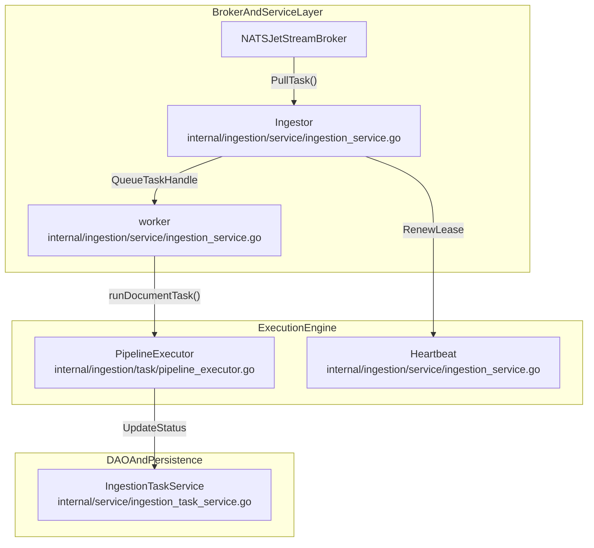
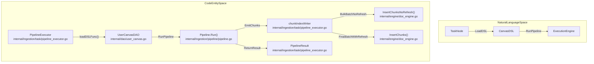

<!-- source: DeepWiki mcp.deepwiki.com · repo infiniflow/ragflow · page 6.8 Ingestion Pipeline Execution · fetched 2026-10-29 -->

# Ingestion Pipeline Execution

<details>
<summary>Relevant source files</summary>

The following files were used as context for generating this wiki page:

- [internal/dao/ingestion_task_test.go](internal/dao/ingestion_task_test.go)
- [internal/ingestion/component/chunker/block_kind_contract_cgo_test.go](internal/ingestion/component/chunker/block_kind_contract_cgo_test.go)
- [internal/ingestion/component/chunker/block_kind_contract_test.go](internal/ingestion/component/chunker/block_kind_contract_test.go)
- [internal/ingestion/component/chunker/crop_title_test.go](internal/ingestion/component/chunker/crop_title_test.go)
- [internal/ingestion/component/schema/chunk_docitem_test.go](internal/ingestion/component/schema/chunk_docitem_test.go)
- [internal/ingestion/component/schema/chunk_types.go](internal/ingestion/component/schema/chunk_types.go)
- [internal/ingestion/pipeline/pipeline.go](internal/ingestion/pipeline/pipeline.go)
- [internal/ingestion/pipeline/pipeline_test.go](internal/ingestion/pipeline/pipeline_test.go)
- [internal/ingestion/pipeline/template/ingestion_pipeline_audio.json](internal/ingestion/pipeline/template/ingestion_pipeline_audio.json)
- [internal/ingestion/pipeline/template/ingestion_pipeline_book.json](internal/ingestion/pipeline/template/ingestion_pipeline_book.json)
- [internal/ingestion/pipeline/template/ingestion_pipeline_email.json](internal/ingestion/pipeline/template/ingestion_pipeline_email.json)
- [internal/ingestion/pipeline/template/ingestion_pipeline_general.json](internal/ingestion/pipeline/template/ingestion_pipeline_general.json)
- [internal/ingestion/pipeline/template/ingestion_pipeline_laws.json](internal/ingestion/pipeline/template/ingestion_pipeline_laws.json)
- [internal/ingestion/pipeline/template/ingestion_pipeline_manual.json](internal/ingestion/pipeline/template/ingestion_pipeline_manual.json)
- [internal/ingestion/pipeline/template/ingestion_pipeline_one.json](internal/ingestion/pipeline/template/ingestion_pipeline_one.json)
- [internal/ingestion/pipeline/template/ingestion_pipeline_paper.json](internal/ingestion/pipeline/template/ingestion_pipeline_paper.json)
- [internal/ingestion/pipeline/template/ingestion_pipeline_picture.json](internal/ingestion/pipeline/template/ingestion_pipeline_picture.json)
- [internal/ingestion/pipeline/template/ingestion_pipeline_presentation.json](internal/ingestion/pipeline/template/ingestion_pipeline_presentation.json)
- [internal/ingestion/pipeline/template/ingestion_pipeline_qa.json](internal/ingestion/pipeline/template/ingestion_pipeline_qa.json)
- [internal/ingestion/service/ingestion_service.go](internal/ingestion/service/ingestion_service.go)
- [internal/ingestion/service/progress_sink.go](internal/ingestion/service/progress_sink.go)
- [internal/ingestion/service/progress_sink_test.go](internal/ingestion/service/progress_sink_test.go)
- [internal/ingestion/service/worker_dispatcher_integration_test.go](internal/ingestion/service/worker_dispatcher_integration_test.go)
- [internal/ingestion/task/indexdoc/process.go](internal/ingestion/task/indexdoc/process.go)
- [internal/ingestion/task/indexdoc/process_test.go](internal/ingestion/task/indexdoc/process_test.go)
- [internal/ingestion/task/pipeline_executor.go](internal/ingestion/task/pipeline_executor.go)
- [internal/ingestion/task/pipeline_executor_defaults_test.go](internal/ingestion/task/pipeline_executor_defaults_test.go)
- [internal/ingestion/task/pipeline_executor_test.go](internal/ingestion/task/pipeline_executor_test.go)
- [internal/parser/parser/doc_item.go](internal/parser/parser/doc_item.go)
- [internal/parser/parser/doc_item_test.go](internal/parser/parser/doc_item_test.go)
- [internal/parser/parser/html_parser_align_test.go](internal/parser/parser/html_parser_align_test.go)
- [internal/service/document/document_list.go](internal/service/document/document_list.go)
- [internal/service/ingestion_task_service.go](internal/service/ingestion_task_service.go)
- [internal/service/ingestion_task_service_test.go](internal/service/ingestion_task_service_test.go)

</details>


## Purpose and Scope

This page documents the technical details of the ingestion pipeline execution subsystem in RAGFlow, implemented in Go under the `internal/ingestion/` directory [internal/ingestion/task/pipeline_executor.go:1-43](). It explains how ingestion tasks are consumed from the NATS message broker by `Ingestor` [internal/ingestion/service/ingestion_service.go:54-142](), how pipeline parameters and the component canvas graph DSL are loaded and validated via `Pipeline` [internal/ingestion/pipeline/pipeline.go:39-48](), how pipeline execution proceeds using `PipelineExecutor` [internal/ingestion/task/pipeline_executor.go:73-84](), and how component lifecycle progress is reported through durable `ProgressSink` implementations [internal/ingestion/pipeline/pipeline.go:95-98]().

Sources:
`internal/ingestion/task/pipeline_executor.go:1-84` (),
`internal/ingestion/service/ingestion_service.go:54-142` (),
`internal/ingestion/pipeline/pipeline.go:39-98` ()

---

## 1. Task Consumption and Worker Pool Architecture

### Overview

Document ingestion is initiated by scheduling ingestion tasks through `IngestionTaskService.CreateForDocuments` [internal/service/ingestion_task_service.go:101-143](), which creates task records and publishes ingestion messages onto NATS JetStream. The `Ingestor` daemon running in the ingestion service subscribes to these tasks and dispatches them across a worker pool [internal/ingestion/service/ingestion_service.go:54-150]().

### Key Components

- **`IngestionTaskService` (`internal/service/ingestion_task_service.go`)**: Manages task creation, record persistence, and message publishing via `TaskPublisher` [internal/service/ingestion_task_service.go:65-84]().
- **`Ingestor` (`internal/ingestion/service/ingestion_service.go`)**: Manages worker goroutines (`worker` struct) [internal/ingestion/service/ingestion_service.go:151-154](), handles Pull-based task consumption, and executes heartbeat routines to keep leased messages active (`defaultHeartbeatInterval = 2 * time.Second`) [internal/ingestion/service/ingestion_service.go:45-53]().
- **`worker`**: Wraps a channel inbox `inbox chan common.TaskHandle` [internal/ingestion/service/ingestion_service.go:151-154]() that receives tasks and delegates them to the document ingestion handler.

### Data Flow Diagram



*Diagram 1: Natural Language Task Scheduling to Code Entity Execution Flow.*

Sources:
`internal/ingestion/service/ingestion_service.go:45-154` (),
`internal/service/ingestion_task_service.go:65-84` ()

---

## 2. Pipeline Parameters and Canvas DSL Decoding

The ingestion pipeline configuration is defined as a directed acyclic graph DSL ("canvas") containing components like parsers, chunkers, extractors, and tokenizers.

The `Pipeline` struct in `internal/ingestion/pipeline/pipeline.go` encapsulates the task state and execution graph:

```go
type Pipeline struct {
	taskID     string
	documentID string 
	canvas     *canvas.Canvas
	tracker    *canvas.RunTracker       
	kv         *kvrocks.Client          
	factory    runtime.ComponentFactory 
	sink       ProgressSink             
}
```[internal/ingestion/pipeline/pipeline.go:39-48]()

### Construction and Validation

- **`NewPipelineFromDSL`** [internal/ingestion/pipeline/pipeline.go:110-133](): Unwraps optional JSON envelopes, decodes the canvas via `canvas.DecodeFromDSL`, and invokes `ValidatePipeline` [internal/ingestion/pipeline/pipeline.go:122-124]().
- **Constraint Enforcement**: `ValidatePipeline` ensures that at most one `Extractor` component exists in the graph topology [internal/ingestion/pipeline/pipeline.go:135-151]().
- **Parameter Normalization**: Helper functions clean and align legacy configurations with component param structs like `schema.ExtractorParam` and `schema.TokenChunkerParam` [internal/ingestion/pipeline/pipeline.go:1-193]().

Sources:
`internal/ingestion/pipeline/pipeline.go:39-193` ()

---

## 3. Component Graph and Execution Engine (`PipelineExecutor`)

The `PipelineExecutor` orchestrates the execution of the ingestion graph for an individual task.

### Core Structures and Functions

- **`PipelineExecutor`** [internal/ingestion/task/pipeline_executor.go:73-84](): Manages task context validation, loading canvas DSL via `UserCanvas` lookup, running the pipeline graph, and dispatching chunks to the index writer.
- **`NewPipelineExecutor`** [internal/ingestion/task/pipeline_executor.go:145-174](): Validates the `TaskContext`, configures chunk writers using bulk insertion strategies, and sets up compensating deletion functions (`DeleteChunksFunc`) [internal/ingestion/task/pipeline_executor.go:160-173]().
- **Chunk Ingestion Strategies**:
  - `insertChunksForIngestion` [internal/ingestion/task/pipeline_executor.go:124-131](): Leverages `noRefreshChunkInserter` [internal/ingestion/task/pipeline_executor.go:107-112]() when available to write intermediate chunks without triggering expensive index refreshes.
  - `insertFinalChunksForIngestion` [internal/ingestion/task/pipeline_executor.go:136-140](): Forces index refreshing on the terminal batch to ensure full visibility before task completion.
- **`PipelineResult`** [internal/ingestion/task/pipeline_executor.go:48-71](): Holds metadata output such as `ChunkCount`, `TokenConsumption`, `Duration`, and compiled variant products.

### Execution Flow Diagram



*Diagram 2: Pipeline Execution and Indexing Architecture.*

Sources:
`internal/ingestion/task/pipeline_executor.go:48-174` (),
`internal/ingestion/pipeline/pipeline.go:193-480` ()

---

## 4. Progress Sinks and Lifecycle Tracking

The ingestion pipeline reports component execution milestones through the `ProgressSink` interface:

```go
type ProgressEvent struct {
	TaskID     string
	DocumentID string
	Component  string
	Message    string
	Phase      int
}

type ProgressSink interface {
	OnComponentTotal(ctx context.Context, taskID string, total int)
	OnComponentProgress(ctx context.Context, ev ProgressEvent)
}
```[internal/ingestion/pipeline/pipeline.go:81-98]()

- **`OnComponentTotal`**: Informs the sink of the total number of components/phases in the pipeline graph [internal/ingestion/pipeline/pipeline.go:96]().
- **`OnComponentProgress`**: Emits lifecycle status updates for individual components [internal/ingestion/pipeline/pipeline.go:97]().
- **Database Persistence**: Concrete implementations live in `internal/ingestion/service/progress_sink.go` to persist states for UI status monitoring. A `nil` sink drops events during unit tests or headless runs [internal/ingestion/pipeline/pipeline.go:91-105]().

Sources:
`internal/ingestion/pipeline/pipeline.go:81-105` (),
`internal/ingestion/service/progress_sink.go` ()

---

## 5. Chunk Cache and Indexing Step

To optimize performance and eliminate duplicate computation during retries:

- **Chunk Caching (`internal/ingestion/chunkcache/`)**: Caches intermediate parse outputs, structural chunk trees, and embeddings keyed by document and run identifiers [internal/ingestion/task/pipeline_executor.go:34]().
- **TTL Alignment**: Cache and run-tracker expiration horizons match (`defaultTrackerTTL = 7 * 24 * time.Hour`), ensuring consistency across restarts and task replays [internal/ingestion/pipeline/pipeline.go:188-191]().
- **Batching & Indexing**: Chunks are grouped by `docBulkSize` within the `PipelineExecutor` before being persisted to the underlying `DocEngine` storage backend (Elasticsearch, Infinity, OceanBase, or SereneDB) [internal/ingestion/task/pipeline_executor.go:76-79](), incorporating pre-index processing via `indexdoc.ProcessChunksForPipeline` [internal/ingestion/task/indexdoc/process.go:68-106]().

Sources:
`internal/ingestion/chunkcache/` (),
`internal/ingestion/pipeline/pipeline.go:188-191` (),
`internal/ingestion/task/pipeline_executor.go:34-84` (),
`internal/ingestion/task/indexdoc/process.go:68-106` ()

---

## References

| Concept | Code Entity / File Path |
| :--- | :--- |
| Ingestion Task Scheduling | `internal/service/ingestion_task_service.go` () |
| Worker Pool Ingestion Daemon | `internal/ingestion/service/ingestion_service.go` () |
| Pipeline Executor & Indexing | `internal/ingestion/task/pipeline_executor.go` () |
| Pipeline DSL & Runner | `internal/ingestion/pipeline/pipeline.go` () |
| Pre-index Chunk Processing | `internal/ingestion/task/indexdoc/process.go` () |
| Progress Sinks | `internal/ingestion/service/progress_sink.go` () |
| Chunk Caching | `internal/ingestion/chunkcache/` () |

Sources:
All files cited in sections above.

---

