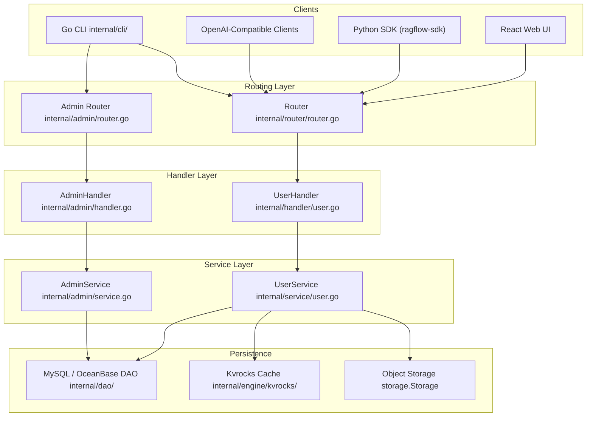
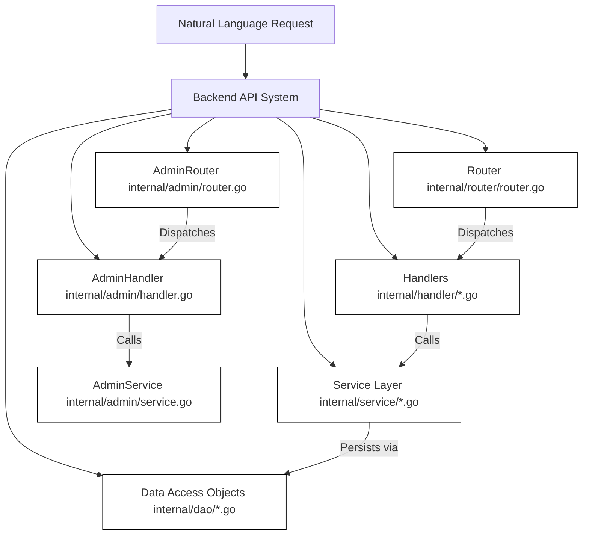
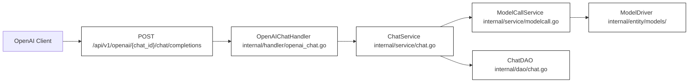

<!-- source: DeepWiki mcp.deepwiki.com · repo infiniflow/ragflow · page 7 Backend API System · fetched 2026-10-29 -->

# Backend API System

Relevant source files

The following files were used as context for generating this wiki page:

- [internal/admin/handler.go](internal/admin/handler.go)
- [internal/admin/handler_ee.go](internal/admin/handler_ee.go)
- [internal/admin/router.go](internal/admin/router.go)
- [internal/admin/router_ee.go](internal/admin/router_ee.go)
- [internal/admin/service.go](internal/admin/service.go)
- [internal/admin/service_ee.go](internal/admin/service_ee.go)
- [internal/cli/admin_command.go](internal/cli/admin_command.go)
- [internal/cli/admin_command_ee.go](internal/cli/admin_command_ee.go)
- [internal/cli/admin_parser.go](internal/cli/admin_parser.go)
- [internal/cli/cli.go](internal/cli/cli.go)
- [internal/cli/cli_http.go](internal/cli/cli_http.go)
- [internal/cli/common_command.go](internal/cli/common_command.go)
- [internal/cli/http_client.go](internal/cli/http_client.go)
- [internal/cli/lexer.go](internal/cli/lexer.go)
- [internal/cli/parser.go](internal/cli/parser.go)
- [internal/cli/response.go](internal/cli/response.go)
- [internal/cli/types.go](internal/cli/types.go)
- [internal/cli/user_command.go](internal/cli/user_command.go)
- [internal/cli/user_parser.go](internal/cli/user_parser.go)
- [internal/handler/system_ee.go](internal/handler/system_ee.go)
- [internal/handler/user_auth_ee.go](internal/handler/user_auth_ee.go)
- [internal/router/router.go](internal/router/router.go)
- [internal/router/router_ee.go](internal/router/router_ee.go)

The Backend API System in RAGFlow serves as the primary HTTP REST interface exposing the platform's core capabilities, including dataset management, document ingestion, chat interactions, agent workflows, memory systems, monitoring, and chat channel integrations. Designed around a Go-native backend, the API layer provides a performant routing engine [`internal/router/router.go:26-141`](), modular handlers [`internal/router/router.go:27-57`](), and OpenAI-compatible endpoints.

As a PARENT page, this document provides an architectural overview of the REST API system. For in-depth technical specifications, refer to the child pages linked below.

Sources: [internal/router/router.go:26-141]()

---

## API Layer Architecture

The API routing is structured around two primary router engines:
1. **User API Router**: Defined in `internal/router/router.go`, handling tenant, user, dataset, document, chunk, chat, agent, and tool endpoints [internal/router/router.go:26-141]().
2. **Admin API Router**: Defined in `internal/admin/router.go`, guarding operational endpoints with superuser checks under `/api/v1/admin` [internal/admin/router.go:35-131]().

Handlers follow a consistent layered design pattern:
- **Routers**: Map HTTP methods and paths to specific handler methods using `gin-gonic/gin` [internal/router/router.go:141-176]().
- **Handlers**: Parse requests, validate inputs, and invoke underlying services (e.g., `handler.UserHandler`, `handler.DatasetsHandler`, `admin.Handler`) [internal/router/router.go:27-57](), [internal/admin/handler.go:39-50]().
- **Services**: Contain business logic and interact with Data Access Objects (`dao`) for database operations and document storage engines.

Clients interact with the system via the React web frontend, the official Python SDK (`ragflow-sdk`), OpenAI-compatible clients, and the Go CLI (`internal/cli/`) [internal/cli/cli_http.go:25-36]().

### Backend API Request Flow Architecture

Sources: [internal/router/router.go:26-141](), [internal/admin/router.go:35-131](), [internal/cli/cli_http.go:25-36]()

---

## Standard Response Codes and Error Handling

RAGFlow combines standard HTTP status codes with application-level business codes in JSON responses for precise client-side error handling.

### HTTP Status Codes
- `200 OK`: Request succeeded; examine the business code in the JSON body.
- `400 Bad Request`: Validation failure or malformed payload.
- `401 Unauthorized`: Missing or invalid authentication token.
- `403 Forbidden`: Insufficient permissions for the requested operation.
- `404 Not Found`: Resource or route does not exist.
- `500 Internal Server Error`: Unhandled server exception.

### Business Response Codes
- `0`: Success
- `10`: Not effective
- `100`: General exception/error
- `101`: Invalid request argument
- `102`: Missing or invalid data
- `105`: Connection error
- `106`: Operation still running
- `108`: Permission denied
- `109`: Authentication error

Sources: [docs/references/http_api_reference.md:14-50]()

---

## Child Pages Overview

For detailed documentation on specific API domains, refer to the following child pages:

- [API Architecture and Python SDK](#7.1) — Route groups in `internal/router`, handler/service/dao layering, request/response and error-code conventions, OpenAI-compatible endpoints, the Python SDK, and example scripts.
- [Authentication and Authorization](#7.2) — AuthMiddleware and BetaAuthMiddleware, JWT/API-key/beta tokens, itsdangerous-compatible signing, Werkzeug-compatible password hashing, and OAuth callbacks.
- [User and Tenant Management](#7.3) — Registration, login, profile/settings, password reset with OTP, team membership and invites, and tenant-scoped defaults.
- [Dataset and Knowledge Base APIs](#7.4) — Dataset CRUD, parser/pipeline configuration, metadata settings, tags, dataset search and artifacts endpoints, plus the dataset frontend flows.
- [Document, Chunk and File Management APIs](#7.5) — Document upload/ingest/cancel, file2document mapping, file manager and folders, chunk CRUD and browsing UI, document preview and metadata dialogs.
- [Chat and Conversation APIs](#7.6) — Chat assistants, sessions, completion/streaming endpoints, the chat pipeline, citations, TTS/ASR audio endpoints, and the next-chats frontend.
- [Agent, Bot and Memory APIs](#7.7) — Agent/canvas endpoints, bot completion routes (chatbots/agentbots/searchbots), and the memory system REST API.
- [System Status and Health Monitoring](#7.8) — Health/healthz/config/version endpoints, component status aggregation, log-level control, runtime variables, and MCP server exposure.
- [Chat Channel Integrations](#7.9) — `internal/channels` runtime integrating RAGFlow with Feishu, Discord, Telegram, WeChat, DingTalk, WhatsApp, Line, QQBot and WeWork; channel registry and reconciliation.
- [Skill Spaces and Skill Search](#7.10) — Skill spaces and packages (`SKILL.md` frontmatter, versioning, validation), skill hub sources and security scanning in `internal/cli/filesystem`, the skill indexer/search, and the skills UI.

Sources: [internal/router/router.go:26-141](), [internal/admin/router.go:35-131]()

---

## Natural Language to Code Entity Bridges

### Backend API System Components and Code Entities

Sources: [internal/router/router.go:26-141](), [internal/admin/router.go:35-131](), [internal/admin/handler.go:39-50]()

### OpenAI-Compatible Chat Completion Endpoint and Code

Sources: [internal/router/router.go:38-38]()

---

