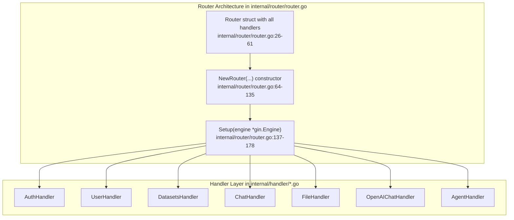
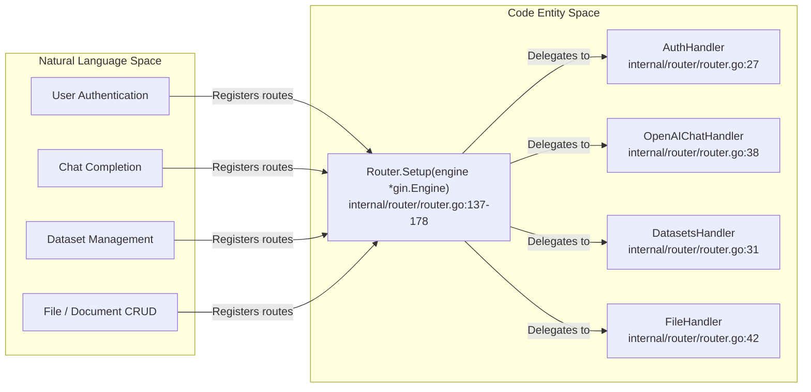
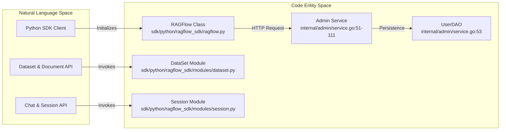

<!-- source: DeepWiki mcp.deepwiki.com · repo infiniflow/ragflow · page 7.1 API Architecture and Python SDK · fetched 2026-10-29 -->

# API Architecture and Python SDK

<details>
<summary>Relevant source files</summary>

The following files were used as context for generating this wiki page:

- [docs/develop/acquire_ragflow_api_key.md](docs/develop/acquire_ragflow_api_key.md)
- [docs/faq.mdx](docs/faq.mdx)
- [docs/guides/models/deploy_local_llm.mdx](docs/guides/models/deploy_local_llm.mdx)
- [docs/guides/models/llm_api_key_setup.md](docs/guides/models/llm_api_key_setup.md)
- [docs/references/http_api_reference.md](docs/references/http_api_reference.md)
- [docs/references/python_api_reference.md](docs/references/python_api_reference.md)
- [docs/release_notes.md](docs/release_notes.md)
- [internal/admin/handler.go](internal/admin/handler.go)
- [internal/admin/handler_ee.go](internal/admin/handler_ee.go)
- [internal/admin/router.go](internal/admin/router.go)
- [internal/admin/router_ee.go](internal/admin/router_ee.go)
- [internal/admin/service.go](internal/admin/service.go)
- [internal/admin/service_ee.go](internal/admin/service_ee.go)
- [internal/cli/admin_command.go](internal/cli/admin_command.go)
- [internal/cli/admin_command_ee.go](internal/cli/admin_command_ee.go)
- [internal/cli/admin_parser.go](internal/cli/admin_parser.go)
- [internal/cli/cli.go](internal/cli/cli.go)
- [internal/cli/cli_http.go](internal/cli/cli_http.go)
- [internal/cli/common_command.go](internal/cli/common_command.go)
- [internal/cli/http_client.go](internal/cli/http_client.go)
- [internal/cli/lexer.go](internal/cli/lexer.go)
- [internal/cli/parser.go](internal/cli/parser.go)
- [internal/cli/response.go](internal/cli/response.go)
- [internal/cli/types.go](internal/cli/types.go)
- [internal/cli/user_command.go](internal/cli/user_command.go)
- [internal/cli/user_parser.go](internal/cli/user_parser.go)
- [internal/dao/user_canvas_version.go](internal/dao/user_canvas_version.go)
- [internal/dao/user_canvas_version_limit_test.go](internal/dao/user_canvas_version_limit_test.go)
- [internal/dao/user_canvas_version_test.go](internal/dao/user_canvas_version_test.go)
- [internal/handler/system_ee.go](internal/handler/system_ee.go)
- [internal/handler/user_auth_ee.go](internal/handler/user_auth_ee.go)
- [internal/ingestion/task/pipeline_version_test.go](internal/ingestion/task/pipeline_version_test.go)
- [internal/router/router.go](internal/router/router.go)
- [internal/router/router_ee.go](internal/router/router_ee.go)
- [sdk/python/ragflow_sdk/modules/agent.py](sdk/python/ragflow_sdk/modules/agent.py)
- [sdk/python/ragflow_sdk/modules/base.py](sdk/python/ragflow_sdk/modules/base.py)
- [sdk/python/ragflow_sdk/modules/chat.py](sdk/python/ragflow_sdk/modules/chat.py)
- [sdk/python/ragflow_sdk/modules/chunk.py](sdk/python/ragflow_sdk/modules/chunk.py)
- [sdk/python/ragflow_sdk/modules/dataset.py](sdk/python/ragflow_sdk/modules/dataset.py)
- [sdk/python/ragflow_sdk/modules/document.py](sdk/python/ragflow_sdk/modules/document.py)
- [sdk/python/ragflow_sdk/modules/session.py](sdk/python/ragflow_sdk/modules/session.py)
- [sdk/python/ragflow_sdk/ragflow.py](sdk/python/ragflow_sdk/ragflow.py)
- [test/testcases/test_sdk_api/test_file_management_within_dataset/test_download_document.py](test/testcases/test_sdk_api/test_file_management_within_dataset/test_download_document.py)
- [web/src/hooks/use-agent-request.ts](web/src/hooks/use-agent-request.ts)
- [web/src/interfaces/database/document.ts](web/src/interfaces/database/document.ts)
- [web/src/interfaces/request/document.ts](web/src/interfaces/request/document.ts)
- [web/src/pages/agent/canvas/node/card.test.tsx](web/src/pages/agent/canvas/node/card.test.tsx)
- [web/src/pages/agent/components/alias-form-dialog.tsx](web/src/pages/agent/components/alias-form-dialog.tsx)
- [web/src/pages/agent/components/publish-confirm-dialog.tsx](web/src/pages/agent/components/publish-confirm-dialog.tsx)
- [web/src/pages/agent/hooks/use-canvas-checklist.ts](web/src/pages/agent/hooks/use-canvas-checklist.ts)
- [web/src/pages/agent/hooks/use-save-graph.ts](web/src/pages/agent/hooks/use-save-graph.ts)
- [web/src/pages/agent/index.tsx](web/src/pages/agent/index.tsx)
- [web/src/pages/agent/version-dialog/index.test.tsx](web/src/pages/agent/version-dialog/index.test.tsx)
- [web/src/pages/agent/version-dialog/index.tsx](web/src/pages/agent/version-dialog/index.tsx)
- [web/src/services/agent-service.ts](web/src/services/agent-service.ts)
- [web/src/services/knowledge-service.ts](web/src/services/knowledge-service.ts)
- [web/src/utils/api.ts](web/src/utils/api.ts)

</details>


## Purpose and Scope

This page provides a detailed technical overview of RAGFlow's backend REST API architecture and the Python SDK implementation. It covers the internal Go server routing groups, the layered handler-service-DAO design pattern, request/response and error-code conventions, the OpenAI-compatible API endpoints, the structure and usage of the Python SDK (`ragflow-sdk`), as well as example and test scripts for SDK integration. The goal is to explain the key code entities, data flow, and design patterns enabling the API services and client interaction.

Sources: 
[internal/router/router.go:1-178](), [docs/references/http_api_reference.md:8-127](), [docs/references/python_api_reference.md:1-232](), [internal/admin/handler.go:39-131]()

---

## 1. API Server Architecture and Route Groups

RAGFlow's API backend is implemented as a single Go binary exposing REST endpoints. The API routes are organized into groups corresponding to distinct resource domains. This structure enables maintainable, scalable, and clear separation of concerns.

### Router Structure

- The core router implementation is in [internal/router/router.go](), where the `Router` struct aggregates instances of handlers for various API domains [internal/router/router.go:26-61]():

  - `authHandler` for authentication  
  - `userHandler` for user operations  
  - `datasetsHandler` for dataset management  
  - `documentHandler` for document-related functionality  
  - `chatHandler` and `openaiChatHandler` for chat and OpenAI-compatible chat completions  
  - Other specialized handlers for files, agents, skills, providers, memory, and more.

- The `NewRouter()` function constructs and injects all handler dependencies, returning a `Router` instance [internal/router/router.go:64-135]().

- The `Setup(engine *gin.Engine)` method registers the HTTP routes and middlewares on the Gin web framework engine [internal/router/router.go:137-178](). It adds:

  - Logging middleware for all incoming requests [internal/router/router.go:148-150]()  
  - A custom response header: `X-API-Source: go` to indicate responses served by the Go backend [internal/router/router.go:142-146]()  
  - Health check endpoints outside of authentication middleware for simple monitoring [internal/router/router.go:151-160]()  
  - Grouped routes under `/api/v1` for versioned API access [internal/router/router.go:154-178]().

### Route Grouping and Organization

- API endpoints are grouped under `/api/v1`, with subgroups by resource types:

  - `/api/v1/users`, `/auth` for user and auth management [internal/router/router.go:174-177]()  
  - `/api/v1/datasets` for knowledge bases and data ingestion  
  - `/api/v1/documents` and `/files` for document and file CRUD  
  - `/api/v1/chats` and `/api/v1/openai` for chat endpoints including OpenAI-compatible interfaces  
  - `/api/v1/agents`, `/api/v1/memory`, `/api/v1/skills` for advanced agent and memory system integration  
  - `/api/v1/system` for health, config, and version introspection [internal/router/router.go:155-160]()

- Each handler encapsulates routing, request parsing, validation, invoking service layer logic, and formatting responses.

### Diagram: API Server Router Architecture

Title: "API Server Router Architecture"

*Figure 1: Overview of the API router structure with handlers.*

Sources: [internal/router/router.go:26-178]()

---

## 2. Layered Handler, Service, DAO Pattern

RAGFlow backend architecture follows a layered design pattern to improve modularity and testability:

- **Handler Layer** (`internal/handler` or specific service handlers like [internal/admin/handler.go]()): Handles HTTP request parsing, validation, response formatting, and calls to the business logic layer [internal/admin/handler.go:88-102]().

- **Service Layer** (`internal/service` or domain-specific packages like [internal/admin/service.go]()): Encapsulates business rules, workflows, and coordination among DAOs and external engines [internal/admin/service.go:51-111]().

- **DAO Layer** (`internal/dao`): Direct interaction with persistent storage databases, encapsulating all CRUD and query logic.

### Example Data Flow for User Registration

1. **Handler:**  
   - Receives `POST /api/v1/users` request with user registration JSON.  
   - Validates payload format and required fields.

2. **Service:**  
   - Encrypts and hashes password securely (`Service.CreateUser` in [internal/admin/service.go:177-206]()).  
   - Checks for email uniqueness.  
   - Sets initial user and tenant defaults.  
   - Uses DAO to insert records into database.

3. **DAO:**  
   - Executes database SQL statements via GORM ORM to persist user and tenant entities.

The clear division keeps concerns separate—HTTP and protocol logic in handlers, business decisions in services, and DB actions in DAOs.

Sources:  
- [internal/router/router.go:26-178]()  
- [internal/admin/service.go:51-111]()  
- [internal/admin/handler.go:39-130]()  

---

## 3. Request and Response Conventions, Error Codes

### Request Handling

- Input payloads are accepted as JSON bodies, form-data (files), or URL query parameters depending on endpoint.

- Validation occurs immediately upon request entry to enforce required fields, types, and data constraints.

### Response Structure

- Responses universally return JSON objects.

- Fields include:

  - `code` — business status code (separate from HTTP status) [docs/references/http_api_reference.md:18-32]()  
  - `message` — descriptive error or success text [docs/references/http_api_reference.md:12-13]()  
  - `data` — result payload or nil

- HTTP status codes follow standard REST:
  
| HTTP Status | Meaning             |
|-------------|---------------------|
| 200         | Success [docs/references/http_api_reference.md:24-24]() |
| 400         | Bad Request [docs/references/http_api_reference.md:25-25]() |
| 401         | Unauthorized [docs/references/http_api_reference.md:26-26]() |
| 403         | Forbidden [docs/references/http_api_reference.md:27-27]() |
| 404         | Not Found [docs/references/http_api_reference.md:28-28]() |
| 409         | Conflict [docs/references/http_api_reference.md:29-29]() |
| 500         | Internal Server Error [docs/references/http_api_reference.md:30-30]() |

### Business Codes

| Code | Meaning               |
|-------|-----------------------|
| 0     | Success [docs/references/http_api_reference.md:36-36]() |
| 10    | Not effective [docs/references/http_api_reference.md:37-37]() |
| 100   | Exception error [docs/references/http_api_reference.md:38-38]() |
| 101   | Invalid request argument [docs/references/http_api_reference.md:39-39]() |
| 102   | Invalid or missing data [docs/references/http_api_reference.md:40-40]() |
| 103   | Operation error [docs/references/http_api_reference.md:41-41]() |
| 105   | Connection error [docs/references/http_api_reference.md:42-42]() |
| 106   | Operation still running [docs/references/http_api_reference.md:43-43]() |
| 108   | Permission error [docs/references/http_api_reference.md:44-44]() |
| 109   | Authentication error [docs/references/http_api_reference.md:45-45]() |
| 400   | Bad request [docs/references/http_api_reference.md:46-46]() |
| 500   | Server error [docs/references/http_api_reference.md:51-51]() |

- Additionally, all Go backend responses include a special HTTP header `X-API-Source: go` for identifying the serving backend version and origin [internal/router/router.go:142-146]().

Sources: [docs/references/http_api_reference.md:14-52](), [internal/router/router.go:142-146]()

---

## 4. OpenAI-Compatible API Endpoints

RAGFlow supports OpenAI-API-compatible endpoints that allow clients and SDKs designed for OpenAI's API to interoperate seamlessly with RAGFlow.

### Main Endpoint

- **Chat Completion:**  
  `POST /api/v1/openai/{chat_id}/chat/completions` [docs/references/http_api_reference.md:98-100]()

- Supports requests with parameters similar to OpenAI's API [docs/references/http_api_reference.md:96-120]():

  - `model`: model identifier string [docs/references/http_api_reference.md:118-118]()  
  - `messages`: list of chat message objects with roles (`user`, `assistant`, `system`) [docs/references/http_api_reference.md:119-119]()  
  - `stream`: boolean to enable streaming responses [docs/references/http_api_reference.md:120-120]()  
  - `extra_body`: optional additional parameters (e.g., referencing metadata) [docs/references/python_api_reference.md:113-119]()

- Responses mimic OpenAI format for easy client adaptation.

### Benefits

- Enables existing OpenAI SDKs and clients to use RAGFlow's chat capabilities without code changes.

- Supports streaming responses using Server-Sent Events (SSE).

- Enables OpenAI-compatible tokens and usage tracking.

Sources: [docs/references/http_api_reference.md:96-130](), [internal/router/router.go:38-55]()

---

## 5. Python SDK Architecture

### Overview

The Python SDK (`ragflow-sdk`) provides a high-level client library wrapping RAGFlow's REST API in Python idioms. It enables easy integration for Python applications to interact with RAGFlow.

### Core SDK Modules and Classes

| Module           | Main Class      | Description                              |
|------------------|-----------------|------------------------------------------|
| `ragflow.py`     | `RAGFlow`       | Main client entrypoint, manages auth and base URLs [docs/references/python_api_reference.md:147-160]() |
| `dataset.py`     | `DataSet`       | Dataset creation, update, metadata, upload management [docs/references/python_api_reference.md:147-160]() |
| `chat.py`        | `Chat`          | Chat assistant creation and management [docs/references/python_api_reference.md:66-88]() |
| `session.py`     | `Session`       | Chat conversation sessions, streaming responses [docs/references/python_api_reference.md:66-88]() |
| `document.py`    | `Document`      | Document CRUD, chunk operations [docs/references/python_api_reference.md:1-232]() |
| `chunk.py`       | `Chunk`         | Chunk management and query [docs/references/python_api_reference.md:1-232]() |

### Usage Summary

```python
from ragflow_sdk.ragflow import RAGFlow

client = RAGFlow(api_key="your-api-key", base_url="http://localhost:8000/api/v1")

# Create a dataset
dataset = client.create_dataset(name="MyKB")

# Upload documents
dataset.upload_documents(["doc1.pdf", "doc2.txt"])

# Create chat assistant
chat = client.create_chat(name="SupportBot")

# Start a chat session and ask something
session = chat.create_session()
response = session.ask("What is RAGFlow?")

print(response.choices[0].message["content"])
```

### Streaming Support

- Chat sessions support a `stream=True` option to receive answers incrementally, aligned with RAGFlow's server-side SSE streaming.

- This enables interactive chat UIs in Python clients.

Sources:  
[docs/references/python_api_reference.md:1-232]()

---

## 6. Example and Test Scripts for SDK Integration

- The SDK contains automated test suites.

- Tests cover standard API operations such as registration, login, data ingestion, chat completion, and streaming responses.

- Fixtures automate authentication setup, environment initialization, and configuration injection.

- These samples double as practical usage examples and ensure stable SDK and API integration through continuous regression tests.

Sources: [docs/references/python_api_reference.md:1-232]()

---

## 7. Summary Diagrams: Natural Language to Code Entity Space

### Diagram 1: API Router and Handlers Mapping

Title: "APIRouterAndHandlersMapping"

*Figure 2: Mapping from user-facing feature requirements to Gin router setup and specific handler classes.*

Sources: [internal/router/router.go:26-178]()

### Diagram 2: SDK Client to Backend Layer Mapping

Title: "SDKClientToBackendLayerMapping"

*Figure 3: Mapping from Python SDK client modules down to Go backend service and DAO abstractions.*

Sources: [docs/references/python_api_reference.md:1-232](), [internal/admin/service.go:51-111]()

---

## 8. Summary Table: Key API Endpoints and Python SDK Method Mapping

| Feature                      | HTTP Endpoint (Go Backend)                          | Python SDK Method                         |
|------------------------------|---------------------------------------------------|------------------------------------------|
| User Registration            | `POST /api/v1/users`                              | `RAGFlow.register_user()` (via client) [docs/references/python_api_reference.md:1-232]() |
| User Login                   | `POST /api/v1/auth/login`                         | Managed via client authorization flow [docs/references/python_api_reference.md:1-232]() |
| Create Dataset               | `POST /api/v1/datasets`                           | `RAGFlow.create_dataset()` [docs/references/python_api_reference.md:147-160]() |
| List Datasets                | `GET /api/v1/datasets`                            | `RAGFlow.list_datasets()` [docs/references/python_api_reference.md:1-232]() |
| Upload Documents             | `POST /api/v1/datasets/{id}/documents`            | `DataSet.upload_documents()` [docs/references/python_api_reference.md:1-232]() |
| Parse Documents              | `POST /api/v1/datasets/{id}/chunks`               | `DataSet.parse_documents()` [docs/references/python_api_reference.md:1-232]() |
| Create Chat Assistant        | `POST /api/v1/chats`                              | `RAGFlow.create_chat()` [docs/references/python_api_reference.md:1-232]() |
| Chat Completions             | `POST /api/v1/chat/completions`                    | `Session.ask()` [docs/references/python_api_reference.md:66-88]() |
| OpenAI-Compatible Completion | `POST /api/v1/openai/{chat_id}/chat/completions` | `Session.ask()` with OpenAI compatible endpoint [docs/references/python_api_reference.md:66-140]() |
| Update Document              | `PATCH /api/v1/datasets/{ds_id}/documents/{id}`  | `Document.update()` [docs/references/python_api_reference.md:1-232]() |
| Health Check                 | `GET /api/v1/system/healthz`                      | Use direct HTTP or SDK health method [docs/references/http_api_reference.md:77-77]() |

Sources: [docs/references/python_api_reference.md:1-232](), [docs/references/http_api_reference.md:8-127]()

---

# Conclusion

RAGFlow's API system is architected with clear routing groups backed by modular handler-service-DAO layers implemented in Go. It standardizes request/response conventions and error handling while exposing OpenAI-compatible endpoints for interoperability with existing clients. The Python SDK provides a rich client interface that mirrors these backend APIs, enabling seamless integration for Python applications.

Complemented by comprehensive example scripts and test suites, this architecture ensures maintainability, extensibility, and ease of use for building scalable RAG-centric applications.

Sources:  
[internal/router/router.go:1-178](), [docs/references/http_api_reference.md:8-130](), [docs/references/python_api_reference.md:1-232](), [internal/admin/service.go:51-111]()

---

