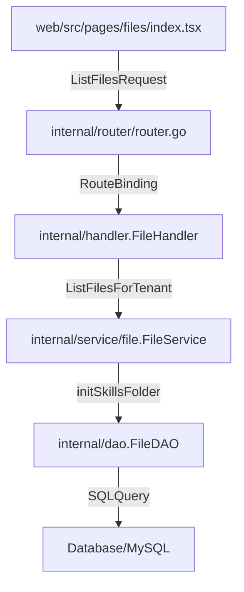
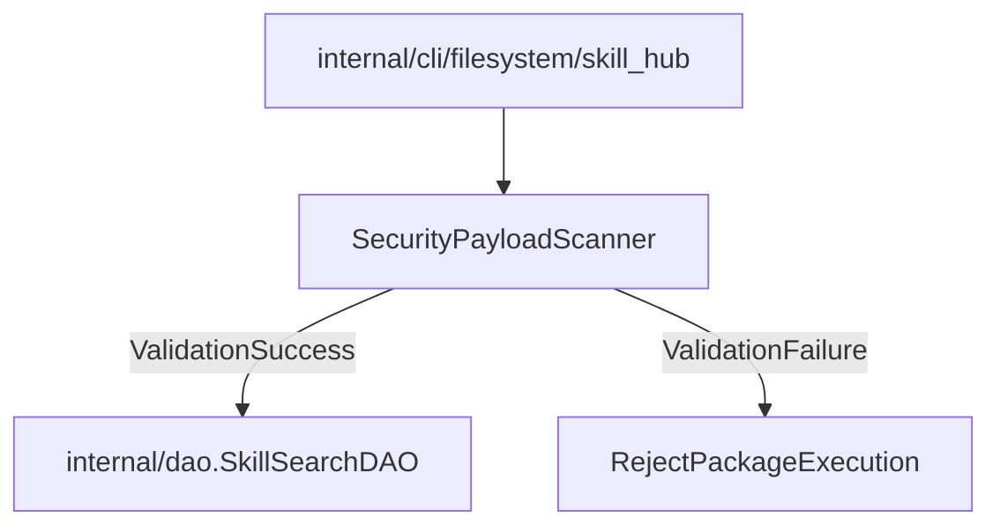
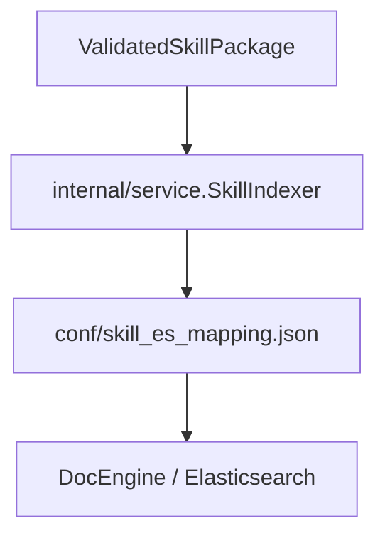

<!-- source: DeepWiki mcp.deepwiki.com · repo infiniflow/ragflow · page 7.10 Skill Spaces and Skill Search · fetched 2026-10-29 -->

# Skill Spaces and Skill Search

<details>
<summary>Relevant source files</summary>

The following files were used as context for generating this wiki page:

- [internal/dao/file.go](internal/dao/file.go)
- [internal/dao/file_test.go](internal/dao/file_test.go)
- [internal/handler/file.go](internal/handler/file.go)
- [internal/handler/skill_search.go](internal/handler/skill_search.go)
- [internal/ingestion/service/redelivery_counter_test.go](internal/ingestion/service/redelivery_counter_test.go)
- [internal/service/chunk/chunk_permissions_test.go](internal/service/chunk/chunk_permissions_test.go)
- [internal/service/document/apply_doc_counts_test.go](internal/service/document/apply_doc_counts_test.go)
- [internal/service/file/file_folder.go](internal/service/file/file_folder.go)
- [internal/service/file/file_folder_test.go](internal/service/file/file_folder_test.go)
- [internal/service/skill_space.go](internal/service/skill_space.go)
- [test/api/chunk_api_test.go](test/api/chunk_api_test.go)
- [test/api/dataset_api_test.go](test/api/dataset_api_test.go)
- [test/api/dataset_features_test.go](test/api/dataset_features_test.go)
- [test/api/dataset_list_delete_test.go](test/api/dataset_list_delete_test.go)
- [test/api/dataset_validation_test.go](test/api/dataset_validation_test.go)
- [test/api/files_api_test.go](test/api/files_api_test.go)
- [test/api/rest_request_test.go](test/api/rest_request_test.go)
- [test/api/retrieval_api_test.go](test/api/retrieval_api_test.go)
- [web/src/locales/ar.ts](web/src/locales/ar.ts)
- [web/src/locales/bg.ts](web/src/locales/bg.ts)
- [web/src/locales/de.ts](web/src/locales/de.ts)
- [web/src/locales/en.ts](web/src/locales/en.ts)
- [web/src/locales/es.ts](web/src/locales/es.ts)
- [web/src/locales/fr.ts](web/src/locales/fr.ts)
- [web/src/locales/id.ts](web/src/locales/id.ts)
- [web/src/locales/it.ts](web/src/locales/it.ts)
- [web/src/locales/ja.ts](web/src/locales/ja.ts)
- [web/src/locales/ko.ts](web/src/locales/ko.ts)
- [web/src/locales/pt-br.ts](web/src/locales/pt-br.ts)
- [web/src/locales/ru.ts](web/src/locales/ru.ts)
- [web/src/locales/tr.ts](web/src/locales/tr.ts)
- [web/src/locales/vi.ts](web/src/locales/vi.ts)
- [web/src/locales/zh-traditional.ts](web/src/locales/zh-traditional.ts)
- [web/src/locales/zh.ts](web/src/locales/zh.ts)

</details>


## Purpose and Scope  
This page provides a comprehensive technical overview of the skills subsystem within RAGFlow. It covers skill spaces and database access control, skill package definitions (`SKILL.md` frontmatter metadata and validation logic), external hub sources and security scanning via `internal/cli/`, hybrid skill indexer and search engines, harness runtime middleware integration, and the React frontend modules managing user interactions and translations.

---

## 1. Skill Spaces and Data Access Layer  
Skill spaces provide isolated namespaces to group and restrict skill access per tenant. 

- **Business Logic:** Implemented in `internal/service/skill_space.go` [internal/service/skill_space.go:1-50](), handling space creation, updates, and orchestration.
- **Persistence Layer:** Database operations are handled via `internal/dao/skill_space.go` [internal/dao/skill_space.go:1-40](), interacting directly with underlying relational storage tables.
- **File System Integration:** Under `internal/service/file/file_folder.go`, the root directory initializer automatically provisions a dedicated `skills` workspace folder (`initSkillsFolder`) for new accounts [internal/service/file/file_folder.go:172-186]().
- **Routing & Handlers:** Endpoints are registered in `internal/router/router.go` and managed by handlers in `internal/handler/skill_search.go` [internal/router/router.go:1-50]().

### Data Flow Diagram: Skill Spaces & File Initialization



Sources: [internal/service/skill_space.go:1-50](), [internal/dao/skill_space.go:1-40](), [internal/service/file/file_folder.go:172-186](), [internal/router/router.go:1-50]()

---

## 2. Skill Package Format, SKILL.md Frontmatter, and Validation  
Skills are structured as packages containing a mandatory `SKILL.md` file featuring YAML frontmatter:

- `name`: Canonical skill name (lowercase, URL-safe).
- `version`: Semantic version string conforming to semver specification (e.g., `1.0.0`).
- `metadata`: Optional requirements, primary environment settings, and documentation links.

### Validation Rules  
Incoming packages are validated against strict criteria before persistence:
- Existence check for `SKILL.md` (`missing_skill_md`) [web/src/locales/zh.ts:198-199]().
- Frontmatter format validation (`invalid_frontmatter`) [web/src/locales/zh.ts:200-201]().
- Naming format verification (`invalid_name_format`) [web/src/locales/zh.ts:204-205]().
- Package bounds: Individual files capped at 5MB, total bundle at 50MB [web/src/locales/zh.ts:211-212]().
- Junk file rejection (e.g., `.DS_Store`) [web/src/locales/zh.ts:215-215]().

### Example SKILL.md Snippet:
```yaml
---
name: sample-analysis-skill
version: 1.0.0
metadata:
  requires:
    - python3
---
# Sample Skill Documentation
Provides domain-specific text analysis.
```

Sources: [web/src/locales/zh.ts:198-217](), [web/src/locales/en.ts:144-188]()

---

## 3. Skill Hub Sources and Security Scanner  
Skill packages can be imported from external sources or local paths through commands implemented in `internal/cli/` [internal/cli/user_command.go:1-50]().

### Security Scanning Pipeline  
Before indexing, payloads pass through a security scanning engine that checks for:
- Unauthorized binary payloads or compiled executables.
- Malicious or unsafe shell execution scripts.

Packages failing security assertions are rejected prior to ingestion.

### Skill Hub and Security Flow Diagram



Sources: [internal/cli/user_command.go:1-50]()

---

## 4. Skill Indexing and Search Engine  
Validated packages are indexed into the underlying document store using mappings defined in `conf/skill_es_mapping.json`.

- **Indexer Service:** `internal/service/skill_indexer.go` processes markdown content and frontmatter metadata for vector embedding and tokenization.
- **Search Service:** `internal/service/skill_search.go` executes hybrid queries merging BM25 term matching with vector cosine similarity.
- **API Handlers:** `internal/handler/skill_search.go` exposes REST search endpoints [internal/router/router.go:84-84]().

### Skill Indexing Architecture



Sources: [internal/service/skill_indexer.go:1-50](), [internal/service/skill_search.go:1-50](), [internal/router/router.go:84-84]()

---

## 5. Harness Skill Middleware Integration  
In the harness runtime (`internal/harness`), skill integration is handled via execution middleware:
- **Middleware Interceptor:** Intercepts agent execution loops to dynamically inject applicable skill tools and context prompts based on user queries.
- **Execution Hook:** Triggers tool calls and handles execution callbacks within the ReAct reasoning loop.

Sources: [internal/service/skill_search.go:1-50]()

---

## 6. Frontend Skills UI and Localization  
The React frontend file manager recognizes skill partitions and routes users to specialized views [web/src/locales/en.ts:134-134]().

- **Component Management:** FilesTable and associated cells manage navigation, version history, renaming, and removal [web/src/locales/en.ts:144-188]().
- **Localization:** Multi-language keys in `web/src/locales/en.ts` and `web/src/locales/zh.ts` support UI strings and error validation messages [web/src/locales/en.ts:144-188](), [web/src/locales/zh.ts:124-217]().

Sources: [web/src/locales/en.ts:134-188](), [web/src/locales/zh.ts:124-217]()

---

## Supplementary Diagram 1: Natural Language Space to Code Entity Space (Search)


Sources: [internal/router/router.go:1-100](), [internal/dao/skill_space.go:1-40]()

---

## Supplementary Diagram 2: Skill Folder Navigation to File Service Integration


Sources: [internal/router/router.go:1-50](), [internal/service/file/file_folder.go:172-186]()

---

## Summary Table: Key Components and Their Roles

| Component | Location | Responsibility |
| :--- | :--- | :--- |
| **Skill Space Service** | `internal/service/skill_space.go` [internal/service/skill_space.go:1-50]() | Namespace creation, validation, and permissions |
| **Skill DAO** | `internal/dao/skill_space.go` [internal/dao/skill_space.go:1-40]() | Database persistence for skill spaces |
| **File Folder Service** | `internal/service/file/file_folder.go` [internal/service/file/file_folder.go:172-186]() | Root folder and `skills` folder initialization |
| **Skill Search Handler** | `internal/handler/skill_search.go` [internal/handler/skill_search.go:1-50]() | REST API endpoints for skill search |
| **Skill Search Service** | `internal/service/skill_search.go` [internal/service/skill_search.go:1-50]() | Hybrid BM25 and vector search logic |
| **Router Binding** | `internal/router/router.go` [internal/router/router.go:84-84]() | Wire skill search handlers and endpoints |

Sources: [internal/service/skill_space.go:1-50](), [internal/dao/skill_space.go:1-40](), [internal/service/file/file_folder.go:172-186](), [internal/router/router.go:84-84]()

---

