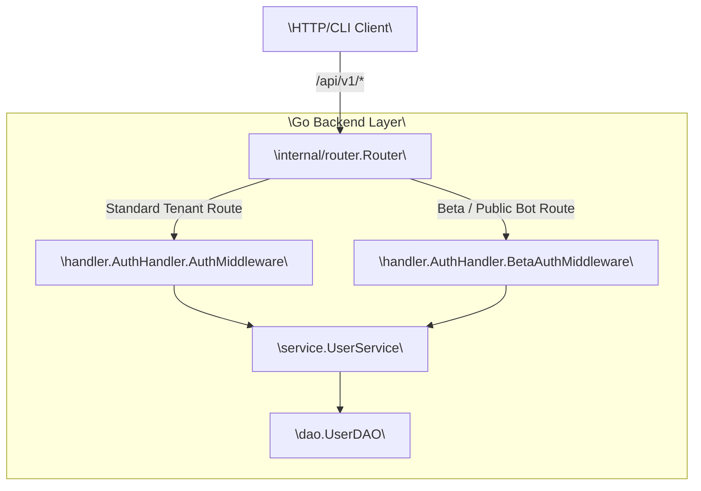
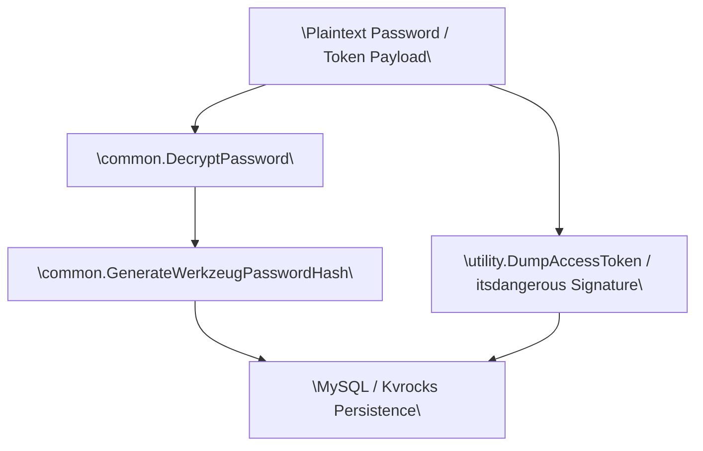

<!-- source: DeepWiki mcp.deepwiki.com · repo infiniflow/ragflow · page 7.2 Authentication and Authorization · fetched 2026-10-29 -->

# Authentication and Authorization

<details>
<summary>Relevant source files</summary>

The following files were used as context for generating this wiki page:

- [cmd/args_flag_test.go](cmd/args_flag_test.go)
- [cmd/deepdoc_server_ee.go](cmd/deepdoc_server_ee.go)
- [cmd/ragflow_server.go](cmd/ragflow_server.go)
- [cmd/ragflow_server_deepdoc_test.go](cmd/ragflow_server_deepdoc_test.go)
- [cmd/ragflow_server_test.go](cmd/ragflow_server_test.go)
- [conf/service_conf.yaml](conf/service_conf.yaml)
- [docker/service_conf.yaml.template](docker/service_conf.yaml.template)
- [internal/dao/tenant_model_group_ee.go](internal/dao/tenant_model_group_ee.go)
- [internal/handler/auth.go](internal/handler/auth.go)
- [internal/handler/providers_ee.go](internal/handler/providers_ee.go)
- [internal/handler/system.go](internal/handler/system.go)
- [internal/handler/user.go](internal/handler/user.go)
- [internal/ingestion/component/vision_source_admission_test.go](internal/ingestion/component/vision_source_admission_test.go)
- [internal/ingestion/service/execute_memory_task_panic_test.go](internal/ingestion/service/execute_memory_task_panic_test.go)
- [internal/server/api/server.go](internal/server/api/server.go)
- [internal/server/bootstrap/args.go](internal/server/bootstrap/args.go)
- [internal/server/bootstrap/runtime.go](internal/server/bootstrap/runtime.go)
- [internal/server/config.go](internal/server/config.go)
- [internal/server/config/admin_config.go](internal/server/config/admin_config.go)
- [internal/server/config/api_server_config.go](internal/server/config/api_server_config.go)
- [internal/server/config/api_server_config_test.go](internal/server/config/api_server_config_test.go)
- [internal/server/config/ingestor_config.go](internal/server/config/ingestor_config.go)
- [internal/server/config/ingestor_config_test.go](internal/server/config/ingestor_config_test.go)
- [internal/server/config/log_config.go](internal/server/config/log_config.go)
- [internal/server/config_getallconfigs_test.go](internal/server/config_getallconfigs_test.go)
- [internal/server/deepdoc/server.go](internal/server/deepdoc/server.go)
- [internal/server/ingestor/server.go](internal/server/ingestor/server.go)
- [internal/server/local/admin_status.go](internal/server/local/admin_status.go)
- [internal/server/local/admin_status_ee.go](internal/server/local/admin_status_ee.go)
- [internal/server/syncer/server.go](internal/server/syncer/server.go)
- [internal/service/system.go](internal/service/system.go)
- [internal/service/user.go](internal/service/user.go)
- [web/src/constants/authorization.ts](web/src/constants/authorization.ts)
- [web/src/hooks/auth-hooks.ts](web/src/hooks/auth-hooks.ts)
- [web/src/hooks/use-login-request.ts](web/src/hooks/use-login-request.ts)
- [web/src/pages/admin/layouts/authorized-layout.tsx](web/src/pages/admin/layouts/authorized-layout.tsx)
- [web/src/pages/admin/layouts/navigation-layout.tsx](web/src/pages/admin/layouts/navigation-layout.tsx)
- [web/src/pages/admin/layouts/root-layout.tsx](web/src/pages/admin/layouts/root-layout.tsx)
- [web/src/pages/admin/login.tsx](web/src/pages/admin/login.tsx)
- [web/src/pages/home/agent-list.tsx](web/src/pages/home/agent-list.tsx)
- [web/src/pages/home/application-card.tsx](web/src/pages/home/application-card.tsx)
- [web/src/pages/home/chat-list.tsx](web/src/pages/home/chat-list.tsx)
- [web/src/pages/home/search-list.tsx](web/src/pages/home/search-list.tsx)
- [web/src/routes.tsx](web/src/routes.tsx)
- [web/src/services/admin-service.ts](web/src/services/admin-service.ts)
- [web/src/services/user-service.ts](web/src/services/user-service.ts)
- [web/src/utils/authorization-util.ts](web/src/utils/authorization-util.ts)

</details>


This page provides a comprehensive technical reference for RAGFlow's authentication and authorization subsystems. It details the implementation of Go-based middleware (`AuthMiddleware` and `BetaAuthMiddleware`), token resolution strategies supporting user access tokens, API keys, and beta tokens, cryptographic signing compatible with Python's `itsdangerous`, password hashing compatible with Werkzeug, and OAuth/cookie management bridging the backend and the React SPA.

Sources: 
[internal/handler/auth.go:32-184](), [internal/handler/user.go:48-70]()

---

## 1. Overview and Architecture

RAGFlow’s authentication architecture combines Gin-based HTTP middleware layers in the Go backend (`internal/handler`) with relational data persistence (`dao.UserDAO`) and caching/secret management layers (`kvrocks`).

The API routing system dispatches incoming requests through specific authentication gates depending on whether the route is part of the standard tenant API surface, public beta endpoints, or administrative routes.

The diagram below maps natural language architectural concepts to concrete Go code entities handling client requests:



Sources:  
[internal/handler/auth.go:32-184](), [internal/service/user.go:48-65]()

---

## 2. Go-Side Authentication Handlers and Middlewares

The backend implements distinct middleware strategies for standard tenant operations and public/beta endpoints.

### 2.1 `AuthMiddleware()`

`AuthMiddleware` (`[internal/handler/auth.go:129-174]()`) enforces strict token validation for standard tenant APIs. Its processing sequence includes:
- Extracting the token from the HTTP `Authorization` header (`[internal/handler/auth.go:134]()`).
- Attempting resolution via `userService.ResolveAccessToken` (`[internal/handler/auth.go:143]()`).
- Falling back to `userService.ResolveAPIToken` if access token resolution fails (`[internal/handler/auth.go:145]()`).
- Rejecting system superusers (`IsSuperuser`) from accessing tenant-scoped APIs with an HTTP 403 status (`[internal/handler/auth.go:154-158]()`).
- Verifying admin availability using local status checks (`[internal/handler/auth.go:160-167]()`).
- Injecting resolved identity fields (`user`, `user_id`, `tenant_id`, `email`) into the Gin `Context` and request context via `permission.WithSubject` (`[internal/handler/auth.go:169-184]()`).

### 2.2 `BetaAuthMiddleware()`

`BetaAuthMiddleware` (`[internal/handler/auth.go:84-127]`) provides a permissive authentication path for public chat bots, search bots, and beta interfaces:
- Checks the `Authorization` header, falling back to the `ragflow_auth` cookie if the header is absent (`[internal/handler/auth.go:87-92]()`).
- Evaluates token types in strict precedence order:
  1. User access token (`ResolveAccessToken`) (`[internal/handler/auth.go:101]()`)
  2. Regular API token (`ResolveAPIToken`) (`[internal/handler/auth.go:107]()`)
  3. Beta API token (`ResolveBetaAPIToken`) (`[internal/handler/auth.go:114]()`)
- Sets context flags (`auth_via_api_token`, `auth_via_beta_token`, `agent_id`) and proceeds via `c.Next()`, or aborts with code `102` ("Authorization is not valid!") (`[internal/handler/auth.go:109-126]()`).

### 2.3 MCP User Resolution (`ResolveMCPUser`)

For standalone Model Context Protocol (MCP) transport layers, `ResolveMCPUser` evaluates tokens using the same priority logic without requiring Gin middleware wiring (`[internal/handler/auth.go:39-53]()`).

### Authentication Middleware Decision Flow

```mermaid
graph TD
    Req["\"HTTP Request\""]
    CheckAuth{"\"Authorization Header Present?\""}
    CookieFallback{"\"Fallback to ragflow_auth Cookie?\""}
    ResolveAccess["\"userService.ResolveAccessToken\""]
    ResolveAPI["\"userService.ResolveAPIToken\""]
    ResolveBeta["\"userService.ResolveBetaAPIToken\""]
    Success["\"Set Subject in Context & c.Next()\""]
    Reject["\"Abort Request / Return 401 or Code 102\""]

    Req --> CheckAuth
    CheckAuth -- Yes --> ResolveAccess
    CheckAuth -- No --> CookieFallback
    CookieFallback -- Found --> ResolveAccess
    CookieFallback -- Missing --> Reject
    
    ResolveAccess -- Success --> Success
    ResolveAccess -- Fail --> ResolveAPI
    ResolveAPI -- Success --> Success
    ResolveAPI -- Fail --> ResolveBeta
    ResolveBeta -- Success --> Success
    ResolveBeta -- Fail --> Reject
```

Sources:  
[internal/handler/auth.go:32-184]()

---

## 3. Token Types and Resolution Lifecycle

RAGFlow manages several token categories to support interactive web clients, programmatic SDKs, and embedded public agents.

### Summary of Token Resolvers

| Token Type | Resolution Method | Target Entity / Role | File & Line Range |
|------------|-------------------|----------------------|-------------------|
| **User Access Token** | `userService.ResolveAccessToken` | Standard logged-in user session | [internal/handler/auth.go:43-45]() |
| **API Token** | `userService.ResolveAPIToken` | Developer or tenant API key | [internal/handler/auth.go:46-48]() |
| **Beta API Token** | `userService.ResolveBetaAPIToken` | Public chatbot / widget integration | [internal/handler/auth.go:49-51]() |

Sources:  
[internal/handler/auth.go:39-53]()

---

## 4. Cryptographic Operations and Password Security

### 4.1 Werkzeug-Compatible Password Hashing

During user registration and password updates, RAGFlow processes plaintext passwords securely:
- Incoming passwords are decrypted via `common.DecryptPassword` (`[internal/service/user.go:132-135]()`).
- Hashing is performed via `common.GenerateWerkzeugPasswordHash`, ensuring structural and algorithmic compatibility with Python Werkzeug password verification hashes (`[internal/service/user.go:137-141]()`).

### 4.2 Itsdangerous-Compatible Signing

Access tokens and session payloads are cryptographically signed using secret keys retrieved from the Kvrocks caching engine (`server.GetSecretKey`) (`[internal/handler/user.go:97-106]()`), maintaining compatibility with Python `itsdangerous` sign/unsign serialization.



Sources:  
[internal/service/user.go:132-141](), [internal/handler/user.go:97-106]()

---

## 5. OAuth Callbacks and Frontend Credential Management

To support single-sign-on (SSO) and OAuth authentication flows, the backend sets an auth cookie upon successful login or registration.

### 5.1 OAuth Cookie Handling

- The constant `authCookie` (`ragflow_auth`) stores the signed access token (`[internal/handler/user.go:52-53]()`).
- `setAuthCookie` issues the cookie with `HttpOnly: false`, allowing the Single Page Application (SPA) JavaScript layer to read it and populate authorization headers (`[internal/handler/user.go:57-70]()`).

### 5.2 Frontend Token Consumption

- The React hook inspects URL search parameters for an `auth` token, saves it via authorization utility functions, and navigates to the application root (`[web/src/utils/authorization-util.ts:95-100]()`).
- `authorizationUtil` manages credential persistence across `localStorage` keys for users and administrators (`[web/src/utils/authorization-util.ts:52-69]()`).

Sources:  
[internal/handler/user.go:48-70](), [web/src/utils/authorization-util.ts:52-100]()

---

## Summary Table of Authentication Entities

| Name | Package / File | Purpose / Description |
| :--- | :--- | :--- |
| `AuthHandler.AuthMiddleware` | `internal/handler/auth.go` | Middleware enforcing strict JWT/API key authentication |
| `AuthHandler.BetaAuthMiddleware` | `internal/handler/auth.go` | Permissive middleware supporting beta and public tokens |
| `AuthHandler.ResolveMCPUser` | `internal/handler/auth.go` | Direct user token resolution for MCP server transport |
| `setAuthCookie` | `internal/handler/user.go` | Sets the `ragflow_auth` cookie for SPA OAuth handoff |
| `UserService.Register` | `internal/service/user.go` | User registration with Werkzeug password hashing |

Sources:  
[internal/handler/auth.go:32-184](), [internal/handler/user.go:48-70](), [internal/service/user.go:113-141]()

---

