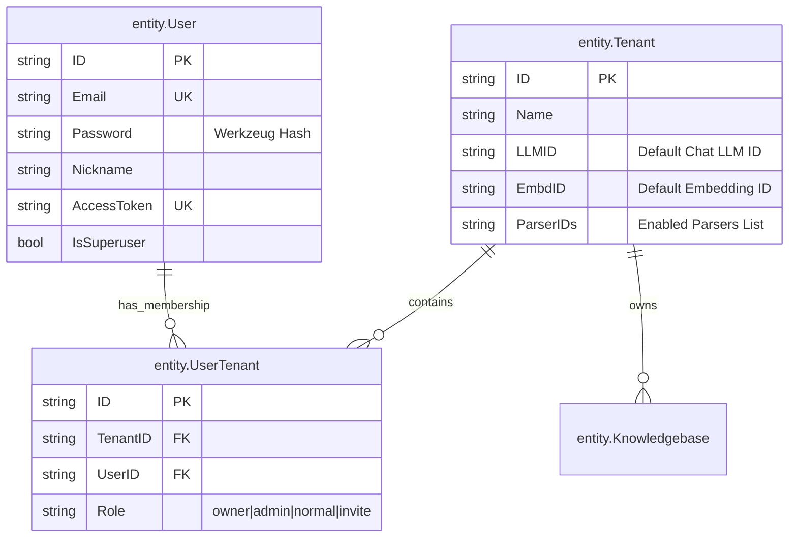
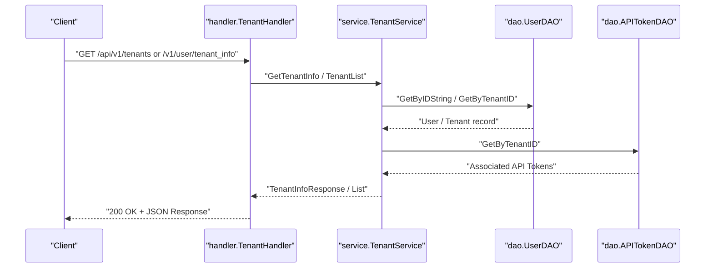
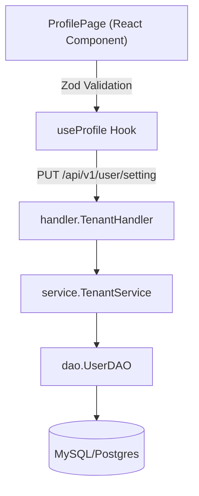
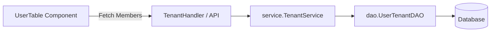
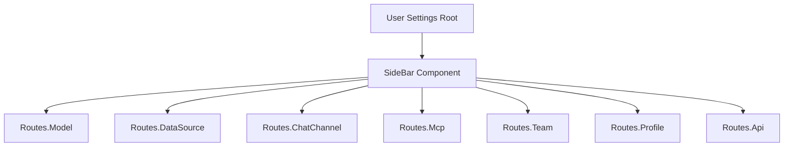

<!-- source: DeepWiki mcp.deepwiki.com · repo infiniflow/ragflow · page 7.3 User and Tenant Management · fetched 2026-10-29 -->

# User and Tenant Management

Relevant source files

The following files were used as context for generating this wiki page:

- [internal/dao/api_token.go](internal/dao/api_token.go)
- [internal/dao/api_token_beta_test.go](internal/dao/api_token_beta_test.go)
- [internal/dao/search_detail_test.go](internal/dao/search_detail_test.go)
- [internal/dao/task.go](internal/dao/task.go)
- [internal/dao/tenant.go](internal/dao/tenant.go)
- [internal/dao/user.go](internal/dao/user.go)
- [internal/dao/user_tenant.go](internal/dao/user_tenant.go)
- [internal/entity/types.go](internal/entity/types.go)
- [internal/handler/searchbot_detail_test.go](internal/handler/searchbot_detail_test.go)
- [internal/handler/tenant.go](internal/handler/tenant.go)
- [internal/service/search_share_detail_test.go](internal/service/search_share_detail_test.go)
- [internal/service/tenant.go](internal/service/tenant.go)
- [internal/service/tenant_test.go](internal/service/tenant_test.go)
- [internal/service/user_beta_test.go](internal/service/user_beta_test.go)
- [web/src/components/search-highlight.tsx](web/src/components/search-highlight.tsx)
- [web/src/pages/user-setting/index.tsx](web/src/pages/user-setting/index.tsx)
- [web/src/pages/user-setting/mcp/index.tsx](web/src/pages/user-setting/mcp/index.tsx)
- [web/src/pages/user-setting/mcp/use-bulk-operate-mcp.tsx](web/src/pages/user-setting/mcp/use-bulk-operate-mcp.tsx)
- [web/src/pages/user-setting/mcp/use-import-mcp.ts](web/src/pages/user-setting/mcp/use-import-mcp.ts)
- [web/src/pages/user-setting/profile/hooks/use-profile.ts](web/src/pages/user-setting/profile/hooks/use-profile.ts)
- [web/src/pages/user-setting/profile/index.tsx](web/src/pages/user-setting/profile/index.tsx)
- [web/src/pages/user-setting/setting-team/add-user-modal.tsx](web/src/pages/user-setting/setting-team/add-user-modal.tsx)
- [web/src/pages/user-setting/setting-team/hooks.ts](web/src/pages/user-setting/setting-team/hooks.ts)
- [web/src/pages/user-setting/setting-team/index.tsx](web/src/pages/user-setting/setting-team/index.tsx)
- [web/src/pages/user-setting/setting-team/tenant-table.tsx](web/src/pages/user-setting/setting-team/tenant-table.tsx)
- [web/src/pages/user-setting/setting-team/user-table.tsx](web/src/pages/user-setting/setting-team/user-table.tsx)
- [web/src/pages/user-setting/sidebar/index.tsx](web/src/pages/user-setting/sidebar/index.tsx)

This page documents the technical implementation of RAGFlow's user and tenant management system. It covers user registration, login authentication, profile and settings management, password handling with OTP capabilities, team membership and invitations, tenant-scoped defaults, and the React frontend state and routing structures supporting these features.

---

## 1. Multi-Tenant Architecture and Entity Relationships

RAGFlow enforces strict multi-tenant workspace isolation. Each user can belong to multiple tenants, and all significant resources (such as knowledge bases, documents, files, and chat sessions) are scoped exclusively to a tenant identifier (`tenant_id`).

- **User (`entity.User`)**: Stores individual user authentication credentials, access tokens, and profile attributes [internal/dao/user.go]().
- **Tenant (`entity.Tenant`)**: Represents an isolated workspace containing tenant-scoped defaults for LLMs, embeddings, and parser configurations [internal/service/tenant.go:121-157]().
- **UserTenant (`entity.UserTenant`)**: Join table tracking user membership within a tenant, defining roles such as `owner`, `admin`, `normal`, and `invite` [internal/dao/user_tenant.go:29-50]().

Sources: [internal/dao/user.go](), [internal/service/tenant.go:121-157](), [internal/dao/user_tenant.go:29-50]()

---

## 2. User Registration, Authentication, and Session Lifecycle

User registration and authentication are coordinated via the REST API endpoints implemented in `handler.TenantHandler` [internal/handler/tenant.go:38-52]() and persistence data access objects like `dao.UserDAO` [internal/dao/user.go:26-32]() and `dao.APITokenDAO` [internal/dao/api_token.go:26-32]().

### Registration and Authentication Flow

1. Incoming requests are processed through routing handlers.
2. `dao.UserDAO` queries user entities by email, string ID, or access tokens [internal/dao/user.go:50-124]().
3. Password verification relies on compatible hashing schemes (such as Werkzeug-compatible hashes).
4. Access tokens and API keys are stored and retrieved via `dao.APITokenDAO` to support both standard bearer tokens and SDK/bot authorization (`beta` tokens) [internal/dao/api_token.go:34-66]().

Sources: [internal/handler/tenant.go:135-179](), [internal/dao/user.go:50-124](), [internal/dao/api_token.go:34-66]()

---

## 3. User Profile and Settings Management

Authenticated users can manage their profile settings (nickname, avatar, language, color schema, timezone, and password updates) through dedicated user interface components and service calls [web/src/pages/user-setting/profile/index.tsx:107-166]().

- **Profile Updates**: Handled in the frontend via `ProfilePage` [web/src/pages/user-setting/profile/index.tsx:107]() using Zod validation schemas for input sanitization (`baseSchema`, `nameSchema`, `passwordSchema`) enforcing constraints such as `NICKNAME_MAX_LENGTH` and regex matching.
- **Settings State**: Managed via React hooks (`useProfile`) which interface with backend profile updating routines [web/src/pages/user-setting/profile/hooks/use-profile.ts]().

Sources: [web/src/pages/user-setting/profile/index.tsx:38-125](), [web/src/pages/user-setting/profile/hooks/use-profile.ts](), [internal/dao/user.go:125-134]()

---

## 4. Team Membership, Invitations, and Role Administration

Team management enables users to collaborate within a tenant workspace. Membership roles (`owner`, `admin`, `normal`, `invite`) are regulated via `TenantService` and stored in `entity.UserTenant`.

- **Listing Team Users**: The `UserTable` component renders tenant members by consuming `useListTenantUser` queries with sorting and search capabilities [web/src/pages/user-setting/setting-team/user-table.tsx:51-90]().
- **Role Administration**: Members can be added or removed through admin flows, with permission checks enforced via `tenantMemberPermission` [internal/service/tenant.go:55-76]() and transactional validation.
- **Unit Testing Security Checks**: Authorization logic is tested thoroughly in `TestListMembersAuthCheck`, `TestAddMemberAuthCheck`, and `TestRemoveMemberSelfAllowed` to guarantee role separation [internal/service/tenant_test.go:61-142]().

Sources: [internal/service/tenant.go:35-119](), [web/src/pages/user-setting/setting-team/user-table.tsx:33-90](), [internal/service/tenant_test.go:61-174]()

---

## 5. Tenant-Scoped Defaults and Model Configurations

Tenants maintain isolated configuration defaults, such as default model instances for chat, embeddings, reranking, ASR, OCR, and document parser pipelines [internal/service/tenant.go:121-157]().

- **Default Models**: Managed via `TenantHandler.GetDefaultModels` and `SetDefaultModels` [internal/handler/tenant.go:54-126](). Requests parse model providers, instances, names, and types to configure isolated tenant behavior.
- **Parser Settings**: Stored in `Tenant.ParserIDs` as a comma-separated list of enabled ingestion parsers returned via `TenantInfoResponse` [internal/service/tenant.go:121-157]().

Sources: [internal/service/tenant.go:121-192](), [internal/handler/tenant.go:54-126]()

---

## 6. Frontend Routing and User Setting Navigation

The React SPA defines user and tenant management routes within the central configuration. The user settings module uses a sidebar layout (`SideBar`) to switch between profile settings, team management, model configurations, API keys, MCP server settings, and chat channels [web/src/pages/user-setting/sidebar/index.tsx:43-160]().

- **MCP Integration Settings**: Users can configure Model Context Protocol (MCP) servers under user settings (`McpServer` component) [web/src/pages/user-setting/mcp/index.tsx:50-98]() alongside team management (`UserTable`) [web/src/pages/user-setting/setting-team/user-table.tsx:51-100]().

Sources: [web/src/pages/user-setting/sidebar/index.tsx:43-160](), [web/src/pages/user-setting/mcp/index.tsx:50-98](), [web/src/pages/user-setting/setting-team/user-table.tsx:51-100]()

---

## References

- Tenant service business logic and permission checks: [internal/service/tenant.go:35-192]()
- Tenant REST handlers and default model binding: [internal/handler/tenant.go:38-179]()
- User Data Access Object implementation: [internal/dao/user.go:26-172]()
- UserTenant Data Access Object implementation: [internal/dao/user_tenant.go:29-180]()
- API Token and Beta Token persistence: [internal/dao/api_token.go:26-80]()
- Tenant permission unit tests: [internal/service/tenant_test.go:35-174]()
- Frontend profile page and Zod validation: [web/src/pages/user-setting/profile/index.tsx:38-125]()
- Frontend team user table and role badges: [web/src/pages/user-setting/setting-team/user-table.tsx:33-100]()
- Frontend user setting sidebar navigation: [web/src/pages/user-setting/sidebar/index.tsx:43-160]()

---

