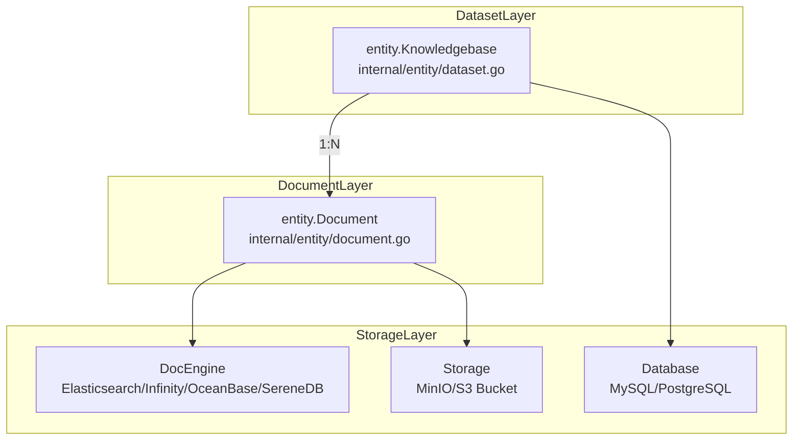
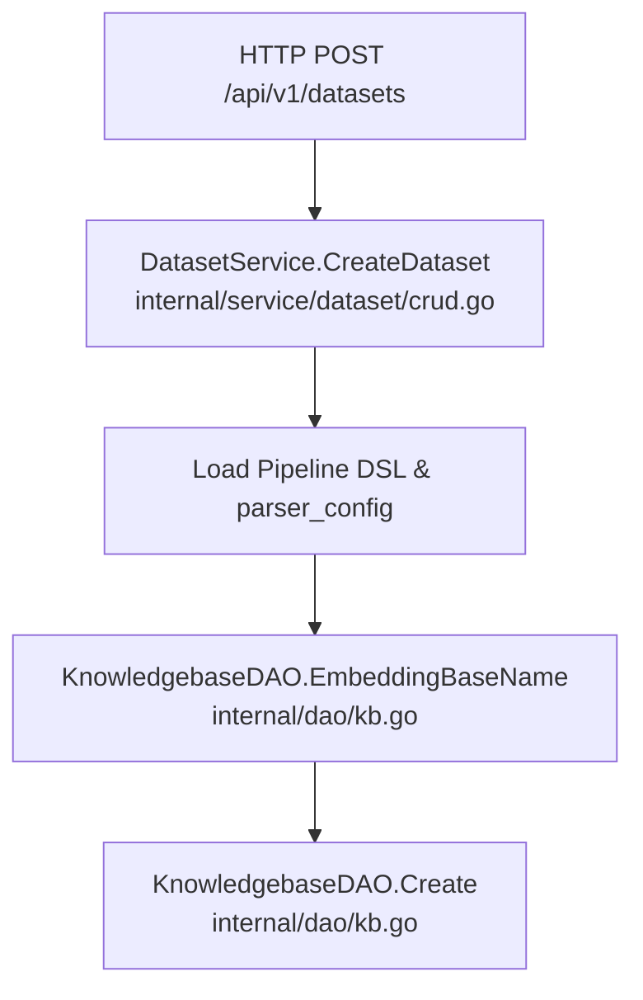
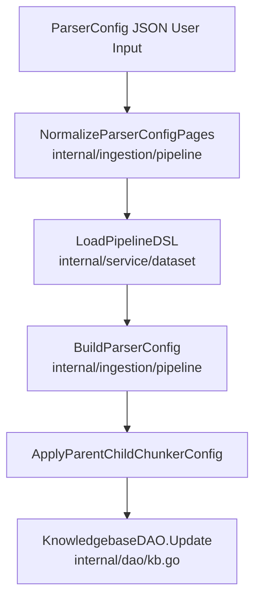
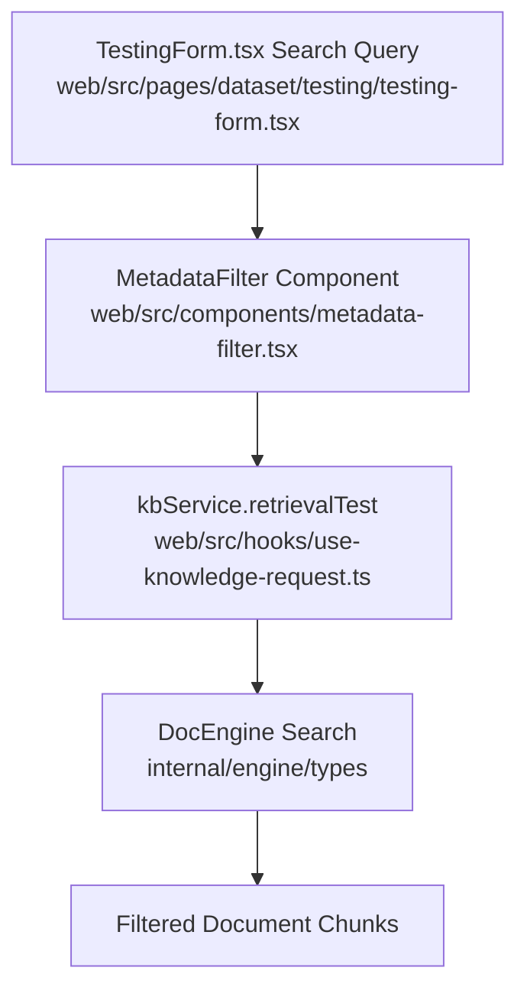
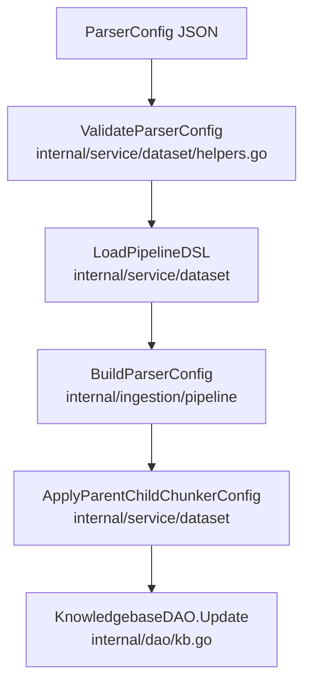

<!-- source: DeepWiki mcp.deepwiki.com · repo infiniflow/ragflow · page 7.4 Dataset and Knowledge Base APIs · fetched 2026-10-29 -->

# Dataset and Knowledge Base APIs

Relevant source files

The following files were used as context for generating this wiki page:

- [internal/dao/kb.go](internal/dao/kb.go)
- [internal/entity/dataset.go](internal/entity/dataset.go)
- [internal/ingestion/pipeline/pipeline_params.go](internal/ingestion/pipeline/pipeline_params.go)
- [internal/ingestion/pipeline/pipeline_params_test.go](internal/ingestion/pipeline/pipeline_params_test.go)
- [internal/service/dataset/create_test.go](internal/service/dataset/create_test.go)
- [internal/service/dataset/crud.go](internal/service/dataset/crud.go)
- [internal/service/dataset/helpers.go](internal/service/dataset/helpers.go)
- [internal/service/dataset/helpers_test.go](internal/service/dataset/helpers_test.go)
- [internal/service/dataset/setup_test.go](internal/service/dataset/setup_test.go)
- [internal/service/dataset/update.go](internal/service/dataset/update.go)
- [internal/service/dataset/update_test.go](internal/service/dataset/update_test.go)
- [internal/service/dataset/utils.go](internal/service/dataset/utils.go)
- [internal/service/document/document.go](internal/service/document/document.go)
- [internal/service/document/document_crud.go](internal/service/document/document_crud.go)
- [internal/service/document/document_dataset_update.go](internal/service/document/document_dataset_update.go)
- [internal/service/document/document_dataset_update_test.go](internal/service/document/document_dataset_update_test.go)
- [internal/service/document/document_ingest.go](internal/service/document/document_ingest.go)
- [internal/service/document/document_modify_guard_test.go](internal/service/document/document_modify_guard_test.go)
- [internal/service/document/document_parse.go](internal/service/document/document_parse.go)
- [internal/service/document/document_parser_selection.go](internal/service/document/document_parser_selection.go)
- [internal/service/document/document_parser_selection_test.go](internal/service/document/document_parser_selection_test.go)
- [internal/service/document/document_test.go](internal/service/document/document_test.go)
- [internal/service/document/document_upload.go](internal/service/document/document_upload.go)
- [internal/service/document/file2document.go](internal/service/document/file2document.go)
- [internal/service/document/sync_document.go](internal/service/document/sync_document.go)
- [web/src/components/knowledge-base-item.tsx](web/src/components/knowledge-base-item.tsx)
- [web/src/components/list-filter-bar/filter-field.tsx](web/src/components/list-filter-bar/filter-field.tsx)
- [web/src/components/list-filter-bar/filter-popover.tsx](web/src/components/list-filter-bar/filter-popover.tsx)
- [web/src/components/list-filter-bar/index.tsx](web/src/components/list-filter-bar/index.tsx)
- [web/src/components/list-filter-bar/interface.ts](web/src/components/list-filter-bar/interface.ts)
- [web/src/components/top-select.tsx](web/src/components/top-select.tsx)
- [web/src/components/ui/__tests__/multi-select.test.tsx](web/src/components/ui/__tests__/multi-select.test.tsx)
- [web/src/components/ui/multi-select.tsx](web/src/components/ui/multi-select.tsx)
- [web/src/components/ui/popover.tsx](web/src/components/ui/popover.tsx)
- [web/src/components/ui/time-picker.tsx](web/src/components/ui/time-picker.tsx)
- [web/src/hooks/use-knowledge-request.ts](web/src/hooks/use-knowledge-request.ts)
- [web/src/interfaces/request/knowledge.ts](web/src/interfaces/request/knowledge.ts)
- [web/src/pages/dataset/components/metedata/hooks/use-manage-modal.ts](web/src/pages/dataset/components/metedata/hooks/use-manage-modal.ts)
- [web/src/pages/dataset/components/metedata/hooks/use-manage-values-modal.ts](web/src/pages/dataset/components/metedata/hooks/use-manage-values-modal.ts)
- [web/src/pages/dataset/components/metedata/interface.ts](web/src/pages/dataset/components/metedata/interface.ts)
- [web/src/pages/dataset/components/metedata/manage-modal-column.tsx](web/src/pages/dataset/components/metedata/manage-modal-column.tsx)
- [web/src/pages/dataset/components/metedata/manage-modal.tsx](web/src/pages/dataset/components/metedata/manage-modal.tsx)
- [web/src/pages/dataset/components/metedata/manage-values-modal.tsx](web/src/pages/dataset/components/metedata/manage-values-modal.tsx)
- [web/src/pages/dataset/dataset/use-select-filters.ts](web/src/pages/dataset/dataset/use-select-filters.ts)
- [web/src/pages/dataset/index.tsx](web/src/pages/dataset/index.tsx)
- [web/src/pages/dataset/setting/category-panel.tsx](web/src/pages/dataset/setting/category-panel.tsx)
- [web/src/pages/dataset/setting/chunk-method-learn-more.tsx](web/src/pages/dataset/setting/chunk-method-learn-more.tsx)
- [web/src/pages/dataset/setting/components/added-source-card.tsx](web/src/pages/dataset/setting/components/added-source-card.tsx)
- [web/src/pages/dataset/setting/components/link-data-source-modal.tsx](web/src/pages/dataset/setting/components/link-data-source-modal.tsx)
- [web/src/pages/dataset/setting/components/link-data-source.tsx](web/src/pages/dataset/setting/components/link-data-source.tsx)
- [web/src/pages/dataset/setting/embedding-model-form-field.tsx](web/src/pages/dataset/setting/embedding-model-form-field.tsx)
- [web/src/pages/dataset/setting/form-schema.ts](web/src/pages/dataset/setting/form-schema.ts)
- [web/src/pages/dataset/setting/general-form.tsx](web/src/pages/dataset/setting/general-form.tsx)
- [web/src/pages/dataset/setting/hooks.test.tsx](web/src/pages/dataset/setting/hooks.test.tsx)
- [web/src/pages/dataset/setting/hooks.ts](web/src/pages/dataset/setting/hooks.ts)
- [web/src/pages/dataset/setting/index.tsx](web/src/pages/dataset/setting/index.tsx)
- [web/src/pages/dataset/setting/permission-form-field.tsx](web/src/pages/dataset/setting/permission-form-field.tsx)
- [web/src/pages/dataset/sidebar/index.tsx](web/src/pages/dataset/sidebar/index.tsx)
- [web/src/pages/dataset/testing/index.tsx](web/src/pages/dataset/testing/index.tsx)
- [web/src/pages/dataset/testing/testing-form.tsx](web/src/pages/dataset/testing/testing-form.tsx)
- [web/src/pages/dataset/testing/testing-result.tsx](web/src/pages/dataset/testing/testing-result.tsx)
- [web/src/pages/datasets/dataset-creating-dialog.tsx](web/src/pages/datasets/dataset-creating-dialog.tsx)
- [web/src/pages/datasets/hooks.ts](web/src/pages/datasets/hooks.ts)
- [web/src/pages/files/link-to-dataset-dialog.tsx](web/src/pages/files/link-to-dataset-dialog.tsx)

## Purpose and Scope

This page provides an in-depth technical overview of the Dataset and Knowledge Base APIs in RAGFlow. These APIs manage dataset lifecycle (CRUD), parser and pipeline configurations, metadata extraction settings, tag management, search endpoints, and knowledge artifacts. Additionally, frontend integration flows with React components and hooks are explained. Datasets encapsulate document ingestion logic and knowledge base abstraction, supporting embedding model consistency, parsing pipeline selection, and advanced knowledge compilation workflows.

Sources: [internal/service/dataset/crud.go:23-211](), [web/src/hooks/use-knowledge-request.ts:92-118]()

---

## Dataset Resource Model

Datasets are modeled around the `Knowledgebase` entity (`internal/entity/dataset.go`), supplemented by documents and chunk stores distributed across various storage backends.

Key dataset properties:
- **Identity and ownership:** `ID`, `Name`, `TenantID`, `CreatedBy`, `Avatar`.
- **Parsing mode:** Either built-in parsers (`ParserID`) or custom ingestion pipelines (`PipelineID`), with structured JSON `ParserConfig`.
- **Embedding models:** `EmbdID` and optional `TenantEmbdID` resolve to tenant-specific embeddings for retrieval consistency.
- **Access control:** Permissions scoped as "me" (personal) or "team" (shared).
- **Status and task tracking:** Track ingestion tasks and advanced feature runs like GraphRAG and RAPTOR with associated task IDs and status timestamps.

The dataset abstracts SQL metadata with connection to distributed document engines (`Elasticsearch`, `Infinity`, `OceanBase`, `SereneDB`) and object storage (`MinIO`/`S3`).

Sources: [internal/entity/dataset.go:1-75](), [internal/dao/kb.go:1-186]()

---

## Core Dataset CRUD Operations (Go Implementation)

The `DatasetService` implements essential dataset management operations through carefully validated business logic.

### Create Dataset

- **Validation:** Checks tenant and user identity, dataset name (non-empty, length capped), and embedding model format.
- **Parsing mode:** Enforces explicit parse type (`BuiltIn` or `Pipeline`) with mutually exclusive `ParserID` and `PipelineID`.
- **Embedding model resolution:** Verifies availability, normalizes to tenant embedding ID if applicable.
- **Parser config:** Loads and merges pipeline DSL defaults with user-provided parser configs, scoped distinctly to components.
- **Parent-child chunking:** Applies chunker parent-child delimiter settings consistently.
- **Access checks:** Ensures canvas access is authorized for ingestion pipelines.
- **Persistence:** Writes the `Knowledgebase` entity to database with status `valid`.

Sources: [internal/service/dataset/crud.go:23-211](), [internal/dao/kb.go:111-132]()

### Update Dataset

- Supports updates to mutable fields like `Name`, `Description`, `EmbeddingModel`, `ParserConfig`, permission scope.
- Similar embedding reference validations and parser ID normalization performed.
- Prevents name duplicates under the same tenant.

Sources: [internal/service/dataset/update_test.go:34-173]()

### Delete Dataset (Soft Delete)

- Marks dataset status as invalid.
- Also cascades removals to associated documents, chunks, and ingestion events asynchronously.

Sources: [internal/service/dataset/crud.go:23-211]()

### List and Get Dataset(s)

- Lists support pagination, filtering by owner, name, and expose aggregated ingestion and parsing metrics.
- Retrieve by ID exposes full metadata including parser and embedding config.

Sources: [internal/service/dataset/crud.go:23-211](), [internal/service/dataset/helpers.go:20-36]()

---

## Parser and Pipeline Configuration

Datasets specify document parsing via two modes:

- **Built-in parsers:** Chunking strategies preset by known parser IDs such as `general`, `tag`, etc.
- **Ingestion pipelines:** Custom complex pipelines identified by pipeline IDs referencing a graph of components built in the visual canvas.

The unified JSON `parser_config` holds details such as chunk token size, delimiters, metadata extraction config, and flags enabling features like metadata extraction.

### Parser Config Validation and Normalization

- Keys must be component-scoped (must contain colon, e.g. `Chunker:abc123`).
- Flat (unscoped) keys are dropped with a warning.
- JSON serialization size capped to prevent excessively large configs.
- Parent-child chunking config merged into all chunker components.
- DSL defaults loaded dynamically for selected parser/pipeline and overridden by user configs.

Sources: [internal/service/dataset/helpers.go:59-213](), [internal/service/dataset/crud.go:107-182]()

---

## Metadata Settings and Filtering

Datasets can enable structured metadata extraction and maintain schemas in `parser_config.metadata`. Metadata is persisted alongside chunk records in document engines.

- Metadata filtering supports complex logical queries (AND, OR, NOT) and multi-type fields.
- Filtering is implemented via a meta-filter predicate evaluator in the retrieval subsystem, applied before document chunk ranking.
- Metadata keys and extraction configuration are exposed via dedicated dataset API endpoints.

Sources: [web/src/pages/dataset/testing/testing-form.tsx:14-16](), [web/src/hooks/use-knowledge-request.ts:142-207]()

---

## Dataset Search and Tag APIs

- Datasets can be searched and filtered by name, tenant, and owner.
- Tag management APIs allow listing, renaming, and removing tags associated with datasets or chunks.
- Tags serve as important metadata and filters for document retrieval contexts.
- The frontend supports interactive tag-based filtering with dynamic updates.

Sources: [web/src/hooks/use-knowledge-request.ts:20-140]()

---

## Dataset Artifacts and Knowledge Graph APIs

RAGFlow compiles datasets into advanced knowledge artifacts:

- **Artifacts:** Pages, topics, and structured knowledge graph data generated from document processing.
- **Wiki commits:** Revision history of wiki-like knowledge base pages with diffs and detailed metadata.
- **Graph and RAPTOR tasks:** Support for hierarchical summarization and graph-based retrieval pipelines.

The APIs expose retrieval and update endpoints for these artifacts used in advanced knowledge-based applications.

Sources: [web/src/hooks/use-knowledge-request.ts:20-140]()

---

## Frontend Dataset Flows and Components

### Dataset Creating Dialog (`DatasetCreatingDialog`)

- React form with Zod validation for dataset creation.
- Dynamically switches form fields based on parse type (`BuiltIn` or `Pipeline`).
- Requires either a canonical parser ID or pipeline ID exclusively.
- Embedding model defaults asynchronously fetched and backfilled.

Sources: [web/src/pages/datasets/dataset-creating-dialog.tsx:35-117]()

### Dataset Selection Field (`KnowledgeBaseFormField`)

- Multi-select field for dataset picking with embedding model compatibility validation.
- Internally resolves embedding base model names to enforce consistent multi-dataset queries.
- Automatically fetches dataset names for IDs not in the current paginated load.

Sources: [web/src/components/knowledge-base-item.tsx:46-142]()

### Sidebar and Navigation

- Dataset sidebar organizes dataset overview, files, testing, settings, and artifacts views.
- Displays metadata summaries (e.g., file counts, chunk counts, embedding model).
- Controlled navigation integration with React Router.

Sources: [web/src/pages/dataset/sidebar/index.tsx:27-130]()

### Retrieval Testing UI

- Provides interactive testing of retrieval queries per dataset.
- Configures similarity thresholds, keyword weights, rerank candidate counts, and metadata filters.

Sources: [web/src/pages/dataset/testing/index.tsx:14-95]()

---

## REST API Endpoint Summary

| Endpoint                              | Method | Description                               | Key Implementation                       |
|-------------------------------------|--------|-------------------------------------------|------------------------------------------|
| `/api/v1/datasets`                  | POST   | Create a new dataset                      | `DatasetService.CreateDataset` [internal/service/dataset/crud.go:23]() |
| `/api/v1/datasets/{id}`             | GET    | Retrieve dataset metadata and config      | `DatasetService.GetByID` [internal/dao/kb.go:144]() |
| `/api/v1/datasets/{id}`             | PUT    | Update dataset attributes                 | `DatasetService.UpdateDataset` [internal/service/dataset/update_test.go:34]() |
| `/api/v1/datasets`                  | DELETE | Soft delete datasets                       | `DatasetService.CreateDataset` [internal/service/dataset/crud.go:23]() |
| `/api/v1/datasets`                  | GET    | List datasets with filtering and pagination | `DatasetService.CreateDataset` [internal/service/dataset/crud.go:23]() |
| `/api/v1/datasets/{id}/pipeline-config` | GET    | Fetch dataset parser/pipeline configuration | API + Service Layer [internal/service/dataset/crud.go:23]() |
| `/api/v1/datasets/{id}/metadata`   | GET    | Retrieve metadata keys and schema         | `ManageMetadataModal` [web/src/pages/dataset/components/metedata/manage-modal.tsx:52]() |
| `/api/v1/datasets/{id}/tags`       | GET/PUT/DELETE | Tag list, rename, removal                | `useKnowledgeBaseId` [web/src/hooks/use-knowledge-request.ts:120]() |
| `/api/v1/datasets/{id}/artifacts`  | GET    | List/fetch knowledge artifacts             | `useFetchNextKnowledgeListByPage` [web/src/hooks/use-knowledge-request.ts:209]() |

Sources: [internal/service/dataset/crud.go:23-211](), [web/src/hooks/use-knowledge-request.ts:20-140]()

---

## Implementation Reference Summary

| Component / Symbol                | Role                                                   | Location                                 |
|---------------------------------|--------------------------------------------------------|------------------------------------------|
| `DatasetService`                | Backend service for dataset CRUD, parser and metadata management | [internal/service/dataset/crud.go:23]() |
| `KnowledgebaseDAO`              | DAO object for database access of dataset metadata     | [internal/dao/kb.go:85]() |
| `pipelinepkg`                  | Pipeline DSL parsing, parser config normalization      | [internal/ingestion/pipeline/pipeline_params.go:1]() |
| `useKnowledgeBaseId` / `useTestRetrieval` | React hooks for dataset context and retrieval testing    | [web/src/hooks/use-knowledge-request.ts:120-142]() |
| `DatasetCreatingDialog`         | React dataset creation dialog UI                        | [web/src/pages/datasets/dataset-creating-dialog.tsx:167-199]() |
| `KnowledgeBaseFormField`        | React multi-select dataset form component                | [web/src/components/knowledge-base-item.tsx:144-212]() |

Sources: [internal/service/dataset/crud.go:23](), [internal/dao/kb.go:85](), [web/src/hooks/use-knowledge-request.ts:120]()

---

## Diagrams Bridging Natural Language to Code Entities

### Dataset Creation Workflow: User Interaction to Code Entities

```mermaid
graph LR
    UI["DatasetCreatingDialog<br/>web/src/pages/datasets/dataset-creating-dialog.tsx"]
    API["HTTP POST /api/v1/datasets"]
    Service["DatasetService.CreateDataset<br/>internal/service/dataset/crud.go"]
    Validate["canonicalDatasetParserID<br/>internal/service/dataset/helpers.go"]
    LoadDSL["LoadPipelineDSL<br/>internal/service/dataset"]
    ParserConfig["NormalizeParserConfigPages<br/>internal/ingestion/pipeline"]
    EmbeddingResolve["EmbeddingBaseName<br/>internal/dao/kb.go"]
    Persist["KnowledgebaseDAO.Create<br/>internal/dao/kb.go"]

    UI --> API
    API --> Service
    Service --> Validate
    Validate --> LoadDSL
    LoadDSL --> ParserConfig
    ParserConfig --> EmbeddingResolve
    EmbeddingResolve --> Persist
```

Sources: [internal/service/dataset/crud.go:23-211](), [web/src/pages/datasets/dataset-creating-dialog.tsx:35-108]()

### Parser and Pipeline Configuration Normalization Flow

Sources: [internal/service/dataset/helpers.go:191-213](), [internal/service/dataset/crud.go:121-180]()

---

## Summary

The Dataset and Knowledge Base APIs form a foundational layer in RAGFlow enabling management of logical knowledge containers. Through explicit parser or pipeline configuration, embedding model enforcement, metadata extraction, and tag filtering, these APIs empower advanced retrieval and knowledge compilation pipelines. The tight integration between the Go backend services and React frontend flows ensures robust user interactions, configuration validation, and end-to-end ingestion control. Advanced knowledge artifacts such as graphs and wiki histories are managed via specialized endpoints extending the dataset abstraction.

Sources: [internal/service/dataset/crud.go:23-211](), [web/src/hooks/use-knowledge-request.ts:20-140]()

---

