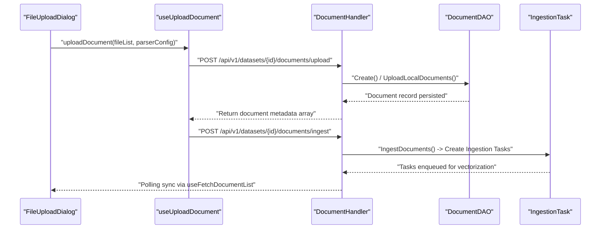
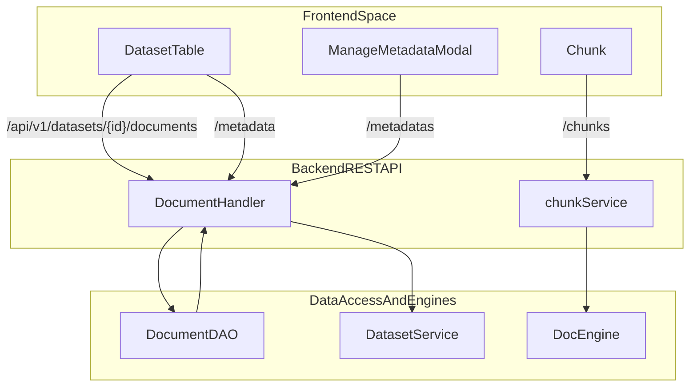

<!-- source: DeepWiki mcp.deepwiki.com · repo infiniflow/ragflow · page 7.5 Document, Chunk and File Management APIs · fetched 2026-10-29 -->

# Document, Chunk and File Management APIs

Relevant source files

The following files were used as context for generating this wiki page:

- [conf/models/radeon_cloud.json](conf/models/radeon_cloud.json)
- [internal/dao/document.go](internal/dao/document.go)
- [internal/dao/document_test.go](internal/dao/document_test.go)
- [internal/dao/file.go](internal/dao/file.go)
- [internal/dao/file_test.go](internal/dao/file_test.go)
- [internal/entity/models/radeon_cloud.go](internal/entity/models/radeon_cloud.go)
- [internal/handler/document.go](internal/handler/document.go)
- [internal/handler/document_test.go](internal/handler/document_test.go)
- [internal/handler/file.go](internal/handler/file.go)
- [internal/handler/skill_search.go](internal/handler/skill_search.go)
- [internal/ingestion/component/tag_biff8_test.go](internal/ingestion/component/tag_biff8_test.go)
- [internal/ingestion/component/tag_query.go](internal/ingestion/component/tag_query.go)
- [internal/ingestion/component/tag_source.go](internal/ingestion/component/tag_source.go)
- [internal/ingestion/component/tag_source_test.go](internal/ingestion/component/tag_source_test.go)
- [internal/ingestion/service/redelivery_counter_test.go](internal/ingestion/service/redelivery_counter_test.go)
- [internal/service/chunk/chunk_permissions_test.go](internal/service/chunk/chunk_permissions_test.go)
- [internal/service/dataset/ingestion_summary_test.go](internal/service/dataset/ingestion_summary_test.go)
- [internal/service/dataset/service.go](internal/service/dataset/service.go)
- [internal/service/dataset/tags.go](internal/service/dataset/tags.go)
- [internal/service/dataset/tags_aggregate_test.go](internal/service/dataset/tags_aggregate_test.go)
- [internal/service/document/apply_doc_counts_test.go](internal/service/document/apply_doc_counts_test.go)
- [internal/service/file/file_folder.go](internal/service/file/file_folder.go)
- [internal/service/file/file_folder_test.go](internal/service/file/file_folder_test.go)
- [internal/service/skill_space.go](internal/service/skill_space.go)
- [internal/service/tag.go](internal/service/tag.go)
- [test/api/chunk_api_test.go](test/api/chunk_api_test.go)
- [test/api/dataset_api_test.go](test/api/dataset_api_test.go)
- [test/api/dataset_features_test.go](test/api/dataset_features_test.go)
- [test/api/dataset_list_delete_test.go](test/api/dataset_list_delete_test.go)
- [test/api/dataset_validation_test.go](test/api/dataset_validation_test.go)
- [test/api/files_api_test.go](test/api/files_api_test.go)
- [test/api/rest_request_test.go](test/api/rest_request_test.go)
- [test/api/retrieval_api_test.go](test/api/retrieval_api_test.go)
- [web/public/iconfont.js](web/public/iconfont.js)
- [web/src/components/bulk-operate-bar.tsx](web/src/components/bulk-operate-bar.tsx)
- [web/src/components/document-preview/csv-preview.tsx](web/src/components/document-preview/csv-preview.tsx)
- [web/src/components/document-preview/doc-preview.test.tsx](web/src/components/document-preview/doc-preview.test.tsx)
- [web/src/components/document-preview/doc-preview.tsx](web/src/components/document-preview/doc-preview.tsx)
- [web/src/components/document-preview/excel-source-locate.test.ts](web/src/components/document-preview/excel-source-locate.test.ts)
- [web/src/components/document-preview/hooks.test.ts](web/src/components/document-preview/hooks.test.ts)
- [web/src/components/document-preview/hooks.ts](web/src/components/document-preview/hooks.ts)
- [web/src/components/document-preview/image-preview.tsx](web/src/components/document-preview/image-preview.tsx)
- [web/src/components/document-preview/index.tsx](web/src/components/document-preview/index.tsx)
- [web/src/components/document-preview/pdf-preview.tsx](web/src/components/document-preview/pdf-preview.tsx)
- [web/src/components/document-preview/txt-preview.tsx](web/src/components/document-preview/txt-preview.tsx)
- [web/src/components/file-icon/index.tsx](web/src/components/file-icon/index.tsx)
- [web/src/components/file-upload-dialog/index.tsx](web/src/components/file-upload-dialog/index.tsx)
- [web/src/components/file-uploader.tsx](web/src/components/file-uploader.tsx)
- [web/src/components/icon-font.tsx](web/src/components/icon-font.tsx)
- [web/src/components/image/index.tsx](web/src/components/image/index.tsx)
- [web/src/components/next-message-item/reference-document-list.tsx](web/src/components/next-message-item/reference-document-list.tsx)
- [web/src/components/next-message-item/reference-image-list.tsx](web/src/components/next-message-item/reference-image-list.tsx)
- [web/src/components/rename-dialog/index.tsx](web/src/components/rename-dialog/index.tsx)
- [web/src/components/rename-dialog/rename-form.tsx](web/src/components/rename-dialog/rename-form.tsx)
- [web/src/components/ui/async-tree-select.tsx](web/src/components/ui/async-tree-select.tsx)
- [web/src/components/ui/table.tsx](web/src/components/ui/table.tsx)
- [web/src/constants/file.ts](web/src/constants/file.ts)
- [web/src/hooks/__tests__/use-delete-file.test.tsx](web/src/hooks/__tests__/use-delete-file.test.tsx)
- [web/src/hooks/__tests__/use-file-list-not-found.test.tsx](web/src/hooks/__tests__/use-file-list-not-found.test.tsx)
- [web/src/hooks/logic-hooks/use-row-selection.ts](web/src/hooks/logic-hooks/use-row-selection.ts)
- [web/src/hooks/use-chunk-request.ts](web/src/hooks/use-chunk-request.ts)
- [web/src/hooks/use-document-request.ts](web/src/hooks/use-document-request.ts)
- [web/src/hooks/use-file-request.ts](web/src/hooks/use-file-request.ts)
- [web/src/interfaces/database/file-manager.ts](web/src/interfaces/database/file-manager.ts)
- [web/src/pages/agent/form/extractor-form/use-tag-file-tree.ts](web/src/pages/agent/form/extractor-form/use-tag-file-tree.ts)
- [web/src/pages/agent/form/parser-form/dynamic-page-range.tsx](web/src/pages/agent/form/parser-form/dynamic-page-range.tsx)
- [web/src/pages/agent/form/title-chunker-form/hook.ts](web/src/pages/agent/form/title-chunker-form/hook.ts)
- [web/src/pages/agent/form/title-chunker-form/index.tsx](web/src/pages/agent/form/title-chunker-form/index.tsx)
- [web/src/pages/chunk/parsed-result/add-knowledge/components/knowledge-chunk/components/chunk-card/index.tsx](web/src/pages/chunk/parsed-result/add-knowledge/components/knowledge-chunk/components/chunk-card/index.tsx)
- [web/src/pages/chunk/parsed-result/add-knowledge/components/knowledge-chunk/components/chunk-creating-modal/index.tsx](web/src/pages/chunk/parsed-result/add-knowledge/components/knowledge-chunk/components/chunk-creating-modal/index.tsx)
- [web/src/pages/chunk/parsed-result/add-knowledge/components/knowledge-chunk/components/chunk-result-bar/checkbox-sets.tsx](web/src/pages/chunk/parsed-result/add-knowledge/components/knowledge-chunk/components/chunk-result-bar/checkbox-sets.tsx)
- [web/src/pages/chunk/parsed-result/add-knowledge/components/knowledge-chunk/components/chunk-result-bar/index.tsx](web/src/pages/chunk/parsed-result/add-knowledge/components/knowledge-chunk/components/chunk-result-bar/index.tsx)
- [web/src/pages/chunk/parsed-result/add-knowledge/components/knowledge-chunk/index.tsx](web/src/pages/chunk/parsed-result/add-knowledge/components/knowledge-chunk/index.tsx)
- [web/src/pages/dataflow-result/chunker.tsx](web/src/pages/dataflow-result/chunker.tsx)
- [web/src/pages/dataflow-result/components/chunk-card/index.tsx](web/src/pages/dataflow-result/components/chunk-card/index.tsx)
- [web/src/pages/dataset/dataset-overview/__tests__/utils.test.ts](web/src/pages/dataset/dataset-overview/__tests__/utils.test.ts)
- [web/src/pages/dataset/dataset/dataset-action-cell.tsx](web/src/pages/dataset/dataset/dataset-action-cell.tsx)
- [web/src/pages/dataset/dataset/dataset-table.tsx](web/src/pages/dataset/dataset/dataset-table.tsx)
- [web/src/pages/dataset/dataset/hooks.ts](web/src/pages/dataset/dataset/hooks.ts)
- [web/src/pages/dataset/dataset/index.tsx](web/src/pages/dataset/dataset/index.tsx)
- [web/src/pages/dataset/dataset/parser-gap-content.tsx](web/src/pages/dataset/dataset/parser-gap-content.tsx)
- [web/src/pages/dataset/dataset/parsing-status-cell.test.tsx](web/src/pages/dataset/dataset/parsing-status-cell.test.tsx)
- [web/src/pages/dataset/dataset/parsing-status-cell.tsx](web/src/pages/dataset/dataset/parsing-status-cell.tsx)
- [web/src/pages/dataset/dataset/reparse-dialog.tsx](web/src/pages/dataset/dataset/reparse-dialog.tsx)
- [web/src/pages/dataset/dataset/use-bulk-operate-dataset.tsx](web/src/pages/dataset/dataset/use-bulk-operate-dataset.tsx)
- [web/src/pages/dataset/dataset/use-dataset-table-columns.tsx](web/src/pages/dataset/dataset/use-dataset-table-columns.tsx)
- [web/src/pages/dataset/dataset/use-parser-gap-validation.ts](web/src/pages/dataset/dataset/use-parser-gap-validation.ts)
- [web/src/pages/dataset/dataset/use-run-document.ts](web/src/pages/dataset/dataset/use-run-document.ts)
- [web/src/pages/dataset/dataset/use-upload-document.test.ts](web/src/pages/dataset/dataset/use-upload-document.test.ts)
- [web/src/pages/dataset/dataset/use-upload-document.ts](web/src/pages/dataset/dataset/use-upload-document.ts)
- [web/src/pages/dataset/dataset/utils.test.ts](web/src/pages/dataset/dataset/utils.test.ts)
- [web/src/pages/dataset/dataset/utils.ts](web/src/pages/dataset/dataset/utils.ts)
- [web/src/pages/dataset/ingestion-message-hooks.ts](web/src/pages/dataset/ingestion-message-hooks.ts)
- [web/src/pages/document-viewer/index.tsx](web/src/pages/document-viewer/index.tsx)
- [web/src/pages/files/action-cell.tsx](web/src/pages/files/action-cell.tsx)
- [web/src/pages/files/files-table.tsx](web/src/pages/files/files-table.tsx)
- [web/src/pages/files/hooks.ts](web/src/pages/files/hooks.ts)
- [web/src/pages/files/index.tsx](web/src/pages/files/index.tsx)
- [web/src/pages/files/knowledge-cell.tsx](web/src/pages/files/knowledge-cell.tsx)
- [web/src/pages/files/move-dialog.tsx](web/src/pages/files/move-dialog.tsx)
- [web/src/pages/files/use-bulk-operate-file.tsx](web/src/pages/files/use-bulk-operate-file.tsx)
- [web/src/pages/files/use-upload-file.ts](web/src/pages/files/use-upload-file.ts)
- [web/src/pages/files/util.ts](web/src/pages/files/util.ts)
- [web/src/pages/next-search/document-preview-modal/index.tsx](web/src/pages/next-search/document-preview-modal/index.tsx)
- [web/src/services/file-manager-service.ts](web/src/services/file-manager-service.ts)
- [web/src/utils/dom-util.ts](web/src/utils/dom-util.ts)
- [web/src/utils/file-util.ts](web/src/utils/file-util.ts)
- [web/src/utils/next-request.ts](web/src/utils/next-request.ts)
- [web/src/utils/request.ts](web/src/utils/request.ts)

## Purpose and Scope

This section covers the technical details of RAGFlow's document, chunk, and file management APIs. It documents the implementation and data flow of file upload, ingestion, cancellation, file-to-document mapping, file manager and folder structures, chunk Create/Read/Update/Delete (CRUD) operations, chunk browsing UI components, document preview, and metadata dialogs.

RAGFlow separates raw file storage from logical document processing through a clear backend and frontend architecture managed via `DocumentHandler` [internal/handler/document.go:97-111](), `DocumentDAO` [internal/dao/document.go:31-37](), `chunkService` [web/src/services/knowledge-service.ts:174-214](), and associated React hooks [web/src/hooks/use-document-request.ts:1-89]().

Sources: [internal/handler/document.go:1-130](), [web/src/hooks/use-document-request.ts:1-211](), [web/src/services/knowledge-service.ts:1-215](), [web/src/pages/dataset/dataset/index.tsx:1-214](), [internal/dao/document.go:31-187]()

---

## 1. File and Document Management Layers

RAGFlow organizes content along two principal layers:

- **File Layer**: Manages physical files stored in object storage, including folder paths, file metadata, and raw bytes. Managed via file services and file data access objects like `FileService` and `DocumentDAO` [internal/dao/document.go:31-37]().
- **Document Layer**: Abstracts business-level documents bound to specific knowledge base datasets. Managed via `DocumentHandler` [internal/handler/document.go:97-111]() and `DocumentDAO` [internal/dao/document.go:31-37](), tracking metadata, parsing states, and chunk counts.

The **File2Document** mapping service connects these layers, maintaining the relationship between raw file entries and dataset-scoped logical documents used in ingestion pipelines.

Sources: [internal/handler/document.go:48-87](), [internal/dao/document.go:31-187]()

---

## 2. Document Upload, Ingestion and Cancellation Flows

### Upload Process

Files are uploaded via the frontend using `useUploadDocument` [web/src/hooks/use-document-request.ts:131-188](), which posts multipart form data containing files and optional parser configurations to `/api/v1/datasets/{id}/documents/upload`. 

On the backend, `DocumentHandler` [internal/handler/document.go:97-111]() receives the multipart files via `UploadLocalDocuments` [internal/handler/document.go:72-72](), stores them in object storage, records their metadata, and maps them to documents.

### Ingestion and Parsing Triggering

Ingestion can be initiated immediately upon upload or triggered asynchronously. The backend methods `IngestDocuments` and `ParseDocuments` [internal/handler/document.go:55-80]() enqueue ingestion tasks targeting specific document IDs. The worker processes files into vector chunks using the configured document engine and model drivers.

### Cancellation and Stopping

Active parsing and ingestion tasks can be stopped or canceled via `StopParseDocuments` or `StopIngestionTasks` [internal/handler/document.go:56-81](). The backend records task cancellation states, updating the running status via `ingestionStatusToRunningStatus` [web/src/pages/dataset/dataset/utils.ts:44-64]() and `ParsingStatusCell` [web/src/pages/dataset/dataset/parsing-status-cell.tsx:112-165](), allowing graceful teardown of parser workers.

Sources: [web/src/hooks/use-document-request.ts:131-191](), [internal/handler/document.go:49-85](), [web/src/pages/dataset/dataset/utils.ts:44-64](), [web/src/pages/dataset/dataset/parsing-status-cell.tsx:112-165]()

---

## 3. File and Folder Management

The file manager provides a hierarchical folder structure over object storage. Folders and files are tracked through database tables managed by file services and DAOs. 

- **Folders**: Identified by unique IDs, supporting recursive tree operations, breadcrumb navigation, and specialized folders such as the `skills` directory [web/src/pages/files/files-table.tsx:170-178]().
- **Files**: Contain metadata such as file name, path, size, and status, and link directly to dataset documents when ingested via `FilesTable` [web/src/pages/files/files-table.tsx:66-122]().

Sources: [web/src/pages/files/files-table.tsx:37-122]()

---

## 4. Document and Chunk CRUD APIs

### Document CRUD

`DocumentDAO` [internal/dao/document.go:31-37]() and `DocumentHandler` [internal/handler/document.go:97-111]() implement document lifecycle operations:
- Retrieval by ID (`GetDocumentByID` [internal/handler/document.go:51-120]())
- Metadata updates (`UpdateDocument` [internal/handler/document.go:52-52]())
- Single and batch deletion (`DeleteDocument`, `DeleteDocuments` [internal/handler/document.go:53-54]())
- Filtered listing supporting keywords, run statuses, and suffixes (`ListDocumentsByDatasetIDWithOptions` [internal/handler/document.go:59-59]())

### Chunk CRUD and State

`chunkService` [web/src/services/knowledge-service.ts:174-214]() and backend chunk handlers manage chunk records stored in the document engine (Elasticsearch, Infinity, OceanBase, or SereneDB). Chunks maintain attributes such as weighted text contents, positions, question keywords, important keywords, and base64-encoded chunk images [web/src/services/knowledge-service.ts:96-165]() within components like `Chunk` [web/src/pages/chunk/parsed-result/add-knowledge/components/knowledge-chunk/index.tsx:53-110]().

Sources: [internal/dao/document.go:31-187](), [internal/handler/document.go:49-85](), [web/src/services/knowledge-service.ts:96-214](), [web/src/pages/chunk/parsed-result/add-knowledge/components/knowledge-chunk/index.tsx:53-110]()

---

## 5. Metadata Management and Document Preview

### Metadata Dialogs and Batch Updates

The UI utilizes metadata management modals to handle document metadata fields and values [web/src/pages/dataset/dataset/index.tsx:71-78](). The backend supports batch metadata updates through `BatchUpdateDocumentMetadatas` [internal/handler/document.go:78-78]() and `MetadataBatchUpdate` [internal/handler/document_test.go:99-99]() endpoints, accepting `MetadataSelector` criteria to mass-assign or remove attributes across selected documents.

### Document Preview

Document preview dialogs aggregate properties including document metadata summaries, ingestion task logs, chunk counts, parsing pipeline settings, and associated image thumbnails retrieved via backend document thumbnail and preview functions [internal/handler/document.go:64-71]().

Sources: [web/src/pages/dataset/dataset/index.tsx:1-127](), [internal/handler/document.go:61-71](), [internal/handler/document_test.go:44-120]()

---

## 6. Frontend Integration and React Hooks

- **`useFetchDocumentList`**: Queries document lists with pagination, search filtering, and conditional polling for active ingestion statuses [web/src/hooks/use-document-request.ts:190-209]().
- **`useUploadDocument`**: Manages file upload mutations and query invalidation (`DocumentKeys.all()`) [web/src/hooks/use-document-request.ts:131-188]().
- **`useDatasetTableColumns`**: Configures table columns including selection checkboxes, document names, status toggles, chunk counts, and metadata action buttons [web/src/pages/dataset/dataset/use-dataset-table-columns.tsx:35-49]().
- **`useBulkOperateDataset`**: Coordinates batch operations like mass running, pausing, or removing documents from a dataset view [web/src/pages/dataset/dataset/use-bulk-operate-dataset.tsx:31-134]().

Sources: [web/src/hooks/use-document-request.ts:1-211](), [web/src/pages/dataset/dataset/use-dataset-table-columns.tsx:35-49](), [web/src/pages/dataset/dataset/use-bulk-operate-dataset.tsx:31-134]()

---

## 7. Mermaid Diagrams: Bridging UI Actions to Backend Services

### Diagram 1: Document Upload and Ingest Flow (Code Entity Space)

Sources: [web/src/hooks/use-document-request.ts:131-188](), [internal/handler/document.go:72-81](), [internal/dao/document.go:40-42]()

---

### Diagram 2: Document and Chunk Service Architecture Mapping

Sources: [internal/handler/document.go:49-85](), [web/src/services/knowledge-service.ts:174-214](), [internal/dao/document.go:31-105]()

# End of Section 7.5

---

