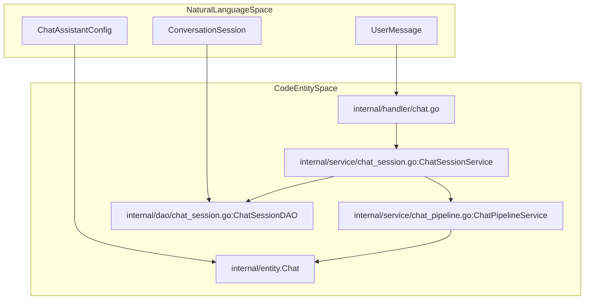
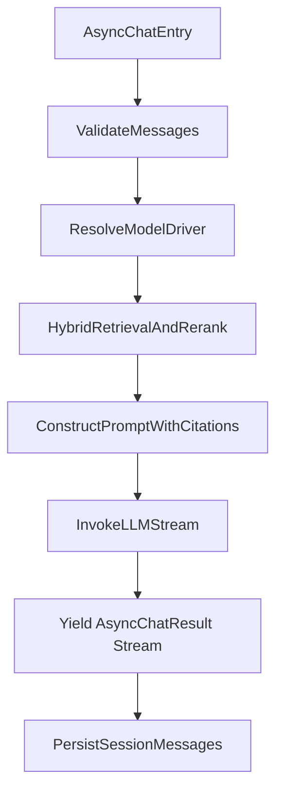
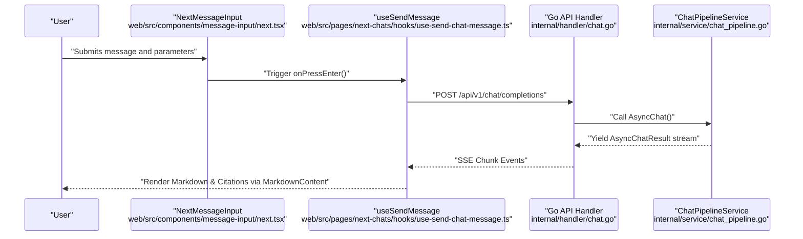

<!-- source: DeepWiki mcp.deepwiki.com · repo infiniflow/ragflow · page 7.6 Chat and Conversation APIs · fetched 2026-10-29 -->

# Chat and Conversation APIs

Relevant source files

The following files were used as context for generating this wiki page:

- [internal/dao/chat.go](internal/dao/chat.go)
- [internal/dao/chat_test.go](internal/dao/chat_test.go)
- [internal/dao/search.go](internal/dao/search.go)
- [internal/dao/search_test.go](internal/dao/search_test.go)
- [internal/handler/chat.go](internal/handler/chat.go)
- [internal/handler/chat_recommendation.go](internal/handler/chat_recommendation.go)
- [internal/handler/chat_test.go](internal/handler/chat_test.go)
- [internal/handler/dataset_list_test.go](internal/handler/dataset_list_test.go)
- [internal/handler/mcp_server.go](internal/handler/mcp_server.go)
- [internal/handler/mindmap.go](internal/handler/mindmap.go)
- [internal/handler/mindmap_test.go](internal/handler/mindmap_test.go)
- [internal/handler/openai_chat_test.go](internal/handler/openai_chat_test.go)
- [internal/handler/search.go](internal/handler/search.go)
- [internal/handler/searchbot.go](internal/handler/searchbot.go)
- [internal/handler/searchbot_test.go](internal/handler/searchbot_test.go)
- [internal/rag/prompts/citation_prompt.md](internal/rag/prompts/citation_prompt.md)
- [internal/rag/prompts/generator.go](internal/rag/prompts/generator.go)
- [internal/service/chat.go](internal/service/chat.go)
- [internal/service/chat_list_test.go](internal/service/chat_list_test.go)
- [internal/service/chat_pipeline.go](internal/service/chat_pipeline.go)
- [internal/service/chat_pipeline_test.go](internal/service/chat_pipeline_test.go)
- [internal/service/chat_rest_update_test.go](internal/service/chat_rest_update_test.go)
- [internal/service/citation.go](internal/service/citation.go)
- [internal/service/citation_test.go](internal/service/citation_test.go)
- [internal/service/dataset/list_test.go](internal/service/dataset/list_test.go)
- [internal/service/openai_chat.go](internal/service/openai_chat.go)
- [internal/service/openai_chat_test.go](internal/service/openai_chat_test.go)
- [internal/service/related_question.go](internal/service/related_question.go)
- [internal/service/search.go](internal/service/search.go)
- [internal/service/search_test.go](internal/service/search_test.go)
- [internal/service/test_helpers_test.go](internal/service/test_helpers_test.go)
- [internal/service/web_search_provider.go](internal/service/web_search_provider.go)
- [internal/service/web_search_provider_test.go](internal/service/web_search_provider_test.go)
- [web/src/components/embed-container.tsx](web/src/components/embed-container.tsx)
- [web/src/components/embed-dialog/__tests__/index.test.tsx](web/src/components/embed-dialog/__tests__/index.test.tsx)
- [web/src/components/embed-dialog/index.tsx](web/src/components/embed-dialog/index.tsx)
- [web/src/components/embed-dialog/use-show-embed-dialog.ts](web/src/components/embed-dialog/use-show-embed-dialog.ts)
- [web/src/components/floating-chat-widget-markdown.module.less](web/src/components/floating-chat-widget-markdown.module.less)
- [web/src/components/floating-chat-widget-markdown.tsx](web/src/components/floating-chat-widget-markdown.tsx)
- [web/src/components/floating-chat-widget.tsx](web/src/components/floating-chat-widget.tsx)
- [web/src/components/highlight-markdown/index.tsx](web/src/components/highlight-markdown/index.tsx)
- [web/src/components/large-model-form-field.tsx](web/src/components/large-model-form-field.tsx)
- [web/src/components/llm-select/next.tsx](web/src/components/llm-select/next.tsx)
- [web/src/components/llm-setting-items/llm-form-field.tsx](web/src/components/llm-setting-items/llm-form-field.tsx)
- [web/src/components/llm-setting-items/next.tsx](web/src/components/llm-setting-items/next.tsx)
- [web/src/components/markdown-content/__tests__/index.test.tsx](web/src/components/markdown-content/__tests__/index.test.tsx)
- [web/src/components/markdown-content/index.tsx](web/src/components/markdown-content/index.tsx)
- [web/src/components/message-input/next.tsx](web/src/components/message-input/next.tsx)
- [web/src/components/message-item/group-button.tsx](web/src/components/message-item/group-button.tsx)
- [web/src/components/message-item/hooks.ts](web/src/components/message-item/hooks.ts)
- [web/src/components/message-item/index.tsx](web/src/components/message-item/index.tsx)
- [web/src/components/next-markdown-content/index.tsx](web/src/components/next-markdown-content/index.tsx)
- [web/src/components/next-message-item/group-button.tsx](web/src/components/next-message-item/group-button.tsx)
- [web/src/components/next-message-item/index.tsx](web/src/components/next-message-item/index.tsx)
- [web/src/components/originui/select-with-search.tsx](web/src/components/originui/select-with-search.tsx)
- [web/src/components/pdf-drawer/hooks.ts](web/src/components/pdf-drawer/hooks.ts)
- [web/src/components/pdf-drawer/index.tsx](web/src/components/pdf-drawer/index.tsx)
- [web/src/components/ui/audio-button.tsx](web/src/components/ui/audio-button.tsx)
- [web/src/components/web-search-form-field.tsx](web/src/components/web-search-form-field.tsx)
- [web/src/constants/chat.ts](web/src/constants/chat.ts)
- [web/src/hooks/logic-hooks.ts](web/src/hooks/logic-hooks.ts)
- [web/src/hooks/use-chat-request.ts](web/src/hooks/use-chat-request.ts)
- [web/src/hooks/use-send-message.ts](web/src/hooks/use-send-message.ts)
- [web/src/interfaces/database/chat.ts](web/src/interfaces/database/chat.ts)
- [web/src/pages/agent/chat/box.tsx](web/src/pages/agent/chat/box.tsx)
- [web/src/pages/agent/chat/chat-sheet.tsx](web/src/pages/agent/chat/chat-sheet.tsx)
- [web/src/pages/agent/chat/use-send-agent-message.ts](web/src/pages/agent/chat/use-send-agent-message.ts)
- [web/src/pages/agent/hooks/use-send-shared-message.ts](web/src/pages/agent/hooks/use-send-shared-message.ts)
- [web/src/pages/agent/share/index.tsx](web/src/pages/agent/share/index.tsx)
- [web/src/pages/next-chats/chat-stream/run-stream.ts](web/src/pages/next-chats/chat-stream/run-stream.ts)
- [web/src/pages/next-chats/chat-stream/store.ts](web/src/pages/next-chats/chat-stream/store.ts)
- [web/src/pages/next-chats/chat-stream/utils.ts](web/src/pages/next-chats/chat-stream/utils.ts)
- [web/src/pages/next-chats/chat/app-settings/chat-basic-settings.tsx](web/src/pages/next-chats/chat/app-settings/chat-basic-settings.tsx)
- [web/src/pages/next-chats/chat/app-settings/chat-prompt-engine.tsx](web/src/pages/next-chats/chat/app-settings/chat-prompt-engine.tsx)
- [web/src/pages/next-chats/chat/app-settings/chat-settings.tsx](web/src/pages/next-chats/chat/app-settings/chat-settings.tsx)
- [web/src/pages/next-chats/chat/app-settings/use-chat-setting-schema.tsx](web/src/pages/next-chats/chat/app-settings/use-chat-setting-schema.tsx)
- [web/src/pages/next-chats/chat/chat-box/next-multiple-chat-box.test.tsx](web/src/pages/next-chats/chat/chat-box/next-multiple-chat-box.test.tsx)
- [web/src/pages/next-chats/chat/chat-box/next-multiple-chat-box.tsx](web/src/pages/next-chats/chat/chat-box/next-multiple-chat-box.tsx)
- [web/src/pages/next-chats/chat/chat-box/single-chat-box.tsx](web/src/pages/next-chats/chat/chat-box/single-chat-box.tsx)
- [web/src/pages/next-chats/chat/conversation-dropdown.tsx](web/src/pages/next-chats/chat/conversation-dropdown.tsx)
- [web/src/pages/next-chats/chat/index.tsx](web/src/pages/next-chats/chat/index.tsx)
- [web/src/pages/next-chats/chat/sessions.tsx](web/src/pages/next-chats/chat/sessions.tsx)
- [web/src/pages/next-chats/chat/web-search-api-key.test.ts](web/src/pages/next-chats/chat/web-search-api-key.test.ts)
- [web/src/pages/next-chats/chat/web-search-api-key.ts](web/src/pages/next-chats/chat/web-search-api-key.ts)
- [web/src/pages/next-chats/hooks/use-select-conversation-list.ts](web/src/pages/next-chats/hooks/use-select-conversation-list.ts)
- [web/src/pages/next-chats/hooks/use-send-chat-message.ts](web/src/pages/next-chats/hooks/use-send-chat-message.ts)
- [web/src/pages/next-chats/hooks/use-send-shared-message.ts](web/src/pages/next-chats/hooks/use-send-shared-message.ts)
- [web/src/pages/next-chats/hooks/use-send-single-message.ts](web/src/pages/next-chats/hooks/use-send-single-message.ts)
- [web/src/pages/next-chats/hooks/use-upload-file.ts](web/src/pages/next-chats/hooks/use-upload-file.ts)
- [web/src/pages/next-chats/share/index.tsx](web/src/pages/next-chats/share/index.tsx)
- [web/src/pages/next-search/markdown-content/index.tsx](web/src/pages/next-search/markdown-content/index.tsx)
- [web/src/pages/next-search/mindmap-sheet.tsx](web/src/pages/next-search/mindmap-sheet.tsx)
- [web/src/pages/user-setting/compilation-templates/edit-next/utils.test.ts](web/src/pages/user-setting/compilation-templates/edit-next/utils.test.ts)
- [web/src/services/chat-completion-stream.ts](web/src/services/chat-completion-stream.ts)
- [web/src/services/next-chat-service.ts](web/src/services/next-chat-service.ts)
- [web/src/utils/__tests__/chat.test.ts](web/src/utils/__tests__/chat.test.ts)
- [web/src/utils/chat.ts](web/src/utils/chat.ts)

This page documents the chat completion and conversation management APIs in RAGFlow, covering Retrieval-Augmented Generation (RAG) chat assistants, conversation sessions, completion and streaming endpoints, the chat pipeline internals, citation management, TTS/ASR audio endpoints, and the React-based `next-chats` frontend. It provides a comprehensive technical overview of the implementation, data flows, key classes and functions, and includes diagrams linking high-level user concepts to code entities.

---

## 1. Architecture Overview and Code Entity Mapping

RAGFlow’s chat subsystem is implemented in Go with a React frontend (`next-chats`), integrating multi-tenant model provider configurations, streaming chat completions, retrieval-enhanced prompt construction, citations, and audio TTS/ASR features.

### System Components Linking Natural Language Interaction to Code

The diagram below maps user and system concepts (chat assistants, sessions, chat completions) to their corresponding Go service classes, handlers, and database models.

- **ChatSessionService** manages session CRUD and access control (`internal/service/chat_session.go`) [internal/service/chat_session.go:80-99]().
- **ChatPipelineService** coordinates hybrid retrieval, prompt formulation, and LLM invocation (`internal/service/chat_pipeline.go`) [internal/service/chat_pipeline.go:57-70]().
- **ChatSessionDAO** handles underlying database persistence for conversation records (`internal/dao/chat_session.go`) [internal/dao/chat.go:1-50]().

Sources: [internal/service/chat_session.go:80-99](), [internal/service/chat_pipeline.go:57-70](), [internal/dao/chat.go:1-50]()

---

## 2. Chat Assistants and Conversation Sessions

### Chat Assistants (Dialogs)
Chat assistants correspond to the `IDialog` interface and `dialog` database entity, encapsulating knowledge base mappings, prompt configurations, and parameter definitions [web/src/interfaces/database/chat.ts:84-113]().
- **PromptConfig**: Controls system prompt templates, prologue messages, quote inclusion, keyword extraction, cross-language settings, and web search provider integrations [web/src/interfaces/database/chat.ts:35-59]().
- **LlmSetting / Variable**: Stores hyperparameters such as `temperature`, `top_p`, `frequency_penalty`, `presence_penalty`, and `max_tokens` [web/src/interfaces/database/chat.ts:66-82]().

### Conversation Sessions (Chat Sessions)
Managed by `ChatService` (`internal/service/chat.go`) and the underlying conversation DAOs, sessions organize multi-turn dialogues [internal/service/chat.go:53-67]().
- **ListChats**: Validates resource access per tenant and retrieves ordered lists of chat configurations and sessions [internal/service/chat.go:103-128]().
- **Create**: Validates chat creation request payload, checking tenant membership and permissions before persisting [internal/service/chat.go:185-208]().

Sources: [web/src/interfaces/database/chat.ts:35-113](), [internal/service/chat.go:53-128](), [internal/service/chat.go:185-208]()

---

## 3. Chat Completion Pipeline and Streaming

The core retrieval-augmented chat pipeline is driven by `ChatPipelineService` (`internal/service/chat_pipeline.go`) [internal/service/chat_pipeline.go:57-70](). It handles message validation, query refinement, hybrid retrieval, prompt construction, and streaming outputs.

### Key Data Structures
- **`AsyncChatResult`**: Represents a single yield from the chat execution stream, containing answer deltas, reasoning strings, references, audio binaries, and thinking flags [internal/service/chat_pipeline.go:89-116]().
- **`ThinkEvent`**: Encapsulates structured reasoning steps (tool calls, stage names, arguments, status, documents, sources, and duration) [internal/service/chat_pipeline.go:136-154]().
- **`ChatTurnUsage`**: Tracks per-turn token usage including prompt, completion, and total tokens [internal/service/chat_pipeline.go:121-125]().

### Chat Pipeline Execution Mapping

Sources: [internal/service/chat_pipeline.go:57-125](), [internal/service/chat_pipeline.go:136-154]()

---

## 4. Citations, Markdown Processing, and Audio Integration

### Citation Management and Rendering
- Retrieved knowledge chunks carry document IDs, chunk IDs, similarity scores, and positional markers [web/src/interfaces/database/chat.ts:156-168]().
- The frontend `MarkdownContent` component (`web/src/components/markdown-content/index.tsx` and `web/src/components/next-markdown-content/index.tsx`) parses citation patterns via regular expressions, injecting interactive hover cards and source modal triggers [web/src/components/markdown-content/index.tsx:127-143]().
- `mergeAnswerChunk` (`web/src/utils/chat.ts`) handles incoming completion deltas, managing thinking blocks (`<think>`) and citation replacements during streaming [web/src/utils/chat.ts:65-99]().

### TTS and ASR Audio Endpoints
- The chat pipeline supports returning audio binary payloads (`audio_binary`) alongside text answers when TTS is enabled in `PromptConfig` [internal/service/chat_pipeline.go:89-116](), [web/src/interfaces/database/chat.ts:35-40]().
- Speech input from the user interface is translated via audio buttons in `NextMessageInput` (`web/src/components/message-input/next.tsx`) before hitting completion routes [web/src/components/message-input/next.tsx:82-97]().

Sources: [web/src/interfaces/database/chat.ts:35-40](), [web/src/interfaces/database/chat.ts:156-168](), [web/src/components/markdown-content/index.tsx:127-143](), [web/src/utils/chat.ts:65-99](), [internal/service/chat_pipeline.go:89-116](), [web/src/components/message-input/next.tsx:82-97]()

---

## 5. React Frontend Architecture (`next-chats`)

The React frontend orchestrates chat interactions, streaming SSE responses, and markdown rendering.

### Frontend-to-Backend Chat Stream Flow

- **`NextMessageInput`**: Manages text input, file uploads, thinking levels, and internet search toggles [web/src/components/message-input/next.tsx:82-97]().
- **`ChatSettings`**: Form interface for modifying dialog parameters, similarity thresholds, rerankers, and LLM settings [web/src/pages/next-chats/chat/app-settings/chat-settings.tsx:41-106]().
- **`MessageItem`**: Renders messages by role, distinguishing user inputs from assistant markdown outputs and references [web/src/components/message-item/index.tsx:58-93]().

Sources: [web/src/components/message-input/next.tsx:82-97](), [web/src/pages/next-chats/chat/app-settings/chat-settings.tsx:41-106](), [web/src/components/message-item/index.tsx:58-93]()

---

