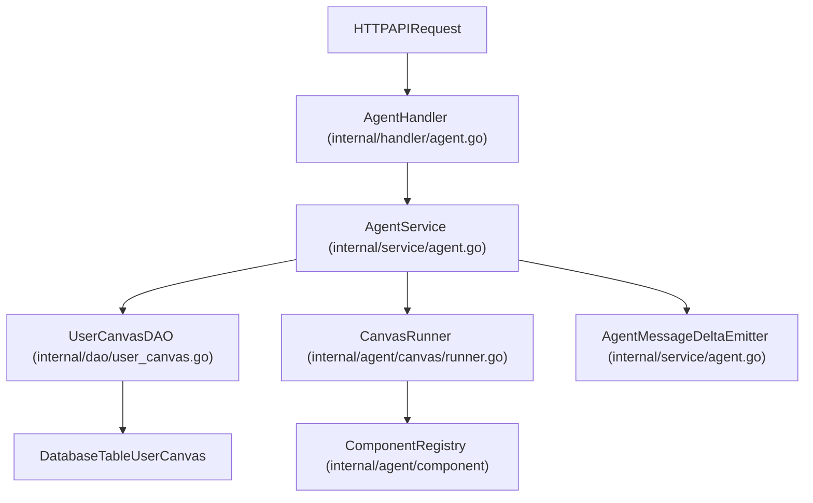
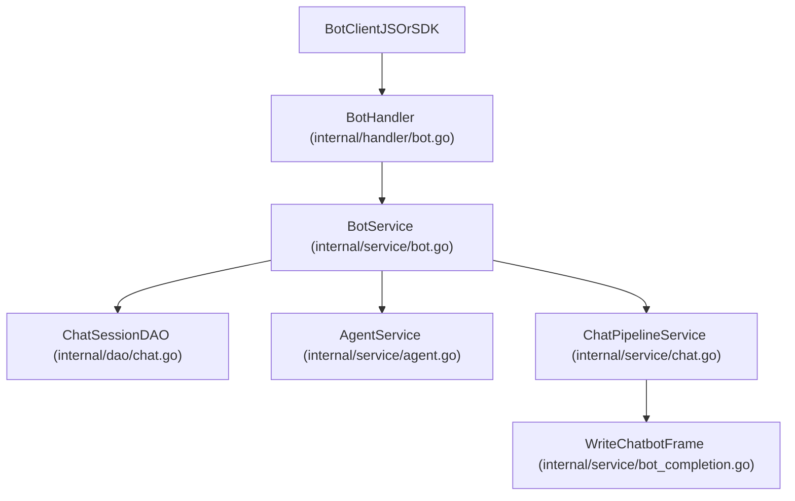
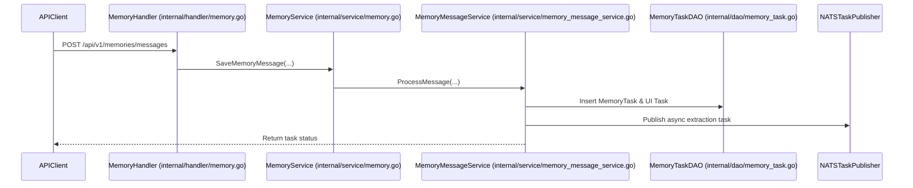

<!-- source: DeepWiki mcp.deepwiki.com · repo infiniflow/ragflow · page 7.7 Agent, Bot and Memory APIs · fetched 2026-10-29 -->

# Agent, Bot and Memory APIs

Relevant source files

The following files were used as context for generating this wiki page:

- [internal/agent/canvas/runner.go](internal/agent/canvas/runner.go)
- [internal/agent/dsl/errors.go](internal/agent/dsl/errors.go)
- [internal/agent/dsl/extract.go](internal/agent/dsl/extract.go)
- [internal/agent/dsl/extract_test.go](internal/agent/dsl/extract_test.go)
- [internal/dao/api_token_test.go](internal/dao/api_token_test.go)
- [internal/dao/chat_session.go](internal/dao/chat_session.go)
- [internal/dao/chat_session_test.go](internal/dao/chat_session_test.go)
- [internal/dao/memory.go](internal/dao/memory.go)
- [internal/dao/user_canvas.go](internal/dao/user_canvas.go)
- [internal/dao/user_canvas_test.go](internal/dao/user_canvas_test.go)
- [internal/entity/canvas.go](internal/entity/canvas.go)
- [internal/entity/user_tenant.go](internal/entity/user_tenant.go)
- [internal/handler/agent.go](internal/handler/agent.go)
- [internal/handler/agent_test.go](internal/handler/agent_test.go)
- [internal/handler/agent_wait_for_user_test.go](internal/handler/agent_wait_for_user_test.go)
- [internal/handler/bot.go](internal/handler/bot.go)
- [internal/handler/bot_test.go](internal/handler/bot_test.go)
- [internal/handler/chat_session.go](internal/handler/chat_session.go)
- [internal/handler/memory.go](internal/handler/memory.go)
- [internal/handler/plugin.go](internal/handler/plugin.go)
- [internal/handler/search_handler_test.go](internal/handler/search_handler_test.go)
- [internal/permission/chat_channel_database_test.go](internal/permission/chat_channel_database_test.go)
- [internal/permission/database_source.go](internal/permission/database_source.go)
- [internal/permission/database_source_test.go](internal/permission/database_source_test.go)
- [internal/permission/policy_ce.go](internal/permission/policy_ce.go)
- [internal/permission/policy_ce_test.go](internal/permission/policy_ce_test.go)
- [internal/permission/types.go](internal/permission/types.go)
- [internal/service/agent.go](internal/service/agent.go)
- [internal/service/agent_input.go](internal/service/agent_input.go)
- [internal/service/agent_input_test.go](internal/service/agent_input_test.go)
- [internal/service/agent_run_e2e_test.go](internal/service/agent_run_e2e_test.go)
- [internal/service/agent_sessions.go](internal/service/agent_sessions.go)
- [internal/service/agent_test.go](internal/service/agent_test.go)
- [internal/service/bot.go](internal/service/bot.go)
- [internal/service/bot_completion.go](internal/service/bot_completion.go)
- [internal/service/bot_completion_history_test.go](internal/service/bot_completion_history_test.go)
- [internal/service/chat_session.go](internal/service/chat_session.go)
- [internal/service/chat_session_contract_test.go](internal/service/chat_session_contract_test.go)
- [internal/service/chat_session_test.go](internal/service/chat_session_test.go)
- [internal/service/memory.go](internal/service/memory.go)
- [internal/service/memory_extractor.go](internal/service/memory_extractor.go)
- [internal/service/memory_extractor_test.go](internal/service/memory_extractor_test.go)
- [internal/service/memory_message_service.go](internal/service/memory_message_service.go)
- [internal/service/memory_message_service_test.go](internal/service/memory_message_service_test.go)
- [internal/service/memory_message_test.go](internal/service/memory_message_test.go)
- [web/src/hooks/use-session-list.ts](web/src/hooks/use-session-list.ts)

## Purpose and Scope

This page documents the technical details of RAGFlow's Agent, Bot, and Memory APIs. It covers:

- The Agent and Canvas REST endpoints for lifecycle management, workspace orchestration, and secure multi-tenant access control via `service.AgentService` and `dao.UserCanvasDAO`.
- Bot completion routes supporting chatbots, agent bots, and search bots via `service.BotService` with Server-Sent Events (SSE) streaming responses using `service.ChatbotSSEFrame`.
- The persistent Memory subsystem REST API handling memory configuration, persistent storage, semantic extraction, and asynchronous task orchestration.

Sources:  
[internal/service/agent.go:71-95](), [internal/dao/user_canvas.go:70-109](), [internal/handler/agent.go:73-120](), [internal/service/bot_completion.go:58-179](), [internal/service/bot.go:46-64](), [internal/service/agent_sessions.go:43-62]()

---

## Agent and Canvas APIs

### Overview

The agent subsystem revolves around the `entity.UserCanvas` entity, which represents visual workflow canvases, often called agents. These canvases are versioned to support iterative development, experimentation, and publishing. An agent is a composable graph of components orchestrated by the internal canvas runtime.

### Key Components and Data Flow

- **AgentService**: The primary service managing agent lifecycle, permissions, and execution orchestration.
  - `LoadCanvasByID(ctx, userID, canvasID)` securely loads an agent canvas with tenant-aware access control [internal/service/agent.go:71-76]().
  - `RunAgent(ctx, userID, canvasID, sessionID, version, userInput, files)` executes an agent workflow, returning a channel streaming `canvas.RunEvent` messages [internal/service/agent.go:87-95]().
  - Context helpers like `WithAgentSessionID` and `WithOpenAICompatMessages` inject execution metadata without breaking public method signatures [internal/service/agent.go:101-141]().

- **UserCanvasDAO**: Handles database-level access and CRUD operations on the `user_canvas` and `user_canvas_version` tables, enforcing tenant isolation [internal/dao/user_canvas.go:70-109]().

- **AgentHandler**: Implements REST HTTP endpoints for agent management and runtime execution. It delegates business logic to `AgentService` and formats SSE streams [internal/handler/agent.go:73-120]().

### Diagram: Agent API Natural Language Space to Code Entity Space

Sources:  
[internal/service/agent.go:71-203](), [internal/dao/user_canvas.go:70-109](), [internal/handler/agent.go:73-120]()

---

## Bot Completion APIs

### Overview

RAGFlow supports multiple chat-based bot variants — traditional chatbots, agentbots, and searchbots — using a unified completion streaming mechanism coordinated by `service.BotService`.

### Core Structures and Functions

- **ChatbotSSEFrame**: Defines the JSON payload structure for SSE frames sent to clients during chat/bot completions [internal/service/bot_completion.go:58-85](). Key fields include `answer`, `reference`, `session_id`, `start_to_think`, and `end_to_think`.
- `WriteChatbotFrame(w, frame)`: Serializes a single SSE JSON frame, flushes the response writer, and sanitizes internal error details [internal/service/bot_completion.go:87-162]().
- `WriteDoneFrame(w)`: Emits the completion marker followed by the OpenAI-style `data: [DONE]` terminator [internal/service/bot_completion.go:163-179]().
- **BotService**: Coordinates chatbot and agentbot metadata queries and completion routing [internal/service/bot.go:46-64]().

### Diagram: Bot Completion Natural Language Space to Code Entity Space

Sources:  
[internal/service/bot_completion.go:58-191](), [internal/service/bot.go:46-64](), [internal/handler/bot.go:1-50]()

---

## Memory System APIs

### Overview

RAGFlow’s memory subsystem maintains persistent agent and chat memories across four types: **raw**, **semantic**, **episodic**, and **procedural**.

### Memory Configuration and Extraction

- **MemoryHandler**: Exposes REST endpoints for memory CRUD operations and filtered listings [internal/handler/memory.go:38-172]().
- **MemoryService**: Implements business logic, tenant permission checks, and DAO coordination [internal/service/memory.go:108-183]().
- **MemoryMessageService**: Coordinates message persistence, unique ID generation via Redis, transactional state writes, embedding generation, and NATS task publishing [internal/service/memory_message_service.go:148-196]().

### Diagram: Memory System Architecture

Sources:  
[internal/handler/memory.go:38-172](), [internal/service/memory.go:108-183](), [internal/service/memory_message_service.go:148-196]()

---

## Summary

| API Area             | Key Service / Handler           | Main Database Entity           | Protocol Notes                   |
|----------------------|--------------------------------|-------------------------------|----------------------------------|
| Agent Canvas         | `AgentService`, `AgentHandler` | `UserCanvas`, `UserCanvasVersion` | SSE streaming RunEvent messaging |
| Bot Completion       | `BotService`, `ChatbotSSEFrame`| `API4Conversation`, `ChatSession` | Python-compatible SSE frames      |
| Memory System        | `MemoryService`, `MemoryHandler`| `Memory`, `MemoryTask`          | JSON REST + NATS async task queue |

Sources:  
[internal/service/agent.go:71-95](), [internal/handler/agent.go:73-120](), [internal/service/bot_completion.go:58-179](), [internal/service/bot.go:46-64](), [internal/service/memory.go:108-183](), [internal/handler/memory.go:38-172]()

---

