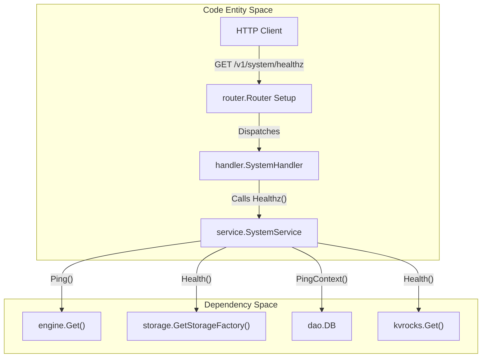
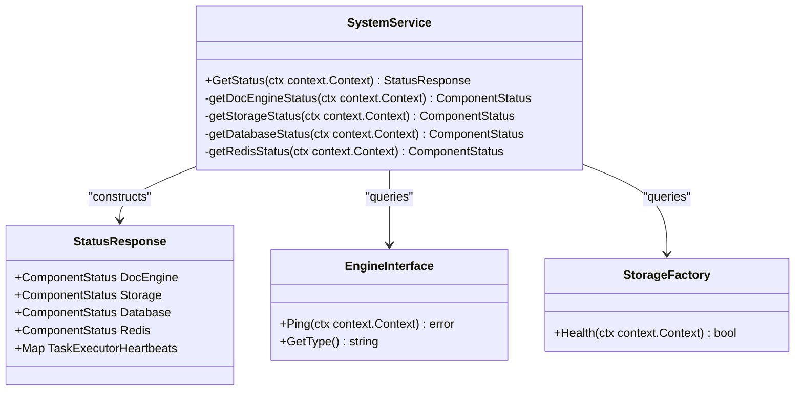

<!-- source: DeepWiki mcp.deepwiki.com · repo infiniflow/ragflow · page 7.8 System Status and Health Monitoring · fetched 2026-10-29 -->

# System Status and Health Monitoring

Relevant source files

The following files were used as context for generating this wiki page:

- [cmd/args_flag_test.go](cmd/args_flag_test.go)
- [cmd/deepdoc_server_ee.go](cmd/deepdoc_server_ee.go)
- [cmd/ragflow_server.go](cmd/ragflow_server.go)
- [cmd/ragflow_server_deepdoc_test.go](cmd/ragflow_server_deepdoc_test.go)
- [cmd/ragflow_server_test.go](cmd/ragflow_server_test.go)
- [conf/service_conf.yaml](conf/service_conf.yaml)
- [docker/service_conf.yaml.template](docker/service_conf.yaml.template)
- [internal/admin/license_ee.go](internal/admin/license_ee.go)
- [internal/admin/state.go](internal/admin/state.go)
- [internal/common/error_code.go](internal/common/error_code.go)
- [internal/common/status_message.go](internal/common/status_message.go)
- [internal/dao/tenant_model_group_ee.go](internal/dao/tenant_model_group_ee.go)
- [internal/handler/auth.go](internal/handler/auth.go)
- [internal/handler/providers_ee.go](internal/handler/providers_ee.go)
- [internal/handler/system.go](internal/handler/system.go)
- [internal/handler/user.go](internal/handler/user.go)
- [internal/ingestion/component/vision_source_admission_test.go](internal/ingestion/component/vision_source_admission_test.go)
- [internal/ingestion/service/execute_memory_task_panic_test.go](internal/ingestion/service/execute_memory_task_panic_test.go)
- [internal/server/admin/server.go](internal/server/admin/server.go)
- [internal/server/api/server.go](internal/server/api/server.go)
- [internal/server/bootstrap/args.go](internal/server/bootstrap/args.go)
- [internal/server/bootstrap/bootstrap.go](internal/server/bootstrap/bootstrap.go)
- [internal/server/bootstrap/bootstrap_test.go](internal/server/bootstrap/bootstrap_test.go)
- [internal/server/bootstrap/runtime.go](internal/server/bootstrap/runtime.go)
- [internal/server/config.go](internal/server/config.go)
- [internal/server/config/admin_config.go](internal/server/config/admin_config.go)
- [internal/server/config/api_server_config.go](internal/server/config/api_server_config.go)
- [internal/server/config/api_server_config_test.go](internal/server/config/api_server_config_test.go)
- [internal/server/config/ingestor_config.go](internal/server/config/ingestor_config.go)
- [internal/server/config/ingestor_config_test.go](internal/server/config/ingestor_config_test.go)
- [internal/server/config/log_config.go](internal/server/config/log_config.go)
- [internal/server/config_getallconfigs_test.go](internal/server/config_getallconfigs_test.go)
- [internal/server/deepdoc/server.go](internal/server/deepdoc/server.go)
- [internal/server/ingestor/server.go](internal/server/ingestor/server.go)
- [internal/server/local/admin_status.go](internal/server/local/admin_status.go)
- [internal/server/local/admin_status_ee.go](internal/server/local/admin_status_ee.go)
- [internal/server/syncer/server.go](internal/server/syncer/server.go)
- [internal/service/admin_client.go](internal/service/admin_client.go)
- [internal/service/admin_client_ee.go](internal/service/admin_client_ee.go)
- [internal/service/system.go](internal/service/system.go)
- [internal/service/user.go](internal/service/user.go)
- [internal/utility/fingerprint_ee.go](internal/utility/fingerprint_ee.go)

## Purpose and Scope

This page details the system status and health monitoring architecture in RAGFlow. It covers the implementation of liveness, health (`/healthz`), configuration, and version endpoints managed by `SystemHandler` [internal/handler/system.go:29-39]() and backed by `SystemService` [internal/service/system.go:33-40](). It also explains component status aggregation across polyglot data stores, runtime log-level adjustments, hardware metrics inspection, and Model Context Protocol (MCP) server exposure controls.

---

## Health Check and System Endpoints

RAGFlow exposes a suite of REST API endpoints for monitoring system health, operational status, configuration metadata, and versioning. These routes are bound through the Gin router infrastructure and mapped directly to methods on `SystemHandler`.

### Endpoint Catalog

| Endpoint | Method | Authentication | Description | Code Implementation |
| :--- | :--- | :--- | :--- | :--- |
| `/v1/system/ping` | GET | None | Lightweight liveness probe returning `"pong"` | [internal/handler/system.go:48-50]() |
| `/health` | GET | None | Basic health status returning JSON `{"status": "ok"}` | [internal/handler/system.go:53-57]() |
| `/v1/system/healthz` | GET | None | Detailed dependency health status (DB, Redis, DocEngine, Storage, MQ) | [internal/handler/system.go:59-67]() |
| `/api/v1/system/config` | GET | None | Returns core runtime configuration flags (e.g., registration status) | [internal/handler/system.go:77-85]() |
| `/v1/system/version` | GET | Token | Returns application version and deployment type | [internal/handler/system.go:114-122]() |
| `/api/v1/system/log_level` | GET | None | Returns current global logging level | [internal/handler/system.go:130-132]() |
| `/api/v1/system/log_level` | PUT | None | Adjusts global logging level at runtime | [internal/handler/system.go:152-169]() |
| `/api/v1/system/hardware` | GET | None | Inspects system-wide hardware resource utilization | [internal/handler/system.go:188-195]() |

### System Status Data Flow

Sources: [internal/handler/system.go:48-67](), [internal/service/system.go:99-107]()

---

## Component Status Aggregation

The system aggregates the health states of core storage, indexing, and caching dependencies via `SystemService.GetStatus` [internal/service/system.go:99-107](). Each subsystem is queried concurrently or sequentially with strict timeouts to construct a unified `StatusResponse` [internal/service/system.go:89-96]().

### Subsystem Health Verification Logic

- **Document Engine (`getDocEngineStatus`)**: Retrieves the active document engine via `engine.Get()` [internal/service/system.go:117]() and issues a 5-second timeout ping (`docEngine.Ping`) [internal/service/system.go:127-129](). Returns `green` on success or `red` with the error message upon failure [internal/service/system.go:130-142]().
- **Storage Engine (`getStorageStatus`)**: Inspects the object storage factory (`storage.GetStorageFactory().GetStorage()`) [internal/service/system.go:153]() and executes `factory.Health(timeOutCtx)` [internal/service/system.go:166]().
- **Database (`getDatabaseStatus`)**: Evaluates `dao.DB` connection pool health by acquiring the underlying `*sql.DB` handle and invoking `sqlDB.PingContext(ctx)` [internal/service/system.go:199-209]().
- **Redis / Kvrocks Cache (`getRedisStatus`)**: Verifies key-value cache liveness using `kvrocks.Get()` and checking `redisClient.Health(ctx)` [internal/service/system.go:227-235]().

### Component Aggregation Architecture

Sources: [internal/service/system.go:99-237]()

---

## Log-Level Control and Runtime Variables

RAGFlow supports dynamic runtime log-level modification without requiring service restarts. 

- **Get Log Level**: `SystemHandler.GetLogLevel` [internal/handler/system.go:130-132]() queries `common.GetLogLevel()` and responds with `{"level": <value>}` to maintain parity with administrative console requirements.
- **Set Log Level**: `SystemHandler.SetLogLevel` [internal/handler/system.go:152-169]() decodes a `SetLogLevelRequest` containing the target `level` string [internal/handler/system.go:138-141](). It invokes `common.SetLogLevel(req.Level)` [internal/handler/system.go:159]() and updates the global server configuration instance via `config.SetLogLevel(req.Level)` [internal/handler/system.go:164-166]().
- **Backward Compatibility**: The `pkg_name` field in `SetLogLevelRequest` is accepted for legacy client payload compatibility but is silently ignored, as per-package filtering has been consolidated into a global log-level manager [internal/handler/system.go:134-151]().

Sources: [internal/handler/system.go:124-169]()

---

## Task Executor Heartbeats and Worker Monitoring

Background task executors (such as ingestion workers and syncer services) report their liveness via heartbeat mechanisms managed by `AdminClient` [internal/service/admin_client.go:35-45]().

- **Heartbeat Dispatch**: `AdminClient.SendHeartbeat` periodically packages server metadata (`BaseMessage` with `MessageType = common.MessageHeartbeat`) [internal/service/admin_client.go:107-117]() and POSTs payloads to the admin telemetry interface (`/api/v1/admin/reports`) [internal/service/admin_client.go:133]().
- **License and State Sync**: The admin server response updates local license status codes (`common.ErrorCode`) and runtime configurations [internal/service/admin_client.go:154-176]().

Sources: [internal/service/admin_client.go:35-186]()

---

## MCP Server Exposure and Configuration

RAGFlow embeds an optional Model Context Protocol (MCP) server interface to expose tools, resources, and context retrieval primitives directly to LLM clients.

- **Configuration Settings**: Configured via the `mcp` block in `conf/service_conf.yaml` [conf/service_conf.yaml:15-25]() and `docker/service_conf.yaml.template` [docker/service_conf.yaml.template:13-25](). Key attributes include `enabled`, `host`, `port`, `launch_mode` (`host` vs `self-host`), `host_api_key`, and transport toggles (`transport_sse_enabled`, `transport_streamable_enabled`) [conf/service_conf.yaml:16-25]().
- **Security Guardrails**: `server.MCPAllowPrivateHosts()` evaluates whether self-hosted MCP servers are permitted to bind to private network topologies based on environment configurations (`ALLOW_ANY_HOST`) [internal/server/config.go:167-176]().
- **User Resolution**: Incoming MCP transport requests authenticate against RAGFlow users using `AuthHandler.ResolveMCPUser()`, validating bearer tokens, user access tokens, API tokens, or beta tokens interchangeably [internal/handler/auth.go:39-53]().

Sources: [conf/service_conf.yaml:13-26](), [internal/server/config.go:167-176](), [internal/handler/auth.go:39-53]()

---

