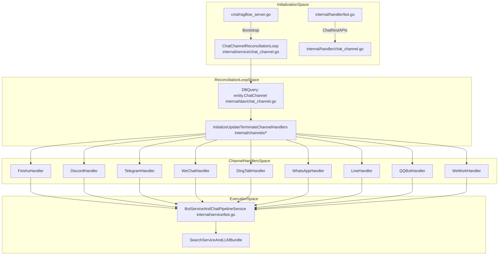
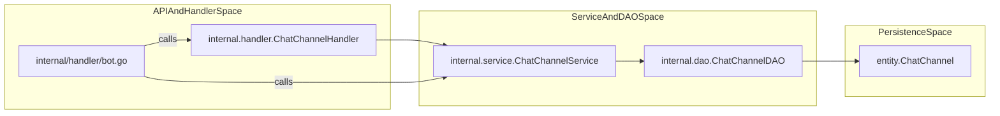
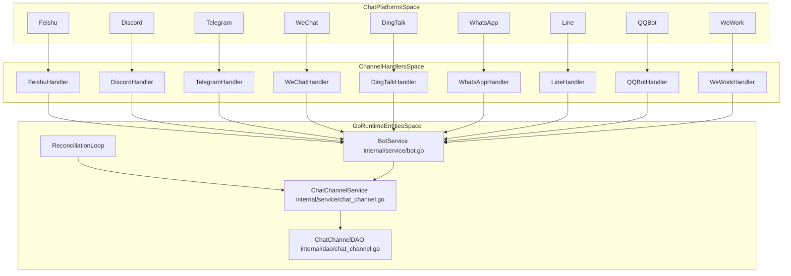

<!-- source: DeepWiki mcp.deepwiki.com · repo infiniflow/ragflow · page 7.9 Chat Channel Integrations · fetched 2026-10-29 -->

# Chat Channel Integrations

Relevant source files

The following files were used as context for generating this wiki page:

- [internal/agent/dsl/errors.go](internal/agent/dsl/errors.go)
- [internal/agent/dsl/extract.go](internal/agent/dsl/extract.go)
- [internal/agent/dsl/extract_test.go](internal/agent/dsl/extract_test.go)
- [internal/dao/user_canvas_version.go](internal/dao/user_canvas_version.go)
- [internal/dao/user_canvas_version_limit_test.go](internal/dao/user_canvas_version_limit_test.go)
- [internal/dao/user_canvas_version_test.go](internal/dao/user_canvas_version_test.go)
- [internal/handler/agent_wait_for_user_test.go](internal/handler/agent_wait_for_user_test.go)
- [internal/handler/bot.go](internal/handler/bot.go)
- [internal/handler/bot_test.go](internal/handler/bot_test.go)
- [internal/handler/plugin.go](internal/handler/plugin.go)
- [internal/handler/search_handler_test.go](internal/handler/search_handler_test.go)
- [internal/ingestion/task/pipeline_version_test.go](internal/ingestion/task/pipeline_version_test.go)
- [internal/service/agent_input.go](internal/service/agent_input.go)
- [internal/service/agent_input_test.go](internal/service/agent_input_test.go)
- [internal/service/bot.go](internal/service/bot.go)
- [internal/service/bot_completion.go](internal/service/bot_completion.go)
- [internal/service/bot_completion_history_test.go](internal/service/bot_completion_history_test.go)
- [web/src/hooks/use-agent-request.ts](web/src/hooks/use-agent-request.ts)
- [web/src/interfaces/database/document.ts](web/src/interfaces/database/document.ts)
- [web/src/interfaces/request/document.ts](web/src/interfaces/request/document.ts)
- [web/src/pages/agent/canvas/node/card.test.tsx](web/src/pages/agent/canvas/node/card.test.tsx)
- [web/src/pages/agent/components/alias-form-dialog.tsx](web/src/pages/agent/components/alias-form-dialog.tsx)
- [web/src/pages/agent/components/publish-confirm-dialog.tsx](web/src/pages/agent/components/publish-confirm-dialog.tsx)
- [web/src/pages/agent/hooks/use-canvas-checklist.ts](web/src/pages/agent/hooks/use-canvas-checklist.ts)
- [web/src/pages/agent/hooks/use-save-graph.ts](web/src/pages/agent/hooks/use-save-graph.ts)
- [web/src/pages/agent/index.tsx](web/src/pages/agent/index.tsx)
- [web/src/pages/agent/version-dialog/index.test.tsx](web/src/pages/agent/version-dialog/index.test.tsx)
- [web/src/pages/agent/version-dialog/index.tsx](web/src/pages/agent/version-dialog/index.tsx)
- [web/src/services/agent-service.ts](web/src/services/agent-service.ts)
- [web/src/services/knowledge-service.ts](web/src/services/knowledge-service.ts)
- [web/src/utils/api.ts](web/src/utils/api.ts)

This page documents the chat channel integration runtime in RAGFlow, which connects RAG agents and knowledge bases to external communication platforms including Feishu, Discord, Telegram, WeChat, DingTalk, WhatsApp, Line, QQBot, and WeWork. It covers the core integration architecture, the reconciliation and bootstrap process, the channel registry pattern, how inbound messages route through the RAG pipeline, and relevant key classes and functions spanning the Go backend.

## Overview and Architecture

The chat channel integration system enables interactive communication between users and RAGFlow assistants over popular chat platforms. It acts as a runtime bridging layer that maintains persistent channel configurations, dynamically manages listeners connecting to external chat services, and orchestrates message routing through RAGFlow's retrieval-augmented generation pipeline to serve relevant answers and citations.

### High-Level Data Flow

1. **Configuration**: Each tenant defines chat channel configurations storing credentials, platform-specific tokens, webhook URLs, and associated chat assistant bindings, persisted in the database via `internal/dao` [internal/dao/chat_channel.go:10-77]().
2. **Bootstrap & Reconciliation**: On server startup and periodically, a reconciliation loop queries active chat channels, then initializes, updates, or terminates platform handlers to match the current configuration [internal/service/chat_channel.go:31-135]().
3. **Inbound Handling**: Events and messages flow in through platform-specific webhooks or gateway connections managed by channel handlers implemented within the `internal/channels` package.
4. **Routing & Execution**: Incoming messages are associated with internal dialogs and passed to the chat pipeline and bot completion services (`BotService`, `ChatPipelineService`) [internal/service/bot.go:17-64]().
5. **Response Dispatch**: Generated answers, optionally enriched with source citations, are formatted per platform API requirements and dispatched back through the respective channel handlers.

### System Architecture and Code Mapping Diagram

Title: "Chat Channel Integration Architecture"

Sources: [internal/service/chat_channel.go:31-135](), [internal/dao/chat_channel.go:10-77](), [internal/handler/chat_channel.go:17-253](), [internal/service/bot.go:17-64]()

---

## The Reconciliation Loop and Bootstrap Process

To allow dynamic enabling, disabling, and updating of chat channel integrations without server restarts, RAGFlow employs a reconciliation loop pattern.

### Implementation Details

- **Background Loops**: The Go backend initializes a background reconciliation goroutine via `ChatChannelService` that continuously polls the database for all active (status=1) chat channels [internal/service/chat_channel.go:31-135]().
- **Listener Lifecycle Management**: For each active channel configuration of a supported platform, the system instantiates or updates the respective channel handler (e.g., `FeishuHandler`, `DiscordHandler`) with the latest configuration.
- **Graceful Teardown**: Removed or disabled channels cause the associated listeners to be stopped cleanly.
- **Separation of Concerns**: This runtime manager ensures that live connections reflect the authoritative stored configuration and that changes propagate in near real-time.
- **Runtime Metadata Access**: Consumers such as the HTTP REST API or event routers can query the current connection/runtime state via snapshot providers exposed by the service layer [internal/service/chat_channel.go:31-135]().

### Backend Components Involved

| Component                | Role                               | Location                          |
|-------------------------|-----------------------------------|---------------------------------|
| `ChatChannelService`     | Reconcile channel configs and manage channel lifecycle | `internal/service/chat_channel.go` |
| `ChatChannelDAO`         | Database persistence access for `ChatChannel` records | `internal/dao/chat_channel.go`  |
| Channel Handlers         | Platform-specific connectors and event processors | `internal/channels/*`            |
| Runtime Provider (func)  | Supplies runtime metadata snapshot of live listeners | `internal/service/chat_channel.go` |

### Code Entity Mapping Diagram

Title: "Chat Channel Reconciliation Code Mapping"

Sources: [internal/service/chat_channel.go:31-135](), [internal/dao/chat_channel.go:10-77](), [internal/handler/chat_channel.go:17-253](), [internal/handler/bot.go:35-57]()

---

## Channel Registry Pattern

RAGFlow implements a registry to support multiple chat platforms in a scalable and extensible way. This pattern provides a common interface for authentication, event parsing, message construction, and webhook or gateway connection management.

### Supported Platforms and Integration Methods

| Platform   | Integration Type                  | Description                                |
|------------|---------------------------------|--------------------------------------------|
| Feishu     | Webhook/Event Subscription       | Enterprise collaboration platform          |
| Discord    | WebSocket Gateway API            | Community chat platform                     |
| Telegram   | Bot API (Webhook/Long Polling)  | Popular global messaging                    |
| WeChat     | Official Account Webhook         | WeChat public accounts support              |
| DingTalk   | Stream Mode/Webhook              | Enterprise automation platform              |
| WhatsApp   | Meta Business API                | Global messaging via official WhatsApp API |
| Line       | Messaging API Webhook            | Regional messaging app                       |
| QQBot      | OpenAPI WebSocket                | Community engagement bot                     |
| WeWork     | Corporate API Webhook            | Enterprise WeChat (WeCom)                    |

Each platform handler fulfills these responsibilities:
- OAuth or token-based authentication and credential management.
- Webhook or gateway connection establishment and event ingestion.
- Parsing inbound events into generic incoming message structures.
- Invoking the general RAG chat pipeline (`BotService` / `ChatPipelineService`) for answers [internal/service/bot.go:17-64]().
- Formatting and sending outbound responses following each platform’s API.

Sources: [internal/service/chat_channel.go:31-135](), [internal/dao/chat_channel.go:10-77]()

---

## Interaction with Chat Sessions and RAG Pipeline

Inbound messages from chat channels are processed end-to-end as follows:

1. **Session Identification**: The platform user/account IDs are mapped to internal `Dialog` or `Conversation` entities, supporting multi-turn conversational context with user persistence [internal/service/bot.go:66-97]().
2. **Message Enrichment**: Historical context and session variables are fetched from memory or document stores, if applicable.
3. **Retrieval-Based Answering**: The `BotService` or `ChatPipelineService` invokes the retrieval services and language model inference bundles to synthesize accurate, source-aware answers [internal/service/bot.go:142-169]().
4. **JSON Sanitization**: The system sanitizes streaming outputs to remove invalid JSON float values, ensuring robust and standards-compliant real-time client streaming [internal/service/bot_completion.go:98-162]().
5. **Response Delivery**: The processed response is formatted per platform specifics and pushed back via API calls or WebSocket gateways.

### Key Functions

- `BotService.ChatbotCompletion` / `AgentbotCompletion`: Core invocation points pulling together retrieval and LLM generation for chat and agents [internal/service/bot.go:142-169]().
- `WriteChatbotFrame`: SSE envelope writer ensuring robust streaming shapes [internal/service/bot_completion.go:98-162]().
- `ChatChannelService.Insert`, `UpdateChatChannel`, `DeleteChatChannel`: Manage lifecycle and persistence of channels [internal/service/chat_channel.go:31-135]().

Sources: [internal/service/chat_channel.go:31-135](), [internal/service/bot.go:66-169](), [internal/service/bot_completion.go:98-162]()

---

## Key Classes and Functions

| Name                     | Description                                                      | Location                                         |
|--------------------------|------------------------------------------------------------------|-------------------------------------------------|
| `ChatChannelService`     | Manages business logic and state reconciliation for chat channels| `internal/service/chat_channel.go`               |
| `ChatChannelDAO`         | Persistence layer for chat channel entities                      | `internal/dao/chat_channel.go`                    |
| `BotService`             | Coordinates chatbot and agentbot completion pathways             | `internal/service/bot.go:40-64`                  |
| `BotHandler`             | REST API HTTP handler for chat and agent bots                    | `internal/handler/bot.go:30-57`                  |
| `WriteChatbotFrame`      | SSE event envelope writer for chatbot completion streams         | `internal/service/bot_completion.go:98-162`      |

The runtime also provides tenant-aware access control ensuring only authorized users can operate on or view chat channels [internal/service/bot_completion_history_test.go:134-188]().

Sources: [internal/service/chat_channel.go:31-135](), [internal/dao/chat_channel.go:10-77](), [internal/service/bot.go:40-64](), [internal/handler/bot.go:30-57](), [internal/service/bot_completion.go:98-162](), [internal/service/bot_completion_history_test.go:134-188]()

---

## Summary

The chat channel integration runtime in RAGFlow is a sophisticated bridge enabling RAG-powered assistants to be accessed through multiple popular chat platforms. It maintains persistent per-tenant channel configurations, manages platform-specific handlers via a robust reconciliation loop, processes inbound messages into the RAG pipeline, and returns enriched responses with citations.

### Natural Language to Code Entity Bridge Diagram

Title: "Chat Platforms to Go Runtime Entities Bridge"

Sources: [internal/service/chat_channel.go:31-135](), [internal/dao/chat_channel.go:10-78](), [internal/service/bot.go:40-64](), [internal/handler/bot.go:30-57]()

---

