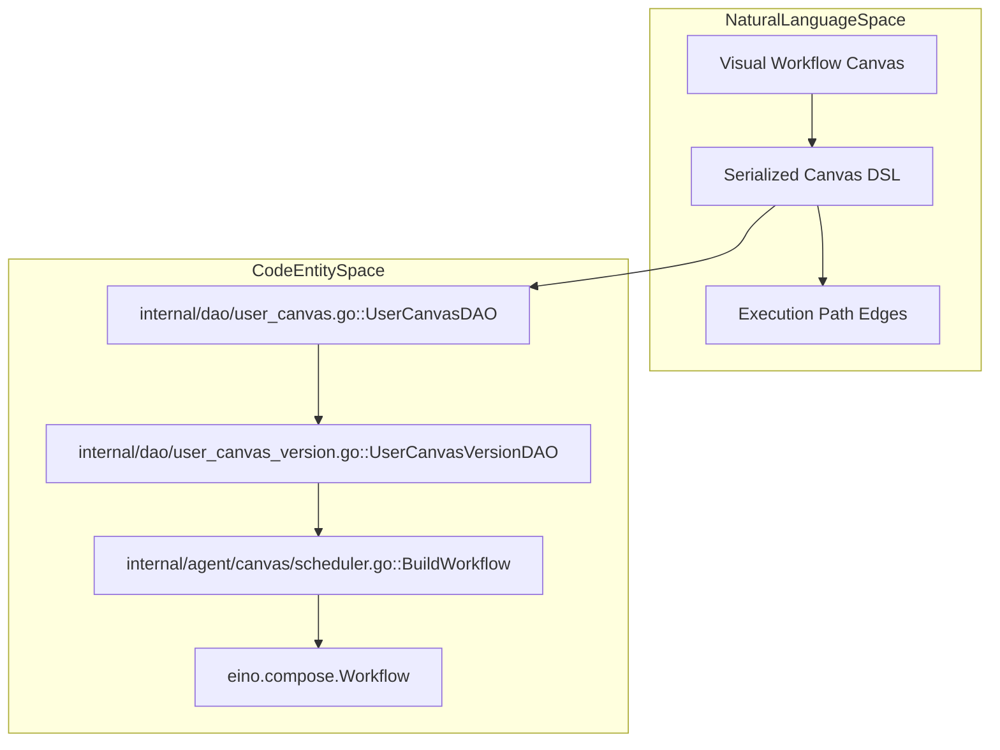
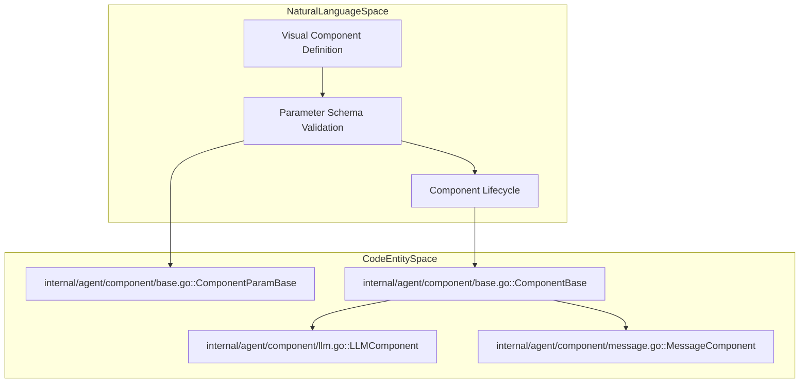
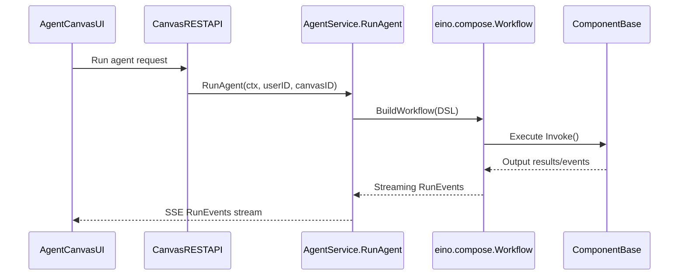

<!-- source: DeepWiki mcp.deepwiki.com · repo infiniflow/ragflow · page 8 Agent and Workflow System · fetched 2026-10-29 -->

# Agent and Workflow System

Relevant source files

The following files were used as context for generating this wiki page:

- [internal/agent/canvas/runner.go](internal/agent/canvas/runner.go)
- [internal/dao/api_token_test.go](internal/dao/api_token_test.go)
- [internal/dao/chat_session.go](internal/dao/chat_session.go)
- [internal/dao/chat_session_test.go](internal/dao/chat_session_test.go)
- [internal/dao/user_canvas.go](internal/dao/user_canvas.go)
- [internal/dao/user_canvas_test.go](internal/dao/user_canvas_test.go)
- [internal/entity/canvas.go](internal/entity/canvas.go)
- [internal/entity/user_tenant.go](internal/entity/user_tenant.go)
- [internal/handler/agent.go](internal/handler/agent.go)
- [internal/handler/agent_test.go](internal/handler/agent_test.go)
- [internal/handler/chat_session.go](internal/handler/chat_session.go)
- [internal/permission/chat_channel_database_test.go](internal/permission/chat_channel_database_test.go)
- [internal/permission/database_source.go](internal/permission/database_source.go)
- [internal/permission/database_source_test.go](internal/permission/database_source_test.go)
- [internal/permission/policy_ce.go](internal/permission/policy_ce.go)
- [internal/permission/policy_ce_test.go](internal/permission/policy_ce_test.go)
- [internal/permission/types.go](internal/permission/types.go)
- [internal/service/agent.go](internal/service/agent.go)
- [internal/service/agent_run_e2e_test.go](internal/service/agent_run_e2e_test.go)
- [internal/service/agent_sessions.go](internal/service/agent_sessions.go)
- [internal/service/agent_test.go](internal/service/agent_test.go)
- [internal/service/chat_session.go](internal/service/chat_session.go)
- [internal/service/chat_session_contract_test.go](internal/service/chat_session_contract_test.go)
- [internal/service/chat_session_test.go](internal/service/chat_session_test.go)
- [web/src/hooks/use-session-list.ts](web/src/hooks/use-session-list.ts)

The Agent and Workflow System is the core framework enabling visual creation and execution of AI-powered workflows and autonomous agents in RAGFlow. It integrates a visual canvas-based workflow design with a Go-native runtime execution engine, supporting complex graph topologies, conditional branching, loops, and multi-step reasoning [internal/service/agent.go:33-40](). The system bridges the visual DSL-driven agent model with high-performance execution via the `eino` workflow framework and persistence layers managed by `UserCanvasDAO` [internal/dao/user_canvas.go:70-76]() and `AgentHandler` [internal/handler/agent.go:76-78]().

This system orchestrates components, manages conversation state, resolves variables, and drives real-time event streaming. It interfaces tightly with core subsystems including LLM integration ([LLM Integration System](#5)), REST API services ([Backend API System](#7)), and document retrieval ([Retrieval and Search System](#9)).

The functional architecture of the Agent and Workflow System is organized into the following child pages:

- [Canvas Engine and DSL](#8.1) — internal/agent/dsl v1/v2 schemas and converter, canvas compile/decode, graph execution model, and workflow storage.
- [Component System Architecture](#8.2) — Component base abstractions, parameter schemas and validation, registry/wiring, and the parity between backend components and frontend forms.
- [Built-in Components and Node Forms](#8.3) — Standard components (LLM/Agent, Retrieval, Tool, Categorize, Message, Switch, Iteration, Invoke, Code, Variable ops) and their canvas nodes and configuration forms.
- [Workflow Execution and Streaming](#8.4) — The eino-based scheduler, workflowx loop/parallel extensions, multibranch handling, SSE event generation, and the frontend agent chat/debug streaming.
- [State and Variable Management](#8.5) — CanvasState runtime, variable resolution (sys.*, env.*, component@output), prompt editor variable pickers, structured outputs, and global variables.
- [Agent Tools and ReAct Loop](#8.6) — internal/agent/tool registry with 20+ built-in tools, retrieval tool bridges, code execution sandbox tool, MCP tools, and the ReAct multi-step reasoning loop.
- [Canvas API, Templates and Management](#8.7) — Canvas CRUD and versioning, agent sessions and logs, webhooks, sharing/embedding, and agent templates in the frontend.

---

## Canvas DSL and Graph Model

At the heart of the system is a JSON-based Domain-Specific Language (DSL) persisted via `UserCanvasDAO` and `UserCanvasVersionDAO` [internal/dao/user_canvas.go:70-85]() that describes AI workflows as directed acyclic graphs (DAGs). Each workflow canvas contains nodes representing operational components linked by edges that dictate execution flow.

The Go runtime processes this DSL across packages such as `internal/agent/canvas` and `internal/service`, converting serialized graph configurations into executable workflows [internal/service/agent_run_e2e_test.go:177-196]().

### Natural Language to Code Entity Mapping: Canvas Model

Sources: [internal/dao/user_canvas.go:70-85](), [internal/service/agent_run_e2e_test.go:177-196]()

For detailed DSL schemas, compilation steps, execution models, and workflow storage, see [Canvas Engine and DSL](#8.1).

---

## Component System Architecture

The component system provides modular units representing functional blocks in workflows, such as LLM invocations, data retrieval, logical switches, and agent steps. Components are dynamically instantiated using a registry and factory pattern [internal/service/agent_run_e2e_test.go:52-54]().

### Core Component Base

- `ComponentParamBase` — defines parameter structures with hierarchical validation and semantic error handling.
- `ComponentBase` — provides lifecycle management, input/output state handling, and context integration [internal/service/agent.go:37-41]().

### Natural Language to Code Entity Mapping: Component System

Sources: [internal/service/agent.go:37-41](), [internal/service/agent_run_e2e_test.go:52-54]()

For full component design, parameter schemas, and dynamic registries, see [Component System Architecture](#8.2).

---

## Built-in Components and Node Forms

RAGFlow includes a comprehensive library of built-in components supporting diverse workflow architectures:

- **LLM / Agent** — powering text generation, dialogue turns, and multi-step reasoning [internal/service/agent.go:33-41]().
- **Retrieval** — executing vector and keyword searches against indexed knowledge bases.
- **Tool** — integrating internal and external tools (20+ built-in varieties).
- **Categorize & Message** — data routing and response formatting.
- **Switch, Iteration, & Loop** — implementing advanced control flow and parallel execution [internal/service/agent_run_e2e_test.go:180-196]().
- **Invoke, Code, & Variable Ops** — custom script execution and variable manipulation.

Each component is mapped to a visual canvas node and corresponds to a React configuration form [internal/handler/agent.go:76-98]().

Sources: [internal/service/agent.go:33-41](), [internal/handler/agent.go:76-98](), [internal/service/agent_run_e2e_test.go:180-196]()

For detailed component descriptions, configuration schemas, and UI node forms, see [Built-in Components and Node Forms](#8.3).

---

## Workflow Execution and Streaming

The execution engine evaluates visual workflows as directed graphs using the Go-native `eino` framework [internal/service/agent.go:33-40](). The scheduler compiles canvas DSL representations into executable runtime graphs (`compose.Workflow`), injecting state handlers and tracking execution telemetry [internal/service/agent_run_e2e_test.go:177-196]().

Execution yields real-time streaming updates, such as token deltas or structured execution events, delivered via Server-Sent Events (SSE) to support debugging and chat interfaces [internal/service/agent.go:143-202](), [internal/handler/agent.go:74-107]().

### Workflow Execution Flow

Sources: [internal/service/agent.go:33-202](), [internal/handler/agent.go:74-107](), [internal/service/agent_run_e2e_test.go:177-196]()

For details on the scheduler, parallel extensions, multibranch handling, and SSE generation, see [Workflow Execution and Streaming](#8.4).

---

## State and Variable Management

The runtime maintains a robust state management layer across workflow execution [internal/service/agent.go:39-40]() using standardized namespaces:

- `sys.*`: System-level variables such as current query, user identification, conversation turns, and webhook payloads [internal/service/agent.go:52-60]().
- `env.*`: User environment settings.
- `globals.*`: Global workflow variables.
- `componentID@outputKey`: Granular inter-component outputs accessible by downstream nodes.

Sources: [internal/service/agent.go:39-60]()

For complete details on the `CanvasState` runtime and variable resolution, see [State and Variable Management](#8.5).

---

## Agent Tools and ReAct Loop

Agents execute complex tasks via an extensible tool registry supporting the ReAct (Reasoning + Acting) execution pattern [internal/service/agent.go:40-41](). 

- Tools encapsulate functions including retrieval queries, code execution sandboxes, and MCP (Model Context Protocol) integrations [internal/service/agent.go:40-41]().
- The `Agent` component combines LLM instances with tool suites to drive iterative reasoning loops featuring observation-action cycles.

Sources: [internal/service/agent.go:40-41]()

For details on the tool registry, retrieval tool bridges, code sandbox, and the ReAct reasoning loop, see [Agent Tools and ReAct Loop](#8.6).

---

## Canvas API, Templates and Management

The Canvas API layer exposes comprehensive REST endpoints and service methods for managing agent workflows:

- CRUD operations and versioning for canvas metadata and DSL payloads via `AgentHandler` and `UserCanvasDAO` [internal/handler/agent.go:76-120](), [internal/dao/user_canvas.go:70-98]().
- Execution logs and session tracing supporting debugging [internal/service/agent_sessions.go:41-61]().
- Webhook management for external event-driven triggers [internal/service/agent.go:78-95]().

Sources: [internal/handler/agent.go:76-120](), [internal/dao/user_canvas.go:70-98](), [internal/service/agent_sessions.go:41-61](), [internal/service/agent.go:78-95]()

For details on canvas CRUD, session management, webhooks, and agent templates, see [Canvas API, Templates and Management](#8.7).

---

