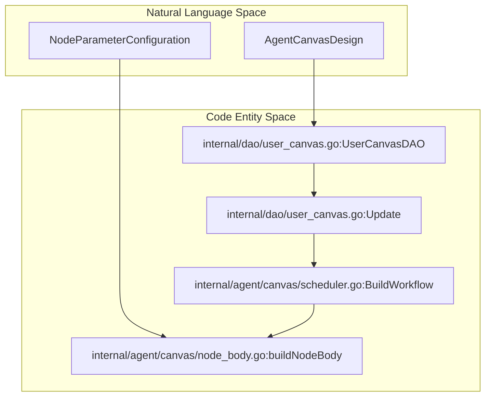
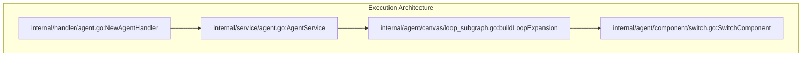

<!-- source: DeepWiki mcp.deepwiki.com · repo infiniflow/ragflow · page 8.1 Canvas Engine and DSL · fetched 2026-10-29 -->

# Canvas Engine and DSL

Relevant source files

The following files were used as context for generating this wiki page:

- [internal/agent/canvas/runner.go](internal/agent/canvas/runner.go)
- [internal/dao/api_token_test.go](internal/dao/api_token_test.go)
- [internal/dao/chat_session.go](internal/dao/chat_session.go)
- [internal/dao/chat_session_test.go](internal/dao/chat_session_test.go)
- [internal/dao/user_canvas.go](internal/dao/user_canvas.go)
- [internal/dao/user_canvas_test.go](internal/dao/user_canvas_test.go)
- [internal/dao/user_canvas_version.go](internal/dao/user_canvas_version.go)
- [internal/dao/user_canvas_version_limit_test.go](internal/dao/user_canvas_version_limit_test.go)
- [internal/dao/user_canvas_version_test.go](internal/dao/user_canvas_version_test.go)
- [internal/entity/canvas.go](internal/entity/canvas.go)
- [internal/entity/user_tenant.go](internal/entity/user_tenant.go)
- [internal/handler/agent.go](internal/handler/agent.go)
- [internal/handler/agent_test.go](internal/handler/agent_test.go)
- [internal/handler/chat_session.go](internal/handler/chat_session.go)
- [internal/ingestion/task/pipeline_version_test.go](internal/ingestion/task/pipeline_version_test.go)
- [internal/permission/chat_channel_database_test.go](internal/permission/chat_channel_database_test.go)
- [internal/permission/database_source.go](internal/permission/database_source.go)
- [internal/permission/database_source_test.go](internal/permission/database_source_test.go)
- [internal/permission/policy_ce.go](internal/permission/policy_ce.go)
- [internal/permission/policy_ce_test.go](internal/permission/policy_ce_test.go)
- [internal/permission/types.go](internal/permission/types.go)
- [internal/service/agent.go](internal/service/agent.go)
- [internal/service/agent_run_e2e_test.go](internal/service/agent_run_e2e_test.go)
- [internal/service/agent_sessions.go](internal/service/agent_sessions.go)
- [internal/service/agent_test.go](internal/service/agent_test.go)
- [internal/service/chat_session.go](internal/service/chat_session.go)
- [internal/service/chat_session_contract_test.go](internal/service/chat_session_contract_test.go)
- [internal/service/chat_session_test.go](internal/service/chat_session_test.go)
- [web/src/hooks/use-agent-request.ts](web/src/hooks/use-agent-request.ts)
- [web/src/hooks/use-session-list.ts](web/src/hooks/use-session-list.ts)
- [web/src/interfaces/database/document.ts](web/src/interfaces/database/document.ts)
- [web/src/interfaces/request/document.ts](web/src/interfaces/request/document.ts)
- [web/src/pages/agent/canvas/node/card.test.tsx](web/src/pages/agent/canvas/node/card.test.tsx)
- [web/src/pages/agent/components/alias-form-dialog.tsx](web/src/pages/agent/components/alias-form-dialog.tsx)
- [web/src/pages/agent/components/publish-confirm-dialog.tsx](web/src/pages/agent/components/publish-confirm-dialog.tsx)
- [web/src/pages/agent/hooks/use-canvas-checklist.ts](web/src/pages/agent/hooks/use-canvas-checklist.ts)
- [web/src/pages/agent/hooks/use-save-graph.ts](web/src/pages/agent/hooks/use-save-graph.ts)
- [web/src/pages/agent/index.tsx](web/src/pages/agent/index.tsx)
- [web/src/pages/agent/version-dialog/index.test.tsx](web/src/pages/agent/version-dialog/index.test.tsx)
- [web/src/pages/agent/version-dialog/index.tsx](web/src/pages/agent/version-dialog/index.tsx)
- [web/src/services/agent-service.ts](web/src/services/agent-service.ts)
- [web/src/services/knowledge-service.ts](web/src/services/knowledge-service.ts)
- [web/src/utils/api.ts](web/src/utils/api.ts)

Purpose and scope: This leaf page documents the RAGFlow Canvas Engine and DSL, covering v1/v2 schema structures, Go-based converters, canvas compilation and decoding into eino workflow topologies, graph execution models, and workflow persistence via DAO and service layers.

---

## Overview

- The RAGFlow Canvas DSL is a JSON-serializable graph structure defining AI agent workflows, node parameters, and edge bindings `[internal/dao/user_canvas.go:70-114]()`.
- The architecture supports dual schema representations and converts them into executable topologies via `internal/agent/canvas/scheduler.go` `[internal/agent/canvas/scheduler.go:1-35]()`.
- Canvases compile into eino `compose.Workflow` instances, managing nodes, loops (`internal/agent/canvas/loop_subgraph.go`), and conditional branching (`internal/agent/component/switch.go`) `[internal/agent/canvas/loop_subgraph.go:37-60]()`.

Sources:
- `internal/dao/user_canvas.go:70-114` [internal/dao/user_canvas.go:70-114]()
- `internal/agent/canvas/scheduler.go:1-35` [internal/agent/canvas/scheduler.go:1-35]()
- `internal/agent/canvas/loop_subgraph.go:37-60` [internal/agent/canvas/loop_subgraph.go:37-60]()

---

## 1. Canvas DSL Structure and Conversion

### DSL Schema & Persistence
Canvases are stored in the database via `UserCanvasDAO` (`internal/dao/user_canvas.go`), maintaining graph objects, metadata, and version snapshots `[internal/dao/user_canvas.go:70-114]()`.
- **`Update` / `UpdateTx`**: Persists new graph topologies and paths into the `UserCanvas` entity `[internal/dao/user_canvas.go:101-120]()`.
- **Frontend Integration**: Managed via React hooks (`web/src/pages/agent/hooks/use-save-graph.ts` and `web/src/hooks/use-agent-request.ts`) handling parsers, chunkers, and switches, serializing parameter maps that feed directly into backend compilation `[web/src/pages/agent/hooks/use-save-graph.ts:33-73]()`.

| Symbol | Location | Description |
| :--- | :--- | :--- |
| `UserCanvasDAO` | `internal/dao/user_canvas.go` | Data access object for agent canvases and DSL blobs |
| `Update` | `internal/dao/user_canvas.go` | Updates the JSON-serialized graph DSL structure |
| `useSaveGraph` | `web/src/pages/agent/hooks/use-save-graph.ts` | Frontend hook for saving graph DSL payloads |

Sources:
- `internal/dao/user_canvas.go:70-120` [internal/dao/user_canvas.go:70-120]()
- `web/src/pages/agent/hooks/use-save-graph.ts:33-73` [web/src/pages/agent/hooks/use-save-graph.ts:33-73]()

---

## 2. Canvas Compilation to Eino Workflow

### Graph Execution Model & Node Bodies
Canvases are compiled into Directed Acyclic Graphs (DAGs) using eino's `compose.Workflow` `[internal/agent/canvas/scheduler.go:1-35]()`.
- **`BuildWorkflow`**: Traverses components, checks for legacy no-op nodes using `isLegacyNoOp`, and wires edges into the eino workflow engine `[internal/agent/canvas/scheduler.go:100-134]()`.
- **`buildNodeBody`**: Located in `internal/agent/canvas/node_body.go`, this function generates invocation lambdas for each node, handling parameter overrides and factory bindings `[internal/agent/canvas/node_body.go:123-151]()`.
- **Loop Expansions**: Implemented in `internal/agent/canvas/loop_subgraph.go`, loops are expanded into sub-workflows with dedicated termination conditions and variable snapshots `[internal/agent/canvas/loop_subgraph.go:51-125]()`.

### Core Compilation Functions

| Symbol | Location | Description |
| :--- | :--- | :--- |
| `BuildWorkflow` | `internal/agent/canvas/scheduler.go` | Compiles DSL Canvas into an eino `compose.Workflow` |
| `isLegacyNoOp` | `internal/agent/canvas/scheduler.go` | Identifies legacy DSL v1 sentinel components |
| `buildNodeBody` | `internal/agent/canvas/node_body.go` | Resolves and builds node execution lambdas with overrides |
| `buildLoopExpansion` | `internal/agent/canvas/loop_subgraph.go` | Expands loop macro nodes into sub-workflows |

Sources:
- `internal/agent/canvas/scheduler.go:1-134` [internal/agent/canvas/scheduler.go:1-134]()
- `internal/agent/canvas/node_body.go:123-151` [internal/agent/canvas/node_body.go:123-151]()
- `internal/agent/canvas/loop_subgraph.go:51-125` [internal/agent/canvas/loop_subgraph.go:51-125]()

---

## 3. Workflow Storage, Versioning, and Execution Management

### Service & DAO Integration
Runtime execution of compiled workflows is orchestrated by `AgentService` (`internal/service/agent.go`) and handled via REST handlers (`internal/handler/agent.go`) `[internal/handler/agent.go:76-127]()`.
- **`RunAgent`**: Loads canvas versions, decodes the DSL, compiles the workflow, and executes it while streaming progress events (`internal/service/agent.go`) `[internal/service/agent.go:72-95]()`.
- **Session Persistence**: Agent conversations and run histories are recorded using DAO layers and managed via session helper functions `[internal/dao/user_canvas.go:79-114]()`.

Sources:
- `internal/handler/agent.go:76-127` [internal/handler/agent.go:76-127]()
- `internal/service/agent.go:72-95` [internal/service/agent.go:72-95]()
- `internal/dao/user_canvas.go:79-114` [internal/dao/user_canvas.go:79-114]()

---

## 4. Natural Language Space to Code Entity Mapping Diagrams

### Diagram 1: DSL Storage and Workflow Compilation Pipeline

Sources:
- `internal/dao/user_canvas.go:70-120` [internal/dao/user_canvas.go:70-120]()
- `internal/agent/canvas/scheduler.go:1-35` [internal/agent/canvas/scheduler.go:1-35]()
- `internal/agent/canvas/node_body.go:123-151` [internal/agent/canvas/node_body.go:123-151]()

---

### Diagram 2: Execution Engine and Loop Expansion Subsystem

Sources:
- `internal/service/agent.go:72-95` [internal/service/agent.go:72-95]()
- `internal/agent/canvas/loop_subgraph.go:51-125` [internal/agent/canvas/loop_subgraph.go:51-125]()
- `internal/agent/component/switch.go:56-83` [internal/agent/component/switch.go:56-83]()
- `internal/handler/agent.go:109-128` [internal/handler/agent.go:109-128]()

---

