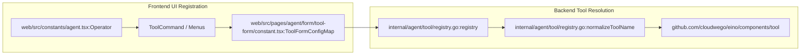
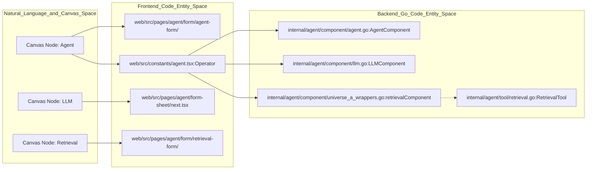
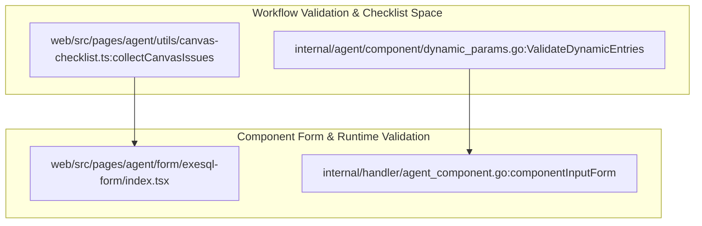
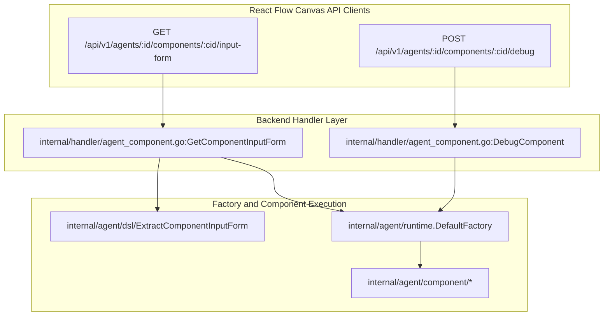
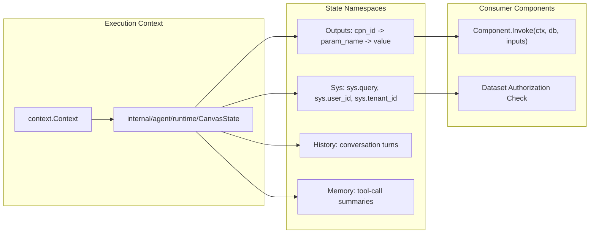

<!-- source: DeepWiki mcp.deepwiki.com · repo infiniflow/ragflow · page 8.2 Component System Architecture · fetched 2026-10-29 -->

# Component System Architecture

Relevant source files

The following files were used as context for generating this wiki page:

- [internal/agent/component/agent_meta_test.go](internal/agent/component/agent_meta_test.go)
- [internal/agent/component/categorize.go](internal/agent/component/categorize.go)
- [internal/agent/component/categorize_decision.go](internal/agent/component/categorize_decision.go)
- [internal/agent/component/categorize_decision_integration_test.go](internal/agent/component/categorize_decision_integration_test.go)
- [internal/agent/component/categorize_decision_test.go](internal/agent/component/categorize_decision_test.go)
- [internal/agent/component/categorize_test.go](internal/agent/component/categorize_test.go)
- [internal/agent/component/data_operations.go](internal/agent/component/data_operations.go)
- [internal/agent/component/data_operations_test.go](internal/agent/component/data_operations_test.go)
- [internal/agent/component/dynamic_params.go](internal/agent/component/dynamic_params.go)
- [internal/agent/component/dynamic_params_test.go](internal/agent/component/dynamic_params_test.go)
- [internal/agent/component/exesql_params.go](internal/agent/component/exesql_params.go)
- [internal/agent/component/exesql_params_test.go](internal/agent/component/exesql_params_test.go)
- [internal/agent/component/llm_credentials.go](internal/agent/component/llm_credentials.go)
- [internal/agent/component/llm_id.go](internal/agent/component/llm_id.go)
- [internal/agent/component/llm_id_test.go](internal/agent/component/llm_id_test.go)
- [internal/agent/runtime/state.go](internal/agent/runtime/state.go)
- [internal/agent/runtime/state_test.go](internal/agent/runtime/state_test.go)
- [internal/agent/tool/github.go](internal/agent/tool/github.go)
- [internal/agent/tool/github_test.go](internal/agent/tool/github_test.go)
- [internal/agentic_rag/decision_judge_test.go](internal/agentic_rag/decision_judge_test.go)
- [internal/entity/models/systemone.go](internal/entity/models/systemone.go)
- [internal/entity/models/systemone_test.go](internal/entity/models/systemone_test.go)
- [internal/handler/agent_component.go](internal/handler/agent_component.go)
- [internal/handler/agent_component_test.go](internal/handler/agent_component_test.go)
- [web/src/pages/agent/components/canvas-checklist.test.tsx](web/src/pages/agent/components/canvas-checklist.test.tsx)
- [web/src/pages/agent/components/canvas-checklist.tsx](web/src/pages/agent/components/canvas-checklist.tsx)
- [web/src/pages/agent/form/exesql-form/index.tsx](web/src/pages/agent/form/exesql-form/index.tsx)
- [web/src/pages/agent/form/exesql-form/use-submit-form.ts](web/src/pages/agent/form/exesql-form/use-submit-form.ts)
- [web/src/pages/agent/hooks/use-run-preflight.test.ts](web/src/pages/agent/hooks/use-run-preflight.test.ts)
- [web/src/pages/agent/options.ts](web/src/pages/agent/options.ts)
- [web/src/pages/agent/utils/__tests__/canvas-checklist.test.ts](web/src/pages/agent/utils/__tests__/canvas-checklist.test.ts)
- [web/src/pages/agent/utils/canvas-checklist.ts](web/src/pages/agent/utils/canvas-checklist.ts)

## Purpose and Scope

This document details the internal architecture of the component system in RAGFlow, which forms the foundation for building Agent, Workflow, and Pipeline functionality. Components are modular, self-contained Go structs performing discrete functions such as invoking LLM models, performing retrieval, categorization, data operations, messaging, or calling external APIs within a Canvas workflow.

RAGFlow features a Go-native backend coupled with a React frontend. This page covers the base component abstractions, parameter schemas and validation, component factory/registry mechanisms, runtime state management, tool wiring, and the critical parity between backend Go components and frontend React dynamic forms and API debug endpoints.

For orchestration and workflow runtime details, see [Canvas Engine and DSL](). For specific built-in components and their front-end forms, see [Built-in Components]().

Sources:
[internal/agent/component/agent.go:75-122](), [internal/agent/component/llm.go:38-113](), [internal/agent/component/message.go:48-64](), [internal/agent/component/universe_a_wrappers.go:155-169](), [internal/agent/component/data_operations.go:160-183]()

---

## Component Struct Hierarchy and Abstractions

The Go component architecture relies on concrete structs and shared parameter models rather than heavy class inheritance hierarchies. Components implement standard interfaces for execution (`Invoke`, `Stream`) and metadata introspection (`Name`, `Inputs`, `Outputs`, `GetInputForm`).

### Core Component Structs

- `AgentComponent`: A multi-turn ReAct agent powered by CloudWeGo's Eino flow framework, wrapping tool-calling chat models [internal/agent/component/agent.go:75-78]().
- `LLMComponent`: A one-shot language model invocation component, reading system and user prompts [internal/agent/component/llm.go:38-41]().
- `MessageComponent`: The canvas terminal output node, handling Jinja2-style template resolution, output formatting, audio synthesis, and memory persistence [internal/agent/component/message.go:48-64]().
- `retrievalComponent`: Adapts the DSL retrieval parameters at build time and delegates per-invocation execution to `agenttool.RetrievalTool` and `nlp.RetrievalService` [internal/agent/component/universe_a_wrappers.go:155-169]().
- `DataOperationsComponent`: Applies discrete dictionary and list transformations (`select_keys`, `literal_eval`, `combine`, `filter_values`, `append_or_update`, `remove_keys`, `rename_keys`) to canvas variables [internal/agent/component/data_operations.go:23-36](), [internal/agent/component/data_operations.go:160-183]().
- `GenerateStub` and `IterationStub`: Legacy v1 fixtures that alias deprecated names (`Generate`, `Iteration`, `IterationItem`) to canonical Go implementations (`LLMComponent` and `Parallel`) for backward compatibility [internal/agent/component/fixture_stubs.go:54-67](), [internal/agent/component/fixture_stubs.go:155-168]().

### Parameter Schemas

Each component type is paired with a strongly typed Go parameter struct:
- `AgentParam`: Captures multi-round limits, system/user prompts, thinking flags, max tokens, temperature, and bound tools [internal/agent/component/agent.go:81-121]().
- `LLMParam`: Captures model ID, prompts, sampling hyperparameters (`Temperature`, `TopP`, `PresencePenalty`, `FrequencyPenalty`), JSON output options, and structured schemas [internal/agent/component/llm.go:44-112]().
- `retrievalParams`: Captures dataset IDs, query templates, top-$N$, top-$K$, similarity thresholds, rerankers, and cross-language settings [internal/agent/component/universe_a_wrappers.go:71-86]().
- `dataOperationsParam`: Captures query references, operation type, select/remove/rename keys, and filter/update rules [internal/agent/component/data_operations.go:54-62]().

```mermaid
graph TB
    subgraph "Go Parameter Structs"
        AgentParam["internal/agent/component/agent.go:AgentParam"]
        LLMParam["internal/agent/component/llm.go:LLMParam"]
        RetrievalParams["internal/agent/component/universe_a_wrappers.go:retrievalParams"]
        DataOpsParam["internal/agent/component/data_operations.go:dataOperationsParam"]
    end

    subgraph "Go Component Entities"
        AgentComp["internal/agent/component/agent.go:AgentComponent"] -.-> AgentParam
        LLMComp["internal/agent/component/llm.go:LLMComponent"] -.-> LLMParam
        RetrievalComp["internal/agent/component/universe_a_wrappers.go:retrievalComponent"] -.-> RetrievalParams
        DataOpsComp["internal/agent/component/data_operations.go:DataOperationsComponent"] -.-> DataOpsParam
    end

    subgraph "Execution Runtime"
        AgentComp --> EinoReact["eino/flow/agent/react"]
        LLMComp --> EinoChat["models.EinoChatModel"]
        RetrievalComp --> RetrievalTool["agenttool.RetrievalTool"]
        DataOpsComp --> StateEngine["runtime.CanvasState"]
    end
```

Sources:
[internal/agent/component/agent.go:75-121](), [internal/agent/component/llm.go:38-112](), [internal/agent/component/message.go:48-64](), [internal/agent/component/universe_a_wrappers.go:71-86](), [internal/agent/component/universe_a_wrappers.go:155-169](), [internal/agent/component/data_operations.go:54-62](), [internal/agent/component/data_operations.go:160-183](), [internal/agent/component/fixture_stubs.go:54-67](), [internal/agent/component/fixture_stubs.go:155-168]()

---

## Parameter Schemas, Initialization, and Validation

Component configurations flow from frontend JSON definitions into Go parameter objects or runtime map structures. Default values and initial parameters are strictly synchronized between the React state management and the Go execution engine.

- **Initial State Maps**: The frontend establishes baseline parameters via maps such as `initialLlmBaseValues`, `initialRetrievalValues`, and `initialCategorizeValues` [web/src/pages/agent/constant/index.tsx:89-136](), [web/src/constants/agent.tsx:66-73]().
- **Parameter Gating**: Boolean switches (`*Disabled`) in parameter structs ensure that runtime inputs carrying values without their corresponding enable flag do not inadvertently re-enable samplers or penalties [internal/agent/component/agent.go:118-121](), [internal/agent/component/llm.go:69-77]().
- **Validation Rules**: Parameter structs and dynamic validation routines like `ValidateDynamicEntries` (`internal/agent/component/dynamic_params.go`) inspect complex repeatable parameters (such as message contents, agent tool lists, database connection settings, and loop/iteration rules) before graph compilation [internal/agent/component/dynamic_params.go:18-121](). Front-end Zod schemas (e.g., `ExeSQLFormSchema` in `web/src/pages/agent/form/exesql-form/use-submit-form.ts`) mirror these structural constraints [web/src/pages/agent/form/exesql-form/use-submit-form.ts:15-41]().

Sources:
[web/src/pages/agent/constant/index.tsx:89-136](), [web/src/constants/agent.tsx:66-73](), [internal/agent/component/agent.go:118-121](), [internal/agent/component/llm.go:69-77](), [internal/agent/component/dynamic_params.go:18-121](), [web/src/pages/agent/form/exesql-form/use-submit-form.ts:15-41]()

---

## Registry, Wiring, and Tool Integration

Components and tools are registered and discovered dynamically via operator enums, factory registries, and name normalization layers.

### Tool Configuration and Command Mapping

Tools available to agents are organized into category menus (`ToolCommand`) and mapped via form configuration registries (`ToolFormConfigMap`) [web/src/pages/agent/form/agent-form/tool-popover/tool-command.tsx:20-58](), [web/src/pages/agent/form/tool-form/constant.tsx:25-52]().

On the backend, `internal/agent/tool/registry.go` maintains a global `registry` map linking tool identifiers (such as `retrieval`, `code_exec`, `wikipedia`, `execute_sql`) to corresponding `Factory` functions [internal/agent/tool/registry.go:34-78](). The `normalizeToolName` helper bridges differences between Canvas component names (e.g., `CodeExec`, `GoogleScholar`) and snake_case backend registry keys (`code_exec`, `google_scholar`) [internal/agent/tool/registry.go:84-96](), [internal/agent/tool/registry.go:157-160]().

Sources:
[web/src/constants/agent.tsx:84-150](), [web/src/pages/agent/form/agent-form/tool-popover/tool-command.tsx:20-58](), [web/src/pages/agent/form/tool-form/constant.tsx:25-52](), [internal/agent/tool/registry.go:34-96](), [internal/agent/tool/registry.go:157-160]()

---

## Natural Language Space to Code Entity Space Mapping

This diagram maps user-facing Canvas nodes and operator definitions directly to their corresponding Go component implementations and frontend form renderers.

Sources:
[web/src/constants/agent.tsx:84-150](), [web/src/pages/agent/canvas/index.tsx:87-116](), [internal/agent/component/agent.go:75-121](), [internal/agent/component/llm.go:38-112](), [internal/agent/component/universe_a_wrappers.go:155-169](), [internal/agent/tool/retrieval.go:94-111]()

Sources:
[web/src/pages/agent/utils/canvas-checklist.ts:1-60](), [internal/agent/component/dynamic_params.go:18-54](), [internal/handler/agent_component.go:78-111]()

---

## Frontend-Backend Parity: Node Types, Form Introspection, and Debugging APIs

To maintain parity between the React canvas and the Go execution engine, node types, configuration forms, and runtime debugging endpoints are symmetrically defined:

- **Node Types Registry**: React Flow instances register custom node renderers via `nodeTypes` in `web/src/pages/agent/canvas/index.tsx` [web/src/pages/agent/canvas/index.tsx:87-116]().
- **Operator Initialization**: `useInitializeOperatorParams` instantiates default configuration structures mapped to each `Operator` key [web/src/pages/agent/hooks/use-add-node.ts:154-205]().
- **Component Input Form API**: `GET /api/v1/agents/:canvas_id/components/:component_id/input-form` (`AgentHandler.GetComponentInputForm`) inspects the component DSL or dynamically instantiates the component using `runtime.DefaultFactory()` to call `GetInputForm()` [internal/handler/agent_component.go:47-111]().
- **Component Debug API**: `POST /api/v1/agents/:canvas_id/components/:component_id/debug` (`AgentHandler.DebugComponent`) extracts node parameters, flattens request arguments, seeds user identity, and executes `Invoke()` on the instantiated component [internal/handler/agent_component.go:113-193]().

Sources:
[web/src/pages/agent/canvas/index.tsx:87-116](), [web/src/pages/agent/hooks/use-add-node.ts:154-205](), [internal/handler/agent_component.go:47-193]()

---

## Runtime State Management (`CanvasState`)

During workflow execution, components communicate and share outputs through `runtime.CanvasState` (`internal/agent/runtime/state.go`). 

- **State Bag Structure**: `CanvasState` maintains concurrent-safe maps for node outputs (`Outputs`), system variables (`Sys`), environment constants (`Env`), execution path (`Path`), conversation history (`History`), and temporary tool memories (`Memory`) [internal/agent/runtime/state.go:60-74]().
- **Identity Seeding**: `SeedIdentity` ensures that user and tenant IDs are securely propagated into `Sys` (`sys.user_id`, `sys.tenant_id`) for downstream authorization checks [internal/agent/runtime/state.go:123-138]().
- **Serialization Registry**: `CanvasState` registers itself with Eino's internal serialization mechanism (`compose.RegisterSerializableType`) to support workflow checkpointing, interruption, and resumption [internal/agent/runtime/state.go:140-151]().

Sources:
[internal/agent/runtime/state.go:60-151]()

---

# Summary

RAGFlow's component system architecture bridges the React frontend canvas with a robust Go-native execution engine:
- Go structs (`AgentComponent`, `LLMComponent`, `MessageComponent`, `retrievalComponent`, `DataOperationsComponent`) encapsulate discrete workflow and transformation logic.
- Strongly typed parameter structs (`AgentParam`, `LLMParam`, `retrievalParams`, `dataOperationsParam`) govern component configuration and validation.
- Tool registries, normalization layers, and operator enums (`Operator`) unify backend execution with frontend canvas node creation.
- REST endpoints (`GetComponentInputForm`, `DebugComponent`) and shared runtime state (`CanvasState`) ensure full parity and interactivity between frontend dynamic forms and backend execution entities.

Sources:
[internal/agent/component/agent.go:75-121](), [internal/agent/component/llm.go:38-112](), [internal/agent/component/message.go:48-64](), [internal/agent/component/universe_a_wrappers.go:71-169](), [internal/agent/component/data_operations.go:54-183](), [internal/handler/agent_component.go:47-193](), [internal/agent/runtime/state.go:60-151]()

---

