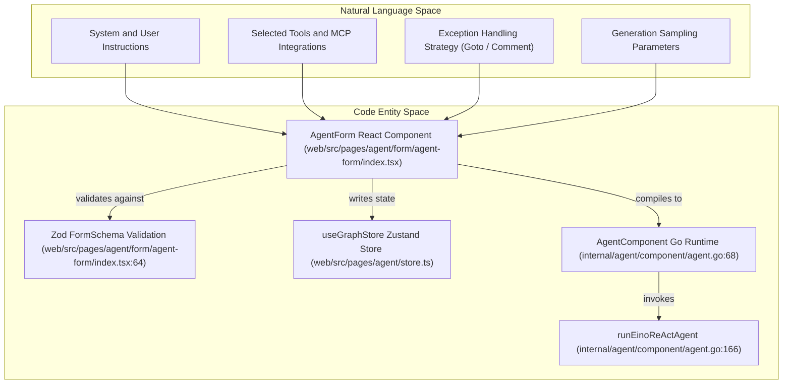
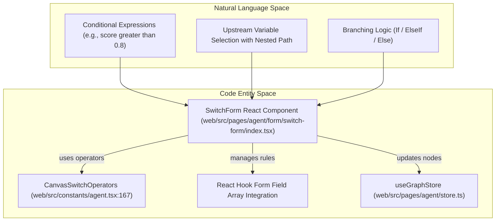

<!-- source: DeepWiki mcp.deepwiki.com · repo infiniflow/ragflow · page 8.3 Built-in Components and Node Forms · fetched 2026-10-29 -->

# Built-in Components and Node Forms

Relevant source files

The following files were used as context for generating this wiki page:

- [internal/agent/canvas/canvas_streaming_e2e_test.go](internal/agent/canvas/canvas_streaming_e2e_test.go)
- [internal/agent/canvas/direct_message_downstream_test.go](internal/agent/canvas/direct_message_downstream_test.go)
- [internal/agent/canvas/loop_subgraph.go](internal/agent/canvas/loop_subgraph.go)
- [internal/agent/canvas/node_body.go](internal/agent/canvas/node_body.go)
- [internal/agent/canvas/node_body_timeout_test.go](internal/agent/canvas/node_body_timeout_test.go)
- [internal/agent/canvas/scheduler.go](internal/agent/canvas/scheduler.go)
- [internal/agent/component/agent.go](internal/agent/component/agent.go)
- [internal/agent/component/agent_test.go](internal/agent/component/agent_test.go)
- [internal/agent/component/llm.go](internal/agent/component/llm.go)
- [internal/agent/component/llm_retry.go](internal/agent/component/llm_retry.go)
- [internal/agent/component/llm_retry_test.go](internal/agent/component/llm_retry_test.go)
- [internal/agent/component/llm_test.go](internal/agent/component/llm_test.go)
- [internal/agent/component/message.go](internal/agent/component/message.go)
- [internal/agent/component/message_test.go](internal/agent/component/message_test.go)
- [internal/agent/component/reference_recording_tool.go](internal/agent/component/reference_recording_tool.go)
- [internal/agent/component/reference_recording_tool_test.go](internal/agent/component/reference_recording_tool_test.go)
- [internal/agent/component/streaming_test.go](internal/agent/component/streaming_test.go)
- [internal/agent/runtime/context.go](internal/agent/runtime/context.go)
- [internal/entity/models/llm.go](internal/entity/models/llm.go)
- [internal/entity/models/llm_test.go](internal/entity/models/llm_test.go)
- [web/src/components/canvas/background.tsx](web/src/components/canvas/background.tsx)
- [web/src/components/collapse.tsx](web/src/components/collapse.tsx)
- [web/src/components/home-card.tsx](web/src/components/home-card.tsx)
- [web/src/components/llm-setting-items/use-watch-change.ts](web/src/components/llm-setting-items/use-watch-change.ts)
- [web/src/components/ui/sheet.tsx](web/src/components/ui/sheet.tsx)
- [web/src/constants/agent.tsx](web/src/constants/agent.tsx)
- [web/src/global.less](web/src/global.less)
- [web/src/interfaces/database/agent.ts](web/src/interfaces/database/agent.ts)
- [web/src/pages/agent/canvas/edge/index.tsx](web/src/pages/agent/canvas/edge/index.tsx)
- [web/src/pages/agent/canvas/index.tsx](web/src/pages/agent/canvas/index.tsx)
- [web/src/pages/agent/canvas/node/agent-node.tsx](web/src/pages/agent/canvas/node/agent-node.tsx)
- [web/src/pages/agent/canvas/node/begin-node.tsx](web/src/pages/agent/canvas/node/begin-node.tsx)
- [web/src/pages/agent/canvas/node/categorize-node.tsx](web/src/pages/agent/canvas/node/categorize-node.tsx)
- [web/src/pages/agent/canvas/node/dropdown/accordion-operators.tsx](web/src/pages/agent/canvas/node/dropdown/accordion-operators.tsx)
- [web/src/pages/agent/canvas/node/dropdown/next-step-dropdown.tsx](web/src/pages/agent/canvas/node/dropdown/next-step-dropdown.tsx)
- [web/src/pages/agent/canvas/node/handle.tsx](web/src/pages/agent/canvas/node/handle.tsx)
- [web/src/pages/agent/canvas/node/index.tsx](web/src/pages/agent/canvas/node/index.tsx)
- [web/src/pages/agent/canvas/node/iteration-node.tsx](web/src/pages/agent/canvas/node/iteration-node.tsx)
- [web/src/pages/agent/canvas/node/message-node.tsx](web/src/pages/agent/canvas/node/message-node.tsx)
- [web/src/pages/agent/canvas/node/node-wrapper.tsx](web/src/pages/agent/canvas/node/node-wrapper.tsx)
- [web/src/pages/agent/canvas/node/note-node/index.tsx](web/src/pages/agent/canvas/node/note-node/index.tsx)
- [web/src/pages/agent/canvas/node/resize-icon.tsx](web/src/pages/agent/canvas/node/resize-icon.tsx)
- [web/src/pages/agent/canvas/node/retrieval-node.tsx](web/src/pages/agent/canvas/node/retrieval-node.tsx)
- [web/src/pages/agent/canvas/node/switch-node.tsx](web/src/pages/agent/canvas/node/switch-node.tsx)
- [web/src/pages/agent/constant/index.tsx](web/src/pages/agent/constant/index.tsx)
- [web/src/pages/agent/context.ts](web/src/pages/agent/context.ts)
- [web/src/pages/agent/form-sheet/form-config-map.tsx](web/src/pages/agent/form-sheet/form-config-map.tsx)
- [web/src/pages/agent/form-sheet/next.tsx](web/src/pages/agent/form-sheet/next.tsx)
- [web/src/pages/agent/form/agent-form/index.tsx](web/src/pages/agent/form/agent-form/index.tsx)
- [web/src/pages/agent/form/agent-form/tool-popover/tool-command.tsx](web/src/pages/agent/form/agent-form/tool-popover/tool-command.tsx)
- [web/src/pages/agent/form/agent-form/use-show-structured-output-dialog.ts](web/src/pages/agent/form/agent-form/use-show-structured-output-dialog.ts)
- [web/src/pages/agent/form/agent-form/use-values.ts](web/src/pages/agent/form/agent-form/use-values.ts)
- [web/src/pages/agent/form/agent-form/use-watch-change.ts](web/src/pages/agent/form/agent-form/use-watch-change.ts)
- [web/src/pages/agent/form/begin-form/index.tsx](web/src/pages/agent/form/begin-form/index.tsx)
- [web/src/pages/agent/form/begin-form/parameter-dialog.tsx](web/src/pages/agent/form/begin-form/parameter-dialog.tsx)
- [web/src/pages/agent/form/begin-form/query-table.tsx](web/src/pages/agent/form/begin-form/query-table.tsx)
- [web/src/pages/agent/form/begin-form/use-edit-query.ts](web/src/pages/agent/form/begin-form/use-edit-query.ts)
- [web/src/pages/agent/form/begin-form/use-values.ts](web/src/pages/agent/form/begin-form/use-values.ts)
- [web/src/pages/agent/form/begin-form/use-watch-change.ts](web/src/pages/agent/form/begin-form/use-watch-change.ts)
- [web/src/pages/agent/form/code-form/index.tsx](web/src/pages/agent/form/code-form/index.tsx)
- [web/src/pages/agent/form/code-form/next-variable.tsx](web/src/pages/agent/form/code-form/next-variable.tsx)
- [web/src/pages/agent/form/code-form/schema.ts](web/src/pages/agent/form/code-form/schema.ts)
- [web/src/pages/agent/form/code-form/use-values.ts](web/src/pages/agent/form/code-form/use-values.ts)
- [web/src/pages/agent/form/code-form/use-watch-change.ts](web/src/pages/agent/form/code-form/use-watch-change.ts)
- [web/src/pages/agent/form/invoke-form/variable-table.tsx](web/src/pages/agent/form/invoke-form/variable-table.tsx)
- [web/src/pages/agent/form/message-form/use-values.ts](web/src/pages/agent/form/message-form/use-values.ts)
- [web/src/pages/agent/form/retrieval-form/next.tsx](web/src/pages/agent/form/retrieval-form/next.tsx)
- [web/src/pages/agent/form/switch-form/index.tsx](web/src/pages/agent/form/switch-form/index.tsx)
- [web/src/pages/agent/form/tool-form/constant.tsx](web/src/pages/agent/form/tool-form/constant.tsx)
- [web/src/pages/agent/form/tool-form/retrieval-form/index.tsx](web/src/pages/agent/form/tool-form/retrieval-form/index.tsx)
- [web/src/pages/agent/form/user-fill-up-form/index.tsx](web/src/pages/agent/form/user-fill-up-form/index.tsx)
- [web/src/pages/agent/form/user-fill-up-form/use-watch-change.ts](web/src/pages/agent/form/user-fill-up-form/use-watch-change.ts)
- [web/src/pages/agent/hooks.test.tsx](web/src/pages/agent/hooks.test.tsx)
- [web/src/pages/agent/hooks.tsx](web/src/pages/agent/hooks.tsx)
- [web/src/pages/agent/hooks/use-add-node.ts](web/src/pages/agent/hooks/use-add-node.ts)
- [web/src/pages/agent/hooks/use-agent-tool-initial-values.ts](web/src/pages/agent/hooks/use-agent-tool-initial-values.ts)
- [web/src/pages/agent/hooks/use-cache-chat-log.ts](web/src/pages/agent/hooks/use-cache-chat-log.ts)
- [web/src/pages/agent/hooks/use-show-drawer.tsx](web/src/pages/agent/hooks/use-show-drawer.tsx)
- [web/src/pages/agent/hooks/use-watch-form-change.ts](web/src/pages/agent/hooks/use-watch-form-change.ts)
- [web/src/pages/agent/log-sheet/index.tsx](web/src/pages/agent/log-sheet/index.tsx)
- [web/src/pages/agent/log-sheet/tool-timeline-item.tsx](web/src/pages/agent/log-sheet/tool-timeline-item.tsx)
- [web/src/pages/agent/log-sheet/workflow-timeline.tsx](web/src/pages/agent/log-sheet/workflow-timeline.tsx)
- [web/src/pages/agent/store.ts](web/src/pages/agent/store.ts)
- [web/src/pages/agent/utils/build-output-list.ts](web/src/pages/agent/utils/build-output-list.ts)
- [web/src/pages/agents/agent-card.tsx](web/src/pages/agents/agent-card.tsx)
- [web/src/pages/agents/agent-dropdown.tsx](web/src/pages/agents/agent-dropdown.tsx)
- [web/src/pages/agents/use-rename-agent.ts](web/src/pages/agents/use-rename-agent.ts)

This page details RAGFlow's built-in components and their corresponding node forms used within the visual canvas system. These components serve as the foundational building blocks for constructing retrieval-augmented generation (RAG) pipelines, multi-turn conversational agents, and programmable logic workflows. Each component encompasses a React Flow canvas node representation (`RAGFlowNodeType`), a configuration form implemented with React Hook Form and Zod validation, and backend runtime semantics executed within Go.

---

## Component Overview and Classifications

RAGFlow categorizes its built-in components based on their function in workflow construction:

| Category | Components | Purpose |
| --- | --- | --- |
| **LLM & Agent** | `Agent`, `LLM`, `RewriteQuestion`, `Extractor` | Model invocations, multi-turn reasoning, prompt rewriting, data extraction |
| **Retrieval & Search** | `Retrieval`, `DuckDuckGo`, `Wikipedia`, `PubMed`, `ArXiv`, `Google`, `Bing`, `SearXNG` | Dataset chunk retrieval and external web search tool integration |
| **Control Flow** | `Categorize`, `Switch`, `Iteration`, `Loop`, `ExitLoop` | Conditional branching, intent classification, looping, and list iteration |
| **Data & Logic** | `Code`, `DataOperations`, `ListOperations`, `VariableAssigner`, `VariableAggregator` | Sandboxed script execution, data transformations, variable assignment |
| **Integration & Tools** | `Tool`, `Invoke`, `Message`, `Email`, `Crawler` | External HTTP APIs, custom tool bindings, message dispatch, web scraping |
| **Entry Point** | `Begin` | Workflow entry point supporting conversational, task, and webhook modes |

Sources:  
[web/src/pages/agent/form/agent-form/index.tsx:1-198](),  
[web/src/pages/agent/form/begin-form/index.tsx:1-190](),  
[web/src/pages/agent/form-sheet/next.tsx:1-164](),  
[web/src/constants/agent.tsx:85-148]()

---

## LLM / Agent Components

### LLM Component

The `LLM` component handles single-turn Large Language Model calls. It exposes parameters for system and user prompts, sampling controls (`temperature`, `top_p`, `max_tokens`), and JSON schema validation for structured outputs. In the backend, it wraps model drivers conforming to chat model interfaces.

### Agent Component

The `Agent` component implements a multi-turn ReAct agent supporting tool orchestration, sub-agent delegation, and custom exception handling. It utilizes eino's `react.AgentConfig` and delegates execution to `runEinoReActAgent` [internal/agent/component/agent.go:26-30]().

#### Implementation & Form Details

The `AgentForm` schema (`FormSchema`) manages parameters such as `sys_prompt`, `user_prompt`, `message_history_window_size`, `max_retries`, and `exception_method` (`AgentExceptionMethod.Goto` or `Comment`) [web/src/pages/agent/form/agent-form/index.tsx:64-90](). The form sheet coordinates runtime validation, model selection via `LargeModelFormField`, and single-step debugging drawers [web/src/pages/agent/form-sheet/next.tsx:84-158]().

The canvas node `AgentNode` renders handles for main flow, exception routing (`NodeHandleId.AgentException`), and attached tools (`NodeHandleId.Tool`) [web/src/pages/agent/canvas/index.tsx:99]().

#### Natural Language to Code Entity Mapping: LLM / Agent Component

Sources:  
[web/src/pages/agent/form/agent-form/index.tsx:64-198](),  
[web/src/pages/agent/form-sheet/next.tsx:54-160](),  
[web/src/pages/agent/store.ts:146-214](),  
[internal/agent/component/agent.go:68-166]()

---

## Retrieval Component

The `Retrieval` component queries vector and hybrid indexes across datasets or memory stores. It manages query templates, top-$N$ limits, score thresholds, and metadata filters. The initial configuration parameters are defined by `initialRetrievalValues` which establishes default bindings for `query`, `top_n`, `rerank_candidates_count`, and `dataset_ids` [web/src/pages/agent/constant/index.tsx:88-112]().

Sources:  
[web/src/pages/agent/constant/index.tsx:88-112](),  
[web/src/pages/agent/form/retrieval-form/next.tsx:47-97]()

---

## Categorize Component

The `Categorize` component routes input queries through an LLM classifier to match user-defined categories. The form manages category names and description dictionaries (`category_description`), which translate classification outputs into distinct conditional canvas edges. Default parameters are instantiated via `initialCategorizeValues` [web/src/pages/agent/constant/index.tsx:118-129]().

Sources:  
[web/src/pages/agent/constant/index.tsx:118-129]()

---

## Message Component

The `Message` component constructs text or markdown responses to be sent back to the user or downstream nodes. 

### Implementation

`MessageComponent` parses parameters like `text`, `content`, `output_format`, and TTS configuration (`auto_play`, `voice`, `lang`) [internal/agent/component/message.go:55-102](). At runtime, its `Invoke` method resolves the template against the `*CanvasState` and produces output under `outputs["content"]` [internal/agent/component/message.go:154-174]().

Sources:  
[internal/agent/component/message.go:55-174](),  
[web/src/pages/agent/constant/index.tsx:131-133]()

---

## Control Flow Components

### Switch Component

The `Switch` component implements multi-branch conditional logic (`If`, `ElseIf`, `Else`) utilizing comparison operators (`CanvasSwitchOperators`) and logical operators (`SwitchLogicOperator`) [web/src/constants/agent.tsx:167-180]().

#### Natural Language to Code Entity Mapping: Switch Component

Sources:  
[web/src/constants/agent.tsx:167-180](),  
[web/src/pages/agent/store.ts:1-214]()

### Iteration and Loop Components

- `Iteration`: Iterates over incoming list variables, executing internal subgraphs per item using `IterationStart` nodes [web/src/pages/agent/hooks/use-add-node.ts:91-116]().
- `Loop`: Managed by `LoopStart` and `ExitLoop` nodes to execute repeated cycles with state accumulation.

Sources:  
[web/src/pages/agent/hooks/use-add-node.ts:91-116](),  
[web/src/constants/agent.tsx:144-146]()

---

## Code and Variable Operations

### Code Component

The `Code` component executes Python or JavaScript snippets inside sandboxed execution providers. It accepts input variables and returns dictionary outputs. Default code templates are structured via `CodeTemplateStrMap` mapping programming languages to initial execution boilerplate [web/src/constants/agent.tsx:31-44]().

### Variable Operations

- `VariableAssigner`: Sets explicit variable mappings.
- `VariableAggregator`: Combines multiple incoming stream values into unified lists or summaries.

Sources:  
[web/src/constants/agent.tsx:31-44](),  
[web/src/constants/agent.tsx:129-130]()

---

## Integration Components

### Tool Component

The `Tool` component aggregates built-in tools, custom functions, and Model Context Protocol (MCP) servers into an executable command palette. `FormSheet` inspects component descriptors and tool metadata dynamically [web/src/pages/agent/form-sheet/next.tsx:54-68]().

### Invoke Component

The `Invoke` component executes external HTTP requests with dynamic URL templating, custom headers, and request body payloads bound to canvas variables.

Sources:  
[web/src/pages/agent/form-sheet/next.tsx:54-68](),  
[web/src/pages/agent/hooks/use-add-node.ts:182]()

---

## Begin Component

The `Begin` node represents the entry point of every RAGFlow workflow.

### Modes and Form Configuration

`BeginForm` supports three distinct execution modes via `AgentDialogueMode`:
- `Conversational`: Multi-turn chat ingestion with optional opening copy (`prologue`) [web/src/pages/agent/form/begin-form/index.tsx:31-38]().
- `Task`: Single-execution pipeline mode.
- `Webhook`: External HTTP event-driven invocation.

It also manages input parameters via `QueryTable` and file layout recognition settings when file inputs are detected [web/src/pages/agent/form/begin-form/index.tsx:59-185]().

Sources:  
[web/src/pages/agent/form/begin-form/index.tsx:27-191]()

---

