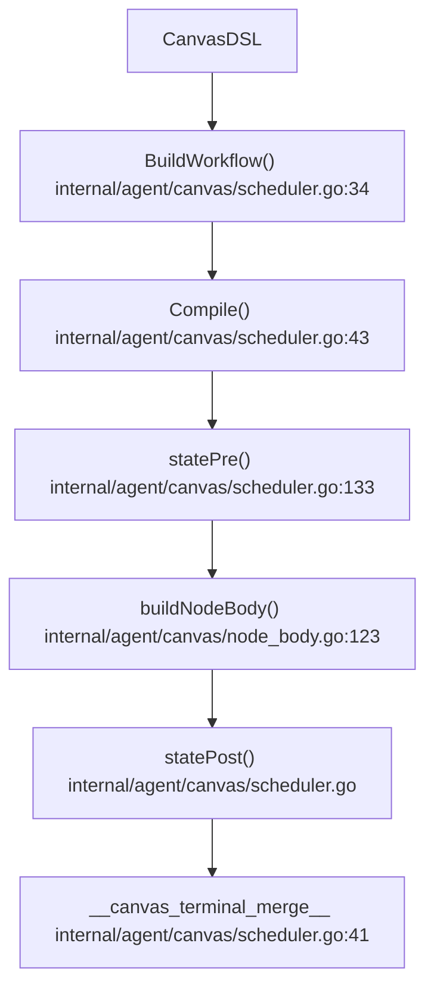
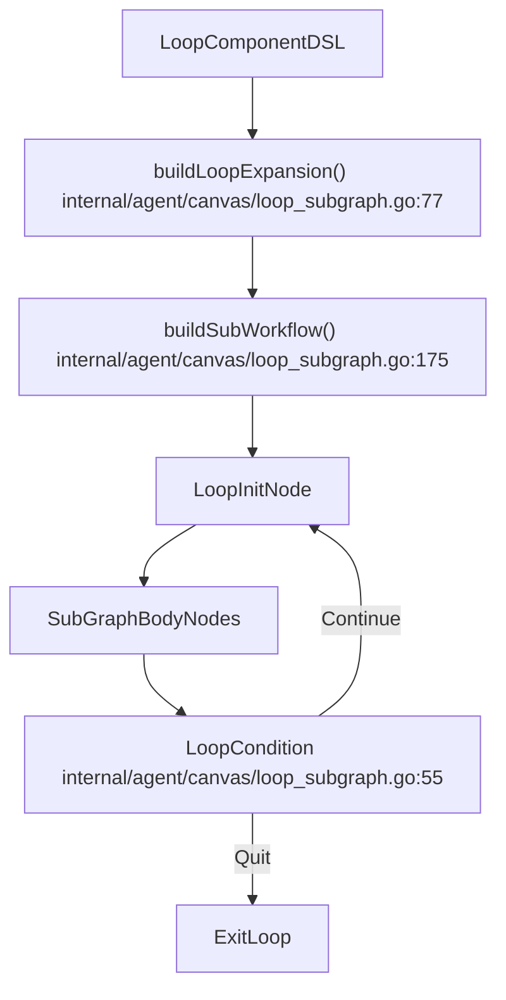
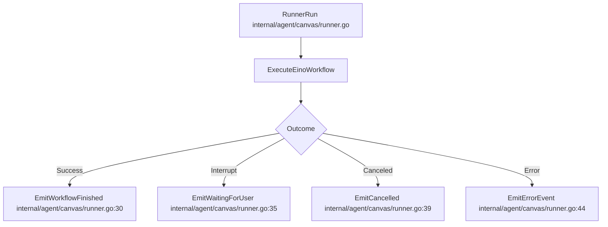
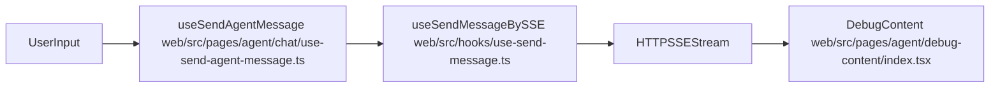
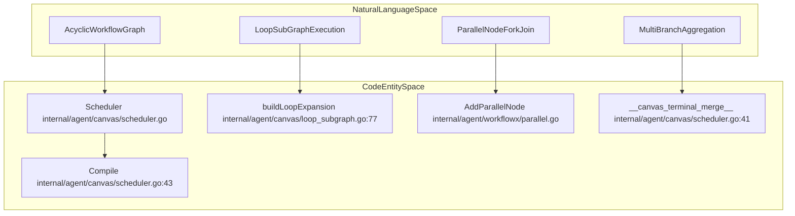
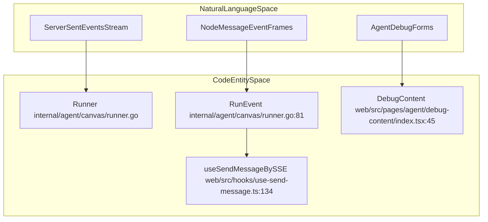

<!-- source: DeepWiki mcp.deepwiki.com · repo infiniflow/ragflow · page 8.4 Workflow Execution and Streaming · fetched 2026-10-29 -->

# Workflow Execution and Streaming

Relevant source files

The following files were used as context for generating this wiki page:

- [internal/agent/canvas/canvas_streaming_e2e_test.go](internal/agent/canvas/canvas_streaming_e2e_test.go)
- [internal/agent/canvas/direct_message_downstream_test.go](internal/agent/canvas/direct_message_downstream_test.go)
- [internal/agent/canvas/loop_subgraph.go](internal/agent/canvas/loop_subgraph.go)
- [internal/agent/canvas/node_body.go](internal/agent/canvas/node_body.go)
- [internal/agent/canvas/node_body_timeout_test.go](internal/agent/canvas/node_body_timeout_test.go)
- [internal/agent/canvas/scheduler.go](internal/agent/canvas/scheduler.go)
- [internal/agent/component/agent.go](internal/agent/component/agent.go)
- [internal/agent/component/agent_test.go](internal/agent/component/agent_test.go)
- [internal/agent/component/llm.go](internal/agent/component/llm.go)
- [internal/agent/component/llm_retry.go](internal/agent/component/llm_retry.go)
- [internal/agent/component/llm_retry_test.go](internal/agent/component/llm_retry_test.go)
- [internal/agent/component/llm_test.go](internal/agent/component/llm_test.go)
- [internal/agent/component/message.go](internal/agent/component/message.go)
- [internal/agent/component/message_test.go](internal/agent/component/message_test.go)
- [internal/agent/component/reference_recording_tool.go](internal/agent/component/reference_recording_tool.go)
- [internal/agent/component/reference_recording_tool_test.go](internal/agent/component/reference_recording_tool_test.go)
- [internal/agent/component/streaming_test.go](internal/agent/component/streaming_test.go)
- [internal/agent/runtime/context.go](internal/agent/runtime/context.go)
- [internal/entity/models/llm.go](internal/entity/models/llm.go)
- [internal/entity/models/llm_test.go](internal/entity/models/llm_test.go)
- [web/src/pages/agent/canvas/node/data-operations-node.tsx](web/src/pages/agent/canvas/node/data-operations-node.tsx)
- [web/src/pages/agent/canvas/node/variable-aggregator-node.tsx](web/src/pages/agent/canvas/node/variable-aggregator-node.tsx)
- [web/src/pages/agent/debug-content/index.tsx](web/src/pages/agent/debug-content/index.tsx)
- [web/src/pages/agent/form-sheet/single-debug-sheet/index.tsx](web/src/pages/agent/form-sheet/single-debug-sheet/index.tsx)
- [web/src/pages/agent/form-sheet/single-debug-sheet/utils.ts](web/src/pages/agent/form-sheet/single-debug-sheet/utils.ts)
- [web/src/pages/agent/form/code-form/utils.ts](web/src/pages/agent/form/code-form/utils.ts)
- [web/src/pages/agent/form/components/dynamic-fom-header.tsx](web/src/pages/agent/form/components/dynamic-fom-header.tsx)
- [web/src/pages/agent/form/components/query-variable-list.tsx](web/src/pages/agent/form/components/query-variable-list.tsx)
- [web/src/pages/agent/form/data-operations-form/filter-values.tsx](web/src/pages/agent/form/data-operations-form/filter-values.tsx)
- [web/src/pages/agent/form/data-operations-form/index.tsx](web/src/pages/agent/form/data-operations-form/index.tsx)
- [web/src/pages/agent/form/data-operations-form/select-keys.tsx](web/src/pages/agent/form/data-operations-form/select-keys.tsx)
- [web/src/pages/agent/form/data-operations-form/updates.tsx](web/src/pages/agent/form/data-operations-form/updates.tsx)
- [web/src/pages/agent/form/variable-aggregator-form/dynamic-group-variable.tsx](web/src/pages/agent/form/variable-aggregator-form/dynamic-group-variable.tsx)
- [web/src/pages/agent/form/variable-aggregator-form/index.tsx](web/src/pages/agent/form/variable-aggregator-form/index.tsx)
- [web/src/pages/agent/form/variable-aggregator-form/schema.ts](web/src/pages/agent/form/variable-aggregator-form/schema.ts)
- [web/src/pages/agent/form/variable-aggregator-form/use-handle-name-change.ts](web/src/pages/agent/form/variable-aggregator-form/use-handle-name-change.ts)
- [web/src/pages/agent/form/variable-aggregator-form/use-watch-change.ts](web/src/pages/agent/form/variable-aggregator-form/use-watch-change.ts)
- [web/src/pages/agent/log-sheet/tool-timeline-item.tsx](web/src/pages/agent/log-sheet/tool-timeline-item.tsx)
- [web/src/pages/agent/run-sheet/index.tsx](web/src/pages/agent/run-sheet/index.tsx)
- [web/src/pages/agent/setting-dialog/setting-form.tsx](web/src/pages/agent/setting-dialog/setting-form.tsx)
- [web/src/utils/canvas-util.tsx](web/src/utils/canvas-util.tsx)

This page details the implementation of the **workflow execution and streaming engine** in RAGFlow. It covers the Go-native eino-based scheduler for asynchronous component execution, the extended workflowx control-flow primitives (loop and parallel), multibranch handling, server-sent events (SSE) generation, and the React frontend agent chat/debug streaming integration.

---

## 1. Eino-Based Scheduler and Workflow Compilation

The core workflow engine compiles a visual Canvas DSL into an **eino**-based Directed Acyclic Graph (DAG) using `internal/agent/canvas/scheduler.go`. Eino strictly requires graphs to be acyclic at compile time (`Compile()`), rejecting cycles immediately. Frontend validations (`hasCanvasCycle` in `web/src/pages/agent/hooks.tsx`) prevent cycle creation at the React Flow layer, guaranteeing production graphs arriving at `BuildWorkflow` are acyclic [internal/agent/canvas/scheduler.go:12-18]().

The scheduler wires state preprocessors (`statePre`) and postprocessors (`statePost`) onto nodes to synchronize outputs into the runtime `CanvasState` store [internal/agent/canvas/scheduler.go:9-11, 133-167](). It also propagates `RunMeta` via context, carrying the SSE event channel and message/session IDs needed for streaming emission during node execution [internal/agent/canvas/scheduler.go:35-62]().

Title: Eino Workflow Compilation and Node Binding Pipeline

Sources: [internal/agent/canvas/scheduler.go:1-167](), [internal/agent/canvas/node_body.go:123-159]()

---

## 2. Workflowx Loop and Parallel Extensions

Complex control flows like loops and parallel execution branches are handled via extensions in `internal/agent/workflowx/` and compiled through `internal/agent/canvas/loop_subgraph.go`:

- **Loop Subgraphs:** Collapses a Loop parent node and its downstream body components into a single eino sub-workflow node. A synthetic `LoopInit` node seeds loop variables, and a termination condition closure (`workflowx.LoopCondition`) evaluates loop continuation on each iteration [internal/agent/canvas/loop_subgraph.go:17-35]().
- **Parallel Nodes:** Executes sub-workflows concurrently across item collections up to configured concurrency limits, supporting per-item checkpointing and interrupt/resume mechanics [internal/agent/workflowx/parallel.go]() [internal/agent/canvas/loop_subgraph.go:1-121]().

Title: Workflowx Control-Flow Sub-Graph Expansion

Sources: [internal/agent/canvas/loop_subgraph.go:1-121](), [internal/agent/workflowx/parallel.go]()

---

## 3. Multibranch Handling and State Persistence

When workflows branch into parallel execution paths or loops, multiple concurrent nodes produce events simultaneously. 

- **Terminal Merge Node:** The scheduler inserts a specialized merge node (`__canvas_terminal_merge__`) to collect multi-branch outputs cleanly, ensuring that termination events (e.g., `WorkflowFinished`) are emitted only after all concurrent branches finish [internal/agent/canvas/scheduler.go:41-61]().
- **State Isolation:** Node outputs are tagged by component ID (`cpn_id`) and safely persisted within the shared `CanvasState` store [internal/agent/canvas/node_body.go:73-77](). Pre/post handlers ensure thread-safe variable resolution across branches [internal/agent/canvas/scheduler.go:133-167]().

Sources: [internal/agent/canvas/scheduler.go:35-167](), [internal/agent/canvas/node_body.go:73-77]()

---

## 4. Runner and SSE Event Generation

The execution runner (`internal/agent/canvas/runner.go`) drives Canvas execution and translates outcomes into structured `RunEvent` items pushed onto an output channel [internal/agent/canvas/runner.go:17-51]().

### Run Outcomes & Event Dispatch
1. **Normal Completion:** Emits progress events (`workflow_started`, `node_started`, `node_finished`, `message`, `message_end`, `workflow_finished`) followed by a completion marker [internal/agent/canvas/runner.go:30-34]().
2. **Eino Interrupt (`*InterruptSignal`):** Emits `waiting_for_user` with interrupt IDs, persisting state to allow subsequent resume actions via `compose.ResumeWithData` [internal/agent/canvas/runner.go:35-38]().
3. **Cancellation (`context.Canceled`):** Emits a `cancelled` event frame [internal/agent/canvas/runner.go:39-43]().
4. **Errors:** Emits an `error` event with error metadata [internal/agent/canvas/runner.go:44-45]().

Title: Runner Outcome Event Dispatch Pipeline

Sources: [internal/agent/canvas/runner.go:17-87]()

---

## 5. Frontend Agent Chat and Debug Streaming

The React frontend consumes event streams through specialized hooks and components.

- **SSE Hook (`useSendMessageBySSE`):** Opens a POST request supporting SSE `text/event-stream` responses, parsing stream chunks via `EventSourceParserStream` into an accumulated event list state [web/src/hooks/use-send-message.ts:134-221]().
- **Agent Message Hook (`useSendAgentMessage`):** Coordinates user chat input, SSE transmission, streaming delta accumulation, reasoning/thinking tags (`<think>`), citations, and error handling [web/src/pages/agent/chat/use-send-agent-message.ts:20-141]().
- **Debug Content (`DebugContent`):** Manages dynamic parameter input forms, validation schemas using `zod`, and JSON/text rendering for single-component test runs and workflow debugging [web/src/pages/agent/debug-content/index.tsx:45-106]().

Title: Frontend Event Streaming and Hook Integration

Sources: [web/src/hooks/use-send-message.ts:134-221](), [web/src/pages/agent/chat/use-send-agent-message.ts:20-141](), [web/src/pages/agent/debug-content/index.tsx:45-106]()

---

## 6. Summary Diagrams Bridging Natural Language Space to Code Entity Space

### Diagram A: Workflow Control Flow to Code Entities

Title: Natural Language Workflow Concepts to Code Entities

Sources: [internal/agent/canvas/scheduler.go:34-43](), [internal/agent/canvas/loop_subgraph.go:77](), [internal/agent/workflowx/parallel.go]()

### Diagram B: Streaming and Frontend Event Handling

Title: Streaming Concepts to Code Entities

Sources: [internal/agent/canvas/runner.go:17-87](), [web/src/hooks/use-send-message.ts:134-221](), [web/src/pages/agent/debug-content/index.tsx:45-106]()

---

## 7. Core Functions and Classes Summary

| Concept | Code Symbol | Description |
| :--- | :--- | :--- |
| Workflow Scheduler | `Scheduler` / `BuildWorkflow` | Compiles DSL into eino graph topologies |
| Node Execution Lambda | `buildNodeBody` | Wraps component logic in eino node invocation |
| Loop Sub-graph | `buildLoopExpansion` | Collapses loops into sub-workflows with termination logic |
| Parallel Extension | `workflowx.AddParallelNode` | Executes sub-workflows concurrently with checkpointing |
| Runner & Emitter | `Runner` / `RunEvent` | Drives workflow execution and emits stream events |
| Pre/Post State Sync | `statePre` / `statePost` | Synchronizes node input/output buckets in `CanvasState` |
| Frontend SSE Parser | `useSendMessageBySSE` | Consumes and parses SSE streams in the React UI |
| Agent Chat Hook | `useSendAgentMessage` | Manages message lifecycle and agent communication |
| Debug Panel | `DebugContent` | Renders dynamic parameter input forms and node debugging |

Sources: [internal/agent/canvas/scheduler.go](), [internal/agent/canvas/node_body.go](), [internal/agent/canvas/loop_subgraph.go](), [internal/agent/canvas/runner.go](), [web/src/hooks/use-send-message.ts](), [web/src/pages/agent/debug-content/index.tsx]()

---

