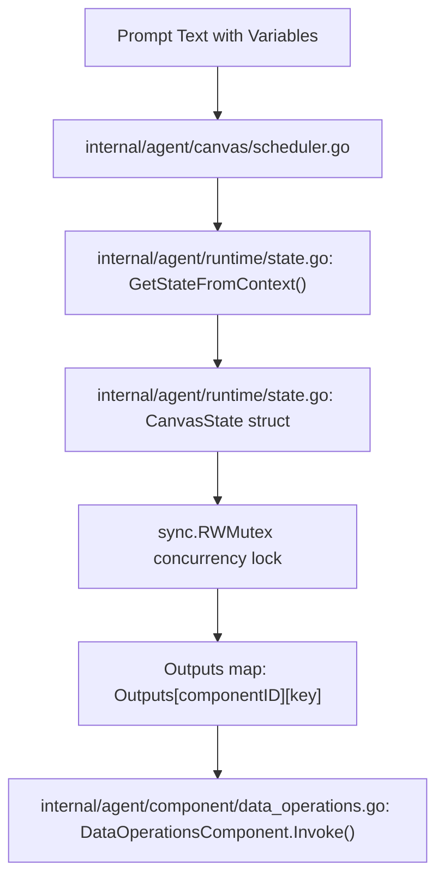
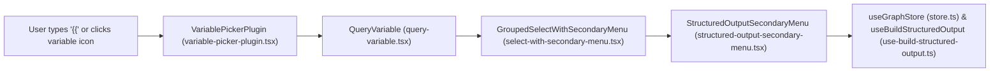

<!-- source: DeepWiki mcp.deepwiki.com · repo infiniflow/ragflow · page 8.5 State and Variable Management · fetched 2026-10-29 -->

# State and Variable Management

Relevant source files

The following files were used as context for generating this wiki page:

- [internal/agent/component/agent_meta_test.go](internal/agent/component/agent_meta_test.go)
- [internal/agent/component/categorize.go](internal/agent/component/categorize.go)
- [internal/agent/component/categorize_decision.go](internal/agent/component/categorize_decision.go)
- [internal/agent/component/categorize_decision_integration_test.go](internal/agent/component/categorize_decision_integration_test.go)
- [internal/agent/component/categorize_decision_test.go](internal/agent/component/categorize_decision_test.go)
- [internal/agent/component/categorize_test.go](internal/agent/component/categorize_test.go)
- [internal/agent/component/data_operations.go](internal/agent/component/data_operations.go)
- [internal/agent/component/data_operations_test.go](internal/agent/component/data_operations_test.go)
- [internal/agent/component/llm_credentials.go](internal/agent/component/llm_credentials.go)
- [internal/agent/component/llm_id.go](internal/agent/component/llm_id.go)
- [internal/agent/component/llm_id_test.go](internal/agent/component/llm_id_test.go)
- [internal/agent/runtime/state.go](internal/agent/runtime/state.go)
- [internal/agent/runtime/state_test.go](internal/agent/runtime/state_test.go)
- [internal/agent/tool/github.go](internal/agent/tool/github.go)
- [internal/agent/tool/github_test.go](internal/agent/tool/github_test.go)
- [internal/agentic_rag/decision_judge_test.go](internal/agentic_rag/decision_judge_test.go)
- [internal/entity/models/systemone.go](internal/entity/models/systemone.go)
- [internal/entity/models/systemone_test.go](internal/entity/models/systemone_test.go)
- [internal/handler/agent_component.go](internal/handler/agent_component.go)
- [internal/handler/agent_component_test.go](internal/handler/agent_component_test.go)
- [web/src/components/ui/command.tsx](web/src/components/ui/command.tsx)
- [web/src/pages/agent/canvas/node/variable-assigner-node.tsx](web/src/pages/agent/canvas/node/variable-assigner-node.tsx)
- [web/src/pages/agent/form/components/prompt-editor/__tests__/insert-variable-trigger.test.ts](web/src/pages/agent/form/components/prompt-editor/__tests__/insert-variable-trigger.test.ts)
- [web/src/pages/agent/form/components/prompt-editor/enter-key-plugin.tsx](web/src/pages/agent/form/components/prompt-editor/enter-key-plugin.tsx)
- [web/src/pages/agent/form/components/prompt-editor/index.css](web/src/pages/agent/form/components/prompt-editor/index.css)
- [web/src/pages/agent/form/components/prompt-editor/index.tsx](web/src/pages/agent/form/components/prompt-editor/index.tsx)
- [web/src/pages/agent/form/components/prompt-editor/insert-variable-trigger.ts](web/src/pages/agent/form/components/prompt-editor/insert-variable-trigger.ts)
- [web/src/pages/agent/form/components/prompt-editor/paste-handler-plugin.tsx](web/src/pages/agent/form/components/prompt-editor/paste-handler-plugin.tsx)
- [web/src/pages/agent/form/components/prompt-editor/utils.ts](web/src/pages/agent/form/components/prompt-editor/utils.ts)
- [web/src/pages/agent/form/components/prompt-editor/variable-node.tsx](web/src/pages/agent/form/components/prompt-editor/variable-node.tsx)
- [web/src/pages/agent/form/components/prompt-editor/variable-on-change-plugin.tsx](web/src/pages/agent/form/components/prompt-editor/variable-on-change-plugin.tsx)
- [web/src/pages/agent/form/components/prompt-editor/variable-path-transform.ts](web/src/pages/agent/form/components/prompt-editor/variable-path-transform.ts)
- [web/src/pages/agent/form/components/prompt-editor/variable-picker-plugin.tsx](web/src/pages/agent/form/components/prompt-editor/variable-picker-plugin.tsx)
- [web/src/pages/agent/form/components/query-variable.tsx](web/src/pages/agent/form/components/query-variable.tsx)
- [web/src/pages/agent/form/components/select-with-secondary-menu.tsx](web/src/pages/agent/form/components/select-with-secondary-menu.tsx)
- [web/src/pages/agent/form/components/structured-output-secondary-menu.tsx](web/src/pages/agent/form/components/structured-output-secondary-menu.tsx)
- [web/src/pages/agent/form/loop-form/loop-termination-condition.tsx](web/src/pages/agent/form/loop-form/loop-termination-condition.tsx)
- [web/src/pages/agent/form/variable-assigner-form/dynamic-variables.tsx](web/src/pages/agent/form/variable-assigner-form/dynamic-variables.tsx)
- [web/src/pages/agent/form/variable-assigner-form/index.tsx](web/src/pages/agent/form/variable-assigner-form/index.tsx)
- [web/src/pages/agent/form/variable-assigner-form/schema.ts](web/src/pages/agent/form/variable-assigner-form/schema.ts)
- [web/src/pages/agent/hooks/use-build-structured-output.ts](web/src/pages/agent/hooks/use-build-structured-output.ts)
- [web/src/pages/agent/hooks/use-get-begin-query.tsx](web/src/pages/agent/hooks/use-get-begin-query.tsx)
- [web/src/pages/agent/use-agent-history-manager.ts](web/src/pages/agent/use-agent-history-manager.ts)
- [web/src/pages/agent/utils/filter-agent-structured-output.ts](web/src/pages/agent/utils/filter-agent-structured-output.ts)

## Purpose and Scope

This page details the implementation of state and variable management within the RAGFlow Agent and Workflow system. It covers the runtime `CanvasState` implementation in Go (`[internal/agent/runtime/state.go:61-75]()`) responsible for managing workflow execution state, variable resolution mechanisms (`sys.*`, `env.*`, `component@output`, and `begin@key`), the Lexical-based prompt editor's variable pickers in the React frontend (`[web/src/pages/agent/form/components/prompt-editor/index.tsx:1-40]()`), structured output resolution (`[web/src/pages/agent/form/components/structured-output-secondary-menu.tsx:1-30]()`), and global variable assignment.

Sources: [internal/agent/runtime/state.go:61-75](), [web/src/pages/agent/form/components/prompt-editor/index.tsx:1-40](), [web/src/pages/agent/form/components/structured-output-secondary-menu.tsx:1-30]()

---

## Variable Naming Conventions and Scopes

Variable names in RAGFlow follow precise conventions to denote their scope and resolution path across workflows and prompts.

| Scope | Syntax | Example | Description |
| :--- | :--- | :--- | :--- |
| **System** | `sys.<name>` | `sys.query`, `sys.user_id` | Built-in runtime and execution context variables. |
| **Environment** | `env.<name>` | `env.api_key` | Persisted global environment variables accessible across runs. |
| **Begin Inputs** | `begin@<key>` | `begin@query` | Inputs defined by the Begin node of the workflow canvas. |
| **Component Outputs** | `<component_id>@<output_name>` | `Retrieval:r1@formalized_content` | Outputs generated by specific nodes in the graph execution. |

Variables embedded within prompt templates use double curly braces (e.g., `{{sys.query}}` or `{{Retrieval:r1@formalized_content}}`). In the React frontend, these are parsed into lexical `VariableNode` instances for structured manipulation (`[web/src/pages/agent/form/components/prompt-editor/index.tsx:49-55]()`).

Sources: [web/src/pages/agent/hooks/use-get-begin-query.tsx:144-214](), [web/src/pages/agent/form/components/prompt-editor/index.tsx:49-55]()

---

## Frontend Prompt Editor and Variable Selection

### Prompt Editor and Lexical Integration

Implemented in `web/src/pages/agent/form/components/prompt-editor/index.tsx`, the prompt editor utilizes the Lexical editor framework:
- Supports rich-text editing with embedded `VariableNode` elements (`[web/src/pages/agent/form/components/prompt-editor/index.tsx:49-55]()`).
- Provides toolbar actions for inserting variables (`[web/src/pages/agent/form/components/prompt-editor/index.tsx:90-93]()`) and toggling path query auto-merging (`[web/src/pages/agent/form/components/prompt-editor/index.tsx:119-138]()`).

### Variable Picker Plugins and Selectors

- **`VariablePickerMenuPlugin`**: Located in `web/src/pages/agent/form/components/prompt-editor/variable-picker-plugin.tsx`, this plugin handles typeahead popup menus when typing `{{` or clicking the variable icon, rendering hierarchical variable groups, icons, and data types (`[web/src/pages/agent/form/components/prompt-editor/variable-picker-plugin.tsx:67-151]()`).
- **`QueryVariable`**: Bound via `web/src/pages/agent/form/components/query-variable.tsx`, this component integrates variable pickers with React Hook Form, leveraging type filtering through `useFilterQueryVariableOptionsByTypes` (`[web/src/pages/agent/form/components/query-variable.tsx:34-100]()`).
- **`GroupedSelectWithSecondaryMenu`**: Located in `web/src/pages/agent/form/components/select-with-secondary-menu.tsx`, this component renders searchable dropdowns with secondary hover menus for nested objects (`[web/src/pages/agent/form/components/select-with-secondary-menu.tsx:61-152]()`).

### Structured Outputs

For complex JSON or object-valued outputs (such as structured agent responses or tool outputs), RAGFlow uses `StructuredOutputSecondaryMenu` (`[web/src/pages/agent/form/components/structured-output-secondary-menu.tsx:32-165]()`):
- Recursively traverses JSON schema properties and items (`[web/src/pages/agent/form/components/structured-output-secondary-menu.tsx:64-119]()`).
- Allows selecting nested keys via dot notation (e.g., `Agent:a1@structured.summary`) backed by helper hooks in `web/src/pages/agent/hooks/use-build-structured-output.ts` (`[web/src/pages/agent/hooks/use-build-structured-output.ts:35-159]()`).

Sources: [web/src/pages/agent/form/components/prompt-editor/index.tsx:49-138](), [web/src/pages/agent/form/components/prompt-editor/variable-picker-plugin.tsx:67-151](), [web/src/pages/agent/form/components/query-variable.tsx:34-100](), [web/src/pages/agent/form/components/select-with-secondary-menu.tsx:61-152](), [web/src/pages/agent/form/components/structured-output-secondary-menu.tsx:32-165](), [web/src/pages/agent/hooks/use-build-structured-output.ts:35-159]()

---

## Go Runtime State Management (`CanvasState`)

The backend Go runtime maintains workflow execution state in the `CanvasState` struct located in `internal/agent/runtime/state.go`.

### Core Data Structures and Concurrency Control

- `CanvasState` (`[internal/agent/runtime/state.go:61-75]()`) manages:
  - `Globals`: Map for user-defined and conversation environment variables (`env.*`).
  - `Sys`: Map for built-in execution context (`sys.*`).
  - `Outputs`: Nested map structured as `Outputs[componentID][outputKey]` storing values produced during execution.
- Thread safety is enforced using a `sync.RWMutex`, permitting concurrent read access during variable resolution and exclusive locking when component outputs are merged.

### Initialization and Seeding

- `NewCanvasState` initializes maps and allocates state structures (`[internal/agent/runtime/state.go:80-97]()`).
- `EnsureSysDate` initializes `sys.date` with the current local timestamp (`[internal/agent/runtime/state.go:102-115]()`).
- `SeedIdentity` writes trusted caller identities (`sys.user_id` and `sys.tenant_id`) into the system context (`[internal/agent/runtime/state.go:124-139]()`).

Sources: [internal/agent/runtime/state.go:61-139]()

---

## Variable Resolution and State Data Flow

### Title: Code Entity Bridge: Go Runtime State & Variable Resolution Flow

Sources: [internal/agent/runtime/state.go:61-97](), [internal/agent/component/data_operations.go:188-213]()

### Title: Code Entity Bridge: Frontend Variable Picker and Structured Output Resolution Flow

Sources: [web/src/pages/agent/form/components/prompt-editor/variable-picker-plugin.tsx:1-151](), [web/src/pages/agent/form/components/query-variable.tsx:32-100](), [web/src/pages/agent/hooks/use-build-structured-output.ts:1-180]()

---

## System Variables (`sys.*`) and Environment Variables (`env.*`)

- **System Variables (`sys.*`)**: Injected automatically by the runtime to provide execution context, such as `sys.query`, `sys.user_id`, `sys.tenant_id`, and `sys.date` (`[internal/agent/runtime/state.go:102-139]()`).
- **Environment Variables (`env.*`)**: Persisted within the canvas DSL JSON under the `globals` key, allowing global state sharing across nodes and conversation turns (`[web/src/pages/agent/hooks/use-get-begin-query.tsx:208-226]()`). Users can manage these values via the global variable sheet UI.

Sources: [internal/agent/runtime/state.go:102-139](), [web/src/pages/agent/hooks/use-get-begin-query.tsx:208-226]()

---

