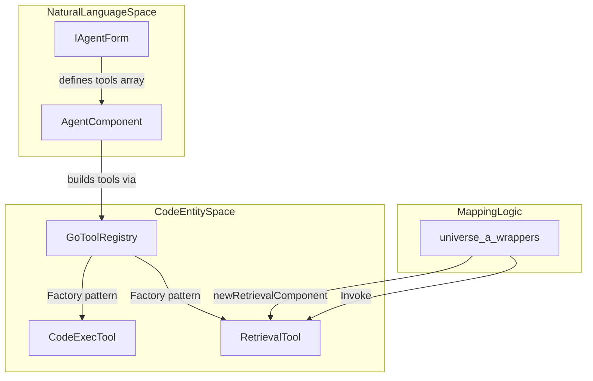
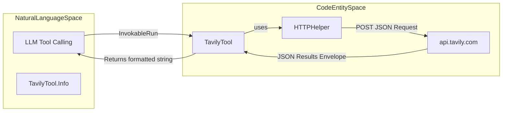

<!-- source: DeepWiki mcp.deepwiki.com · repo infiniflow/ragflow · page 8.6 Agent Tools and ReAct Loop · fetched 2026-10-29 -->

# Agent Tools and ReAct Loop

<details>
<summary>Relevant source files</summary>

The following files were used as context for generating this wiki page:

- [internal/agent/component/fixture_stubs.go](internal/agent/component/fixture_stubs.go)
- [internal/agent/component/invoke.go](internal/agent/component/invoke.go)
- [internal/agent/component/invoke_test.go](internal/agent/component/invoke_test.go)
- [internal/agent/component/production_chain_fixes_test.go](internal/agent/component/production_chain_fixes_test.go)
- [internal/agent/component/registry.go](internal/agent/component/registry.go)
- [internal/agent/component/retrieval_params_test.go](internal/agent/component/retrieval_params_test.go)
- [internal/agent/component/retrieval_swap_test.go](internal/agent/component/retrieval_swap_test.go)
- [internal/agent/component/tool_component.go](internal/agent/component/tool_component.go)
- [internal/agent/component/tool_component_test.go](internal/agent/component/tool_component_test.go)
- [internal/agent/component/universe_a_wrappers.go](internal/agent/component/universe_a_wrappers.go)
- [internal/agent/component/verify_p1_test.go](internal/agent/component/verify_p1_test.go)
- [internal/agent/retrievalbridge/memory.go](internal/agent/retrievalbridge/memory.go)
- [internal/agent/retrievalbridge/memory_test.go](internal/agent/retrievalbridge/memory_test.go)
- [internal/agent/retrievalbridge/runtime_adapter.go](internal/agent/retrievalbridge/runtime_adapter.go)
- [internal/agent/retrievalbridge/runtime_adapter_test.go](internal/agent/retrievalbridge/runtime_adapter_test.go)
- [internal/agent/tool/agentic_search.go](internal/agent/tool/agentic_search.go)
- [internal/agent/tool/google_scholar.go](internal/agent/tool/google_scholar.go)
- [internal/agent/tool/google_scholar_test.go](internal/agent/tool/google_scholar_test.go)
- [internal/agent/tool/google_test.go](internal/agent/tool/google_test.go)
- [internal/agent/tool/keenable.go](internal/agent/tool/keenable.go)
- [internal/agent/tool/keenable_test.go](internal/agent/tool/keenable_test.go)
- [internal/agent/tool/pubmed_test.go](internal/agent/tool/pubmed_test.go)
- [internal/agent/tool/querit.go](internal/agent/tool/querit.go)
- [internal/agent/tool/registry.go](internal/agent/tool/registry.go)
- [internal/agent/tool/registry_test.go](internal/agent/tool/registry_test.go)
- [internal/agent/tool/retrieval.go](internal/agent/tool/retrieval.go)
- [internal/agent/tool/retrieval_service.go](internal/agent/tool/retrieval_service.go)
- [internal/agent/tool/retrieval_test.go](internal/agent/tool/retrieval_test.go)
- [internal/agent/tool/retrieval_wiring_test.go](internal/agent/tool/retrieval_wiring_test.go)
- [internal/agent/tool/search_filters.go](internal/agent/tool/search_filters.go)
- [internal/agent/tool/searxng.go](internal/agent/tool/searxng.go)
- [internal/agent/tool/searxng_test.go](internal/agent/tool/searxng_test.go)
- [internal/agent/tool/sofya.go](internal/agent/tool/sofya.go)
- [internal/agent/tool/sofya_test.go](internal/agent/tool/sofya_test.go)
- [internal/agent/tool/tavily.go](internal/agent/tool/tavily.go)
- [internal/agent/tool/tavily_test.go](internal/agent/tool/tavily_test.go)
- [internal/agent/tool/wencai.go](internal/agent/tool/wencai.go)
- [internal/agent/tool/wencai_test.go](internal/agent/tool/wencai_test.go)
- [internal/agent/tool/wikipedia.go](internal/agent/tool/wikipedia.go)
- [internal/agent/tool/wikipedia_test.go](internal/agent/tool/wikipedia_test.go)
- [internal/agent/tool/yahoo_finance.go](internal/agent/tool/yahoo_finance.go)
- [internal/agent/tool/yahoo_finance_test.go](internal/agent/tool/yahoo_finance_test.go)
- [web/src/components/markdown-content/index.module.less](web/src/components/markdown-content/index.module.less)
- [web/src/components/message-item/index.module.less](web/src/components/message-item/index.module.less)
- [web/src/components/next-markdown-content/index.module.less](web/src/components/next-markdown-content/index.module.less)
- [web/src/components/next-message-item/index.module.less](web/src/components/next-message-item/index.module.less)
- [web/src/components/ui/tabs.tsx](web/src/components/ui/tabs.tsx)
- [web/src/pages/agent/canvas/node/tool-node.tsx](web/src/pages/agent/canvas/node/tool-node.tsx)
- [web/src/pages/agent/form/agent-form/agent-tools.tsx](web/src/pages/agent/form/agent-form/agent-tools.tsx)
- [web/src/pages/agent/form/agent-form/tool-popover/index.tsx](web/src/pages/agent/form/agent-form/tool-popover/index.tsx)
- [web/src/pages/agent/form/agent-form/tool-popover/use-update-tools.test.tsx](web/src/pages/agent/form/agent-form/tool-popover/use-update-tools.test.tsx)
- [web/src/pages/agent/form/agent-form/tool-popover/use-update-tools.ts](web/src/pages/agent/form/agent-form/tool-popover/use-update-tools.ts)
- [web/src/pages/agent/form/agent-form/use-get-tools.ts](web/src/pages/agent/form/agent-form/use-get-tools.ts)
- [web/src/pages/agent/form/components/output.tsx](web/src/pages/agent/form/components/output.tsx)
- [web/src/pages/agent/form/pubmed-form/index.tsx](web/src/pages/agent/form/pubmed-form/index.tsx)
- [web/src/pages/agent/form/querit-form/utils.ts](web/src/pages/agent/form/querit-form/utils.ts)
- [web/src/pages/agent/form/tool-form/querit-form/utils.ts](web/src/pages/agent/form/tool-form/querit-form/utils.ts)

</details>


This document details the Agent component's tool integration system, its implementation of the ReAct (Reasoning + Acting) pattern for multi-step problem-solving, retrieval tool bridges, the code execution sandbox tool, and Model Context Protocol (MCP) tool hosting. The Agent component orchestrates iterative workflows where language models reason about tasks, invoke external tools or remote MCP services, observe results, and synthesize final answers.

---

## 1. Agent Component Overview and ReAct Loop

The Agent component is a specialized LLM component that implements ReAct-style tool use [internal/agent/component/agent.go:74-93](). Unlike a standard LLM component that generates single-shot text responses, the Agent can analyze tasks, plan actions by selecting tools, and reflect on observations to determine next steps.

### Agent vs. LLM Component

| Feature             | LLM Component                    | Agent Component                                                           |
|---------------------|---------------------------------|--------------------------------------------------------------------------|
| **Tool access**      | None                            | Built-in, MCP, and Sub-Agents [internal/agent/component/agent.go:88-90]() |
| **Iterations**       | Single-shot                     | Multi-turn (`MaxRounds`) [internal/agent/component/agent.go:93]()         |
| **Logic Implementation** | `LLM` class (Python)          | `AgentComponent` struct (Go) [internal/agent/component/agent.go:74]()     |

The Go `AgentComponent` struct [internal/agent/component/agent.go:74]() is a multi-turn ReAct agent powered by the `eino` framework's `flow/agent/react` package. It uses RAGFlow's model layer (`models.EinoChatModel`) as a `ToolCallingChatModel`. The `AgentComponent` wires `AgentParam.Tools` into `eino`'s native `react.AgentConfig.ToolsConfig` [internal/agent/component/agent.go:3-11]().

Sources: [internal/agent/component/agent.go:3-93]()

---

## 2. Tool Integration Architecture and Go Tool Registry

The Agent architecture bridges the gap between high-level LLM reasoning and low-level code execution by mapping model tool-calls to specific Go objects or remote MCP sessions via a centralized tool registry.

### Tool Registry and Mapping


Sources: [internal/agent/tool/registry.go:33-72](), [internal/agent/component/universe_a_wrappers.go:159-172](), [internal/agent/component/agent.go:88-93](), [web/src/interfaces/database/agent.ts:196-223]()

**Explanation:**  
The Agent frontend defines agent tools, which the `AgentComponent` maps to the internal Go tool registry using a normalization and factory pattern to instantiate concrete tool implementations. Some tools are implemented as Go wrappers adapting Python-origin tools or directly implemented in Go. The `universe_a_wrappers.go` file contains specialized wrappers bridging Canvas components to tool implementations like `Retrieval`.

Sources: [internal/agent/tool/registry.go:33-72](), [internal/agent/component/universe_a_wrappers.go:159-172](), [internal/agent/component/agent.go:88-93](), [web/src/interfaces/database/agent.ts:196-223]()

### Go Tool Registry (`internal/agent/tool/`)

The Go port implements a centralized tool registry in `internal/agent/tool/registry.go` containing over 20 built-in tools [internal/agent/tool/registry.go:34-79](). This registry uses a `Factory` pattern to build Eino-compatible `einotool.BaseTool` instances [internal/agent/tool/registry.go:31-35]().

- **Tool Registration:** Tools are registered in a `map[string]Factory` keyed by canonical snake_case names (`"code_exec"`, `"retrieval"`, `"execute_sql"`, etc.) [internal/agent/tool/registry.go:36-79]().
- **Canvas Name Normalization:** Canvas DSL uses different casing and naming (e.g., `"CodeExec"`) which is mapped to canonical registry keys via `canvasToolNames` [internal/agent/tool/registry.go:81-98]().
- **Tool Instantiation APIs:**  
  - `BuildByName(name string, params map[string]any) (einotool.BaseTool, error)` resolves a single tool name into a constructed tool instance [internal/agent/tool/registry.go:110-126]().  
  - `BuildAll(names []string, perToolParams map[string]map[string]any) ([]einotool.BaseTool, error)` builds multiple tools, passing optional per-tool DSL params [internal/agent/tool/registry.go:130-157]().

### Built-in Tool Catalog (20+ Tools)

| Category | Tool Names (Canonical / Registry Keys) | Description / Implementation Pointer |
|---|---|---|
| **Data & Search** | `akshare`, `arxiv`, `duckduckgo`, `google`, `google_scholar`, `pubmed`, `wikipedia`, `yahoo_finance` | Fetches data from financial APIs, scientific databases, and open encyclopedias [internal/agent/tool/registry.go:37-78]() |
| **Execution & SQL** | `code_exec`, `execute_sql`, `exesql` | Runs sandboxed code snippets or executes database queries [internal/agent/tool/registry.go:40-51]() |
| **Retrieval & RAG** | `retrieval`, `search_my_dataset`, `dataset_navigation_by_tree`, `wiki_query`, `hybrid_search`, `vector_search`, `bm25_search` | Issues hybrid vector/BM25 searches or structural tree navigations over datasets [internal/agent/tool/registry.go:42-46](), [internal/agent/tool/registry.go:63-65]() |
| **Utilities & Crawlers** | `bgpt`, `crawler`, `web_crawler`, `deepl`, `email`, `github`, `keenable`, `qweather`, `querit`, `search1api`, `searxng`, `sofya`, `tavily`, `tushare`, `wencai`, `youcom` | Web scrapers, translation services, developer platforms, and specialized search tools [internal/agent/tool/registry.go:39-78]() |

Sources: [internal/agent/tool/registry.go:34-79]()

---

## 3. Retrieval Tool Bridges and Custom Tool Implementations

### Retrieval Tool Bridge

The `Retrieval` tool allows agents to issue vector+keyword queries against underlying knowledge bases, datasets, or user memories [internal/agent/tool/retrieval.go:45-67]().

- The `retrievalComponent` defined in `internal/agent/component/universe_a_wrappers.go` wraps `agenttool.RetrievalTool` to inject DSL-level defaults (e.g., dataset IDs, top N results) and resolve runtime overrides [internal/agent/component/universe_a_wrappers.go:71-175]().
- It manages querying the registered `RetrievalService` (backed by `nlp.RetrievalService`) which orchestrates hybrid vector/BM25 retrieval plus optional reranking [internal/agent/tool/retrieval_nlp.go:1-50](), [internal/agent/tool/retrieval_service.go:28-49]().
- The output is structured retrieval chunks with essential properties (content, document ID, score, etc.) used to supply agent observations downstream [internal/agent/tool/retrieval.go:72-87]().

Sources: [internal/agent/component/universe_a_wrappers.go:71-175](), [internal/agent/tool/retrieval.go:89-170](), [internal/agent/tool/retrieval_service.go:28-49]()

### Tavily and External Search Tools

External web search tools like `TavilyTool` follow a robust HTTP helper pattern [internal/agent/tool/tavily.go:122-135]().


Sources: [internal/agent/tool/tavily.go:48-135](), [internal/agent/tool/tavily.go:160-205]()

- `TavilyTool` validates API keys (resolving from environment variables or tool config), builds structured JSON payloads (`tavilyRequestBody`), and dispatches requests through `HTTPHelper` [internal/agent/tool/tavily.go:48-125]().
- Responses are parsed into `tavilyEnvelope` structures containing result lists or standard error markers (`_ERROR`) for downstream error recovery [internal/agent/tool/tavily.go:84-93]().

Sources: [internal/agent/tool/tavily.go:48-135]()

---

## 4. Code Execution Sandbox Tool

The `CodeExec` tool provides a sandboxed Python/JavaScript code executor integrated with the Agent framework.

- Enforces strict business-level contracts on code outputs, ensuring consistent JSON-serializable results [internal/agent/tool/code_exec.go:49-94]().
- Collects and exposes artifact files automatically generated in an `artifacts/` directory, such as PDFs, CSVs, or plots [internal/agent/tool/code_exec.go:49-94]().

Sources: [internal/agent/tool/code_exec.go:49-94]()

---

## 5. Model Context Protocol (MCP) Integration

RAGFlow integrates the Model Context Protocol (MCP) to allow agents to interact dynamically with external or internal MCP servers exposing structured tools that the agent can discover and invoke during execution.

### MCP Server Modes
- **Self-Host Mode (Default):** MCP server authenticates using a static API key bound to one tenant, limiting access scope accordingly.  
- **Host Mode:** Each MCP client request includes dynamic `api_key` or `Authorization` headers controlling the tenant access for that request.  

### MCP Server Management and Tool Discovery
The backend manages MCP servers through `MCPService` and `MCPServerDAO` [internal/service/mcp.go:51-53](). When an MCP server is created or updated, RAGFlow fetches available tools via the `fetchMCPTools` function [internal/service/mcp.go:147]():

```go
tools, err := fetchMCPTools(ctx, req.URL, req.ServerType, headers, variables, req.Timeout)
```

`fetchMCPTools` uses client wrappers to communicate over HTTP stream or SSE endpoints (`/mcp` and `/sse`), applies JSON-RPC semantics, and parses tool schema JSON blobs. These tools then become part of the agent's tool registry at runtime.

Sources: [internal/service/mcp.go:45-206](), [internal/utility/mcp_client.go:1-50](), [internal/handler/mcp.go:45-68](), [web/src/pages/user-setting/mcp/edit-mcp-dialog.tsx:62-116]()

---

## 6. ReAct Loop Execution Flow

The Agent uses the ReAct pattern (Reasoning + Acting) to perform multi-step reasoning and tool invocation iteratively until a final output or a maximum step limit.

### ReAct Iteration Details
1. **Initialization:**  
   The `AgentComponent` is created with parameters (`AgentParam`) including `ModelID`, a list of tool names, optional per-tool parameters, and `MaxRounds` limiting the iteration count [internal/agent/component/agent.go:79-112]().

2. **Tool Construction:**  
   The `buildAgentTools` function builds all tools declared for the agent by calling `tool.BuildAll`. This resolves tool names to concrete `BaseTool` instances using the tool registry and parameter maps [internal/agent/component/agent.go:169](), [internal/agent/tool/registry.go:123-148]().

3. **Model Instantiation:**  
   `buildAgentChatModel` creates an `EinoChatModel` from the specified `ModelID`, which is wrapped as a `ToolCallingChatModel` capable of invoking tools [internal/entity/models/llm.go:10-12](), [internal/agent/component/agent.go:161]().

4. **ReAct Execution:**  
   The core multi-step reasoning logic is within `runEinoReActAgent`, which instantiates an `eino` `react.Agent` configured with the `ToolCallingChatModel`, injected tools, and maximum step count (`MaxStep`) controlling iterations [internal/agent/component/agent.go:162-172]().

5. **Reasoning Loop:**  
   The `eino` agent repeatedly:
   - Generates a "thought" prompt.
   - Selects a tool to call (or decides to finish).
   - Executes the tool, obtaining observations.
   - Feeds the observations back to the model for further reasoning.
   
   This continues until the final answer is produced or `MaxRounds` is exceeded [internal/agent/component/agent.go:173-176]().

6. **Output:**  
   After completion, the `AgentComponent` returns a map including:
   - `content`: The final textual answer.
   - `tool_calls`: Raw tool call logs with arguments and observations.
   - `artifacts`: Optional binary or structured outputs collected during execution [internal/agent/component/agent.go:145-154]().

Sources: [internal/agent/component/agent.go:74-176](), [internal/agent/tool/registry.go:114-143](), [internal/entity/models/llm.go:10-12](), [internal/agent/runtime/canvas_state.go:10-15]()

---

