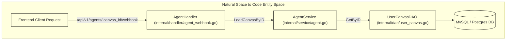
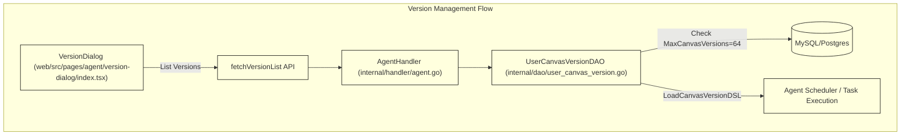

<!-- source: DeepWiki mcp.deepwiki.com · repo infiniflow/ragflow · page 8.7 Canvas API, Templates and Management · fetched 2026-10-29 -->

# Canvas API, Templates and Management

Relevant source files

The following files were used as context for generating this wiki page:

- [internal/agent/canvas/message_predecessor_test.go](internal/agent/canvas/message_predecessor_test.go)
- [internal/agent/canvas/scheduler_test.go](internal/agent/canvas/scheduler_test.go)
- [internal/agent/component/begin.go](internal/agent/component/begin.go)
- [internal/agent/component/begin_test.go](internal/agent/component/begin_test.go)
- [internal/dao/user_canvas_version.go](internal/dao/user_canvas_version.go)
- [internal/dao/user_canvas_version_limit_test.go](internal/dao/user_canvas_version_limit_test.go)
- [internal/dao/user_canvas_version_test.go](internal/dao/user_canvas_version_test.go)
- [internal/handler/agent_logs_test.go](internal/handler/agent_logs_test.go)
- [internal/handler/agent_openai.go](internal/handler/agent_openai.go)
- [internal/handler/agent_run_event.go](internal/handler/agent_run_event.go)
- [internal/handler/agent_webhook.go](internal/handler/agent_webhook.go)
- [internal/handler/agent_webhook_schema.go](internal/handler/agent_webhook_schema.go)
- [internal/handler/agent_webhook_schema_test.go](internal/handler/agent_webhook_schema_test.go)
- [internal/handler/agent_webhook_test.go](internal/handler/agent_webhook_test.go)
- [internal/handler/agent_webhook_trace.go](internal/handler/agent_webhook_trace.go)
- [internal/handler/agent_webhook_trace_poll_test.go](internal/handler/agent_webhook_trace_poll_test.go)
- [internal/handler/agent_webhook_trace_test.go](internal/handler/agent_webhook_trace_test.go)
- [internal/handler/agent_webhook_workflow_test.go](internal/handler/agent_webhook_workflow_test.go)
- [internal/ingestion/task/pipeline_version_test.go](internal/ingestion/task/pipeline_version_test.go)
- [web/src/components/card-container.tsx](web/src/components/card-container.tsx)
- [web/src/hooks/use-agent-request.ts](web/src/hooks/use-agent-request.ts)
- [web/src/interfaces/database/document.ts](web/src/interfaces/database/document.ts)
- [web/src/interfaces/request/document.ts](web/src/interfaces/request/document.ts)
- [web/src/pages/agent/canvas/node/card.test.tsx](web/src/pages/agent/canvas/node/card.test.tsx)
- [web/src/pages/agent/components/alias-form-dialog.tsx](web/src/pages/agent/components/alias-form-dialog.tsx)
- [web/src/pages/agent/components/publish-confirm-dialog.tsx](web/src/pages/agent/components/publish-confirm-dialog.tsx)
- [web/src/pages/agent/form/begin-form/__tests__/use-watch-change.test.tsx](web/src/pages/agent/form/begin-form/__tests__/use-watch-change.test.tsx)
- [web/src/pages/agent/form/begin-form/webhook/__tests__/request-schema.test.tsx](web/src/pages/agent/form/begin-form/webhook/__tests__/request-schema.test.tsx)
- [web/src/pages/agent/hooks/use-canvas-checklist.ts](web/src/pages/agent/hooks/use-canvas-checklist.ts)
- [web/src/pages/agent/hooks/use-save-graph.ts](web/src/pages/agent/hooks/use-save-graph.ts)
- [web/src/pages/agent/index.tsx](web/src/pages/agent/index.tsx)
- [web/src/pages/agent/version-dialog/index.test.tsx](web/src/pages/agent/version-dialog/index.test.tsx)
- [web/src/pages/agent/version-dialog/index.tsx](web/src/pages/agent/version-dialog/index.tsx)
- [web/src/pages/agents/agent-templates.tsx](web/src/pages/agents/agent-templates.tsx)
- [web/src/pages/agents/create-agent-dialog.tsx](web/src/pages/agents/create-agent-dialog.tsx)
- [web/src/pages/agents/create-agent-form.tsx](web/src/pages/agents/create-agent-form.tsx)
- [web/src/pages/agents/template-card.tsx](web/src/pages/agents/template-card.tsx)
- [web/src/pages/agents/template-retrieval-binding.test.ts](web/src/pages/agents/template-retrieval-binding.test.ts)
- [web/src/pages/agents/template-retrieval-binding.ts](web/src/pages/agents/template-retrieval-binding.ts)
- [web/src/pages/agents/template-sidebar.tsx](web/src/pages/agents/template-sidebar.tsx)
- [web/src/services/agent-service.ts](web/src/services/agent-service.ts)
- [web/src/services/knowledge-service.ts](web/src/services/knowledge-service.ts)
- [web/src/utils/api.ts](web/src/utils/api.ts)

This document describes the HTTP API endpoints, webhook triggers, tracing mechanisms, versioning, and management operations for Canvas workflows in RAGFlow. Canvas workflows (also called Agents or DataFlows) are visual workflow definitions that can be created, executed, versioned, shared, and triggered via webhooks. For details about Canvas execution internals, see [Canvas Engine and DSL](8.1). For component architecture, see [Component System Architecture](8.2).

**Purpose and Scope**: This page covers the REST API layer, database services for Canvas persistence (`internal/dao/user_canvas.go`, `internal/dao/user_canvas_version.go`), agent sessions and webhook tracing logs (`internal/handler/agent_webhook.go`), security validation, webhooks and embedding, and the agent template gallery in the React frontend (`web/src/pages/agents/agent-templates.tsx`, `web/src/pages/agent/version-dialog/index.tsx`).

---

## API Architecture and Webhook Routing

The Canvas API organizes agent canvas management into CRUD, versioning, execution sessions, webhook triggers with test tracing, and template instantiation. These layers are implemented as follows:

- **Gin Handlers**: `AgentHandler` defined in `internal/handler/agent.go` provides HTTP handlers for CRUD and execution endpoints, while webhook handlers (`internal/handler/agent_webhook.go`) implement production and test webhook triggers [internal/handler/agent_webhook.go:108-117]().
- **Service Layer**: `AgentService` in `internal/service/agent.go` orchestrates business logic such as loading canvases (`LoadCanvasByID`), running agents with webhook payloads (`RunAgentWithWebhook`), and managing session identities [internal/handler/agent_webhook.go:97-100]().
- **DAO Layer**: `UserCanvasDAO` in `internal/dao/user_canvas.go` and `UserCanvasVersionDAO` in `internal/dao/user_canvas_version.go` handle database persistence of canvases and historical version snapshots through GORM [internal/dao/user_canvas_version.go:115-138]().
- **Frontend UI**: Agent templates, manager dialogs, and dynamic request schema forms live in React components under `web/src/pages/agents/` and `web/src/pages/agent/` [web/src/hooks/use-agent-request.ts:122-147]().

Sources: [internal/handler/agent_webhook.go:97-117](), [internal/dao/user_canvas_version.go:115-138](), [web/src/hooks/use-agent-request.ts:122-147]()

---

## Canvas Lifecycle Management and Versioning

### Access Control and Permissioning

The system enforces multi-tenant isolation and ownership permissions with strict IDOR guards:

- `UserCanvasDAO.GetByID` retrieves user canvas records by primary key, returning `ErrUserCanvasNotFound` when records are missing or unauthorized [internal/dao/user_canvas_version.go:76-85]().
- `AgentService.CheckCanvasAccess` validates whether a user holds read permissions directly or via team structures [internal/service/agent_sessions.go:76-87]().

### Persistence and State

Canvas objects persist workflow DSLs, metadata (title, description, tags), and avatars:

- The `UserCanvasDAO` struct provides methods like `Create`, `Update`, `Delete`, and transactions to ensure atomicity across multi-step operations [internal/dao/user_canvas_version.go:70-133]().
- Draft saves (via auto-save or manual button clicks) refresh the live canvas without consuming version budgets [web/src/pages/agent/hooks/use-save-graph.ts:33-70]().

### Versioning and Snapshot Management

- Agent canvases support robust versioning via `UserCanvasVersionDAO` entities that maintain historical DSL snapshots [internal/dao/user_canvas_version.go:115-138]().
- **Version Cap**: `MaxCanvasVersions` caps the number of DSL versions per canvas at 64 to prevent storage bloat [internal/dao/user_canvas_version.go:63-68](). When exceeded, writes return `ErrCanvasVersionLimitExceeded` [internal/dao/user_canvas_version.go:68-68]().
- **Versioning UI**: The `VersionDialog` React component allows users to list released versions, filter by alias, edit version aliases (`updateVersion`), restore historical states (`applyVersion`), or delete old snapshots [web/src/pages/agent/version-dialog/index.tsx:71-186]().

Sources: [internal/dao/user_canvas_version.go:63-138](), [web/src/pages/agent/version-dialog/index.tsx:71-186](), [web/src/pages/agent/hooks/use-save-graph.ts:33-70]()

---

## Agent Sessions, Logs, and Webhook Tracing

Agent sessions track multi-turn interactions and conversations associated with a canvas execution.

### Session Lifecycle and Management

- Sessions are managed via conversation structures, storing structured messages, references, tokens, and duration metrics [internal/service/agent_sessions.go:119-165]().
- `ListAgentSessionsRequest` defines filters for querying sessions by user, keywords, and date ranges [internal/service/agent_sessions.go:43-56]().

### Webhook Tracing and Redis Event Logs

When webhooks are triggered with test options, execution events are logged to Redis (`kvrocks`).

- `AgentHandler` utilizes a Redis-backed log store to record debug runs and webhook traces [internal/handler/agent_webhook_trace_test.go:80-87]().
- Polling endpoints (`GetAgentWebhookLogs`) retrieve these execution steps incrementally using timestamp cursors (`since_ts`) and event IDs [internal/handler/agent_webhook_trace_test.go:91-120]().

Sources: [internal/service/agent_sessions.go:43-165](), [internal/handler/agent_webhook_trace_test.go:80-120]()

---

## Webhooks, Security, and Schema Validation

External integrations trigger canvas workflows via webhook endpoints managed in `AgentHandler.Webhook` [internal/handler/agent_webhook.go:117-124]().

### Webhook Pipeline and Security Guards

The Go implementation mirrors a rigorous 9-step execution flow [internal/handler/agent_webhook.go:23-39]():
1. **Canvas Loading**: Loads the canvas via `LoadCanvasByID`, collapsing errors into a standardized envelope [internal/handler/agent_webhook.go:160-162]().
2. **Category Validation**: Rejects `DataflowCanvas` categories (webhooks are restricted to agent workflows) [internal/handler/agent_webhook.go:25-25]().
3. **DSL Parsing**: Parses the stored workflow DSL into executable node graphs [internal/handler/agent_webhook.go:26-26]().
4. **Begin Component Binding**: Identifies the `Begin` component configured with `mode == "Webhook"` and captures its `webhook_cfg` [internal/handler/agent_webhook.go:27-27]().
5. **Method Verification**: Validates the HTTP request method against configured allowed methods [internal/handler/agent_webhook.go:28-28]().
6. **Security & Rate Limiting**: Executes `validateWebhookSecurity` checking max body size, IP whitelists, rate limits, and tokens/basic/JWT auth [internal/handler/agent_webhook.go:29-30]().
7. **Body Parsing**: Parses request bodies depending on content type [internal/handler/agent_webhook.go:31-31]().
8. **Schema Extraction**: Extracts query parameters, headers, and body structures via `extractBySchema` [internal/handler/agent_webhook.go:32-33]().
9. **Dispatch**: Depending on execution mode (`Immediately` vs streaming/aggregate), triggers synchronous or detached background execution via `RunAgentWithWebhook` [internal/handler/agent_webhook.go:34-38]().

Sources: [internal/handler/agent_webhook.go:23-162]()

---

## Agent Templates and Frontend Instantiation

The React frontend hosts a gallery of agent canvas templates allowing quick creation of agents from prebuilt DSL blueprints [web/src/pages/agents/agent-templates.tsx:35-55]().

### Template Listing and Filtering

- `AgentTemplates` fetches templates via the `useFetchAgentTemplates` hook, querying `agentService.listAgentTemplate()` [web/src/hooks/use-agent-request.ts:149-161]().
- Templates are filtered by category using sidebar selection components [web/src/pages/agents/agent-templates.tsx:118-140]().

### Instantiation and Binding Logic

- Upon confirmation in `CreateAgentDialog`, the template DSL undergoes dynamic binding via `bindUnboundRetrieval` and `bindUnboundModel` to link retrieval blocks and LLM models to specific dataset or memory IDs [web/src/pages/agents/agent-templates.tsx:75-99]().
- The bound DSL is persisted as a new `IFlow` entity using `createAgent` [web/src/pages/agents/agent-templates.tsx:100-105]().
- Upon success, the UI navigates the user to the newly created agent canvas editor [web/src/pages/agents/agent-templates.tsx:107-114]().

Sources: [web/src/hooks/use-agent-request.ts:149-161](), [web/src/pages/agents/agent-templates.tsx:35-114]()

---

**References**

- `internal/handler/agent_webhook.go` [23-162]()
- `internal/dao/user_canvas_version.go` [63-138]()
- `web/src/pages/agent/version-dialog/index.tsx` [71-186]()
- `web/src/pages/agents/agent-templates.tsx` [35-114]()
- `web/src/hooks/use-agent-request.ts` [122-161]()
- `web/src/pages/agent/hooks/use-save-graph.ts` [33-70]()
- `internal/service/agent_sessions.go` [43-165]()
- `internal/handler/agent_webhook_trace_test.go` [80-120]()

---

