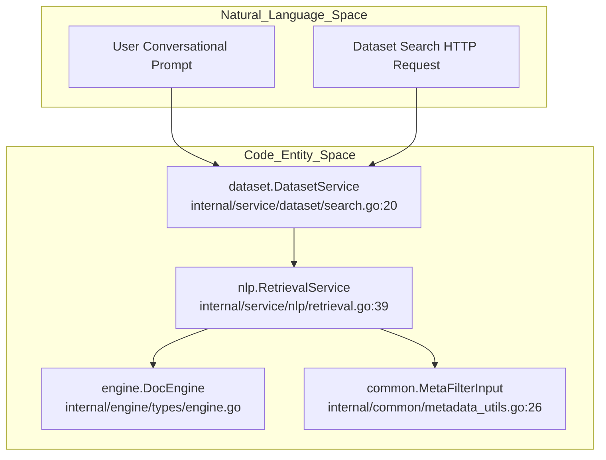
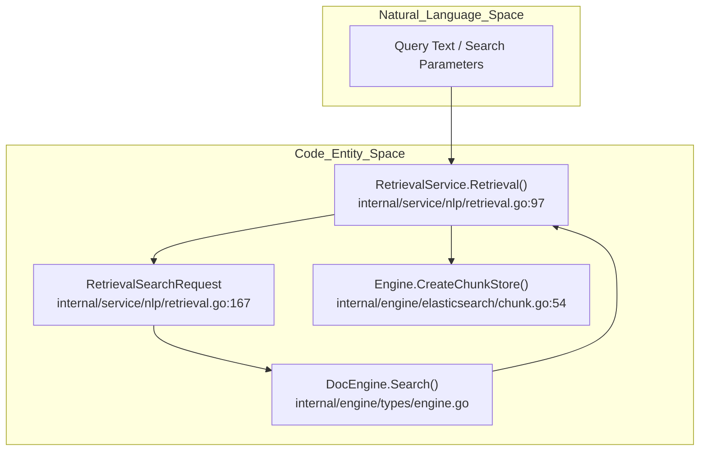

<!-- source: DeepWiki mcp.deepwiki.com · repo infiniflow/ragflow · page 9 Retrieval and Search System · fetched 2026-10-29 -->

# Retrieval and Search System

Relevant source files

The following files were used as context for generating this wiki page:

- [internal/agent/tool/retrieval_nlp.go](internal/agent/tool/retrieval_nlp.go)
- [internal/agent/tool/retrieval_nlp_test.go](internal/agent/tool/retrieval_nlp_test.go)
- [internal/engine/elasticsearch/chunk.go](internal/engine/elasticsearch/chunk.go)
- [internal/engine/elasticsearch/chunk_helpers_test.go](internal/engine/elasticsearch/chunk_helpers_test.go)
- [internal/engine/elasticsearch/chunk_test.go](internal/engine/elasticsearch/chunk_test.go)
- [internal/handler/chunk.go](internal/handler/chunk.go)
- [internal/handler/chunk_test.go](internal/handler/chunk_test.go)
- [internal/handler/dataset.go](internal/handler/dataset.go)
- [internal/handler/dataset_search_test.go](internal/handler/dataset_search_test.go)
- [internal/handler/dify_retrieval_handler.go](internal/handler/dify_retrieval_handler.go)
- [internal/handler/dify_retrieval_handler_test.go](internal/handler/dify_retrieval_handler_test.go)
- [internal/harness/core/cancel_full_test.go](internal/harness/core/cancel_full_test.go)
- [internal/service/chunk/chunk.go](internal/service/chunk/chunk.go)
- [internal/service/chunk/chunk_test.go](internal/service/chunk/chunk_test.go)
- [internal/service/chunk_types.go](internal/service/chunk_types.go)
- [internal/service/chunk_types_test.go](internal/service/chunk_types_test.go)
- [internal/service/dataset/search.go](internal/service/dataset/search.go)
- [internal/service/dataset/search_test.go](internal/service/dataset/search_test.go)
- [internal/service/dataset_types.go](internal/service/dataset_types.go)
- [internal/service/nlp/reranker.go](internal/service/nlp/reranker.go)
- [internal/service/nlp/reranker_question_tks_test.go](internal/service/nlp/reranker_question_tks_test.go)
- [internal/service/nlp/reranker_rank_feature_test.go](internal/service/nlp/reranker_rank_feature_test.go)
- [internal/service/nlp/retrieval.go](internal/service/nlp/retrieval.go)
- [internal/service/nlp/retrieval_test.go](internal/service/nlp/retrieval_test.go)

## Purpose and Scope

This document provides a high-level overview of RAGFlow's retrieval and search system, which orchestrates hybrid lexical and vector search, query refinement, metadata filtering, reranking, and answer generation with citations. It bridges conversational endpoints, dataset search APIs, and background ingestion with multiple document storage backends using a unified interface.

As a parent page, this overview outlines core concepts and high-level architecture. For deep technical details of each subsystem, refer to the dedicated child pages:
- Document store abstraction: [Document Store Abstraction](#9.1)
- Query processing and hybrid search algorithms: [Query Processing and Hybrid Search](#9.2)
- Model-based reranking and filtering: [Reranking and Filtering](#9.3)
- Context formatting, citation insertion, and frontend search experience: [Answer Generation, Citations and the Search App](#9.4)

---

## System Architecture

The retrieval pipeline centers on the `RetrievalService` (`[internal/service/nlp/retrieval.go:39-48]()`), which acts as the core coordinator connecting chat and search API handlers (such as dataset search flows in `[internal/service/dataset/search.go:20-25]()`) to underlying multi-engine document stores through the `DocEngine` interface (`[internal/engine/types/engine.go]()`). Metadata filters and query parameters are unified across providers via helper structures like `MetaFilterInput` (`[internal/common/metadata_utils.go:26-45]()`).

### Diagram: Retrieval Orchestration Architecture

*Sources: [internal/service/dataset/search.go:20-25](), [internal/service/nlp/retrieval.go:39-48](), [internal/engine/types/engine.go](), [internal/common/metadata_utils.go:26-45]() *

---

## Core Retrieval Components

The retrieval subsystem is composed of several key modules:
- **`RetrievalService`** (`[internal/service/nlp/retrieval.go:39-48]()`): Manages the execution of hybrid search queries (`RetrievalRequest` in `[internal/service/nlp/retrieval.go:51-79]()`), candidate collection, pagination bounds, and reranking dispatch.
- **Dataset Search Services** (`[internal/service/dataset/search.go:27-37]()`): Implements access control validation, configuration overrides, and knowledge compilation filtering before handing queries down to the NLP layer.
- **Metadata Filtering Utilities** (`[internal/common/metadata_utils.go:59-107]()`): Parses raw API conditions and evaluates filter logic (`and`/`or`, comparison operators, set memberships) against chunk metadata schemas.

### Diagram: Hybrid Search and RetrievalService Execution Pipeline

*Sources: [internal/service/nlp/retrieval.go:97-178](), [internal/engine/types/engine.go](), [internal/engine/elasticsearch/chunk.go:54-74]() *

---

## Document Store Abstraction

To support multiple storage backends interchangeably, RAGFlow defines the `DocEngine` interface (`[internal/engine/types/engine.go]()`). Concrete implementations manage index bootstrap, vector embedding mappings, and chunk ingestion without exposing underlying database specifics to the service tier.

For index mappings, chunk schemas, metadata filter mappings, and engine selection details, see [Document Store Abstraction](#9.1).

*Sources: [internal/engine/types/engine.go](), [internal/engine/elasticsearch/chunk.go:54-152]() *

---

## Query Processing and Hybrid Search

Hybrid search combines lexical full-text matching (BM25) with dense vector similarity scores. The `RetrievalService` (`[internal/service/nlp/retrieval.go:51-79]()`) applies query refinement strategies, including:
- Tokenization and weighted blending via `VectorSimilarityWeight` (`[internal/service/nlp/retrieval.go:113-123]()`).
- Cross-language query translation and keyword extraction (`[internal/service/generator.go:44-55]()`).
- Metadata filtering (`[internal/service/metadata_filter.go:42-53]()`) and vector-only execution modes (`VectorOnly`).

For in-depth details on token handling, keyword weighting, and hybrid index querying, see [Query Processing and Hybrid Search](#9.2).

*Sources: [internal/service/nlp/retrieval.go:51-123](), [internal/service/generator.go:44-55](), [internal/service/metadata_filter.go:42-53]() *

---

## Reranking and Filtering

After initial candidate retrieval, RAGFlow narrows down and reorders results to ensure highest relevance:
- Model-based rerankers re-score candidates using learned similarity models or feature weights (`RerankCandidatesCount` configuration in `[internal/service/nlp/retrieval.go:137-145]()`).
- Similarity thresholds (`SimilarityThreshold`) eliminate low-quality matches below defined cutoffs (`[internal/service/nlp/retrieval.go:110-112]()`).

For extended details on reranking models, threshold tuning, and retrieval testing workflows, see [Reranking and Filtering](#9.3).

*Sources: [internal/service/nlp/retrieval.go:110-145]() *

---

## Answer Generation, Citations and the Search App

Retrieved chunks flow into conversational generation loops that:
- Assemble structured prompt contexts from top-scoring chunks.
- Insert, verify, and repair inline source citations.
- Generate related follow-up questions and knowledge mindmap artifacts.

For complete mechanics on prompt assembly, citation workflows, and the frontend search experience, refer to [Answer Generation, Citations and the Search App](#9.4).

*Sources: [internal/service/chunk/chunk.go:138-164]() *

---

# Summary

This page summarizes RAGFlow's retrieval and search architecture, which links natural language queries to modular storage engines via hybrid search pipelines, advanced filtering, and reranking. Each tier is cleanly decoupled into Go service modules. For full implementation details, consult the linked child pages.

---

