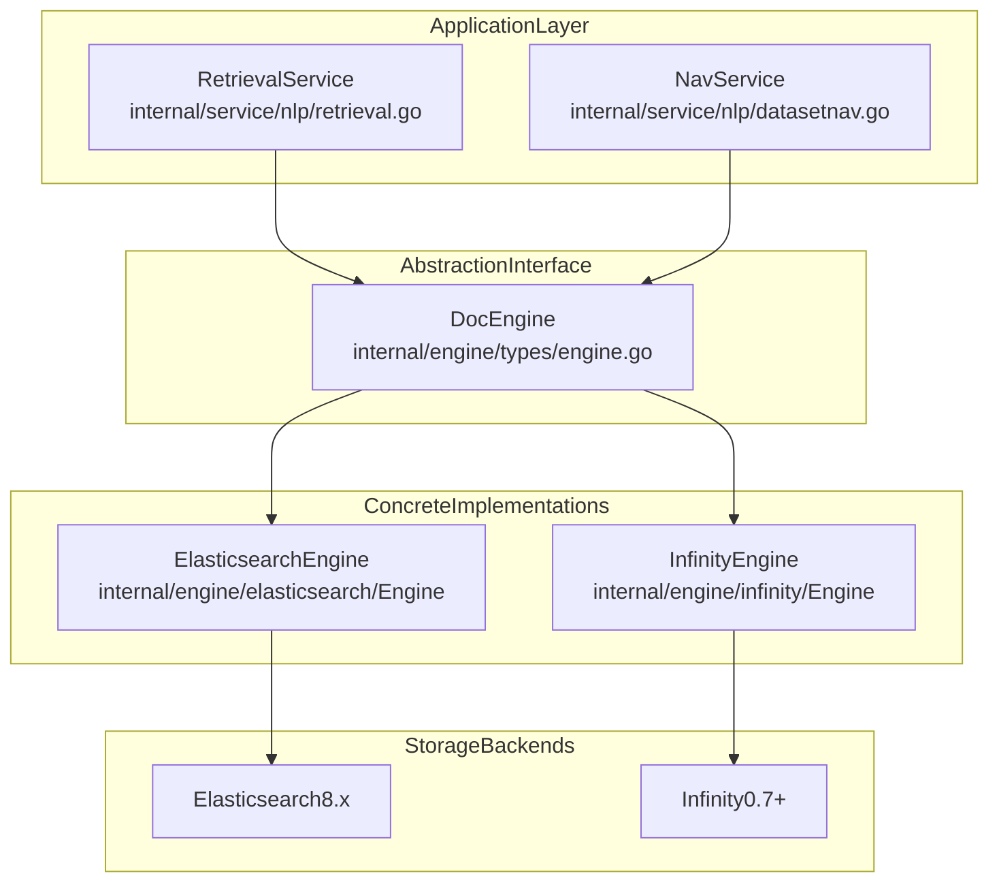
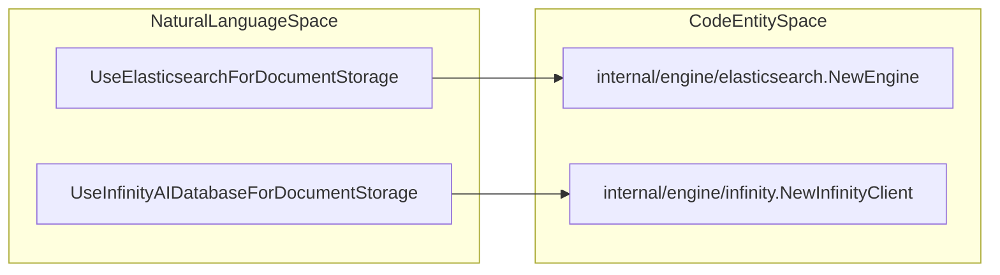
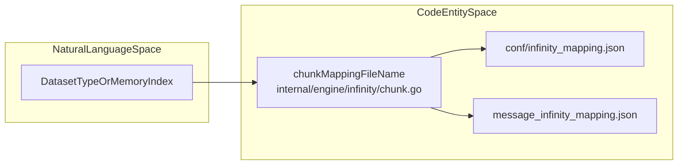
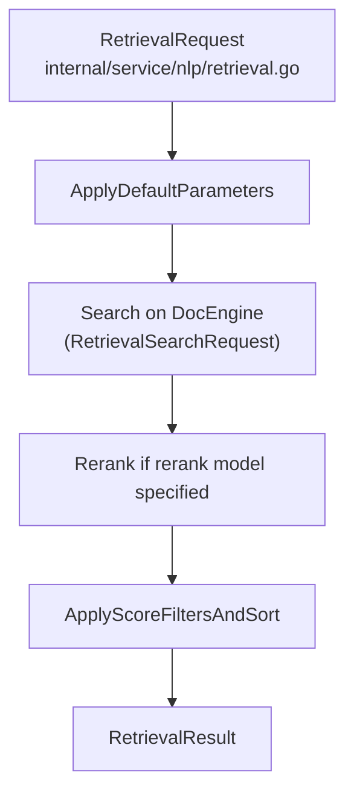

<!-- source: DeepWiki mcp.deepwiki.com · repo infiniflow/ragflow · page 9.1 Document Store Abstraction · fetched 2026-10-29 -->

# Document Store Abstraction

Relevant source files

The following files were used as context for generating this wiki page:

- [conf/infinity_mapping.json](conf/infinity_mapping.json)
- [internal/agent/tool/retrieval_nlp.go](internal/agent/tool/retrieval_nlp.go)
- [internal/agent/tool/retrieval_nlp_test.go](internal/agent/tool/retrieval_nlp_test.go)
- [internal/cli/table.go](internal/cli/table.go)
- [internal/engine/elasticsearch/chunk.go](internal/engine/elasticsearch/chunk.go)
- [internal/engine/elasticsearch/chunk_helpers_test.go](internal/engine/elasticsearch/chunk_helpers_test.go)
- [internal/engine/elasticsearch/chunk_test.go](internal/engine/elasticsearch/chunk_test.go)
- [internal/engine/elasticsearch/client.go](internal/engine/elasticsearch/client.go)
- [internal/engine/elasticsearch/metadata.go](internal/engine/elasticsearch/metadata.go)
- [internal/engine/global.go](internal/engine/global.go)
- [internal/engine/infinity/chunk.go](internal/engine/infinity/chunk.go)
- [internal/engine/infinity/chunk_transform_test.go](internal/engine/infinity/chunk_transform_test.go)
- [internal/engine/infinity/client.go](internal/engine/infinity/client.go)
- [internal/engine/infinity/client_test.go](internal/engine/infinity/client_test.go)
- [internal/engine/infinity/common.go](internal/engine/infinity/common.go)
- [internal/engine/infinity/document.go](internal/engine/infinity/document.go)
- [internal/engine/infinity/integration_test.go](internal/engine/infinity/integration_test.go)
- [internal/engine/infinity/metadata.go](internal/engine/infinity/metadata.go)
- [internal/engine/infinity/sql.go](internal/engine/infinity/sql.go)
- [internal/engine/infinity/sql_test.go](internal/engine/infinity/sql_test.go)
- [internal/handler/chunk.go](internal/handler/chunk.go)
- [internal/handler/chunk_test.go](internal/handler/chunk_test.go)
- [internal/handler/dataset.go](internal/handler/dataset.go)
- [internal/handler/dataset_search_test.go](internal/handler/dataset_search_test.go)
- [internal/handler/dify_retrieval_handler.go](internal/handler/dify_retrieval_handler.go)
- [internal/handler/dify_retrieval_handler_test.go](internal/handler/dify_retrieval_handler_test.go)
- [internal/harness/core/cancel_full_test.go](internal/harness/core/cancel_full_test.go)
- [internal/ingestion/knowledge_compile/wiki_contribution.go](internal/ingestion/knowledge_compile/wiki_contribution.go)
- [internal/ingestion/knowledge_compile/wiki_map_store.go](internal/ingestion/knowledge_compile/wiki_map_store.go)
- [internal/ingestion/knowledge_compile/wiki_map_store_test.go](internal/ingestion/knowledge_compile/wiki_map_store_test.go)
- [internal/ingestion/service/ingestor_lifecycle_test.go](internal/ingestion/service/ingestor_lifecycle_test.go)
- [internal/service/chunk/chunk.go](internal/service/chunk/chunk.go)
- [internal/service/chunk/chunk_test.go](internal/service/chunk/chunk_test.go)
- [internal/service/chunk_types.go](internal/service/chunk_types.go)
- [internal/service/chunk_types_test.go](internal/service/chunk_types_test.go)
- [internal/service/dataset/search.go](internal/service/dataset/search.go)
- [internal/service/dataset/search_test.go](internal/service/dataset/search_test.go)
- [internal/service/dataset_types.go](internal/service/dataset_types.go)
- [internal/service/document/document_metadata.go](internal/service/document/document_metadata.go)
- [internal/service/document/document_metadata_test.go](internal/service/document/document_metadata_test.go)
- [internal/service/nlp/reranker.go](internal/service/nlp/reranker.go)
- [internal/service/nlp/reranker_question_tks_test.go](internal/service/nlp/reranker_question_tks_test.go)
- [internal/service/nlp/reranker_rank_feature_test.go](internal/service/nlp/reranker_rank_feature_test.go)
- [internal/service/nlp/retrieval.go](internal/service/nlp/retrieval.go)
- [internal/service/nlp/retrieval_test.go](internal/service/nlp/retrieval_test.go)
- [internal/utility/path.go](internal/utility/path.go)

## Purpose and Scope

This page details RAGFlow's Document Store Abstraction, which provides a unified interface over multiple backend technologies for storing and retrieving document chunks and their metadata. This abstraction supports a pluggable backend architecture to transparently operate over Elasticsearch, Infinity, OceanBase, SereneDB, and OpenSearch engines.

The key responsibilities include index/table creation and management, chunk insertion and update, search and retrieval with hybrid vector/full-text queries, handling chunk metadata, filters, ranking, and supporting SQL execution for advanced queries. By abstracting these, RAGFlow’s ingestion, retrieval, and dataset navigation layers remain agnostic to the underlying document store technology.

Sources: `[internal/engine/types/engine.go]()`, `[internal/engine/elasticsearch/chunk.go]()`, `[internal/engine/infinity/chunk.go]()`

---

## Architecture Overview

The abstraction is organized around a Go-native interface `DocEngine` defined in `internal/engine/types/engine.go`. Multiple concrete implementations exist for supported storage engines:

- **Elasticsearch** — `internal/engine/elasticsearch/Engine` `[internal/engine/elasticsearch/chunk.go]()`
- **Infinity** (an AI-native vector database) — `internal/engine/infinity/Engine` `[internal/engine/infinity/chunk.go]()`
- **OceanBase, SereneDB, OpenSearch** — Similar abstractions sharing the same interface contract.

RAGFlow initializes one supporting engine dynamically per configuration, with server components accessing it via the `DocEngine` interface.

### Document Store Abstraction Layers

These layers form the foundation for retrieval, ingestion, and administrative operations in RAGFlow.

Sources: `[internal/engine/types/engine.go]()`, `[internal/engine/elasticsearch/chunk.go]()`, `[internal/engine/infinity/chunk.go]()`, `[internal/service/nlp/retrieval.go]()`, `[internal/service/nlp/datasetnav.go]()`

---

## Engine Selection and Initialization

The storage engine is selected using configuration directives that dynamically instantiate the concrete implementation corresponding to the desired backend.

### Engine Selection Mapping

### Table Mapping Resolution Space

Thus, switching storage engines requires only configuration changes, while the business logic remains consistent through the `DocEngine` interface.

Sources: `[internal/engine/elasticsearch/chunk.go:54-74]()`, `[internal/engine/infinity/chunk.go:53-101]()`, `[internal/engine/infinity/client.go]()`

---

## The DocEngine Interface

The `DocEngine` Go interface (in `internal/engine/types/engine.go`) defines the contract every backend engine implementation must meet. It encapsulates index management, chunk CRUD, metadata operations, search, and SQL execution in a backend-agnostic way.

### Key DocEngine Methods

| Method | Signature | Description |
|--------|-----------|-------------|
| `CreateChunkStore` | `CreateChunkStore(ctx context.Context, baseName, datasetID string, vectorSize int, parserID string, language string) error` | Creates the chunk index/table with appropriate mapping/schema and vector dimension. |
| `InsertChunks` | `InsertChunks(ctx context.Context, chunks []map[string]interface{}, baseName, datasetID string, language string) ([]string, error)` | Inserts multiple chunk documents, waits for index refresh before returning. |
| `InsertChunksNoRefresh` | Similar to `InsertChunks` but does not wait for refresh, optimized for ingestion pipelines `[internal/engine/elasticsearch/chunk.go:165-176]()`. |
| `UpdateChunks` | Updates chunk documents matching conditions with new values. |
| `DeleteChunks` | Deletes chunks matching the provided condition filter. |
| `Search` | Performs structured and vector search queries. |
| `DropChunkStore` | Drops the chunk index/table. |
| `ChunkStoreExists` | Checks if the chunk store/index exists. |
| `GetChunk` | Retrieves a single chunk by ID. |
| `CreateMetadataStore` / `InsertMetadata` / `UpdateMetadata` / `DeleteMetadata` | CRUD operations on chunk/document metadata. |
| `SearchMetadata` | Search metadata documents with filtering. |
| `GetFields` | Extract desired fields from chunk data returned by search. |
| `GetAggregation` | Perform aggregation (e.g., counts) on chunk fields. |
| `GetHighlight` | Supports retrieval of highlighted snippets for text matches. |
| `RunSQL` | Execute SQL queries when supported (mainly Infinity). |
| `GetChunkIDs`, `KNNScores`, `GetScores` | Utility methods for chunk ID extraction and scoring. |
| `FilterDocIdsByMetaPushdown` | Filters document IDs based on metadata within the SQL layer when supported (e.g., Infinity). |
| `Close` / `Ping` / `GetType` / `SupportsPageRank` | Lifecycle and capability methods for the engine. |

This interface enables a consistent way to interact and switch between backend engines without coupling any Go component to a specific store.

Sources: `[internal/engine/types/engine.go]()`, `[internal/engine/elasticsearch/chunk.go:154-176]()`

---

## Elasticsearch Backend Implementation

The `Elasticsearch` engine implementation in `internal/engine/elasticsearch/` manages chunk indices and search operations over Elasticsearch 8.x clusters.

### Index (Chunk Store) Creation

- `CreateChunkStore` supports three contexts: normal dataset chunk indices, memory indices (prefixed `memory_`), and skill indices (dataset `"skill"`) `[internal/engine/elasticsearch/chunk.go:54-87]()`.
- For normal datasets, it creates indices with shard and replica settings and a critical property `tag_feas` mapped as `rank_features` to enable tag ranking support `[internal/engine/elasticsearch/chunk.go:89-106]()`.
- For skill datasets and memory indices, dedicated mappings are loaded from JSON files or constructed explicitly.
- Detects existing indices and avoids recreation; ensures memory vector mappings upgrade on embedding dimension changes `[internal/engine/elasticsearch/chunk.go:60-74]()`.

### Chunk Insertion and Update

- `InsertChunks` implements upsert behavior by sending bulk `index` actions. It waits for Elasticsearch refresh on return to ensure immediate consistency for API reads `[internal/engine/elasticsearch/chunk.go:154-163]()`.
- `InsertChunksNoRefresh` is optimized for ingestion to not perform forced refresh and thus improves throughput `[internal/engine/elasticsearch/chunk.go:165-176]()`.
- Indexed documents follow schemas aligning to the mapping files.

### Search and Query Helpers

- Constructs queries using various match expressions including dense vector (`dense_vector`) and full-text `query_string`.
- Supports hybrid vector + BM25 lexical queries using weights.
- Pagination uses the `search_after` technique with sorting and cursors to avoid deep paging penalties.

### Chunk Schema Highlights

- Fields like `content`, `questions`, `important_keywords`, `docnm` (document name), `tag_feas` (rank features), timestamp fields, and chunk IDs are indexed per mapping.
- Vector embeddings are stored in `q_<dim>_vec` fields as `dense_vector` with cosine similarity.

Sources: `[internal/engine/elasticsearch/chunk.go:54-176]`, `[internal/engine/elasticsearch/chunk_helpers_test.go:17-134]`

---

## Infinity Backend Implementation

The Infinity engine implementation in `internal/engine/infinity/` provides a native Go client interface to the Infinity AI vector database.

### Table (Chunk Store) Creation

- Table names are constructed by combining base name and dataset ID via `buildChunkTableName` `[internal/engine/infinity/chunk.go:99-100]()`.
- Table schemas are loaded from the JSON file `conf/infinity_mapping.json` or specialized skill/message mappings via `chunkMappingFileName` `[internal/engine/infinity/chunk.go:81-90]()`.
- Vector columns like `q_<dim>_vec` are dynamically added on embedding dimension changes `[internal/engine/infinity/chunk.go:146-160]()`.
- Adds `chunk_data` JSON column when using the table parser for rich data `[internal/engine/infinity/chunk.go:164-172]()`.

### Chunk Schema and Mapping

- Defines several `varchar`, `integer`, `float`, and `json` fields `[conf/infinity_mapping.json:1-97]()`.
- Analyzers such as `"rag-coarse"` and `"rag-fine"` are mapped on string columns for tokenization strategies supporting semantic search `[conf/infinity_mapping.json:10-17]()`.
- Secondary indexes on low-cardinality fields ensure efficient filtering and sorting `[conf/infinity_mapping.json:4,28,51-53]()`.

### SQL Preprocessing and Aliasing

- Supports execution of SQL queries for advanced filtering and retrieval.
- Preprocessing cleans whitespace, backticks, and special characters in SQL statements `[internal/engine/infinity/sql_test.go:33-66]()`.
- Rewrites field aliases (e.g., `docnm_kwd` to `docnm`) for compatibility with internal schema `[internal/engine/infinity/sql_test.go:81-120]()`.

Sources: `[internal/engine/infinity/chunk.go:53-192]`, `[conf/infinity_mapping.json:1-97]`, `[internal/engine/infinity/sql_test.go:33-152]`

---

## Chunk Schema and Metadata Filters

### Common Fields in Chunk Schema

The chunk schema across backends contains metadata and content fields essential for retrieval:

| Field Name              | Elasticsearch Type    | Infinity Type          | Description                                      |
|-------------------------|----------------------|-----------------------|--------------------------------------------------|
| `id`                    | `keyword`            | `varchar`             | Unique chunk identifier                           |
| `doc_id`                | `keyword`            | `varchar`             | Parent document ID                               |
| `kb_id`                 | `keyword`            | `varchar`             | Tenant or knowledge base ID                      |
| `content`               | `text`               | `varchar`             | Chunk textual content                            |
| `q_*_vec`               | `dense_vector`       | `vector`              | Vector embedding (dimension-specific fields)   |
| `tag_feas`              | `rank_features`      | `varchar`             | Features for tag-based ranking                   |
| `available_int`         | `integer`            | `integer`             | Availability flag (e.g., 1 for available)        |
| `compile_kwd`           | `keyword`            | `varchar`             | Used to mark dataset navigation or compilation chunks |
| `parent_kwd`            | `keyword`            | `varchar`             | Parent ID for hierarchy structures               |
| `docnm`                 | `text`               | `varchar`             | Document name                                    |
| `important_keywords`    | `text`               | `varchar`             | Extracted important keywords                     |
| `questions`             | `text`               | `varchar`             | Extracted questions                              |
| `create_time`           | `date`               | `varchar`             | Creation timestamp                               |
| `chunk_data`            | `object`             | `json`                | Parser-specific JSON data (e.g., for tables)    |

This schema supports hybrid full-text/vector retrieval with rich metadata filtering.

### Metadata Filters and Search Conditions

- Search queries may include complex filters specified as maps.
- Common metadata filters for dataset navigation include conditions like `"compile_kwd":"dataset_nav"` and restricting to a particular `kb_id`.
- The filter maps are translated into backend-specific query DSLs or SQL WHERE clauses at execution.

Sources: `[conf/infinity_mapping.json:1-97]`, `[internal/service/nlp/retrieval.go]()`, `[internal/service/nlp/datasetnav.go]()`

---

## Match Expression System

RAGFlow uses an expression system (`internal/engine/types/engine.go`) to abstract search query construction, providing a consistent and extensible query model over heterogeneous backends.

- **MatchTextExpr**: Used for keyword or phrase search over specified fields.
- **MatchDenseExpr**: Embeds vector similarity queries targeting indexed vector columns in document chunks.
- **FusionExpr**: Combines multiple match expressions with weighting, enabling hybrid lexical and dense vector search.

This expression abstraction enables composing complex retrieval criteria independently of the underlying engine.

Sources: `[internal/engine/types/engine.go]()`

---

## Retrieval Service Data Flow and Filtering

The `RetrievalService` (`internal/service/nlp/retrieval.go`) orchestrates the retrieval logic by accepting high-level requests, applying defaults, executing hybrid search via the DocEngine, reranking if needed, applying thresholds, and paginating results.

### Retrieval Service Flow

### Key Functional Details

- Sets default parameters such as KNN top-k, similarity thresholds, candidate counts.
- Supports vector-only or hybrid vector + lexical search weighting.
- Guarantees candidate set size matches or exceeds pagination bounds.
- Supports highlighting of matches.
- Throws errors if pagination conflicts with reranking or candidate limits.

Sources: `[internal/service/nlp/retrieval.go]()`

---

## Dataset Navigation Service and Filters

The `NavService` (`internal/service/nlp/datasetnav.go`) implements hierarchical dataset navigation based on chunk data retrieved through the `DocEngine`.

- Uses a specific list of fields essential for navigation nodes.
- Applies a dedicated filter restricting to navigation-related chunks (`compile_kwd` = `dataset_nav`) within a knowledge base (`kb_id`).
- Supports embedding-based cluster management with merge/split thresholds, maximum fanout, and recursion limits.
- Integrates with LLMs for naming and describing clusters during merges.

This service uses the document store abstraction extensively for retrieving and manipulating the chunk data needed for navigation trees.

Sources: `[internal/service/nlp/datasetnav.go]()`

---

# Summary

RAGFlow's Document Store Abstraction offers a powerful, extensible interface for interaction with multiple backend storage engines. It provides a stable and consistent data model and operations for chunk storage, full-text/vector search, metadata handling, and index management. Through this abstraction, RAGFlow achieves flexibility and scalability in document retrieval services essential for retrieval-augmented generation pipelines.

# References

- `[internal/engine/types/engine.go]()`
- `[internal/engine/elasticsearch/chunk.go]()`
- `[internal/engine/infinity/chunk.go]()`
- `[conf/infinity_mapping.json]()`
- `[internal/service/nlp/retrieval.go]()`
- `[internal/service/nlp/datasetnav.go]()`
- `[internal/engine/elasticsearch/chunk_helpers_test.go]()`
- `[internal/engine/infinity/sql_test.go]()`
- `[internal/engine/infinity/client.go]()`

---

