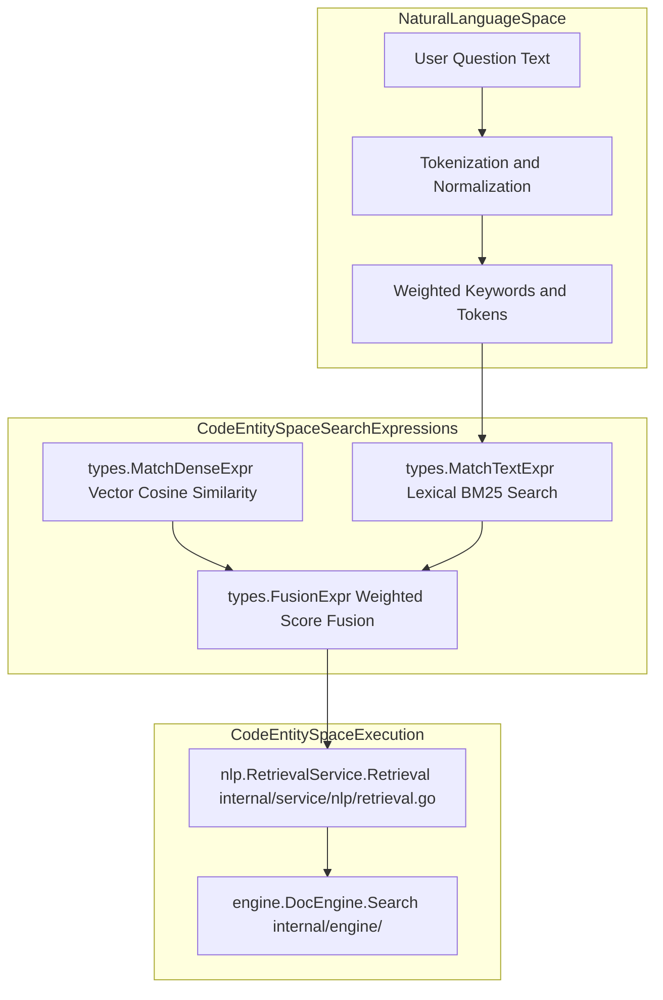
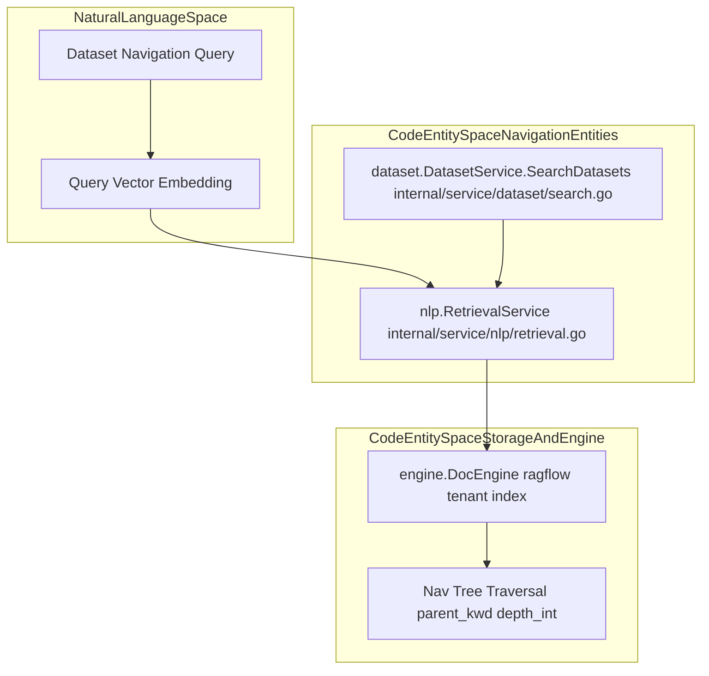
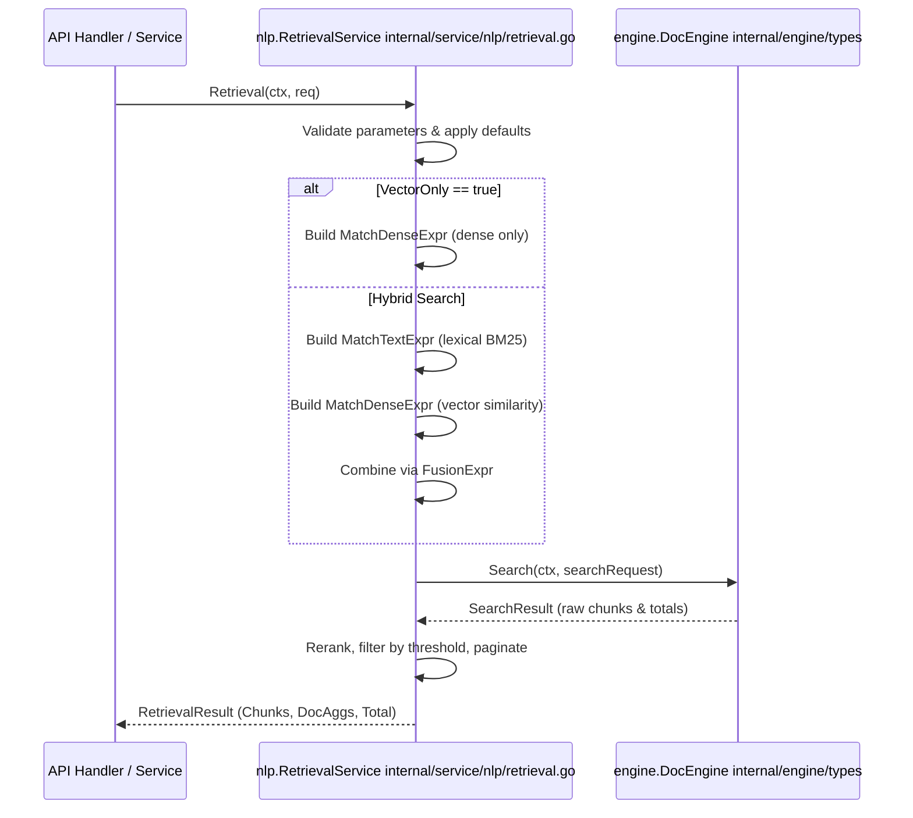

<!-- source: DeepWiki mcp.deepwiki.com · repo infiniflow/ragflow · page 9.2 Query Processing and Hybrid Search · fetched 2026-10-29 -->

# Query Processing and Hybrid Search

Relevant source files

The following files were used as context for generating this wiki page:

- [internal/agent/retrievalbridge/enhancer.go](internal/agent/retrievalbridge/enhancer.go)
- [internal/agent/retrievalbridge/enhancer_test.go](internal/agent/retrievalbridge/enhancer_test.go)
- [internal/agent/tool/retrieval_nlp.go](internal/agent/tool/retrieval_nlp.go)
- [internal/agent/tool/retrieval_nlp_test.go](internal/agent/tool/retrieval_nlp_test.go)
- [internal/common/metadata_utils.go](internal/common/metadata_utils.go)
- [internal/common/metadata_utils_test.go](internal/common/metadata_utils_test.go)
- [internal/engine/elasticsearch/chunk.go](internal/engine/elasticsearch/chunk.go)
- [internal/engine/elasticsearch/chunk_helpers_test.go](internal/engine/elasticsearch/chunk_helpers_test.go)
- [internal/engine/elasticsearch/chunk_test.go](internal/engine/elasticsearch/chunk_test.go)
- [internal/handler/chunk.go](internal/handler/chunk.go)
- [internal/handler/chunk_test.go](internal/handler/chunk_test.go)
- [internal/handler/dataset.go](internal/handler/dataset.go)
- [internal/handler/dataset_search_test.go](internal/handler/dataset_search_test.go)
- [internal/handler/dify_retrieval_handler.go](internal/handler/dify_retrieval_handler.go)
- [internal/handler/dify_retrieval_handler_test.go](internal/handler/dify_retrieval_handler_test.go)
- [internal/harness/core/cancel_full_test.go](internal/harness/core/cancel_full_test.go)
- [internal/service/chunk/chunk.go](internal/service/chunk/chunk.go)
- [internal/service/chunk/chunk_test.go](internal/service/chunk/chunk_test.go)
- [internal/service/chunk_types.go](internal/service/chunk_types.go)
- [internal/service/chunk_types_test.go](internal/service/chunk_types_test.go)
- [internal/service/dataset/search.go](internal/service/dataset/search.go)
- [internal/service/dataset/search_test.go](internal/service/dataset/search_test.go)
- [internal/service/dataset_types.go](internal/service/dataset_types.go)
- [internal/service/enrich_metadata_test.go](internal/service/enrich_metadata_test.go)
- [internal/service/generator.go](internal/service/generator.go)
- [internal/service/metadata.go](internal/service/metadata.go)
- [internal/service/metadata_filter.go](internal/service/metadata_filter.go)
- [internal/service/metadata_filter_test.go](internal/service/metadata_filter_test.go)
- [internal/service/nlp/reranker.go](internal/service/nlp/reranker.go)
- [internal/service/nlp/reranker_question_tks_test.go](internal/service/nlp/reranker_question_tks_test.go)
- [internal/service/nlp/reranker_rank_feature_test.go](internal/service/nlp/reranker_rank_feature_test.go)
- [internal/service/nlp/retrieval.go](internal/service/nlp/retrieval.go)
- [internal/service/nlp/retrieval_test.go](internal/service/nlp/retrieval_test.go)
- [test/api/session_api_test.go](test/api/session_api_test.go)

## Purpose and Scope

This page details the implementation of query processing, hybrid search, metadata filtering, and dataset navigation search within RAGFlow's retrieval subsystem, primarily implemented in `internal/service/nlp/` and `internal/engine/`. It covers the end-to-end data flow from natural language queries and multi-turn refinement to cross-language tokenization, hybrid dense-sparse scoring (`MatchTextExpr`, `MatchDenseExpr`, `FusionExpr`), metadata filter compilation, and hierarchical dataset navigation search.

---

## 1. Query Preprocessing and Refinement

When a search or chat request is initiated, `RetrievalService.Retrieval()` evaluates the input question [internal/service/nlp/retrieval.go:88-101](). If multi-turn conversation context is enabled, the query can be augmented or refined via language model prompts before entering tokenization and vectorization pipelines.

- **Parameter Normalization**: Default parameters such as `KNNTopK` (default `1024`), `KNNNumCandidates` (default `2048`), `SimilarityThreshold` (default `0.2`), and `VectorSimilarityWeight` (default `0.3` or `1.0` for vector-only) are applied if unassigned [internal/service/nlp/retrieval.go:104-123]().
- **Vector-Only Mode**: When `VectorOnly` is set to `true`, lexical text matching expressions are bypassed, and scoring relies purely on dense vector similarity [internal/service/nlp/retrieval.go:70-75, 118-122]().

**Sources:** [internal/service/nlp/retrieval.go:88-145]()

---

## 2. Tokenization and Keyword Weighting

Queries are tokenized to extract weighted keywords for full-text search matching against document indices.

- **Tokenizer Integration**: RAGFlow utilizes text analyzers and tokenizers (such as whitespace analyzers and custom dictionaries) to process string queries into token streams [internal/tokenizer/tokenizer.go:1-50]().
- **Keyword Fields**: Extracted terms populate lexical expression fields like `content_ltks`, `content_with_weight`, and `title_tks` [internal/engine/elasticsearch/chunk_helpers_test.go:17-29]().
- **Diacritic and Case Normalization**: Query terms are normalized (e.g., lowercasing [internal/engine/elasticsearch/chunk_helpers_test.go:44-58](), diacritic folding for languages like Czech/Slovak) to ensure alignment with indexed tokens.

**Sources:** [internal/tokenizer/tokenizer.go:1-50](), [internal/engine/elasticsearch/chunk_helpers_test.go:17-74]()

---

## 3. Hybrid Vector and BM25 Search Architecture

RAGFlow combines neural vector search (dense retrieval) with lexical BM25 search (sparse retrieval) using a fusion strategy.

### Natural Language to Code Entity Mapping

The diagram below bridges the natural language processing space to internal code entities responsible for search expression construction and execution.

**Sources:** [internal/service/nlp/retrieval.go:88-178](), [internal/engine/types/types.go:1-50]()

---

## 4. Metadata Filtering Backend and UI

Metadata filtering allows narrowing retrieval results by structural attributes (e.g., tags, authors, creation dates, custom categorical fields).

### Backend Filtering Model

- **MetaFilterCondition**: Represents individual filter clauses specifying a `Key`, comparison operator (`Op` like `=`, `!=`, `in`, `not in`, `contains`, `>`, `<`), and `Value`.
- **Manual and Auto Modes**: Filters can be constructed manually via the UI condition builder or automatically generated via LLM prompt evaluation (`GenMetaFilter`) using prompt templates (`meta_filter.md`).
- **Engine Translation**: Filter maps are converted into Elasticsearch/Infinity compound query clauses (`bool` filter, `must`, `must_not`, `terms`) [internal/service/nlp/retrieval_test.go:53]().

### Frontend Metadata Filter UI

- **Component Hierarchy**: The React frontend provides filter management under `web/src/components/metadata-filter/`.
- **Condition Building**: `MetadataFilterConditions` manages dynamic key-operator-value rows with type-safe selection and input validation.

**Sources:** [internal/service/nlp/retrieval_test.go:53]()

---

## 5. Dataset Navigation Search

Dataset navigation organizes knowledge into hierarchical tree clusters (`nav_doc`, `nav_cluster`) within the tenant document index, allowing semantic tree traversal and dataset navigation search.

### Natural Language to Code Entity Mapping: Navigation Search

**Sources:** [internal/service/nlp/retrieval.go:40-100]()

---

## 6. Search Execution Flow

The end-to-end execution sequence in `RetrievalService.Retrieval()` coordinates parameter validation, expression assembly, engine querying, and result post-processing [internal/service/nlp/retrieval.go:97-178]().

**Sources:** [internal/service/nlp/retrieval.go:88-178]()

---

## Key Classes and Functions

| Component | File and Location | Role |
| :--- | :--- | :--- |
| `RetrievalService` | `internal/service/nlp/retrieval.go:40-48` | Orchestrates hybrid retrieval, query expansion, and reranking |
| `Retrieval()` | `internal/service/nlp/retrieval.go:88-178` | Main entry point for hybrid search execution |
| `Rerank()` | `internal/service/nlp/reranker.go:56-91` | Handles model-based or engine-fallback reranking |
| `Search()` | `internal/engine/elasticsearch/chunk_helpers_test.go:95-110` | Executes low-level queries against the doc engine |

**Sources:** [internal/service/nlp/retrieval.go:40-178](), [internal/service/nlp/reranker.go:56-91]()

---

