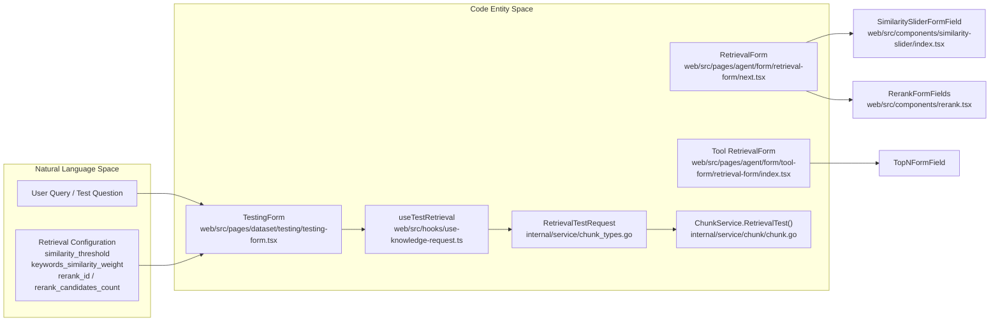
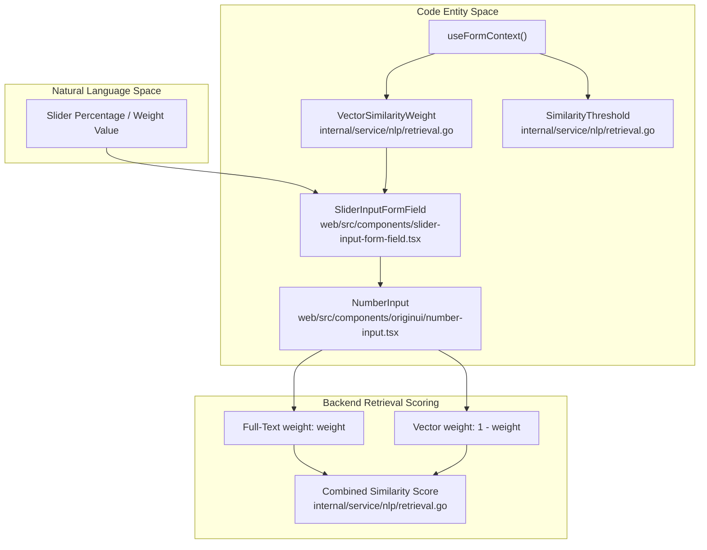
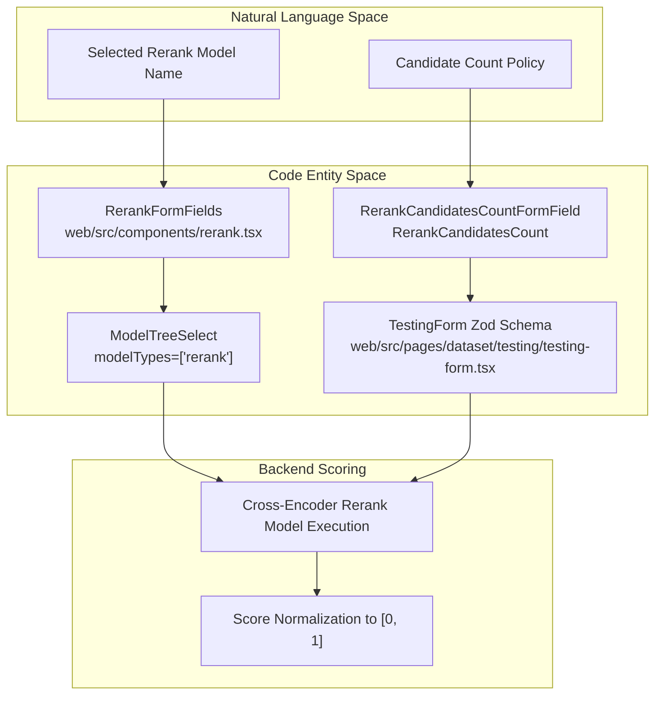
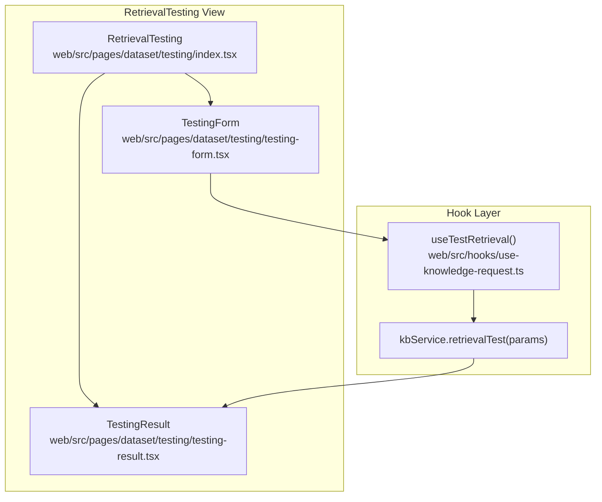

<!-- source: DeepWiki mcp.deepwiki.com · repo infiniflow/ragflow · page 9.3 Reranking and Filtering · fetched 2026-10-29 -->

# Reranking and Filtering

Relevant source files

The following files were used as context for generating this wiki page:

- [internal/agent/tool/retrieval_nlp.go](internal/agent/tool/retrieval_nlp.go)
- [internal/agent/tool/retrieval_nlp_test.go](internal/agent/tool/retrieval_nlp_test.go)
- [internal/engine/elasticsearch/chunk.go](internal/engine/elasticsearch/chunk.go)
- [internal/engine/elasticsearch/chunk_helpers_test.go](internal/engine/elasticsearch/chunk_helpers_test.go)
- [internal/engine/elasticsearch/chunk_test.go](internal/engine/elasticsearch/chunk_test.go)
- [internal/handler/chunk.go](internal/handler/chunk.go)
- [internal/handler/chunk_test.go](internal/handler/chunk_test.go)
- [internal/handler/dataset.go](internal/handler/dataset.go)
- [internal/handler/dataset_search_test.go](internal/handler/dataset_search_test.go)
- [internal/handler/dify_retrieval_handler.go](internal/handler/dify_retrieval_handler.go)
- [internal/handler/dify_retrieval_handler_test.go](internal/handler/dify_retrieval_handler_test.go)
- [internal/harness/core/cancel_full_test.go](internal/harness/core/cancel_full_test.go)
- [internal/service/chunk/chunk.go](internal/service/chunk/chunk.go)
- [internal/service/chunk/chunk_test.go](internal/service/chunk/chunk_test.go)
- [internal/service/chunk_types.go](internal/service/chunk_types.go)
- [internal/service/chunk_types_test.go](internal/service/chunk_types_test.go)
- [internal/service/dataset/search.go](internal/service/dataset/search.go)
- [internal/service/dataset/search_test.go](internal/service/dataset/search_test.go)
- [internal/service/dataset_types.go](internal/service/dataset_types.go)
- [internal/service/nlp/reranker.go](internal/service/nlp/reranker.go)
- [internal/service/nlp/reranker_question_tks_test.go](internal/service/nlp/reranker_question_tks_test.go)
- [internal/service/nlp/reranker_rank_feature_test.go](internal/service/nlp/reranker_rank_feature_test.go)
- [internal/service/nlp/retrieval.go](internal/service/nlp/retrieval.go)
- [internal/service/nlp/retrieval_test.go](internal/service/nlp/retrieval_test.go)
- [web/src/components/auto-keywords-form-field.tsx](web/src/components/auto-keywords-form-field.tsx)
- [web/src/components/children-delimiter-form.test.tsx](web/src/components/children-delimiter-form.test.tsx)
- [web/src/components/children-delimiter-form.tsx](web/src/components/children-delimiter-form.tsx)
- [web/src/components/delimiter-form-field.tsx](web/src/components/delimiter-form-field.tsx)
- [web/src/components/entity-types-form-field.tsx](web/src/components/entity-types-form-field.tsx)
- [web/src/components/excel-to-html-form-field.tsx](web/src/components/excel-to-html-form-field.tsx)
- [web/src/components/knowledge-base-item.tsx](web/src/components/knowledge-base-item.tsx)
- [web/src/components/list-filter-bar/filter-field.tsx](web/src/components/list-filter-bar/filter-field.tsx)
- [web/src/components/list-filter-bar/filter-popover.tsx](web/src/components/list-filter-bar/filter-popover.tsx)
- [web/src/components/list-filter-bar/index.tsx](web/src/components/list-filter-bar/index.tsx)
- [web/src/components/list-filter-bar/interface.ts](web/src/components/list-filter-bar/interface.ts)
- [web/src/components/llm-setting-items/slider.tsx](web/src/components/llm-setting-items/slider.tsx)
- [web/src/components/max-token-number-from-field.tsx](web/src/components/max-token-number-from-field.tsx)
- [web/src/components/message-history-window-size-item.tsx](web/src/components/message-history-window-size-item.tsx)
- [web/src/components/originui/number-input.tsx](web/src/components/originui/number-input.tsx)
- [web/src/components/page-rank-form-field.tsx](web/src/components/page-rank-form-field.tsx)
- [web/src/components/rerank.tsx](web/src/components/rerank.tsx)
- [web/src/components/similarity-slider/index.tsx](web/src/components/similarity-slider/index.tsx)
- [web/src/components/slider-input-form-field.tsx](web/src/components/slider-input-form-field.tsx)
- [web/src/components/top-n-item.tsx](web/src/components/top-n-item.tsx)
- [web/src/components/top-select.tsx](web/src/components/top-select.tsx)
- [web/src/components/ui/__tests__/multi-select.test.tsx](web/src/components/ui/__tests__/multi-select.test.tsx)
- [web/src/components/ui/input.tsx](web/src/components/ui/input.tsx)
- [web/src/components/ui/multi-select.tsx](web/src/components/ui/multi-select.tsx)
- [web/src/components/ui/select.tsx](web/src/components/ui/select.tsx)
- [web/src/components/ui/switch.tsx](web/src/components/ui/switch.tsx)
- [web/src/constants/form.ts](web/src/constants/form.ts)
- [web/src/hooks/use-knowledge-request.ts](web/src/hooks/use-knowledge-request.ts)
- [web/src/interfaces/request/knowledge.ts](web/src/interfaces/request/knowledge.ts)
- [web/src/pages/agent/form/categorize-form/dynamic-categorize.tsx](web/src/pages/agent/form/categorize-form/dynamic-categorize.tsx)
- [web/src/pages/agent/form/categorize-form/dynamic-example.tsx](web/src/pages/agent/form/categorize-form/dynamic-example.tsx)
- [web/src/pages/agent/form/categorize-form/index.tsx](web/src/pages/agent/form/categorize-form/index.tsx)
- [web/src/pages/agent/form/categorize-form/use-form-schema.ts](web/src/pages/agent/form/categorize-form/use-form-schema.ts)
- [web/src/pages/agent/form/token-chunker-form/index.tsx](web/src/pages/agent/form/token-chunker-form/index.tsx)
- [web/src/pages/agent/form/variable-aggregator-form/name-input.tsx](web/src/pages/agent/form/variable-aggregator-form/name-input.tsx)
- [web/src/pages/dataset/dataset/use-select-filters.ts](web/src/pages/dataset/dataset/use-select-filters.ts)
- [web/src/pages/dataset/index.tsx](web/src/pages/dataset/index.tsx)
- [web/src/pages/dataset/setting/chunk-method-learn-more.tsx](web/src/pages/dataset/setting/chunk-method-learn-more.tsx)
- [web/src/pages/dataset/sidebar/index.tsx](web/src/pages/dataset/sidebar/index.tsx)
- [web/src/pages/dataset/testing/index.tsx](web/src/pages/dataset/testing/index.tsx)
- [web/src/pages/dataset/testing/testing-form.tsx](web/src/pages/dataset/testing/testing-form.tsx)
- [web/src/pages/dataset/testing/testing-result.tsx](web/src/pages/dataset/testing/testing-result.tsx)
- [web/src/pages/datasets/dataset-creating-dialog.tsx](web/src/pages/datasets/dataset-creating-dialog.tsx)
- [web/src/pages/datasets/hooks.ts](web/src/pages/datasets/hooks.ts)
- [web/src/pages/files/link-to-dataset-dialog.tsx](web/src/pages/files/link-to-dataset-dialog.tsx)
- [web/src/pages/next-chats/chat/app-settings/dynamic-variable.tsx](web/src/pages/next-chats/chat/app-settings/dynamic-variable.tsx)
- [web/src/stories/number-input.stories.ts](web/src/stories/number-input.stories.ts)

This page documents RAGFlow's reranking system and filtering mechanisms that refine search results before presenting them to the LLM for answer generation. The system combines hybrid keyword/vector scoring, optional model-based reranking, rank feature scoring (such as tags), similarity thresholds, and candidate limits to optimize chunk selection.

For information about initial search and retrieval, see **9.2 Query Processing and Hybrid Search**. For the subsequent formatting of retrieved chunks into context, see **9.4 Answer Generation, Citations and the Search App**.

## System Overview

The reranking and filtering system operates as a post-processing layer following initial hybrid retrieval from the document store. It receives initial search candidates, applies token or model-based scoring, incorporates ranking features, applies similarity thresholds, and truncates results based on top-N limits.

**Retrieval Testing & Reranking Form Architecture (Code Entity Mapping)**

Sources: [internal/service/chunk/chunk.go:138-183](), [web/src/pages/dataset/testing/testing-form.tsx:50-159](), [web/src/hooks/use-knowledge-request.ts:142-207]()

---

## Similarity-Based Reranking and Weights

Similarity-based weighting balances full-text (BM25 / keyword) scores with vector similarity scores. The user interface exposes this via sliders where weights are adjusted dynamically.

### Implementation

The `SimilaritySliderFormField` component in `web/src/components/similarity-slider/index.tsx` binds core parameters defined in the backend `RetrievalRequest` struct (`internal/service/nlp/retrieval.go:51-80`):
1. `SimilarityThreshold`: Defaults to `0.2` if unspecified, controlling the minimum required score for a chunk to be retained [internal/service/nlp/retrieval.go:110-112]().
2. `VectorSimilarityWeight`: Defaults to `0.3` for standard searches or `1.0` for pure vector searches, controlling the balance between keyword matching and vector cosine similarity [internal/service/nlp/retrieval.go:113-123]().

**Similarity Slider Component Data Flow (Code Entity Space)**

Sources: [internal/service/nlp/retrieval.go:51-123](), [web/src/components/slider-input-form-field.tsx:35-156](), [web/src/components/originui/number-input.tsx:16-28]()

---

## Model-Based Reranking

When a reranking model is selected via the model tree selector, candidates retrieved from the initial search pass through an additional cross-encoder reranking stage.

### Reranker Form Configuration

The `RerankFormFields` component renders the model selector restricted to `rerank` model types [web/src/components/rerank.tsx:38-69](). Within `RetrievalService.Retrieval()`, if a `RerankModel` is provided, pagination beyond page 1 is explicitly rejected to ensure scoring consistency across the top candidate window [internal/service/nlp/retrieval.go:146-148]().

**Model-Based Reranking Configuration Flow (Code Entity Space)**

Sources: [internal/service/nlp/retrieval.go:146-148](), [web/src/components/rerank.tsx:38-95](), [web/src/pages/dataset/testing/testing-form.tsx:60-75]()

---

## Thresholds, Top-N, and Candidate Limits

Filtering parameters safeguard output quality and manage context window sizes for downstream LLMs.

### Parameter Constraints and Validation

*   **Similarity Threshold (`SimilarityThreshold`)**: Discards chunks scoring below the set threshold [internal/service/nlp/retrieval.go:110-112]().
*   **Top-N / Page Size (`PageSize`)**: Limits the final number of chunks returned to the workflow or chat prompt [internal/service/nlp/retrieval.go:134-136]().
*   **Rerank Candidates Count (`RerankCandidatesCount`)**: Determines how many initial search results are fetched and presented to the reranking model (default `64`) [internal/service/nlp/retrieval.go:137-139](). `RetrievalService` validates that `rerank_candidates_count` is greater than or equal to `page * page_size` [internal/service/nlp/retrieval.go:143-145]().

Sources: [internal/service/nlp/retrieval.go:110-145](), [web/src/components/similarity-slider/index.tsx:40-51](), [web/src/pages/dataset/testing/testing-form.tsx:60-75]()

---

## Retrieval Testing UI and Settings Forms

RAGFlow features an interactive retrieval testing harness alongside reusable configuration forms embedded in datasets, search apps, chat apps, and agent canvas nodes.

### Retrieval Testing Page Structure

The testing page (`RetrievalTesting`) splits its view into a settings input form and an output evaluation panel [web/src/pages/dataset/testing/index.tsx:14-61]().

**Retrieval Testing UI Data Flow**

Sources: [web/src/pages/dataset/testing/testing-form.tsx:50-159](), [web/src/hooks/use-knowledge-request.ts:142-207]()

### Unified Retrieval Form Implementations

Retrieval options are instantiated across multiple form schemas with strict validation rules:
*   **Agent Retrieval Node Form**: Defined in `web/src/pages/agent/form/retrieval-form/next.tsx`, supporting dynamic dataset bindings, memory bindings, similarity sliders, and metadata filters.
*   **Tool Retrieval Form**: Defined in `web/src/pages/agent/form/tool-form/retrieval-form/index.tsx`, omitting unsupported fields like `top_k` while retaining rerank and slider controls.

Sources: [web/src/hooks/use-knowledge-request.ts:142-207](), [web/src/pages/dataset/testing/testing-form.tsx:50-159]()

---

