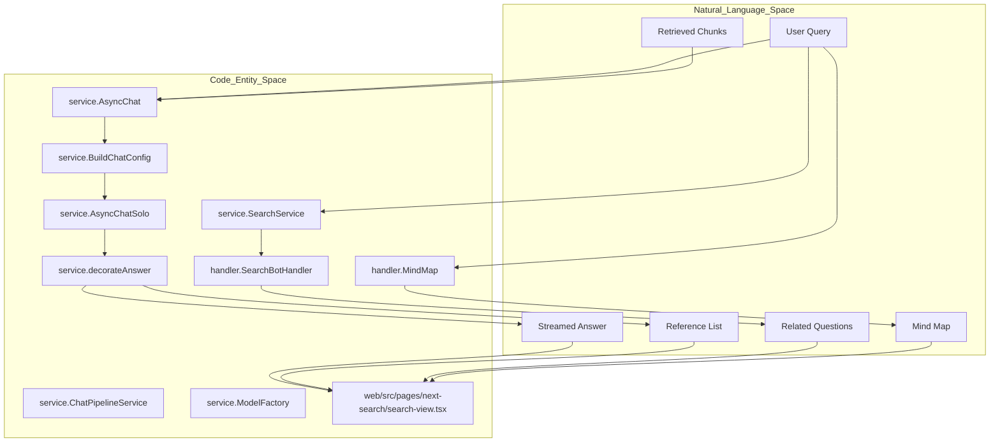
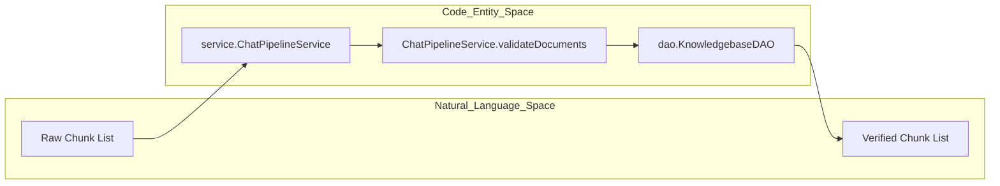

<!-- source: DeepWiki mcp.deepwiki.com · repo infiniflow/ragflow · page 9.4 Answer Generation, Citations and the Search App · fetched 2026-10-29 -->

# Answer Generation, Citations and the Search App

Relevant source files

The following files were used as context for generating this wiki page:

- [internal/dao/chat.go](internal/dao/chat.go)
- [internal/dao/chat_test.go](internal/dao/chat_test.go)
- [internal/dao/search.go](internal/dao/search.go)
- [internal/dao/search_test.go](internal/dao/search_test.go)
- [internal/handler/chat.go](internal/handler/chat.go)
- [internal/handler/chat_recommendation.go](internal/handler/chat_recommendation.go)
- [internal/handler/chat_test.go](internal/handler/chat_test.go)
- [internal/handler/dataset_list_test.go](internal/handler/dataset_list_test.go)
- [internal/handler/mcp_server.go](internal/handler/mcp_server.go)
- [internal/handler/mindmap.go](internal/handler/mindmap.go)
- [internal/handler/mindmap_test.go](internal/handler/mindmap_test.go)
- [internal/handler/openai_chat_test.go](internal/handler/openai_chat_test.go)
- [internal/handler/search.go](internal/handler/search.go)
- [internal/handler/searchbot.go](internal/handler/searchbot.go)
- [internal/handler/searchbot_test.go](internal/handler/searchbot_test.go)
- [internal/rag/prompts/citation_prompt.md](internal/rag/prompts/citation_prompt.md)
- [internal/rag/prompts/generator.go](internal/rag/prompts/generator.go)
- [internal/service/chat.go](internal/service/chat.go)
- [internal/service/chat_list_test.go](internal/service/chat_list_test.go)
- [internal/service/chat_pipeline.go](internal/service/chat_pipeline.go)
- [internal/service/chat_pipeline_test.go](internal/service/chat_pipeline_test.go)
- [internal/service/chat_rest_update_test.go](internal/service/chat_rest_update_test.go)
- [internal/service/citation.go](internal/service/citation.go)
- [internal/service/citation_test.go](internal/service/citation_test.go)
- [internal/service/dataset/list_test.go](internal/service/dataset/list_test.go)
- [internal/service/openai_chat.go](internal/service/openai_chat.go)
- [internal/service/openai_chat_test.go](internal/service/openai_chat_test.go)
- [internal/service/related_question.go](internal/service/related_question.go)
- [internal/service/search.go](internal/service/search.go)
- [internal/service/search_test.go](internal/service/search_test.go)
- [internal/service/test_helpers_test.go](internal/service/test_helpers_test.go)
- [web/src/components/floating-chat-widget-markdown.module.less](web/src/components/floating-chat-widget-markdown.module.less)
- [web/src/components/floating-chat-widget-markdown.tsx](web/src/components/floating-chat-widget-markdown.tsx)
- [web/src/components/highlight-markdown/index.tsx](web/src/components/highlight-markdown/index.tsx)
- [web/src/components/markdown-content/__tests__/index.test.tsx](web/src/components/markdown-content/__tests__/index.test.tsx)
- [web/src/components/markdown-content/index.tsx](web/src/components/markdown-content/index.tsx)
- [web/src/components/next-markdown-content/index.tsx](web/src/components/next-markdown-content/index.tsx)
- [web/src/components/pdf-drawer/hooks.ts](web/src/components/pdf-drawer/hooks.ts)
- [web/src/components/pdf-drawer/index.tsx](web/src/components/pdf-drawer/index.tsx)
- [web/src/hooks/logic-hooks/navigate-hooks.ts](web/src/hooks/logic-hooks/navigate-hooks.ts)
- [web/src/hooks/use-auto-resize-textarea.ts](web/src/hooks/use-auto-resize-textarea.ts)
- [web/src/pages/agents/agent-log-page.tsx](web/src/pages/agents/agent-log-page.tsx)
- [web/src/pages/agents/index.tsx](web/src/pages/agents/index.tsx)
- [web/src/pages/datasets/index.tsx](web/src/pages/datasets/index.tsx)
- [web/src/pages/next-chats/chat-card.tsx](web/src/pages/next-chats/chat-card.tsx)
- [web/src/pages/next-chats/index.tsx](web/src/pages/next-chats/index.tsx)
- [web/src/pages/next-search/embed-app-modal.tsx](web/src/pages/next-search/embed-app-modal.tsx)
- [web/src/pages/next-search/hooks.ts](web/src/pages/next-search/hooks.ts)
- [web/src/pages/next-search/index.tsx](web/src/pages/next-search/index.tsx)
- [web/src/pages/next-search/markdown-content/index.tsx](web/src/pages/next-search/markdown-content/index.tsx)
- [web/src/pages/next-search/mindmap-sheet.tsx](web/src/pages/next-search/mindmap-sheet.tsx)
- [web/src/pages/next-search/search-home.tsx](web/src/pages/next-search/search-home.tsx)
- [web/src/pages/next-search/search-setting-hooks.ts](web/src/pages/next-search/search-setting-hooks.ts)
- [web/src/pages/next-search/search-setting.tsx](web/src/pages/next-search/search-setting.tsx)
- [web/src/pages/next-search/search-view.tsx](web/src/pages/next-search/search-view.tsx)
- [web/src/pages/next-search/searching.tsx](web/src/pages/next-search/searching.tsx)
- [web/src/pages/next-search/share/index.tsx](web/src/pages/next-search/share/index.tsx)
- [web/src/pages/next-searches/hooks.ts](web/src/pages/next-searches/hooks.ts)
- [web/src/pages/next-searches/index.tsx](web/src/pages/next-searches/index.tsx)
- [web/src/pages/next-searches/search-card.tsx](web/src/pages/next-searches/search-card.tsx)
- [web/src/pages/user-setting/compilation-templates/edit-next/utils.test.ts](web/src/pages/user-setting/compilation-templates/edit-next/utils.test.ts)
- [web/src/services/search-service.ts](web/src/services/search-service.ts)
- [web/src/utils/__tests__/chat.test.ts](web/src/utils/__tests__/chat.test.ts)
- [web/src/utils/chat.ts](web/src/utils/chat.ts)

This page details how RAGFlow generates answers from retrieved chunks, inserts and repairs citations, and provides related questions and mindmaps. It also covers the user experience in the "next-search" frontend application.

## Purpose and Scope

This document explains RAGFlow's response generation and citation system. It details how retrieved chunks are transformed into a structured context, how token limits are enforced to fit model constraints, the mechanism for inserting inline citations that link LLM outputs to source documents, and the handling of empty or stale data. It also covers the frontend components that display search results, related questions, and mindmaps.

## System Overview

The response generation pipeline coordinates multiple subsystems to produce cited answers. It bridges the gap between raw document store hits and a coherent, attributed response suitable for user consumption using a Go-based backend (`ChatPipelineService`) and a React frontend (`SearchingView`).

### Response Generation Data Flow

Sources:
- `ChatPipelineService` definition: [internal/service/chat_pipeline.go:57-70]()
- `BuildChatConfig` function: [internal/service/chat_pipeline_test.go:122]()
- `SearchBotHandler` definition: [internal/handler/searchbot.go:105-113]()
- `SearchService` definition: [internal/service/search.go:30-35]()
- `ModelFactory` definition: [internal/service/chat_pipeline.go:58]()
- `decorateAnswer` function: [internal/service/chat_pipeline_test.go:148]()
- `AsyncChat` function: [internal/service/chat_pipeline.go:146]()
- `AsyncChatSolo` function: [internal/service/chat_pipeline.go:147]()
- `SearchingView` (Search App Frontend): [web/src/pages/next-search/search-view.tsx:48-82]()

## Context Formatting and Token Management

RAGFlow uses specialized utilities to ensure that retrieved information is presented to the LLM in a structured manner while respecting the model's context window.

### Chunk Standardizing
The chunk formatting routine standardizes raw hits from storage engines (`engine.DocEngine`) into a common schema. It maps internal fields like `docnm_kwd` to document names and content weights. The Go logic is integrated within `ChatPipelineService` when preparing chunks for the model input [internal/service/chat_pipeline.go:190-200]().

### Context Prompt Assembly
The prompt assembly transforms a list of chunks into a single string for the LLM's system prompt:
- It assigns a numeric ID to each chunk or a hash-based identifier.
- It includes metadata such as Title, URL, and custom document fields using structured formatting.
- It enforces a token limit, stopping context addition once the threshold of `max_tokens` is reached [internal/service/chat_pipeline.go:190-200]().

### Token Truncation
To prevent context window overflow errors, token counting routines calculate exact distributions. If history or retrieved context exceeds configured limits:
1. It prioritizes the System Prompt and the Latest User Query.
2. It calculates the token distribution breakdown across chat history and chunks.
3. It performs character-level trimming to fit within the specified limit.
The Go `ChatPipelineService` manages token counting and truncates inputs to fit within the model's capacity [internal/service/chat_pipeline.go:202-206]().

Sources:
- `ChatPipelineService` prompt assembly: [internal/service/chat_pipeline.go:190-200]()
- `ChatPipelineService` token management: [internal/service/chat_pipeline.go:202-206]()

## Citation Mechanism

Citations are implemented as numeric markers (e.g., `[1]`, `[2]`) that the LLM inserts into its response, which the frontend later resolves to document metadata.

### Backend Citation Prep
The `ChatPipelineService` in Go handles citation preparation:
1. **Reference Data**: The `AsyncChatResult` struct includes a `Reference` field to hold metadata about the cited documents [internal/service/chat_pipeline.go:89-110](). This map contains information about the chunks used to generate the answer.
2. **Prompt Directives**: The system prompt provided to the LLM includes instructions to generate citations in the format `[ID]` based on the provided reference chunks. The `decorateAnswer` process ensures citations are formatted and linked correctly.

### Frontend Citation Rendering
The frontend uses markdown components to parse the LLM's response and replace citation markers with interactive UI elements:
- **Regex Matching**: Pattern matching identifies markers like `[1]` in text streams (e.g., `citationMarkerReg` in [web/src/utils/citation-utils.ts]()).
- **Index Parsing**: Index parsers convert the matched string into zero-based integer indices (`parseCitationIndex` in [web/src/utils/chat.ts:29]()).
- **Metadata Mapping**: The `RetrievalDocuments` component in `SearchingView` maps these indices to the corresponding chunk in the reference object, displaying the document title and content [web/src/pages/next-search/search-view.tsx:44]() [web/src/pages/next-search/search-view.tsx:48-82]().

Sources:
- `AsyncChatResult` structure: [internal/service/chat_pipeline.go:89-110]()
- `RetrievalDocuments` component: [web/src/pages/next-search/search-view.tsx:44]()
- `SearchingView` component: [web/src/pages/next-search/search-view.tsx:48-82]()
- Citation parsing utilities: [web/src/utils/chat.ts:26-31]()

## Related Questions and Mindmaps

RAGFlow enhances the search experience by generating related questions and mindmaps, providing users with additional avenues for exploration.

### Related Questions Generation
The related questions generation utility produces follow-up prompts based on the user's initial query:
- It takes the user ID, question, search ID, and associated services as inputs [internal/handler/searchbot.go:154]().
- It leverages an LLM via model drivers (`ModelFactory`, `ModelCallService`) to formulate relevant questions.
- Handlers expose this functionality via API endpoints [internal/handler/searchbot.go:105-113]().

### Mindmap Generation
The mindmap handler generates structured summaries of retrieved information:
- It takes a question and knowledge base IDs as input, optionally using a search ID to retrieve specific configurations [internal/handler/mindmap.go:45-70]().
- It uses hooks like `useSearchFetchMindMap` and `useShowMindMapDrawer` in the frontend to trigger asynchronous mindmap fetches [web/src/pages/next-searches/hooks.ts:81-110]().

### Frontend Display
The `SearchingView` component in the frontend displays both related questions and mindmaps:
- **Related Questions**: Rendered as clickable suggestions allowing users to quickly initiate new searches [web/src/pages/next-search/search-view.tsx:54-88]().
- **Mindmap**: Controlled by state variables and rendered via sheet components (`MindMapSheet`) [web/src/pages/next-search/search-view.tsx:42]().

Sources:
- `SearchBotHandler` definition: [internal/handler/searchbot.go:105-113]()
- `MindMap` handler: [internal/handler/mindmap.go:45-70]()
- `useSearchFetchMindMap` hook: [web/src/pages/next-searches/hooks.ts:81-110]()
- `SearchingView` component: [web/src/pages/next-search/search-view.tsx:48-82]()

## The Search App Frontend Experience

The "next-search" frontend application provides a dynamic and interactive interface for users to perform searches, view results, and explore related content.

### Search Input and Control
The `SearchHome` and `SearchingView` components manage the user's search input:
- **Search Input Field**: A resizable textarea allows users to type queries with auto-resizing support [web/src/pages/next-search/search-home.tsx:48-50]() [web/src/pages/next-search/search-view.tsx:93-99]().
- **Search Initiation**: The `SearchHome` component transitions the UI from the home screen to the searching view upon submission [web/src/pages/next-search/search-home.tsx:52-63]().
- **Stop Output**: Users can halt streaming responses by invoking stop output handlers [web/src/pages/next-search/search-view.tsx:61]().

### Displaying Results
The `SearchingView` component organizes search results:
- **Answer Display**: Renders the LLM-generated response with markdown support [web/src/pages/next-search/search-view.tsx:41]() [web/src/pages/next-search/search-view.tsx:60]().
- **Retrieval Documents**: Displays source chunks retrieved from the knowledge base [web/src/pages/next-search/search-view.tsx:44]().
- **Loading States**: Manages loading spinners and status indicators during asynchronous retrieval and generation [web/src/pages/next-search/search-view.tsx:55]().

Sources:
- `SearchHome` component: [web/src/pages/next-search/search-home.tsx:29-45]()
- `SearchingView` component: [web/src/pages/next-search/search-view.tsx:48-82]()

## Response Quality and Safety Handling

The system handles cases where no relevant information is found or documents are not ready to ensure response reliability.

### Search Pruning and Validation
The `ChatPipelineService` performs checks to ensure that documents referenced in the retrieval process are valid and accessible, avoiding responses based on stale or deleted data [internal/service/chat_pipeline.go:57-70]().

Sources:
- `ChatPipelineService` validation: [internal/service/chat_pipeline.go:57-70]()
- `KnowledgebaseDAO` definition: [internal/service/chat_pipeline.go:68]()

### Knowledge Base Readiness
The chat pipeline verifies the readiness of knowledge bases before starting a conversation, ensuring sessions do not proceed if underlying documents are still parsing or have encountered errors [internal/service/chat_pipeline.go:146-156]().

### Task Progress Reporting
During long-running generation tasks, the system provides granular feedback using `AsyncChatResult` fields such as `StartToThink`, `EndToThink`, and structured `ThinkEvent` entries [internal/service/chat_pipeline.go:89-149]().

Sources:
- `ChatPipelineService` execution checks: [internal/service/chat_pipeline.go:146-156]()
- `AsyncChatResult` and `ThinkEvent` structures: [internal/service/chat_pipeline.go:89-149]()

---

