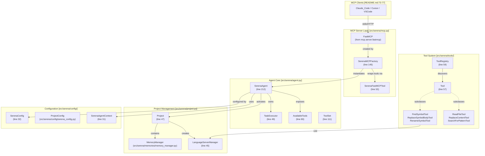
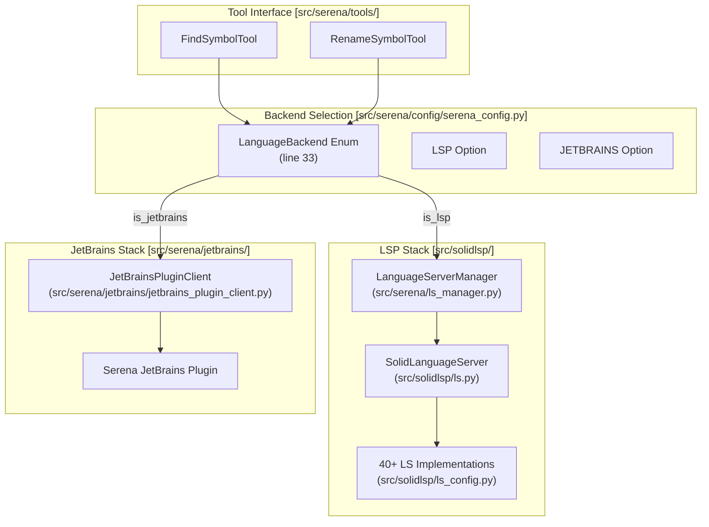

<!-- source: DeepWiki mcp.deepwiki.com · repo oraios/serena · page 1 Introduction to Serena · fetched 2026-10-29 -->

# Introduction to Serena

Relevant source files

The following files were used as context for generating this wiki page:

- [.github/workflows/pytest.yml](.github/workflows/pytest.yml)
- [.gitignore](.gitignore)
- [CHANGELOG.md](CHANGELOG.md)
- [README.md](README.md)
- [docs/01-about/020_programming-languages.md](docs/01-about/020_programming-languages.md)
- [docs/01-about/050_acknowledgements.md](docs/01-about/050_acknowledgements.md)
- [docs/02-usage/020_running.md](docs/02-usage/020_running.md)
- [docs/02-usage/025_jetbrains_plugin.md](docs/02-usage/025_jetbrains_plugin.md)
- [docs/02-usage/030_clients.md](docs/02-usage/030_clients.md)
- [docs/02-usage/040_workflow.md](docs/02-usage/040_workflow.md)
- [docs/02-usage/050_configuration.md](docs/02-usage/050_configuration.md)
- [docs/02-usage/999_additional-usage.md](docs/02-usage/999_additional-usage.md)
- [pyproject.toml](pyproject.toml)
- [resources/serena-logo-dark-mode.svg](resources/serena-logo-dark-mode.svg)
- [resources/serena-logo.svg](resources/serena-logo.svg)
- [src/serena/__init__.py](src/serena/__init__.py)
- [src/serena/util/git.py](src/serena/util/git.py)
- [src/serena/util/shell.py](src/serena/util/shell.py)
- [src/solidlsp/ls_config.py](src/solidlsp/ls_config.py)
- [test/conftest.py](test/conftest.py)
- [test/serena/test_serena_agent.py](test/serena/test_serena_agent.py)
- [uv.lock](uv.lock)

## Purpose and Scope

This document provides a high-level introduction to Serena, a coding agent toolkit that enables Large Language Models (LLMs) to work directly on codebases using semantic code understanding and IDE-like capabilities. This page covers Serena's core purpose, architecture overview, key components, and differentiating features.

Serena acts as a bridge between LLM clients and code analysis backends, providing tools that work like an IDE's capabilities rather than basic file operations.

Sources: [README.md:1-25](), [src/serena/agent.py:1-40]()

## What is Serena?

Serena is an **LLM-agnostic coding agent toolkit** that transforms LLMs into fully-featured development agents. Unlike most coding assistants that rely on simple file-based or text search approaches, Serena provides **symbolic code understanding** through integration with language servers or JetBrains IDEs, enabling precise code navigation and modification at the symbol level (classes, functions, methods, etc.).

### Key Capabilities

| Capability | Description |
|---------------|-------------|
| **Semantic Code Tools** | Symbol-level operations: `FindSymbolTool`, `FindReferencingSymbolsTool`, `ReplaceSymbolBodyTool`, `RenameSymbolTool`, `FindDeclarationTool`, and `FindImplementationsTool`. |
| **MCP Server** | Native support for the Model Context Protocol to integrate with Claude Code, Cursor, VSCode, and terminal clients. |
| **SolidLSP Integration** | An abstraction layer for 40+ language servers, providing language-agnostic semantic analysis. |
| **JetBrains Backend** | An alternative backend leveraging the powerful code analysis of JetBrains IDEs via a dedicated plugin. |
| **Project Management** | Automatic project indexing, memory management (onboarding), and persistent configuration. |

Sources: [README.md:17-25](), [README.md:62-79](), [README.md:104-106](), [src/serena/agent.py:41-60](), [pyproject.toml:6-8](), [CHANGELOG.md:89-110](), [src/serena/tools/__init__.py:18-31]()

## Core Architecture Overview

Serena is organized into several interconnected layers. The following diagram shows the major components using actual class names and file references from the codebase:

**Diagram: Component Architecture with Code Entities**

Sources: [src/serena/agent.py:43-346](), [src/serena/mcp.py:53-200](), [src/serena/config/serena_config.py:31-41]()

## Dual Backend System

Serena supports two alternative backends for code analysis. This allows the agent to maintain the same tool interface while switching the underlying "intelligence" source.

**Diagram: Language Backend Abstraction**

### Language Server Backend (SolidLSP)
The default backend uses the `SolidLanguageServer` framework. It manages over 40 language servers [README.md:112-113](), including:
* **Python**: Pyright (default), Basedpyright, Jedi, or Ty [src/solidlsp/ls_config.py:96](), [CHANGELOG.md:36](), [test/conftest.py:50-52]()
* **TypeScript/JS**: `typescript` [src/solidlsp/ls_config.py:100]()
* **Rust**: `rust` (rust-analyzer) [src/solidlsp/ls_config.py:97]()
* **Java**: `java` (Eclipse JDTLS) [src/solidlsp/ls_config.py:98]()
* **C#**: `csharp` (Roslyn) or `csharp_omnisharp` [src/solidlsp/ls_config.py:95](), [docs/01-about/020_programming-languages.md:54]()
* **Go**: `go` (gopls) [src/solidlsp/ls_config.py:101]()
* **Ada / SPARK**: `ada` (ALS) [src/solidlsp/ls_config.py:169]()
* **GDScript**: `gdscript` (Godot) [src/solidlsp/ls_config.py:177]()
* **LaTeX**: `latex` (texlab) [docs/01-about/020_programming-languages.md:102]()
* **Nix**: `nix` (nixd) [src/solidlsp/ls_config.py:124](), [CHANGELOG.md:37]()

### JetBrains Backend
The `LanguageBackend.JETBRAINS` option connects Serena to a running JetBrains IDE (IntelliJ, PyCharm, etc.) via a dedicated plugin [README.md:115-124](). This provides superior indexing for complex polyglot projects and external libraries. The `jetbrains_plugin_client` handles communication with the IDE instance [src/serena/agent.py:44]().

Sources: [src/serena/config/serena_config.py:33](), [src/solidlsp/ls_config.py:90-185](), [README.md:90-112](), [CHANGELOG.md:55-67]()

## MCP Integration and Tool Exposure

Serena integrates with LLM clients via the Model Context Protocol (MCP). The `SerenaMCPFactory` [src/serena/mcp.py:145]() handles the lifecycle of the `FastMCP` server and tool registration.

### Tool Filtering and Availability
Because MCP clients typically do not support dynamic tool definitions at runtime, Serena distinguishes between **Exposed Tools** and **Active Tools**:

1.  **AvailableTools**: Defined at startup in `SerenaAgent` [src/serena/agent.py:80](). These are the tools the client "sees".
2.  **ToolSet**: A utility to filter tools based on `SerenaAgentContext` or `SerenaAgentMode` [src/serena/agent.py:111]().
3.  **Active Tools**: Tools currently permitted for use. The `ToolRegistry` [src/serena/agent.py:59]() manages the global list of valid tool names and their default enabled status [src/serena/agent.py:134]().

### Primary Integration Patterns
*   **CLI / Terminal**: Using `serena` or `serena-agent` entry points [pyproject.toml:65-66]().
*   **IDE (VSCode/Cursor/JetBrains)**: Configuring the IDE to launch the Serena MCP server via `stdio` transport [docs/02-usage/030_clients.md:69-85]().
*   **Desktop Apps**: Connecting Claude Desktop or OpenWebUI via the `serena start-mcp-server` launch command [docs/02-usage/030_clients.md:73-77]().
*   **Web/Remote**: Using `sse` or `streamable-http` transports for remote client access [src/serena/mcp.py:152]().
*   **Framework Integration**: Integration for the Agno framework via the `agno` optional dependency [pyproject.toml:100]().
*   **Hooks**: Using `serena-hooks` to provide client-specific features like auto-approval or reminders [pyproject.toml:67](), [CHANGELOG.md:83-89]().

Sources: [src/serena/agent.py:80-182](), [src/serena/mcp.py:145-170](), [pyproject.toml:64-67](), [docs/02-usage/030_clients.md:7-17]()

## Project and Workflow

Serena is project-centric. A project is defined by a directory containing a `.serena/project.yml` file.

*   **Indexing**: On activation, Serena scans the directory and determines programming language composition.
*   **Onboarding**: The `OnboardingTool` [src/serena/agent.py:53]() helps the agent create persistent "memories" in `.serena/memories/`.
*   **Memories**: The `MemoryManager` [src/serena/agent.py:46]() handles project-specific markdown files that provide the LLM with long-term context about the codebase.
*   **Dashboard**: A Flask-based web interface `SerenaDashboardAPI` [src/serena/dashboard.py:189]() allows users to monitor tool usage via `ToolUsageStats` [src/serena/dashboard.py:24](), view logs via `MemoryLogHandler` [src/serena/dashboard.py:28](), and manage memories.
*   **Diagnostics**: Tools like `GetDiagnosticsForFileTool` allow agents to see compilation errors directly [test/serena/test_serena_agent.py:27](), [CHANGELOG.md:38-45]().

Sources: [src/serena/agent.py:42-60](), [src/serena/dashboard.py:189-222](), [src/serena/memories/memory_manager.py:1-10](), [CHANGELOG.md:107-110]()

---

