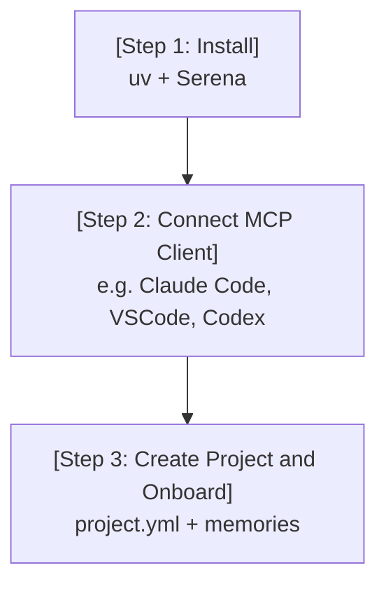
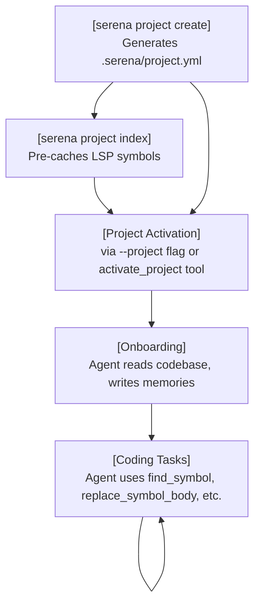
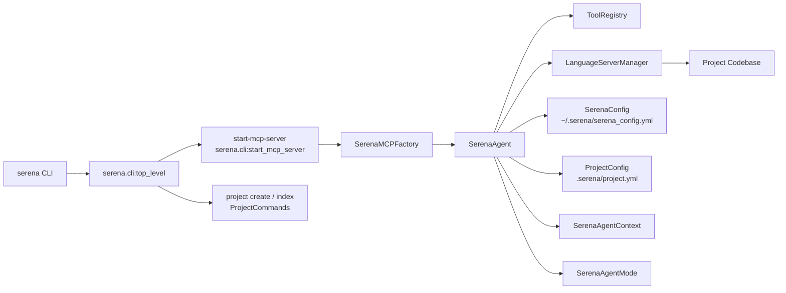

<!-- source: DeepWiki mcp.deepwiki.com · repo oraios/serena · page 2 Getting Started · fetched 2026-10-29 -->

# Getting Started

<details>
<summary>Relevant source files</summary>

The following files were used as context for generating this wiki page:

- [docs/01-about/050_acknowledgements.md](docs/01-about/050_acknowledgements.md)
- [docs/02-usage/010_installation.md](docs/02-usage/010_installation.md)
- [docs/02-usage/020_running.md](docs/02-usage/020_running.md)
- [docs/02-usage/025_jetbrains_plugin.md](docs/02-usage/025_jetbrains_plugin.md)
- [docs/02-usage/030_clients.md](docs/02-usage/030_clients.md)
- [docs/02-usage/040_workflow.md](docs/02-usage/040_workflow.md)
- [docs/02-usage/050_configuration.md](docs/02-usage/050_configuration.md)
- [docs/02-usage/999_additional-usage.md](docs/02-usage/999_additional-usage.md)
- [docs/03-special-guides/serena_on_chatgpt.md](docs/03-special-guides/serena_on_chatgpt.md)

</details>


This page is the entry point for new users setting up Serena. It covers the sequential steps required to get Serena operational: installing prerequisites, connecting an MCP client, and working on a project. Each step is covered in detail in a dedicated child page. For a deeper look at system internals, see [System Architecture](#3).

---

## How Serena Works at a Glance

Serena exposes IDE-like, symbol-level code tools through a Model Context Protocol (MCP) server. An LLM client calls those tools during its reasoning loop. The tools are backed by language servers (LSP) or a JetBrains plugin that understand your codebase semantically. [docs/02-usage/025_jetbrains_plugin.md:21-33]()

**Three-step setup overview:**



Sources: [docs/02-usage/020_running.md:1-15](), [docs/02-usage/040_workflow.md:1-14]()

---

## Step 1 — Installation and Prerequisites

> For full details, see [Installation and Prerequisites](#2.1).

**Core requirement:** The `uv` package manager. Serena is managed by `uv` for installation and environment handling. [docs/02-usage/010_installation.md:5-9]()

Once `uv` is available, you can install Serena globally:

```bash
uv tool install -p 3.13 serena-agent
```
[docs/02-usage/010_installation.md:23-23]()

After installation, initialize your preferred backend:
* `serena init` (for Language Servers) [docs/02-usage/010_installation.md:29-30]()
* `serena init -b JetBrains` (for JetBrains Plugin) [docs/02-usage/010_installation.md:31-32]()

**Language specific requirements** vary. Many dependencies are installed on the fly, but some (like Go or Rust) may require manual runtime installation if using the LSP backend. [docs/02-usage/010_installation.md:10-17]()

Sources: [docs/02-usage/010_installation.md:1-52]()

---

## Step 2 — Connecting an MCP Client

> For full details, see [Client Integration](#2.2).

Start the MCP server with:

```bash
serena start-mcp-server [options]
```
[docs/02-usage/020_running.md:23-23]()

The server supports two primary transport modes:

| Mode | Command flag | Use case |
|---|---|---|
| **Standard I/O** (default) | _(none)_ | Client (e.g. Claude Desktop) manages server lifecycle [docs/02-usage/020_running.md:34-50]() |
| **Streamable HTTP** | `--transport streamable-http` | User manages server lifecycle; shared access [docs/02-usage/020_running.md:55-70]() |

**Context selection** via the `--context` flag controls the initial system prompt and toolset. Built-in contexts include `claude-code`, `ide`, `desktop-app`, and `jb-copilot-plugin`. [docs/02-usage/050_configuration.md:71-82]()

**Representative client configurations:**

*Claude Code (setup utility):*
```shell
serena setup claude-code
```
[docs/02-usage/030_clients.md:107-107]()

*Copilot in JetBrains (`mcp.json`):*
```json
{
  "servers": {
    "serena": {
      "type": "stdio",
      "command": "serena",
      "args": ["start-mcp-server", "--context=jb-copilot-plugin"]
    }
  }
}
```
[docs/02-usage/030_clients.md:72-85]()

Sources: [docs/02-usage/020_running.md:19-102](), [docs/02-usage/030_clients.md:1-145](), [docs/02-usage/050_configuration.md:65-103]()

---

## Step 3 — Project Workflow

> For full details, see [Project Workflow](#2.3).

Serena uses a project-based workflow. A **project** is a directory containing code and a `.serena/project.yml` configuration file. [docs/02-usage/040_workflow.md:3-5]()

**Typical workflow:**



**Project creation examples:**
```bash
# Auto-detect language from existing files
serena project create

# Specify language explicitly
serena project create --language python --language typescript

# Create and immediately index
serena project create --index
```
[docs/02-usage/040_workflow.md:28-38]()

Sources: [docs/02-usage/040_workflow.md:1-132]()

---

## System Component Map

The following diagram maps user-facing commands and configuration files to the internal code entities they invoke.

**Diagram: Entry points and core components**



Sources: [docs/02-usage/020_running.md:1-176](), [docs/02-usage/050_configuration.md:10-15]()

---

**Diagram: Client-to-codebase request path**

```mermaid
flowchart LR
    client["MCP Client\ne.g. ClaudeCode, VSCode, Codex"]
    transport["Transport Layer\nstdio or streamable-http"]
    mcpfactory["SerenaMCPFactory\nsrc/serena/mcp.py"]
    agent["SerenaAgent\nsrc/serena/agent.py"]
    tool["Tool.apply()\ne.g. FindSymbolTool, ReplaceSymbolBodyTool"]
    lsmgr["LanguageServerManager\nsrc/solidlsp/"]
    ls["SolidLanguageServer\ne.g. PyrightServer, Gopls, RustAnalyzer"]
    fs["Filesystem\n.serena/project.yml, source files"]

    client -->|"MCP tool call"| transport
    transport --> mcpfactory
    mcpfactory --> agent
    agent --> tool
    tool --> lsmgr
    lsmgr --> ls
    ls --> fs
```



Sources: [docs/02-usage/020_running.md:34-70](), [docs/02-usage/030_clients.md:9-16]()

---

## Language Backend Choice

Serena supports two backends for code intelligence:

| Backend | How to enable | Notes |
|---|---|---|
| **Language servers (LSP)** | Default | Uses Solid-LSP framework. Supports 30+ languages. [docs/02-usage/010_installation.md:29-30]() |
| **JetBrains plugin** | `serena init -b JetBrains` | Leverages IDE's indexing, refactoring, and debugging. [docs/02-usage/025_jetbrains_plugin.md:38-56]() |

The backend is resolved at startup and determines how symbolic tools retrieve information. [docs/02-usage/025_jetbrains_plugin.md:104-111]()

Sources: [docs/02-usage/025_jetbrains_plugin.md:1-139](), [docs/02-usage/010_installation.md:27-35]()

---

## Quick Command Reference

| Task | Command |
|---|---|
| Start MCP server (stdio) | `serena start-mcp-server` |
| Start MCP server (HTTP, port 9121) | `serena start-mcp-server --transport streamable-http --port 9121` |
| Create project in current directory | `serena project create` |
| Index a project | `serena project index` |
| Edit global config | `serena config edit` |
| List available contexts | `serena context list` |
| List available modes | `serena mode list` |
| Setup Claude Code | `serena setup claude-code` |

Sources: [docs/02-usage/020_running.md:120-174](), [docs/02-usage/030_clients.md:107-107]()

---

