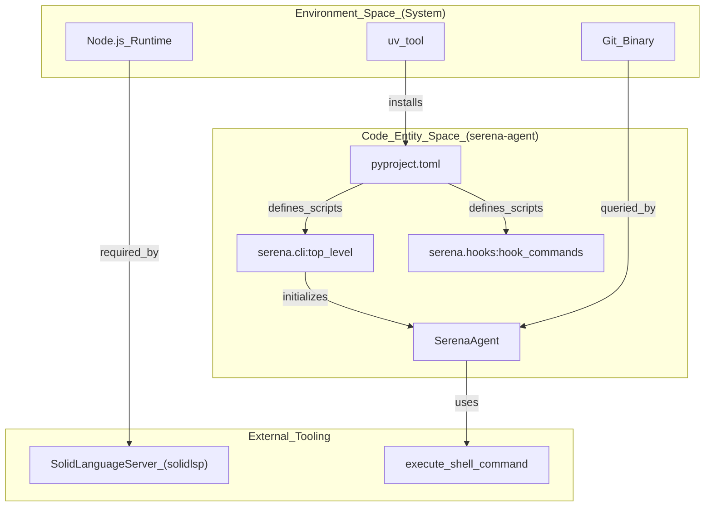
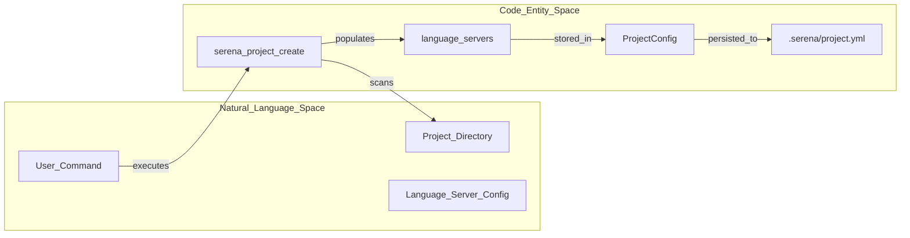

<!-- source: DeepWiki mcp.deepwiki.com · repo oraios/serena · page 2.1 Installation and Prerequisites · fetched 2026-10-29 -->

# Installation and Prerequisites

<details>
<summary>Relevant source files</summary>

The following files were used as context for generating this wiki page:

- [.github/workflows/codespell.yml](.github/workflows/codespell.yml)
- [.github/workflows/docker.yml](.github/workflows/docker.yml)
- [.github/workflows/docs.yaml](.github/workflows/docs.yaml)
- [CHANGELOG.md](CHANGELOG.md)
- [DOCKER.md](DOCKER.md)
- [Dockerfile](Dockerfile)
- [compose.yaml](compose.yaml)
- [docs/02-usage/010_installation.md](docs/02-usage/010_installation.md)
- [docs/03-special-guides/serena_on_chatgpt.md](docs/03-special-guides/serena_on_chatgpt.md)
- [pyproject.toml](pyproject.toml)
- [src/serena/__init__.py](src/serena/__init__.py)
- [src/serena/util/git.py](src/serena/util/git.py)
- [src/serena/util/shell.py](src/serena/util/shell.py)
- [uv.lock](uv.lock)

</details>


This page details the installation steps, system prerequisites, and the entry point configuration for Serena. Serena is a coding agent toolkit designed to be LLM-agnostic, providing semantic code retrieval and editing tools through the Model Context Protocol (MCP).

## Overview

Serena is built on Python 3.11+ and managed via `uv`. It functions as a bridge between LLMs and your codebase by leveraging either Language Servers (LSP) or a JetBrains IDE backend. The installation process involves setting up the core Python environment and ensuring the necessary language runtimes are available for the specific programming languages in your project.

Sources: [pyproject.toml:6-11](), [docs/02-usage/010_installation.md:1-10]()

## System Prerequisites

Before installing Serena, ensure your system meets the following requirements:

| Requirement | Specification | Purpose |
| :--- | :--- | :--- |
| **Python** | `>= 3.11, < 3.15` | Core runtime for the Serena agent and tools. [pyproject.toml:11]() |
| **uv** | Latest | High-performance Python package and project manager. [docs/02-usage/010_installation.md:7-9]() |
| **Node.js & npm** | Version 22.18.0+ | Required for many LSPs (TypeScript, Svelte, etc.). [Dockerfile:27-36]() |
| **Rust / Cargo** | Stable | Required for `rust-analyzer` support. [Dockerfile:44-51]() |
| **Git** | Latest | Required for version tracking and `get_git_status`. [src/serena/util/git.py:11-23]() |

### Supported Platforms
Serena is tested and supported on:
* **Linux**: Primary development and CI platform. [Dockerfile:2-21](), [CHANGELOG.md:74-75]()
* **Windows**: Native support with `pythonnet` and specific handling for line endings. [pyproject.toml:53-53](), [DOCKER.md:64-71]()
* **macOS**: Supported via standard Python/Node installations. [CHANGELOG.md:152-152]()

Sources: [pyproject.toml:11-18](), [docs/02-usage/010_installation.md:5-17](), [Dockerfile:2-51](), [CHANGELOG.md:74-75]()

## Core Installation Methods

### 1. Global Installation (Recommended)
The standard way to install Serena is as a global tool using `uv`. This makes the `serena` and `serena-agent` commands available system-wide.

```bash
uv tool install -p 3.13 serena-agent
```
[docs/02-usage/010_installation.md:21-25]()

### 2. Initializing Serena
After installation, you must initialize the configuration. You can choose between the default LSP-based backend or the JetBrains IDE backend.

```bash
# For default Language Server backend
serena init

# For JetBrains IDE backend (requires JetBrains Plugin)
serena init -b JetBrains
```
[docs/02-usage/010_installation.md:27-32]()

### 3. Docker Installation (Experimental)
For isolated environments, Serena provides a `Dockerfile` and `compose.yaml`. This is useful for securing `execute_shell_command` operations.

```bash
# Build and run using Docker Compose
docker-compose up serena
```
[DOCKER.md:72-80](), [Dockerfile:1-78]()

## Implementation: Entry Points and CLI

Serena defines primary executable entry points in `pyproject.toml`. These map to CLI handlers.

| Entry Point | Command | Function | Description |
| :--- | :--- | :--- | :--- |
| `serena` | `serena` | `serena.cli:top_level` | Main CLI for project management and config. |
| `serena-agent` | `serena-agent` | `serena.cli:top_level` | Alias for the main CLI. |
| `serena-hooks` | `serena-hooks` | `serena.hooks:hook_commands` | Hooks for auto-approve and client-specific reminders. |

[pyproject.toml:64-67](), [CHANGELOG.md:83-89]()

### Data Flow: Installation to Execution

The following diagram illustrates how the installation components interact to launch a functional Serena instance.


**Diagram: Installation and Execution Data Flow**
Sources: [pyproject.toml:64-67](), [src/serena/util/shell.py:16-42](), [src/serena/util/git.py:11-23]()

## Project Configuration Entry Point

When a project is initialized, Serena creates a `.serena/project.yml` file. This maps project-specific settings like `language_servers` (formerly `languages`).


**Diagram: Project Initialization Mapping**
Sources: [docs/02-usage/010_installation.md:29-32](), [CHANGELOG.md:10-11]()

## Summary of Commands

| Command Group | Command Example | Purpose |
| :--- | :--- | :--- |
| **Server** | `serena-mcp-server` | Launches the MCP server (stdio/SSE). [CHANGELOG.md:17-19]() |
| **Project** | `serena project create` | Initializes project configuration. [CHANGELOG.md:10-11]() |
| **Hooks** | `serena-hooks --client=grok` | Sets up environment-specific hooks. [CHANGELOG.md:84-84]() |
| **Shell** | `serena execute-shell-command` | Internal utility for shell access. [src/serena/util/shell.py:16-16]() |

Sources: [pyproject.toml:64-67](), [CHANGELOG.md:9-15](), [src/serena/util/shell.py:16-42]()

---

