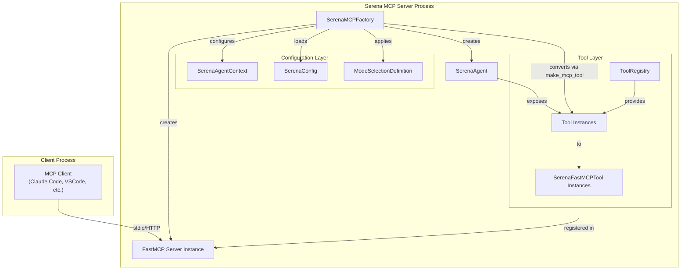
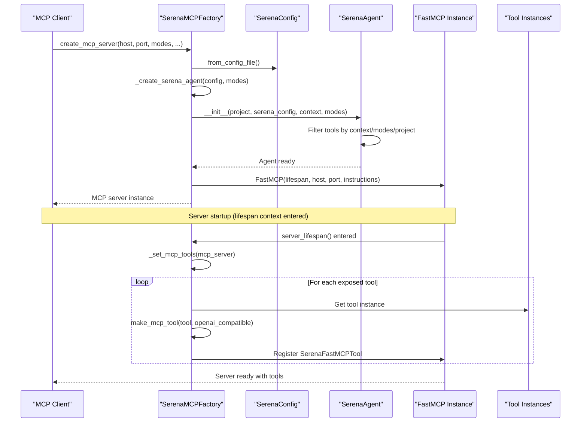

<!-- source: DeepWiki mcp.deepwiki.com · repo oraios/serena · page 2.2 Client Integration · fetched 2026-10-29 -->

# Client Integration

<details>
<summary>Relevant source files</summary>

The following files were used as context for generating this wiki page:

- [docs/01-about/050_acknowledgements.md](docs/01-about/050_acknowledgements.md)
- [docs/02-usage/020_running.md](docs/02-usage/020_running.md)
- [docs/02-usage/025_jetbrains_plugin.md](docs/02-usage/025_jetbrains_plugin.md)
- [docs/02-usage/030_clients.md](docs/02-usage/030_clients.md)
- [docs/02-usage/040_workflow.md](docs/02-usage/040_workflow.md)
- [docs/02-usage/050_configuration.md](docs/02-usage/050_configuration.md)
- [docs/02-usage/999_additional-usage.md](docs/02-usage/999_additional-usage.md)
- [scripts/live_test_grok.py](scripts/live_test_grok.py)
- [scripts/print_tool_overview.py](scripts/print_tool_overview.py)
- [src/serena/cli.py](src/serena/cli.py)
- [src/serena/config/client_setup.py](src/serena/config/client_setup.py)
- [src/serena/hooks.py](src/serena/hooks.py)
- [src/serena/mcp.py](src/serena/mcp.py)
- [src/serena/resources/config/contexts/antigravity.yml](src/serena/resources/config/contexts/antigravity.yml)
- [src/serena/resources/config/contexts/chatgpt.yml](src/serena/resources/config/contexts/chatgpt.yml)
- [src/serena/resources/config/contexts/claude-code.yml](src/serena/resources/config/contexts/claude-code.yml)
- [src/serena/resources/config/contexts/codebuddy.yml](src/serena/resources/config/contexts/codebuddy.yml)
- [src/serena/resources/config/contexts/codex.yml](src/serena/resources/config/contexts/codex.yml)
- [src/serena/resources/config/contexts/copilot-cli.yml](src/serena/resources/config/contexts/copilot-cli.yml)
- [src/serena/resources/config/contexts/grok.yml](src/serena/resources/config/contexts/grok.yml)
- [src/serena/resources/config/contexts/ide.yml](src/serena/resources/config/contexts/ide.yml)
- [src/serena/resources/config/contexts/jb-ai-assistant.yml](src/serena/resources/config/contexts/jb-ai-assistant.yml)
- [src/serena/resources/config/contexts/junie.yml](src/serena/resources/config/contexts/junie.yml)
- [src/serena/resources/config/contexts/vscode.yml](src/serena/resources/config/contexts/vscode.yml)
- [test/serena/config/test_client_setup.py](test/serena/config/test_client_setup.py)
- [test/serena/config/test_context_mode.py](test/serena/config/test_context_mode.py)
- [test/serena/config/test_global_ignored_paths.py](test/serena/config/test_global_ignored_paths.py)
- [test/serena/config/test_grok_docs.py](test/serena/config/test_grok_docs.py)
- [test/serena/test_cli_project_commands.py](test/serena/test_cli_project_commands.py)
- [test/serena/test_cli_setup.py](test/serena/test_cli_setup.py)
- [test/serena/test_edit_marker.py](test/serena/test_edit_marker.py)
- [test/serena/test_hooks.py](test/serena/test_hooks.py)
- [test/serena/test_mcp.py](test/serena/test_mcp.py)

</details>


This page covers how to connect Serena's MCP server to MCP-compatible clients, including Claude Code, Claude Desktop, Codex, VSCode, Cursor, Gemini-CLI, OpenWebUI, and OpenAPI clients via `mcpo`. It also covers the technical architecture of the transport layer (stdio, streamable-http, SSE) and port configuration. For information about project setup and activation after connecting a client, see [Project Workflow](2.3).

## General Connection Approach

Connecting Serena to a client requires two decisions:

1.  **Transport mode**: `stdio` (client launches Serena as a subprocess) or `streamable-http`/`SSE` (Serena runs as a standalone server). [docs/02-usage/020_running.md:34-79]()
2.  **Context**: Which set of tools and system prompt to expose. [docs/02-usage/030_clients.md:34-39]()

In most cases, you register a launch command with the client's MCP settings. The client then starts Serena as a subprocess using that command. For network-based clients (like OpenWebUI or mcpo proxies), you first start Serena in `--transport streamable-http` mode and then point the client at the server URL. [docs/02-usage/020_running.md:56-70]()

> **Note on project activation:** Clients with per-workspace MCP config (VSCode and Claude Code) should typically specify `--project <path>` at startup with a single-project context like `ide` or `claude-code`. [docs/02-usage/030_clients.md:24-29]() Clients with global config (Claude Desktop, Codex, JetBrains) require the user to activate the project they want to work on via the `activate_project` tool or a manual prompt. [docs/02-usage/030_clients.md:30-33](), [docs/02-usage/030_clients.md:88-90]()

Sources: [docs/02-usage/020_running.md:34-79](), [docs/02-usage/030_clients.md:7-40]()

## Overview

Serena implements the Model Context Protocol (MCP) through an MCP server that exposes its tools and capabilities to compatible clients. The integration layer consists of:

*   **SerenaMCPFactory**: Factory class responsible for creating and configuring the MCP server instance. [src/serena/mcp.py:144-147]()
*   **FastMCP Server**: The underlying MCP server framework from the Python MCP SDK. [src/serena/mcp.py:13-15]()
*   **SerenaAgent**: The core agent that orchestrates tools, projects, and language servers. [src/serena/mcp.py:23-25]()
*   **Transport Layer**: Supports `stdio` (subprocess), `streamable-http` (network), and the legacy `sse` transport. [docs/02-usage/020_running.md:34-79]()

Sources: [src/serena/mcp.py:1-67](), [docs/02-usage/020_running.md:34-79]()

## MCP Server Architecture

### Component Structure

The following diagram bridges the high-level client interaction with the internal code entities responsible for the MCP lifecycle.

Title: "Serena MCP Integration Architecture"

Sources: [src/serena/mcp.py:52-126](), [src/serena/mcp.py:144-168](), [src/serena/mcp.py:271-300]()

### SerenaMCPFactory

The `SerenaMCPFactory` class is the central factory for creating MCP server instances with properly configured `SerenaAgent` instances. [src/serena/mcp.py:144-147]()

| Component | Type | Purpose |
| :--- | :--- | :--- |
| `context` | `SerenaAgentContext` | Determines tool availability and system prompts. [src/serena/mcp.py:165]() |
| `project` | `str | None` | Optional project path or name to activate on startup. [src/serena/mcp.py:166]() |
| `memory_log_handler` | `MemoryLogHandler | None` | In-memory log handler for dashboard integration. [src/serena/mcp.py:168]() |
| `agent` | `SerenaAgent | None` | The created agent instance. [src/serena/mcp.py:167]() |

Key methods:
*   `create_mcp_server()`: Creates a configured `FastMCP` instance with transport settings. [src/serena/mcp.py:271-300]()
*   `server_lifespan()`: Async context manager for server startup/shutdown lifecycle. [src/serena/mcp.py:338-346]()
*   `make_mcp_tool()`: Static method converting Serena `Tool` to `SerenaFastMCPTool`. [src/serena/mcp.py:175-185]()
*   `_set_mcp_tools()`: Registers all exposed tools with the FastMCP instance. [src/serena/mcp.py:249-269]()

Sources: [src/serena/mcp.py:144-346]()

## Client Connection Flow

### Initialization Sequence

Title: "Serena MCP Startup and Tool Registration Sequence"

Sources: [src/serena/mcp.py:271-350](), [src/serena/mcp.py:175-247]()

### Context Selection and Impact

The `SerenaAgentContext` determines the initial system prompt and available tools. [docs/02-usage/050_configuration.md:67-70]()

| Context | Single-project | Recommended Clients |
| :--- | :--- | :--- |
| `desktop-app` | No | Claude Desktop (Assume no prior coding capabilities). [docs/02-usage/050_configuration.md:73-74]() |
| `claude-code` | Yes | Claude Code (Optimized to avoid tool duplication). [docs/02-usage/050_configuration.md:75](), [src/serena/resources/config/contexts/claude-code.yml:52]() |
| `codex` | No | OpenAI Codex. [docs/02-usage/050_configuration.md:76](), [src/serena/resources/config/contexts/codex.yml:1-5]() |
| `ide` | Yes | VSCode, Cursor, Cline (Focus on augmenting existing tools). [docs/02-usage/050_configuration.md:78-79](), [src/serena/resources/config/contexts/ide.yml:26]() |
| `chatgpt` | No | ChatGPT. [src/serena/resources/config/contexts/chatgpt.yml:1-16]() |

Sources: [docs/02-usage/050_configuration.md:64-85](), [src/serena/resources/config/contexts/claude-code.yml:1-53](), [src/serena/resources/config/contexts/ide.yml:1-27]()

## Transport Protocols

### Standard I/O Mode (stdio)

The default mode where the client launches Serena as a subprocess. Communication occurs via `stdin`/`stdout`. [docs/02-usage/020_running.md:34-45]()

**Example Command**:
```shell
serena start-mcp-server --context ide --project /path/to/project
```
Sources: [docs/02-usage/020_running.md:47-53]()

### Streamable HTTP Mode

Serena runs as a standalone process. The client connects via a URL. [docs/02-usage/020_running.md:56-60]()

**Server Startup**:
```shell
serena start-mcp-server --transport streamable-http --port 9121
```
The client then connects to `http://localhost:9121/mcp`. [docs/02-usage/020_running.md:61-67]()

Sources: [docs/02-usage/020_running.md:56-77]()

## Automatic Client Setup

Serena includes a `ClientSetupHandler` system to automate the registration of the MCP server with supported clients. [src/serena/config/client_setup.py:8-10]()

| Handler Class | Client | Detection Mechanism |
| :--- | :--- | :--- |
| `ClientSetupHandlerClaudeCode` | Claude Code | Checks `claude --version`. [src/serena/config/client_setup.py:55-57]() |
| `ClientSetupHandlerCodex` | Codex | Checks `codex --version`. [src/serena/config/client_setup.py:80-82]() |
| `ClientSetupHandlerGrok` | Grok | Checks `grok --version`. [src/serena/config/client_setup.py:120-123]() |

The `apply()` method in these handlers executes shell commands (e.g., `claude mcp add`) to register Serena with the client's configuration. [src/serena/config/client_setup.py:63-69](), [src/serena/config/client_setup.py:88](), [src/serena/config/client_setup.py:132-138]()

Sources: [src/serena/config/client_setup.py:8-146]()

## Serena Hooks

The `serena-hooks` utility provides a set of commands to improve client-agent collaboration by intercepting tool calls. [src/serena/hooks.py:1-20]()

### Symbolic Tool Reminders
The `PreToolUseRemindAboutSymbolicToolsHook` tracks consecutive uses of non-symbolic tools like `grep` or `read_file`. [src/serena/hooks.py:115-144]() If the agent exceeds thresholds (e.g., 3 `grep` calls or 3 `read_file` calls), the hook returns a "deny" response with a reminder to use Serena's symbolic tools. [src/serena/hooks.py:149-152](), [src/serena/hooks.py:228-232]()

### Auto-Approval
The `PreToolUseAutoApproveSerenaHook` can be used to automatically allow any tool call that contains "serena" in its name, reducing manual user friction in agent sessions. [src/serena/hooks.py:284-285](), [src/serena/hooks.py:109-112]()

Sources: [src/serena/hooks.py:29-232](), [test/serena/test_hooks.py:1-150]()

## Tool Schema Conversion

### Serena Tool to MCP Tool Mapping

The `SerenaFastMCPTool` class performs the conversion: [src/serena/mcp.py:52-126]()

1.  **Metadata Extraction**: Calls `tool.get_name()`, `tool.get_apply_docstring()`, and `tool.get_apply_fn_metadata()`. [src/serena/mcp.py:60-62]()
2.  **Schema Generation**: Uses the function metadata to build a JSON schema. [src/serena/mcp.py:64]()
3.  **Docstring Parsing**: Extracts parameter descriptions for the schema and handles description overrides. [src/serena/mcp.py:68-96]()
4.  **OpenAI Sanitization**: If `openai_tool_compatible` is true, calls `SerenaMCPFactory._sanitize_for_openai_tools`. [src/serena/mcp.py:65-66]()
5.  **Execution Wrap**: Creates an `execute_fn` that calls `tool.apply_ex(log_call=True, catch_exceptions=False, **kwargs)`. [src/serena/mcp.py:97-102]()

Sources: [src/serena/mcp.py:52-126]()

### OpenAI Compatibility Layer

`_sanitize_for_openai_tools()` modifies schemas for clients like Codex or ChatGPT: [src/serena/mcp.py:171-173]()

*   **Integer to Number**: Converts `"type": "integer"` to `"type": "number"` and adds `"multipleOf": 1`. [src/serena/mcp.py:90-94]()
*   **Null Removal**: Removes `"null"` from union types as OpenAI doesn't support them in tool schemas. [src/serena/mcp.py:96-101]()
*   **Enum Coercion**: Coerces integer-only enums to numbers. [src/serena/mcp.py:107-112]()

Sources: [src/serena/mcp.py:68-173]()

## Client-Specific Configurations

### Claude Code
Add Serena via `serena setup claude-code` or the manual `claude mcp add` command. [docs/02-usage/030_clients.md:105-108]() Due to internal tool bias in Claude Code, it is highly recommended to override the system prompt:
```shell
claude --system-prompt="$(serena prompts print-cc-system-prompt-override)"
```
Sources: [docs/02-usage/030_clients.md:121-125]()

### VSCode / Cursor
Configure as a custom MCP server in settings. Use the `ide` context to avoid duplication with built-in file tools. [docs/02-usage/030_clients.md:24-29](), [docs/02-usage/050_configuration.md:78-79]()

### JetBrains (Copilot)
Configure via Tools / GitHub Copilot / Model Context Protocol (MCP). Use the `jb-copilot-plugin` context. [docs/02-usage/030_clients.md:69-85]() Using the JetBrains backend via the Serena JetBrains Plugin allows the agent to leverage IDE-native symbol analysis. [docs/02-usage/025_jetbrains_plugin.md:3-8]()

### Claude Desktop
Edit `claude_desktop_config.json`. Use the `env` key to provide necessary environment variables (e.g., `DOTNET_ROOT`) that might not be inherited from the shell. [docs/02-usage/030_clients.md:52-65]()

Sources: [docs/02-usage/030_clients.md:52-139](), [docs/02-usage/025_jetbrains_plugin.md:1-56]()

---

