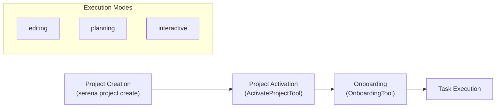
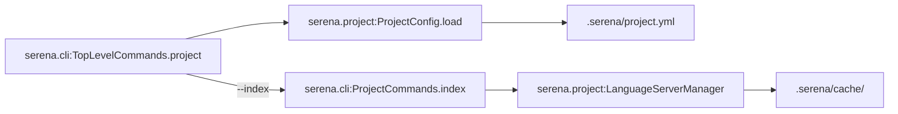
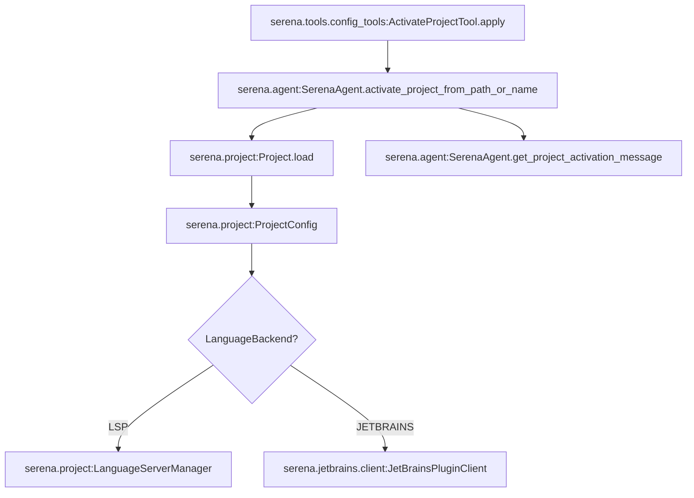
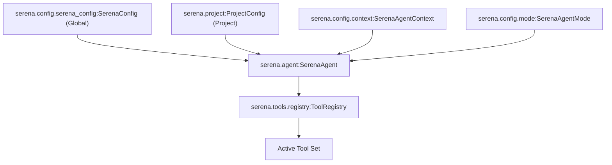

<!-- source: DeepWiki mcp.deepwiki.com · repo oraios/serena · page 2.3 Project Workflow · fetched 2026-10-29 -->

# Project Workflow

<details>
<summary>Relevant source files</summary>

The following files were used as context for generating this wiki page:

- [.serena/.gitignore](.serena/.gitignore)
- [docs/01-about/050_acknowledgements.md](docs/01-about/050_acknowledgements.md)
- [docs/02-usage/020_running.md](docs/02-usage/020_running.md)
- [docs/02-usage/025_jetbrains_plugin.md](docs/02-usage/025_jetbrains_plugin.md)
- [docs/02-usage/030_clients.md](docs/02-usage/030_clients.md)
- [docs/02-usage/040_workflow.md](docs/02-usage/040_workflow.md)
- [docs/02-usage/045_memories.md](docs/02-usage/045_memories.md)
- [docs/02-usage/050_configuration.md](docs/02-usage/050_configuration.md)
- [docs/02-usage/060_dashboard.md](docs/02-usage/060_dashboard.md)
- [docs/02-usage/999_additional-usage.md](docs/02-usage/999_additional-usage.md)
- [flake.lock](flake.lock)
- [flake.nix](flake.nix)
- [src/serena/memories/memory_manager.py](src/serena/memories/memory_manager.py)
- [src/serena/memories/memory_reference_analysis.py](src/serena/memories/memory_reference_analysis.py)
- [src/serena/tools/config_tools.py](src/serena/tools/config_tools.py)
- [src/serena/tools/memory_tools.py](src/serena/tools/memory_tools.py)
- [src/serena/tools/workflow_tools.py](src/serena/tools/workflow_tools.py)
- [src/serena/util/dataclass.py](src/serena/util/dataclass.py)
- [src/serena/util/yaml.py](src/serena/util/yaml.py)
- [test/serena/test_memories_manager.py](test/serena/test_memories_manager.py)
- [test/serena/util/test_yaml.py](test/serena/util/test_yaml.py)

</details>


This page describes the end-to-end workflow for using Serena on a software project: creating project configuration, activating a project, the onboarding process, the memory system, and the built-in modes that shape agent behavior.

---

## Overview

Serena uses a **project-based workflow**. A project is a directory on the filesystem that Serena tracks with a configuration file at `.serena/project.yml` [docs/02-usage/040_workflow.md:1-6](). Working on a project follows four sequential stages:



Sources: [docs/02-usage/040_workflow.md:1-20]()

---

## Stage 1: Project Creation & Indexing

### What Happens
Project creation defines the fundamental settings relevant to Serena's operation. This can be done **implicitly** by activating a directory as a project in-conversation, or **explicitly** via the CLI [docs/02-usage/040_workflow.md:20-24]().

### Explicit Project Creation
To create a project, use the following CLI command:
```bash
serena project create [options] [project directory]
```

| Option | Purpose |
|---|---|
| `--language <lang>` | Specify programming language (repeatable) [docs/02-usage/040_workflow.md:34-36]() |
| `--name <name>` | Set a custom project name [docs/02-usage/040_workflow.md:37]() |
| `--index` | Immediately index the project after creation [docs/02-usage/040_workflow.md:38]() |

The project creation logic detects dominant languages based on source files and prompts the user to enable them [docs/02-usage/040_workflow.md:31-33]().

### Indexing
Indexing pre-caches symbol information provided by language servers to avoid delays during tool calls [docs/02-usage/040_workflow.md:106-109](). This is only relevant for the `LSP` backend; the `JetBrains` backend handles indexing within the IDE [docs/02-usage/040_workflow.md:103-104]().

**Diagram: Project creation data flow**



Sources: [docs/02-usage/040_workflow.md:16-115](), [src/serena/util/yaml.py:65-87]()

---

## Stage 2: Project Activation

### What Happens
Activation makes the agent aware of the project. The system loads the configuration via `Project.load` and initializes the `LanguageServerManager` or connects to the `JetBrains` backend [docs/02-usage/025_jetbrains_plugin.md:21-25]().

### Two Activation Paths
1.  **CLI flag**: Passing `--project <path|name>` at startup, common for single-project contexts like `ide` or `claude-code` [docs/02-usage/050_configuration.md:131-132]().
2.  **In-conversation tool**: The LLM calls the `ActivateProjectTool` [src/serena/tools/config_tools.py:22-39]().

**Diagram: Project activation and Backend selection**



Sources: [src/serena/tools/config_tools.py:22-39](), [docs/02-usage/040_workflow.md:117-136](), [docs/02-usage/025_jetbrains_plugin.md:63-100]()

---

## Stage 3: Onboarding & Memories

### The Onboarding Process
By default, Serena performs onboarding the first time a project is used [docs/02-usage/040_workflow.md:139-142](). The `OnboardingTool` [src/serena/tools/workflow_tools.py:10-30]() provides the agent with instructions to explore the codebase. It seeds a `memory_maintenance` memory to guide the agent on documentation conventions [src/serena/memories/memory_manager.py:89-122]().

### Memories System
The `MemoryManager` [src/serena/memories/memory_manager.py:25]() handles Markdown files in `.serena/memories/` (project) or `~/.serena/memories/global/` (shared) [src/serena/memories/memory_manager.py:26-46]().

| Tool Class | Tool Name | Operation |
|---|---|---|
| `WriteMemoryTool` | `write_memory` | Saves memory; supports `global/` prefix [src/serena/tools/memory_tools.py:9-35]() |
| `ReadMemoryTool` | `read_memory` | Loads memory content [src/serena/tools/memory_tools.py:38-47]() |
| `ListMemoriesTool` | `list_memories` | Lists memories by topic [src/serena/tools/memory_tools.py:50-59]() |
| `RenameMemoryTool` | `rename_memory` | Renames memory and updates `mem:` references [src/serena/tools/memory_tools.py:74-91]() |
| `EditMemoryTool` | `edit_memory` | Regex/Literal replacement in memory [src/serena/tools/memory_tools.py:94-123]() |

Memories can reference each other using the `` `mem:NAME` `` convention. The `MemoryManager` provides `rename_references_to_memory` to maintain referential integrity during renames [src/serena/memories/memory_manager.py:123-148]().

Sources: [src/serena/tools/workflow_tools.py:10-30](), [src/serena/memories/memory_manager.py:1-150](), [src/serena/tools/memory_tools.py:1-123]()

---

## Stage 4: Modes and Contexts

### Contexts
A **context** defines the environment (e.g., `desktop-app`, `claude-code`, `ide`) [docs/02-usage/050_configuration.md:63-67](). Contexts like `claude-code` are "single-project" and disable the `ActivateProjectTool` [docs/02-usage/050_configuration.md:83-88]().

### Modes
Modes refine behavior for specific tasks [docs/02-usage/050_configuration.md:106-109]().

| Mode | Purpose | Key Effect |
|---|---|---|
| `editing` | Code modification | Optimizes for direct modification [docs/02-usage/050_configuration.md:111]() |
| `planning` | Analysis | Focuses on planning and analysis [docs/02-usage/050_configuration.md:110]() |
| `interactive` | Conversational | Suitable for back-and-forth interaction [docs/02-usage/050_configuration.md:112]() |
| `no-memories` | Privacy/Minimalism | Disables all memory tools [docs/02-usage/050_configuration.md:117]() |

**Diagram: Configuration layering**



Sources: [docs/02-usage/050_configuration.md:57-135](), [src/serena/util/yaml.py:27-52]()

---

## Workflow Tools Reference

Serena provides specialized tools to manage the agent's internal state and project lifecycle.

| Tool Name | Class | Purpose |
|---|---|---|
| `onboarding` | `OnboardingTool` | Triggers project structure identification [src/serena/tools/workflow_tools.py:10-30]() |
| `initial_instructions` | `InitialInstructionsTool` | Provides the 'Serena Instructions Manual' [src/serena/tools/workflow_tools.py:32-47]() |
| `activate_project` | `ActivateProjectTool` | Switches the active project context [src/serena/tools/config_tools.py:22-39]() |
| `open_dashboard` | `OpenDashboardTool` | Opens the web dashboard for logs and stats [src/serena/tools/config_tools.py:6-20]() |
| `get_current_config` | `GetCurrentConfigTool` | Prints active projects, tools, and modes [src/serena/tools/config_tools.py:57-67]() |

Sources: [src/serena/tools/workflow_tools.py:1-64](), [src/serena/tools/config_tools.py:1-67]()

---

## Best Practices

1.  **Dashboard Monitoring**: Use the Serena Dashboard to inspect logs and tool usage statistics [docs/02-usage/060_dashboard.md:35-45]().
2.  **Memory Maintenance**: Use the `ensure_memory_maintenance_memory` functionality to define conventions for how the agent should structure future memories [src/serena/memories/memory_manager.py:89-122]().
3.  **Clean State**: It is recommended to start from a clean git state so that changes made by the agent can be easily reviewed and reverted [docs/02-usage/040_workflow.md:146-148]().
4.  **YAML Safety**: When manually editing `project.yml`, ensure values starting with `*` (like glob patterns) are quoted to avoid YAML alias errors [src/serena/util/yaml.py:77-82]().

Sources: [docs/02-usage/060_dashboard.md:1-84](), [src/serena/memories/memory_manager.py:89-122](), [src/serena/util/yaml.py:1-87](), [docs/02-usage/040_workflow.md:146-150]()

---

