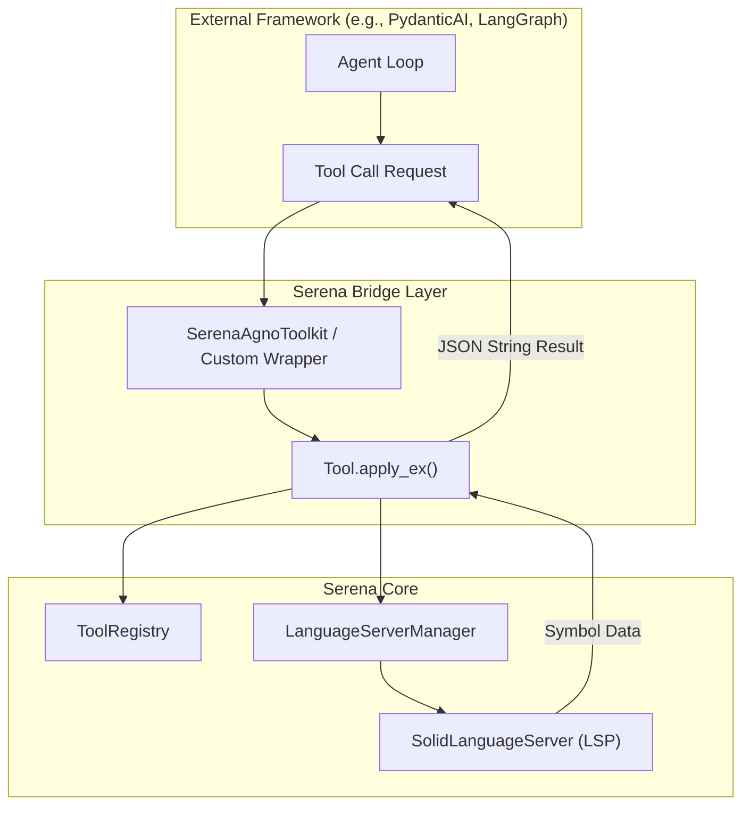
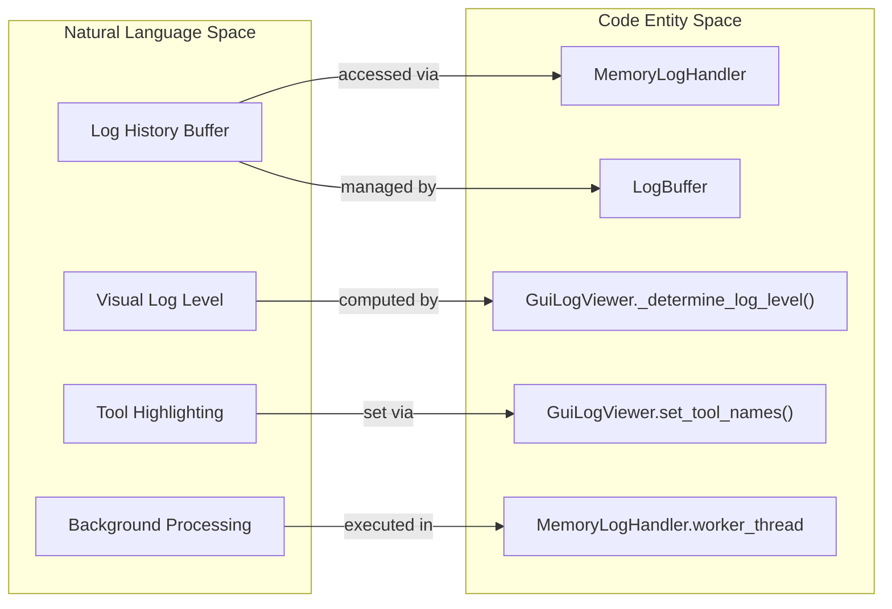

<!-- source: DeepWiki mcp.deepwiki.com · repo oraios/serena · page 2.4 Custom Agents and Framework Integration · fetched 2026-10-29 -->

# Custom Agents and Framework Integration

Relevant source files

The following files were used as context for generating this wiki page:

- [scripts/agno_agent.py](scripts/agno_agent.py)
- [scripts/mcp_server.py](scripts/mcp_server.py)
- [src/serena/agno.py](src/serena/agno.py)
- [src/serena/gui_log_viewer.py](src/serena/gui_log_viewer.py)
- [src/serena/util/logging.py](src/serena/util/logging.py)

While Serena is primarily used via its Model Context Protocol (MCP) server, it is designed as a modular toolkit that can be integrated into any Python-based agent framework. This page details how to use Serena's semantic code tools within the Agno framework, how to integrate them into other frameworks like PydanticAI or LangGraph, and how to utilize the standalone GUI log viewer for monitoring these custom integrations.

## Agno Integration

Serena provides first-class support for the [Agno](https://agno.com/) framework (formerly Phidata) through specialized toolkit and provider classes. This integration allows Agno agents to leverage Serena's full suite of symbolic code navigation and editing tools.

### SerenaAgnoToolkit

The `SerenaAgnoToolkit` class acts as a bridge between Serena's `Tool` objects and Agno's `Function` objects [src/serena/agno.py:25-27](). It automatically discovers all tools exposed by a `SerenaAgent` and converts them into a format Agno understands.

- **Discovery**: It iterates through `serena_agent.get_exposed_tool_instances()` to register functions [src/serena/agno.py:28-29]().
- **Entrypoint Wrapping**: Each tool's `apply` method is wrapped in an `entrypoint` that handles Agno's specific keyword argument passing (merging `kwargs` if explicitly passed) and exception catching [src/serena/agno.py:33-40](). It uses `tool.apply_ex(log_call=True, catch_exceptions=True, ...)` to execute the logic [src/serena/agno.py:40]().
- **Metadata**: It uses `tool.get_name_from_cls()` and `tool.get_apply_fn()` to preserve the original tool signatures and documentation for the LLM, while setting `skip_entrypoint_processing` to `True` to bypass Agno's default parameter handling [src/serena/agno.py:42-46]().

### SerenaAgnoAgentProvider

The `SerenaAgnoAgentProvider` is a singleton factory that simplifies the instantiation of an Agno agent configured with Serena capabilities [src/serena/agno.py:49-51]().

- **Agent Initialization**: It creates a `SerenaAgent` with a default `agent` context [src/serena/agno.py:108]().
- **State Management**: To support Agno's UI and conversation history, it initializes a persistent SQLite database at `temp/agno_agent_storage.db` using `agno.db.sqlite.SqliteDb` [src/serena/agno.py:117-128](). This database is deleted between sessions to ensure a fresh state [src/serena/agno.py:121-122]().
- **System Prompt**: It automatically populates the Agno agent's `system_message` using `serena_agent.create_system_prompt()` [src/serena/agno.py:134]().

### Reference Implementation: `agno_agent.py`

The script `scripts/agno_agent.py` serves as the reference implementation for running Serena within Agno's "AgentOS" environment.

- **Model Selection**: Demonstrates using `Claude` or `Gemini` models (e.g., `gemini-2.5-pro`) with Agno [scripts/agno_agent.py:16-17]().
- **Serving**: Uses `AgentOS` to serve the agent via an HTTP server, making it compatible with the Agno UI [scripts/agno_agent.py:23-33]().

**Sources:** [src/serena/agno.py:25-143](), [scripts/agno_agent.py:1-34]()

## Integrating with Other Frameworks

Serena tools can be integrated into other frameworks (like PydanticAI or LangGraph) by manually accessing the tool instances from a `SerenaAgent`.

### Tool Extraction Pattern
The standard pattern for framework integration involves initializing a `SerenaAgent` and then retrieving the tool instances to pass to the external framework's tool registration system.

| Step | Action | Code Reference |
| :--- | :--- | :--- |
| 1 | Initialize `SerenaAgent` | `agent = SerenaAgent(project_file, ...)` [src/serena/agno.py:108]() |
| 2 | Retrieve Tool Instances | `tools = agent.get_exposed_tool_instances()` [src/serena/agno.py:28]() |
| 3 | Map to Framework | Wrap `tool.apply_ex` in framework-specific decorators. |

### Data Flow: Serena to External Framework
This diagram illustrates how a Serena tool is bridged into an external agent's execution loop.

**Serena Tool Integration Flow**

**Sources:** [src/serena/agno.py:33-40](), [src/serena/agent.py:17]()

## Standalone Monitoring: GUI Log Viewer

When running Serena outside of the standard MCP environment (where logs might be hidden or interleaved with framework logs), the `GuiLogViewer` provides a dedicated Tkinter-based window for real-time monitoring [src/serena/gui_log_viewer.py:26-31]().

### Key Features
- **Threaded Execution**: Runs in a separate thread via `start()` to avoid blocking the agent's execution loop [src/serena/gui_log_viewer.py:77-84]().
- **Memory Integration**: Can be initialized with a `MemoryLogHandler` to display historical logs and receive new ones via callbacks [src/serena/gui_log_viewer.py:72-75]().
- **Visual Cues**: Supports color-coding based on `LogLevel` (DEBUG, INFO, WARNING, ERROR) [src/serena/gui_log_viewer.py:64-70]() and bolding of Serena tool names [src/serena/gui_log_viewer.py:94-102]().
- **Dashboard Link**: Includes a menu option to copy the `SerenaDashboardAPI` URL to the clipboard [src/serena/gui_log_viewer.py:104-113]().

### Integration with Logging System
The `MemoryLogHandler` acts as the central hub, collecting logs from the Python `logging` module and pushing them to the GUI's `message_queue` via an emit callback [src/serena/util/logging.py:31-48]().

**Natural Language to Code Entity Mapping: Logging and GUI**

**Sources:** [src/serena/gui_log_viewer.py:27-147](), [src/serena/util/logging.py:26-113]()

## Reference: Scripting Serena Directly

For developers who do not wish to use an agent framework, Serena can be scripted directly. This is useful for automated refactoring scripts or custom CLI tools.

### Implementation Pattern
1.  **Initialize**: Create a `SerenaAgent` instance for a specific project path [src/serena/agno.py:108]().
2.  **Access Tools**: Retrieve specific tools from the agent's registry or use `get_exposed_tool_instances()` [src/serena/agno.py:28]().
3.  **Execute**: Call `tool.apply_ex(...)` directly to perform symbolic operations like `FindSymbolTool` or `ReplaceSymbolBodyTool`.

**Sources:** [src/serena/agno.py:25-47](), [src/serena/agent.py:17]()

---

