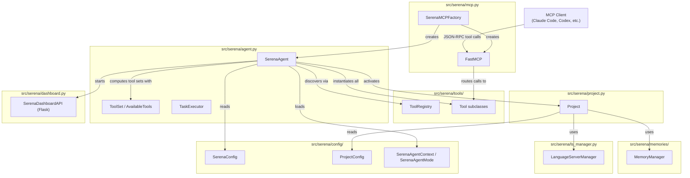
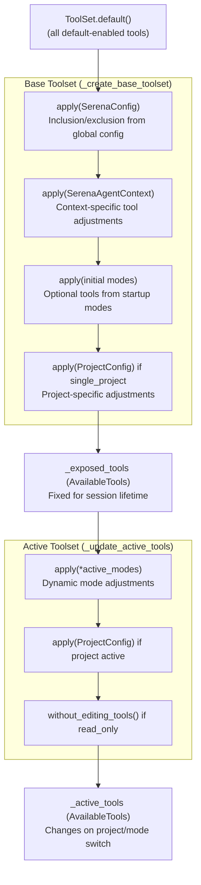
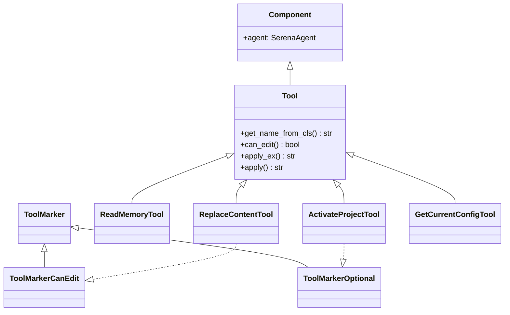
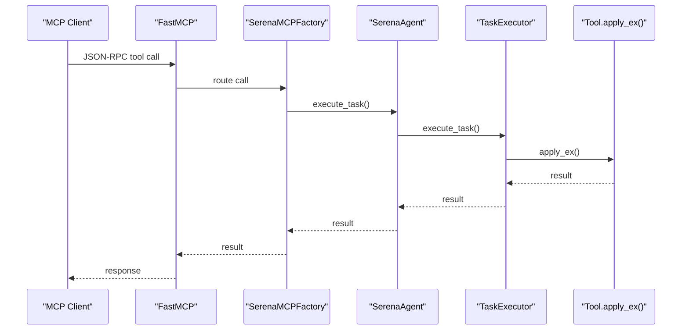
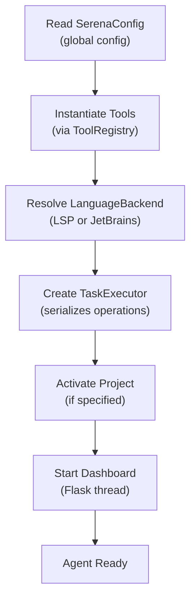

<!-- source: DeepWiki mcp.deepwiki.com · repo oraios/serena · page 3 System Architecture · fetched 2026-10-29 -->

# System Architecture

Relevant source files

The following files were used as context for generating this wiki page:

- [.serena/project.yml](.serena/project.yml)
- [scripts/demo_run_tools.py](scripts/demo_run_tools.py)
- [scripts/print_tool_overview.py](scripts/print_tool_overview.py)
- [src/serena/agent.py](src/serena/agent.py)
- [src/serena/analytics.py](src/serena/analytics.py)
- [src/serena/cli.py](src/serena/cli.py)
- [src/serena/config/serena_config.py](src/serena/config/serena_config.py)
- [src/serena/dashboard.py](src/serena/dashboard.py)
- [src/serena/mcp.py](src/serena/mcp.py)
- [src/serena/project.py](src/serena/project.py)
- [src/serena/resources/dashboard/dashboard.css](src/serena/resources/dashboard/dashboard.css)
- [src/serena/resources/dashboard/dashboard.js](src/serena/resources/dashboard/dashboard.js)
- [src/serena/resources/dashboard/index.html](src/serena/resources/dashboard/index.html)
- [src/serena/resources/project.template.yml](src/serena/resources/project.template.yml)
- [src/serena/resources/serena_config.template.yml](src/serena/resources/serena_config.template.yml)
- [src/serena/util/pypi.py](src/serena/util/pypi.py)
- [test/serena/config/test_global_ignored_paths.py](test/serena/config/test_global_ignored_paths.py)
- [test/serena/config/test_serena_config.py](test/serena/config/test_serena_config.py)
- [test/serena/test_cli_project_commands.py](test/serena/test_cli_project_commands.py)
- [test/serena/test_dashboard.py](test/serena/test_dashboard.py)
- [test/serena/test_edit_marker.py](test/serena/test_edit_marker.py)
- [test/serena/test_mcp.py](test/serena/test_mcp.py)

This page describes the major structural components of Serena, how they are organized, and how they interact at runtime. The focus is on component boundaries, data flow, and the specific classes and modules that implement each layer.

For deeper coverage of individual subsystems, see the child pages:
- Configuration details → [Configuration Management](#4)
- SerenaAgent internals → [SerenaAgent Core](#3.1)
- MCP server specifics → [MCP Server Integration](#3.2)
- Task execution details → [Task Execution System](#3.3)
- Dashboard details → [Dashboard and Monitoring](#3.4)
- Prompt assembly → [Prompt Factory and System Prompt](#3.5)
- Language server internals → [Language Server Integration](#6)
- Tool system internals → [Tool System](#7)

---

## Component Overview

The table below maps each major concern to its primary class and source file.

| Component | Primary Class | Source File |
|---|---|---|
| Central agent orchestrator | `SerenaAgent` | [src/serena/agent.py:227-383]() |
| MCP server factory | `SerenaMCPFactory` | [src/serena/mcp.py:144-173]() |
| Tool discovery and registry | `ToolRegistry` | [src/serena/agent.py:59-60]() |
| Active tool set computation | `ToolSet`, `AvailableTools` | [src/serena/agent.py:81-183]() |
| Project state | `Project` | [src/serena/project.py:32-150]() |
| Per-project memory | `MemoryManager` | [src/serena/project.py:46-54]() |
| Language server lifecycle | `LanguageServerManager` | [src/serena/agent.py:45-45]() |
| Web dashboard | `SerenaDashboardAPI` | [src/serena/dashboard.py:192-221]() |
| Linear task queue | `TaskExecutor` | [src/serena/agent.py:49-49]() |
| Analytics | `ToolUsageStats` | [src/serena/analytics.py:25-50]() |
| In-memory log capture | `MemoryLogHandler` | [src/serena/util/logging.py:63-63]() |
| Prompt assembly | `SerenaPromptFactory` | [src/serena/prompt_factory.py:39-39]() |
| Global configuration | `SerenaConfig` | [src/serena/config/serena_config.py:210-210]() |
| Per-project configuration | `ProjectConfig` | [src/serena/config/serena_config.py:147-147]() |
| Context definition | `SerenaAgentContext` | [src/serena/config/context_mode.py:22-22]() |
| Mode definition | `SerenaAgentMode` | [src/serena/config/context_mode.py:22-22]() |

Sources: [src/serena/agent.py:1-71](), [src/serena/mcp.py:1-33](), [src/serena/dashboard.py:1-36](), [src/serena/config/serena_config.py:1-50]()

---

## High-Level Architecture

**Diagram: Top-Level Component Relationships**

Sources: [src/serena/agent.py:227-383](), [src/serena/mcp.py:144-173](), [src/serena/project.py:32-150](), [src/serena/dashboard.py:192-221]()

---

## SerenaAgent

`SerenaAgent` ([src/serena/agent.py:227-383]()) is the central runtime object. One agent instance exists per Serena process. Its constructor performs the following orchestration:

1. **Configuration**: Reads `SerenaConfig` (global settings) and `SerenaPaths` [src/serena/agent.py:255-260]().
2. **Tool Initialization**: Instantiates every `Tool` subclass found by `ToolRegistry`: `{tool_class: tool_class(self) for tool_class in ToolRegistry().get_all_tool_classes()}` ([src/serena/agent.py:302]()).
3. **Language Backend**: Resolves the backend (`LanguageBackend.LSP` or `LanguageBackend.JETBRAINS`) [src/serena/agent.py:327-332]().
4. **Execution**: Creates a `TaskExecutor` for serialized tool execution [src/serena/agent.py:335]().
5. **Prompts**: Creates a `SerenaPromptFactory` to manage LLM system instructions [src/serena/agent.py:338]().
6. **Project**: Optionally activates a startup project [src/serena/agent.py:356-357]().
7. **Tool Filtering**: Computes the base tool set and the initial active tool set [src/serena/agent.py:361-364]().
8. **Dashboard**: Starts `SerenaDashboardAPI` (Flask server) if enabled [src/serena/agent.py:368-382]().

### Tool Set Layers

`SerenaAgent` maintains two distinct tool collections to manage visibility vs. permission:

| Collection | Field | Mutability | Purpose |
|---|---|---|---|
| Exposed tools | `_exposed_tools` | Fixed at startup | The set of tools reported to the MCP client [src/serena/agent.py:236]() |
| Active tools | `_active_tools` | Updated dynamically | The set of tools currently permitted to execute based on mode/project [src/serena/agent.py:237]() |

Sources: [src/serena/agent.py:230-240](), [src/serena/agent.py:641-666]()

---

## Tool Set Computation

**Diagram: How the Exposed and Active Tool Sets Are Computed**

Sources: [src/serena/agent.py:384-449](), [src/serena/agent.py:641-666](), [src/serena/agent.py:121-183]()

The `ToolSet.apply()` method ([src/serena/agent.py:137-183]()) processes a sequence of `ToolInclusionDefinition` objects. It supports both fixed tool sets (replacing all previous) and incremental adjustments (including optional tools or excluding existing ones).

---

## Tool System

### Tool Class Hierarchy

**Diagram: Tool Class Structure**

Sources: [src/serena/agent.py:50-60](), [src/serena/tools/__init__.py:1-50]()

### ToolRegistry

`ToolRegistry` is a singleton that uses inspection to discover all `Tool` subclasses at import time. It provides:

- `get_all_tool_classes()` — returns all discovered `Tool` subclasses.
- `get_tool_names_default_enabled()` — names of tools not marked as `ToolMarkerOptional` ([src/serena/agent.py:135]()).
- `check_valid_tool_name(name)` — validates that a tool name exists in the registry ([src/serena/agent.py:162]()).

---

## MCP Server Layer

`SerenaMCPFactory` ([src/serena/mcp.py:144-173]()) bridges between the Model Context Protocol and `SerenaAgent`.

**Diagram: MCP Tool Call Flow**

Sources: [src/serena/mcp.py:144-173](), [src/serena/agent.py:683-694](), [src/serena/task_executor.py:18-175]()

### Schema Sanitization

`SerenaMCPFactory._sanitize_for_openai_tools()` ([src/serena/mcp.py:171-173]()) processes Pydantic-generated JSON schemas to comply with the OpenAI tool calling specification, specifically handling type requirements like `number` vs `integer`.

---

## Project System

`Project` ([src/serena/project.py:32-150]()) encapsulates state for a single active codebase.

| Attribute | Type | Purpose |
|---|---|---|
| `project_root` | `str` | Absolute path to the codebase |
| `project_config` | `ProjectConfig` | Loaded from `.serena/project.yml` |
| `memory_manager` | `MemoryManager` | Manages persistent markdown files in `.serena/memories/` |
| `language_server_manager` | `LanguageServerManager` | Lifecycle management for LSP servers |

`Project.load()` ([src/serena/project.py:136-149]()) resolves the project root and configuration. `MemoryManager` ([src/serena/project.py:50-54]()) provides the persistence layer for agent "memories" stored as markdown.

---

## Language Server Layer

`LanguageServerManager` ([src/serena/ls_manager.py:60-200]()) manages language server instances. For polyglot projects, it coordinates multiple servers.

Two backends are supported:
- **LSP**: Spawns language servers via the SolidLSP library.
- **JetBrains**: Communicates with the Serena plugin via `JetBrainsPluginClient` ([src/serena/jetbrains/jetbrains_plugin_client.py:1-50]()).

---

## Dashboard and Monitoring

`SerenaDashboardAPI` ([src/serena/dashboard.py:192-221]()) is a Flask-based web application providing real-time visibility into the agent:

- **Live Logs**: Streamed from the agent via `MemoryLogHandler` [src/serena/dashboard.py:206]().
- **Config Overview**: Active projects, tools, and modes [src/serena/dashboard.py:60-77]().
- **Analytics**: Tool usage counts and token estimation via `ToolUsageStats` [src/serena/dashboard.py:202]().
- **Task Monitoring**: Status of the `TaskExecutor` queue [src/serena/dashboard.py:126-142]().

---

## Startup Sequence

**Diagram: SerenaAgent Initialization Order**

Sources: [src/serena/agent.py:227-383](), [src/serena/mcp.py:144-173]()

---

