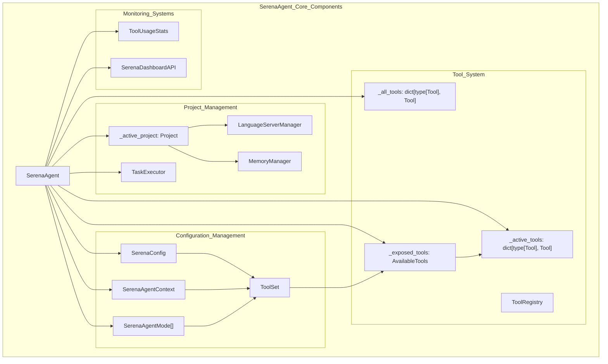
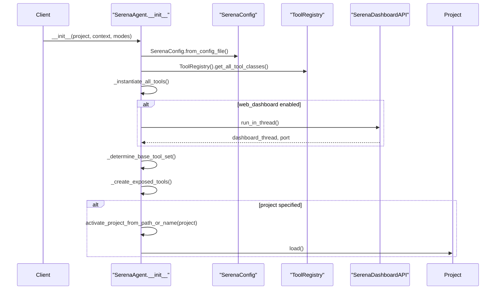
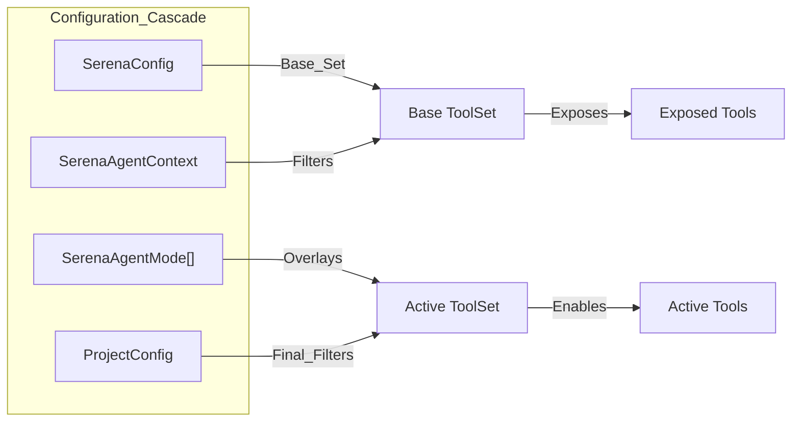

<!-- source: DeepWiki mcp.deepwiki.com · repo oraios/serena · page 3.1 SerenaAgent Core · fetched 2026-10-29 -->

# SerenaAgent Core

Relevant source files

The following files were used as context for generating this wiki page:

- [.serena/project.yml](.serena/project.yml)
- [scripts/gen_prompt_factory.py](scripts/gen_prompt_factory.py)
- [src/serena/agent.py](src/serena/agent.py)
- [src/serena/config/context_mode.py](src/serena/config/context_mode.py)
- [src/serena/config/serena_config.py](src/serena/config/serena_config.py)
- [src/serena/constants.py](src/serena/constants.py)
- [src/serena/project.py](src/serena/project.py)
- [src/serena/prompt_factory.py](src/serena/prompt_factory.py)
- [src/serena/resources/config/contexts/agent.yml](src/serena/resources/config/contexts/agent.yml)
- [src/serena/resources/config/contexts/context.template.yml](src/serena/resources/config/contexts/context.template.yml)
- [src/serena/resources/config/contexts/desktop-app.yml](src/serena/resources/config/contexts/desktop-app.yml)
- [src/serena/resources/config/modes/mode.template.yml](src/serena/resources/config/modes/mode.template.yml)
- [src/serena/resources/project.template.yml](src/serena/resources/project.template.yml)
- [src/serena/resources/serena_config.template.yml](src/serena/resources/serena_config.template.yml)
- [src/serena/task_executor.py](src/serena/task_executor.py)
- [test/serena/config/test_serena_config.py](test/serena/config/test_serena_config.py)

The `SerenaAgent` class serves as the central orchestrator for all Serena operations, coordinating between configuration management, tool execution, language server integration, and project handling. This document covers the core architecture, lifecycle management, and internal coordination mechanisms of the `SerenaAgent`.

## Core Architecture Overview

The `SerenaAgent` acts as the central hub that coordinates multiple subsystems, each with distinct responsibilities:

Title: SerenaAgent Component Architecture

Sources: [src/serena/agent.py:242-450](), [src/serena/agent.py:30-47]()

## Agent Lifecycle and Initialization

The `SerenaAgent` initialization process involves several critical phases executed in a specific order:

Title: SerenaAgent Initialization Sequence

The initialization parameters control agent behavior:

| Parameter | Type | Description |
|-----------|------|-------------|
| `project` | `str \| None` | Project path or registered name to activate immediately [src/serena/agent.py:254]() |
| `context` | `SerenaAgentContext \| None` | Operating context (affects tool availability and prompts) [src/serena/agent.py:258]() |
| `modes` | `list[SerenaAgentMode] \| None` | Active modes for additional tool filtering [src/serena/agent.py:259]() |
| `serena_config` | `SerenaConfig \| None` | Configuration override (defaults to file-based config) [src/serena/agent.py:257]() |

Sources: [src/serena/agent.py:242-368](), [src/serena/agent.py:643-664]()

## Tool Management and ToolRegistry

Serena uses a tool management system where tools are instantiated once and then filtered based on context, mode, and project state.

### Tool Sets and Filtering
The agent distinguishes between different sets of tools:
*   **All Tools (`_all_tools`)**: Every tool class discovered by `ToolRegistry` is instantiated at startup [src/serena/agent.py:311-312]().
*   **Exposed Tools (`_exposed_tools`)**: The set of tools visible to the LLM/MCP client, represented by the `AvailableTools` class [src/serena/agent.py:81-110](). It is determined by the `SerenaAgentContext` and base `SerenaConfig` [src/serena/agent.py:315-316]().
*   **Active Tools (`_active_tools`)**: The subset of exposed tools that are currently executable, further filtered by active `SerenaAgentMode` and `Project` configuration [src/serena/agent.py:317]().

### ToolRegistry and ToolSet
The `ToolRegistry` is a singleton that scans the codebase for subclasses of `Tool`. It categorizes tools using markers like `ToolMarkerCanEdit` and `ToolMarkerOptional`.

The `ToolSet` class provides the logic for applying `ToolInclusionDefinition` objects to compute the final set of tools [src/serena/agent.py:112-218](). It handles legacy name mapping, such as mapping `replace_regex` to `ReplaceContentTool` [src/serena/agent.py:117-120]().

Key logic in `ToolSet.apply`:
1.  **Fixed Mode**: If `fixed_tools` is defined, the existing set is cleared and replaced [src/serena/agent.py:158-164]().
2.  **Incremental Mode**: Tools are added via `included_optional_tools` and removed via `excluded_tools` [src/serena/agent.py:165-182]().

Sources: [src/serena/agent.py:81-218](), [src/serena/config/serena_config.py:143-170]()

## Mode and Context Management

The `SerenaAgent` dynamically adjusts its capabilities through `SerenaAgentContext` and `SerenaAgentMode`.

### System Prompt Generation
The system prompt is generated by the `SerenaPromptFactory` [src/serena/agent.py:48](). It combines:
1.  **Context Prompt**: Instructions specific to the environment (e.g., "claude-code" or "ide") [src/serena/agent.py:339]().
2.  **Mode Prompts**: Instructions for active modes (e.g., "planning" or "editing") [src/serena/agent.py:340]().
3.  **Project Prompt**: Project-specific `initial_prompt` from `project.yml` [src/serena/agent.py:342]().

### Mode Switching
Modes can be switched at runtime using the `set_modes` method, which triggers a recalculation of active tools via `_update_active_tools` [src/serena/agent.py:586-604]().

Title: Tool Set Computation Logic

Sources: [src/serena/agent.py:336-368](), [src/serena/agent.py:586-604](), [src/serena/config/context_mode.py:34-153]()

## Project Lifecycle and Activation

Project activation is the process of binding the agent to a specific codebase.

1.  **Loading**: `Project.load()` reads the `project.yml` and initializes the `MemoryManager` [src/serena/project.py:137-149]().
2.  **Activation**: `_activate_project()` sets the `_active_project` attribute and refreshes tool availability [src/serena/agent.py:665-699]().
3.  **Language Servers**: If the `LanguageBackend` is `LSP`, the agent starts the required language servers via `LanguageServerManager` [src/serena/agent.py:770-803]().
4.  **Ignore Specs**: `Project` gathers ignore patterns from `.gitignore`, project config, and global config asynchronously [src/serena/project.py:79-111]().

Sources: [src/serena/agent.py:665-699](), [src/serena/agent.py:770-803](), [src/serena/project.py:33-111]()

## Task Execution System

The `SerenaAgent` uses a `TaskExecutor` to manage linear execution of background tasks, such as project indexing or complex tool operations.

*   **Queueing**: Tasks are added to a thread-safe queue [src/serena/task_executor.py:26]().
*   **Timeouts**: Tasks can be assigned a timeout, after which the executor continues to the next task while logging a warning [src/serena/task_executor.py:143-146]().
*   **Callbacks**: A `task_completion_callback` can be registered to trigger UI updates (e.g., in the dashboard) after every task [src/serena/task_executor.py:152-157]().

Sources: [src/serena/task_executor.py:18-157]()

## Shutdown Procedure

The `shutdown()` method ensures a clean exit by:
1.  Stopping the `TaskExecutor` to prevent new tasks [src/serena/agent.py:805-808]().
2.  Shutting down the `SerenaDashboardAPI` if it was running [src/serena/agent.py:810-813]().
3.  Shutting down the active project, which includes stopping all language server processes [src/serena/agent.py:815-817]().

Sources: [src/serena/agent.py:805-821]()

---

