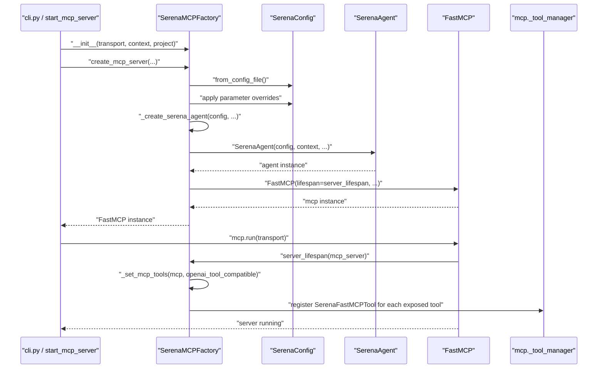
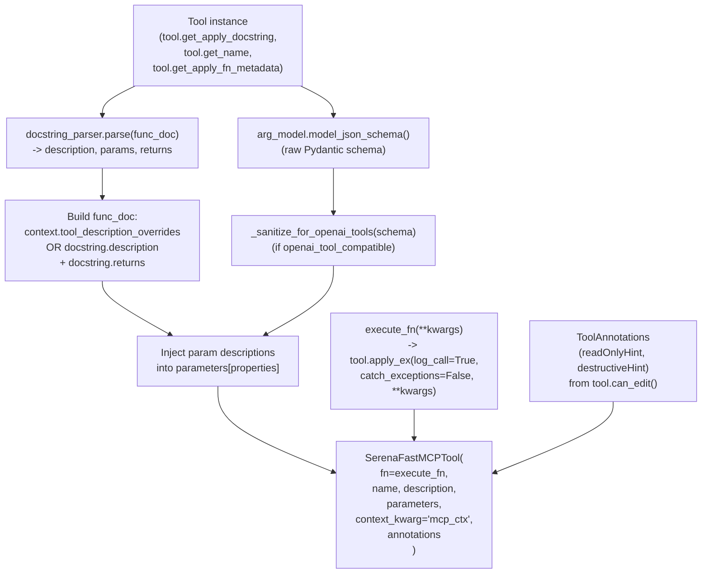
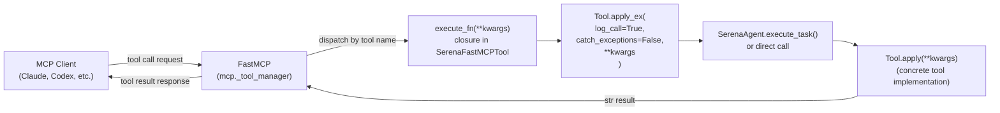

<!-- source: DeepWiki mcp.deepwiki.com · repo oraios/serena · page 3.2 MCP Server Integration · fetched 2026-10-29 -->

# MCP Server Integration

<details>
<summary>Relevant source files</summary>

The following files were used as context for generating this wiki page:

- [.serena/project.yml](.serena/project.yml)
- [scripts/print_tool_overview.py](scripts/print_tool_overview.py)
- [src/serena/agent.py](src/serena/agent.py)
- [src/serena/cli.py](src/serena/cli.py)
- [src/serena/config/serena_config.py](src/serena/config/serena_config.py)
- [src/serena/mcp.py](src/serena/mcp.py)
- [src/serena/project.py](src/serena/project.py)
- [src/serena/resources/project.template.yml](src/serena/resources/project.template.yml)
- [src/serena/resources/serena_config.template.yml](src/serena/resources/serena_config.template.yml)
- [test/serena/config/test_global_ignored_paths.py](test/serena/config/test_global_ignored_paths.py)
- [test/serena/config/test_serena_config.py](test/serena/config/test_serena_config.py)
- [test/serena/test_cli_project_commands.py](test/serena/test_cli_project_commands.py)
- [test/serena/test_edit_marker.py](test/serena/test_edit_marker.py)
- [test/serena/test_mcp.py](test/serena/test_mcp.py)

</details>


This page covers how Serena exposes its tool capabilities as an MCP (Model Context Protocol) server. Specifically, it documents the `SerenaMCPFactory` class, how Serena `Tool` instances are converted into MCP tools, schema sanitization for OpenAI compatibility, request routing, and the server lifecycle.

For the `SerenaAgent` internals (tool registry, active tool computation, project management), see [SerenaAgent Core](#3.1). For transport options and client configuration (Claude Desktop, Codex, etc.), see [Client Integration](#2.2). For how individual tools are implemented and executed, see [Tool Architecture and Registry](#7.1) and [Tool Execution Pipeline](#7.2).

---

## Overview

The MCP layer is implemented entirely in `src/serena/mcp.py`. It acts as an adapter between the MCP protocol (via the `fastmcp` library) and the Serena tool system. The central class is `SerenaMCPFactory`, which:

1. Instantiates a `SerenaAgent` with the desired configuration [src/serena/mcp.py:326-328]().
2. Converts each exposed `Tool` instance into a `SerenaFastMCPTool` [src/serena/mcp.py:255-257]().
3. Registers those tools with a `FastMCP` server during its lifespan startup [src/serena/mcp.py:343-345]().
4. Routes incoming MCP tool calls to `Tool.apply_ex()` [src/serena/mcp.py:98-102]().

The entry point for starting the MCP server in the CLI is `serena start-mcp-server`, defined in `src/serena/cli.py` [src/serena/cli.py:226-231]().

**Sources:** [src/serena/mcp.py:1-50](), [src/serena/mcp.py:145-148](), [src/serena/cli.py:226-231]()

---

## Key Classes

| Class / Symbol | File | Role |
|---|---|---|
| `SerenaMCPFactory` | `src/serena/mcp.py` | Factory that creates and configures the MCP server [src/serena/mcp.py:145-148](). |
| `SerenaMCPRequestContext` | `src/serena/mcp.py` | Dataclass holding the `SerenaAgent` reference per request [src/serena/mcp.py:48-50](). |
| `SerenaFastMCPTool` | `src/serena/mcp.py` | Subclass of `FastMCPTool` that wraps Serena's `Tool` logic [src/serena/mcp.py:53-127](). |
| `FastMCP` | `mcp.server.fastmcp.server` | Third-party MCP server framework [src/serena/mcp.py:15-15](). |
| `SerenaAgent` | `src/serena/agent.py` | Core agent; provides exposed tool instances [src/serena/agent.py:228-232](). |
| `Tool` | `src/serena/tools/tools_base.py` | Serena tool base class [src/serena/mcp.py:30-30](). |

**Sources:** [src/serena/mcp.py:48-53](), [src/serena/agent.py:228-232](), [src/serena/mcp.py:15-30]()

---

## SerenaMCPFactory Lifecycle

**Title: SerenaMCPFactory — Server Creation and Startup Sequence**



**Sources:** [src/serena/mcp.py:271-349](), [src/serena/mcp.py:150-170]()

### Constructor

`SerenaMCPFactory.__init__` accepts:

- `transport` — The transport to use (`stdio`, `sse`, or `streamable-http`) [src/serena/mcp.py:165]().
- `context` — context name or path; loaded via `SerenaAgentContext.load(context)` [src/serena/mcp.py:166]().
- `project` — optional project path or name passed to the agent [src/serena/mcp.py:167]().
- `memory_log_handler` — optional `MemoryLogHandler` for in-process log capture [src/serena/mcp.py:169]().

The agent is **not** created in `__init__`; it is created inside `create_mcp_server()` [src/serena/mcp.py:326]().

**Sources:** [src/serena/mcp.py:150-170]()

### `create_mcp_server()`

[src/serena/mcp.py:271-336]()

This method:
1. Loads `SerenaConfig` from the config file [src/serena/mcp.py:301]().
2. Applies any CLI overrides (log level, tool timeout, language backend, dashboard flags, etc.) [src/serena/mcp.py:303-324]().
3. Calls `_create_serena_agent` to instantiate `SerenaAgent` [src/serena/mcp.py:326]().
4. Patches `Settings.model_config` to prevent `.env` files in project directories from interfering with MCP settings [src/serena/mcp.py:330]().
5. Generates the initial system prompt via `self.agent.create_system_prompt()` and passes it as `instructions` to `FastMCP` [src/serena/mcp.py:332-334]().
6. Returns the `FastMCP` instance (not yet running) [src/serena/mcp.py:336]().

### `server_lifespan()`

[src/serena/mcp.py:338-345]()

An `asynccontextmanager` used as the FastMCP lifespan hook. On startup:
- Determines `openai_tool_compatible` based on context (e.g., `chatgpt`, `codex`, `oaicompat-agent`) [src/serena/mcp.py:341]().
- Calls `_set_mcp_tools(mcp_server, openai_tool_compatible)` to register all tools [src/serena/mcp.py:343]().

---

## Tool Conversion: `SerenaFastMCPTool`

`SerenaFastMCPTool` encapsulates the logic for converting a Serena `Tool` instance into a `fastmcp` compatible tool.

**Title: Tool Conversion Data Flow in SerenaFastMCPTool**



**Sources:** [src/serena/mcp.py:53-127](), [test/serena/test_mcp.py:53-71]()

### Description Construction

The MCP tool description is assembled from the docstring of `Tool.apply()` [src/serena/mcp.py:62-87]():

1. If the context defines a `tool_description_overrides` entry for this tool name, that string is used verbatim [src/serena/mcp.py:73-76]().
2. Otherwise, `docstring.description` is used [src/serena/mcp.py:77-78]().
3. If a `:return:` section exists, it is appended as `"Returns <return description>."` [src/serena/mcp.py:84-87]().

Parameter descriptions are extracted from `:param name:` entries and injected into `parameters["properties"][name]["description"]`, with normalization (capitalization and trailing periods) [src/serena/mcp.py:90-96]().

### Tool Annotations

Each `SerenaFastMCPTool` receives a `ToolAnnotations` object based on `tool.can_edit()` [src/serena/mcp.py:108-113]():

- `readOnlyHint=True` when `tool.can_edit()` returns `False` [src/serena/mcp.py:111]().
- `destructiveHint=True` when `tool.can_edit()` returns `True` [src/serena/mcp.py:112]().

**Sources:** [src/serena/mcp.py:108-113](), [test/serena/test_edit_marker.py:4-14]()

---

## Request Routing

When an MCP client calls a tool, the `FastMCP` framework invokes the `execute_fn` closure created during `SerenaFastMCPTool` initialization [src/serena/mcp.py:98-102]().

**Title: MCP Request Routing to Tool.apply_ex()**



The `context_kwarg="mcp_ctx"` field on `SerenaFastMCPTool` tells the `fastmcp` framework to pass the MCP request context as a keyword argument named `mcp_ctx` [src/serena/mcp.py:124](). This allows threading `SerenaMCPRequestContext` through to the tool execution [src/serena/mcp.py:48-50]().

**Sources:** [src/serena/mcp.py:98-102](), [src/serena/mcp.py:124](), [test/serena/test_mcp.py:73-82]()

---

## OpenAI Schema Sanitization

`SerenaMCPFactory._sanitize_for_openai_tools()` rewrites Pydantic-generated JSON schemas to comply with OpenAI's tool schema restrictions [src/serena/mcp.py:175-247](). It is applied when `openai_tool_compatible=True`, typically for the `chatgpt`, `codex`, and `oaicompat-agent` contexts [src/serena/mcp.py:341]().

The transformations applied recursively include:

| Input construct | Output |
|---|---|
| `"type": "integer"` | `"type": "number"` + `"multipleOf": 1` [src/serena/mcp.py:196-200]() |
| `"type": ["integer", "null"]` | `"type": "number"` (null removed) [src/serena/mcp.py:203-210]() |
| `anyOf: [{type: X}, {type: null}]` | Collapsed to `"type": X` [src/serena/mcp.py:224-231]() |
| Integer-only `"enum"` arrays | `"type": "number"` added [src/serena/mcp.py:213-218]() |
| Duplicate `oneOf`/`anyOf` entries | Collapsed to single schema [src/serena/mcp.py:237-241]() |

**Sources:** [src/serena/mcp.py:175-247]()

---

## Tool Registration Internals

`_set_mcp_tools()` directly manipulates `mcp_server._tool_manager._tools` (a dict from tool name to `MCPTool`) to register tools [src/serena/mcp.py:249-261]():

```python
mcp_server._tool_manager._tools = {}
for tool in self._iter_tools():
    mcp_tool = SerenaFastMCPTool(tool, openai_tool_compatible=...)
    mcp_server._tool_manager._tools[tool.get_name()] = mcp_tool
```

`_iter_tools()` yields from `agent.get_exposed_tool_instances()`, which returns the `_exposed_tools` computed by `SerenaAgent` at startup [src/serena/mcp.py:263-269](). The exposed tool set is fixed for the session; tools that become inactive at runtime return an error from `apply_ex()` rather than being removed from the MCP server tool list.

**Sources:** [src/serena/mcp.py:249-261](), [src/serena/mcp.py:263-269]()

---

## Logging Patch

`fastmcp` has a hard-coded `configure_logging()` function that can interfere with Serena's logging setup. The module patches it at import time [src/serena/mcp.py:45]():

```python
server.configure_logging = configure_logging
```

where the local `configure_logging` only calls `logging.basicConfig(...)` if logging has not already been configured [src/serena/mcp.py:37-41](). This ensures that Serena's `SERENA_LOG_FORMAT` is respected [src/serena/mcp.py:41]().

**Sources:** [src/serena/mcp.py:37-45]()

---

## Configuration Override Precedence

When `create_mcp_server()` is called, the following override chain applies to `SerenaConfig` [src/serena/mcp.py:301-328]():

1. `SerenaConfig.from_config_file()`: Loads base settings [src/serena/mcp.py:301]().
2. **CLI Overrides**:
    - `enable_web_dashboard` [src/serena/mcp.py:303]()
    - `enable_gui_log_window` [src/serena/mcp.py:305]()
    - `open_web_dashboard` [src/serena/mcp.py:307]()
    - `log_level` [src/serena/mcp.py:309]()
    - `trace_lsp_communication` [src/serena/mcp.py:311]()
    - `tool_timeout` [src/serena/mcp.py:313]()
    - `language_backend` [src/serena/mcp.py:315]()
    - `ignored_paths` [src/serena/mcp.py:317]()

These correspond to parameters passed to the factory method which are typically sourced from CLI flags.

**Sources:** [src/serena/mcp.py:301-328](), [src/serena/mcp.py:271-299]()

---

