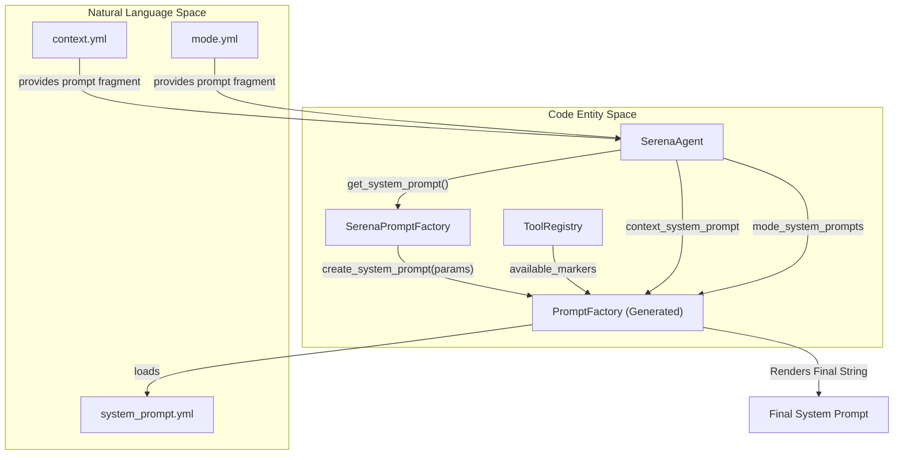
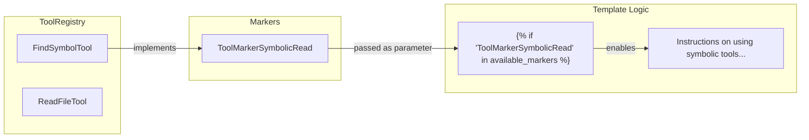

<!-- source: DeepWiki mcp.deepwiki.com · repo oraios/serena · page 3.5 Prompt Factory and System Prompt · fetched 2026-10-29 -->

# Prompt Factory and System Prompt

<details>
<summary>Relevant source files</summary>

The following files were used as context for generating this wiki page:

- [.serena/memories/memory_maintenance.md](.serena/memories/memory_maintenance.md)
- [src/interprompt/.syncCommitId.remote](src/interprompt/.syncCommitId.remote)
- [src/interprompt/.syncCommitId.this](src/interprompt/.syncCommitId.this)
- [src/interprompt/__init__.py](src/interprompt/__init__.py)
- [src/interprompt/jinja_template.py](src/interprompt/jinja_template.py)
- [src/interprompt/multilang_prompt.py](src/interprompt/multilang_prompt.py)
- [src/interprompt/prompt_factory.py](src/interprompt/prompt_factory.py)
- [src/serena/generated/generated_prompt_factory.py](src/serena/generated/generated_prompt_factory.py)
- [src/serena/resources/config/modes/editing.yml](src/serena/resources/config/modes/editing.yml)
- [src/serena/resources/config/modes/interactive.yml](src/serena/resources/config/modes/interactive.yml)
- [src/serena/resources/config/modes/onboarding.yml](src/serena/resources/config/modes/onboarding.yml)
- [src/serena/resources/config/modes/one-shot.yml](src/serena/resources/config/modes/one-shot.yml)
- [src/serena/resources/config/modes/planning.yml](src/serena/resources/config/modes/planning.yml)
- [src/serena/resources/config/prompt_templates/simple_tool_outputs.yml](src/serena/resources/config/prompt_templates/simple_tool_outputs.yml)
- [src/serena/resources/config/prompt_templates/system_prompt.yml](src/serena/resources/config/prompt_templates/system_prompt.yml)
- [src/serena/resources/memory_maintenance.md](src/serena/resources/memory_maintenance.md)

</details>


Serena uses a sophisticated template-based system to generate dynamic system prompts for Large Language Models. This system ensures that the agent understands its role, the available tools, and the specific operational constraints of its current mode and context.

## Overview of Prompt Generation

The prompt generation process is managed by the `SerenaPromptFactory`, which utilizes the `interprompt` library to handle Jinja2 templates, multi-language support, and auto-generated Python interfaces for prompt management.

### Key Components

| Component | Description |
| :--- | :--- |
| `interprompt` | A library for managing prompt templates in YAML files, supporting Jinja2 rendering and multi-language fallbacks. |
| `SerenaPromptFactory` | The main factory class in Serena that coordinates the loading and rendering of templates. |
| `generated_prompt_factory.py` | An auto-generated module that provides a typed Python interface to the templates defined in YAML. |
| `system_prompt.yml` | The primary template containing the core instructions for the agent. |
| `simple_tool_outputs.yml` | Contains auxiliary prompts for onboarding and specific tool information. |

**Sources:**
* [src/serena/generated/generated_prompt_factory.py:1-54]()
* [src/interprompt/prompt_factory.py:10-42]()
* [src/serena/resources/config/prompt_templates/system_prompt.yml:1-60]()
* [src/serena/resources/config/prompt_templates/simple_tool_outputs.yml:1-4]()

## The Interprompt Library

The `interprompt` library provides the foundation for prompt management. It abstracts the complexity of loading templates from multiple directories and rendering them with parameters.

### Implementation Details
* **`PromptFactoryBase`**: The base class for all generated factories. It initializes a `MultiLangPromptCollection` and provides methods like `_render_prompt` [src/interprompt/prompt_factory.py:10-42]().
* **`MultiLangPromptCollection`**: Manages a set of `MultiLangPromptTemplate` objects. It can look for templates across multiple directories, allowing for user overrides [src/interprompt/multilang_prompt.py:192-230]().
* **`JinjaTemplate`**: Wraps the Jinja2 engine to render strings with provided variables [src/interprompt/jinja_template.py:26-40]().
* **`PromptList`**: Formats a list of strings into a bulleted string representation for LLM consumption [src/interprompt/multilang_prompt.py:33-41]().
* **`LanguageFallbackMode`**: Defines behavior (e.g., `USE_DEFAULT_LANG`, `ANY`) when a specific language variant is missing [src/interprompt/multilang_prompt.py:48-64]().

### Prompt Factory Autogeneration
Serena uses the `autogenerate_prompt_factory_module` function to scan prompt templates and generate `src/serena/generated/generated_prompt_factory.py`. This provides IDE autocompletion and type safety when calling methods like `create_system_prompt` [src/interprompt/prompt_factory.py:43-93](). The generated class `PromptFactory` includes specific methods for every template found in the resource directory [src/serena/generated/generated_prompt_factory.py:11-53]().

**Sources:**
* [src/interprompt/prompt_factory.py:43-93]()
* [src/interprompt/multilang_prompt.py:132-190]()
* [src/serena/generated/generated_prompt_factory.py:11-54]()

## Data Flow: From Code to Natural Language

The following diagram illustrates how internal code entities and state are transformed into the final system prompt string.

**Prompt Generation Data Flow**


**Sources:**
* [src/serena/generated/generated_prompt_factory.py:37-47]()
* [src/serena/resources/config/prompt_templates/system_prompt.yml:52-58]()

## Context and Mode Contributions

The system prompt is not static; it is a composition of fragments provided by the active `SerenaAgentContext` and `SerenaAgentMode`.

1.  **Context Prompt**: Defined in the context YAML. It describes the environment, such as whether it's an IDE or a standalone chat.
2.  **Mode Prompts**: Each active mode (e.g., `editing`, `planning`, `onboarding`) contributes its own `prompt` field. For example, the `editing` mode provides instructions for refactoring and symbolic editing [src/serena/resources/config/modes/editing.yml:2-39](), while `planning` restricts the agent to analysis [src/serena/resources/config/modes/planning.yml:2-4]().

### Template Composition in `system_prompt.yml`
The main template uses Jinja2 logic to include these fragments and conditionally adjust instructions based on available tools like `search_for_pattern` or `read_memory` [src/serena/resources/config/prompt_templates/system_prompt.yml:16-39]().

```yaml
Context description:
{{ context_system_prompt }}

Modes descriptions:

{{ prompt }}

```
[src/serena/resources/config/prompt_templates/system_prompt.yml:52-58]()

**Sources:**
* [src/serena/resources/config/modes/editing.yml:1-39]()
* [src/serena/resources/config/modes/planning.yml:1-15]()
* [src/serena/resources/config/prompt_templates/system_prompt.yml:52-58]()

## User Overrides

Serena supports a layered approach to prompt templates. When the `MultiLangPromptCollection` is initialized, it can be configured to look in user-specific directories first.

*   **Internal Templates**: Located in the package resources (e.g., `src/serena/resources/config/prompt_templates/`).
*   **User Overrides**: Serena checks the user's local configuration directories (typically `~/.serena/prompt_templates/`). If a file with the same name exists there, it takes precedence over the internal version [src/interprompt/prompt_factory.py:13-17]().

**Sources:**
* [src/interprompt/prompt_factory.py:13-22]()
* [src/interprompt/multilang_prompt.py:192-205]()

## System Prompt Logic and Markers

The system prompt includes conditional logic based on the "markers" present in the available toolset. This ensures the LLM only receives instructions for capabilities it currently possesses.

**Tool Marker Logic**


For example, if tools implementing `ToolMarkerSymbolicRead` are active, the prompt includes specific instructions on how to use `name_path` and `relative_path` for efficient code navigation [src/serena/resources/config/prompt_templates/system_prompt.yml:22-31](). Similarly, the `editing` mode prompt checks for `jet_brains_move` to provide refactoring instructions [src/serena/resources/config/modes/editing.yml:7-11]().

**Sources:**
* [src/serena/resources/config/prompt_templates/system_prompt.yml:14-15]()
* [src/serena/resources/config/prompt_templates/system_prompt.yml:22-31]()
* [src/serena/generated/generated_prompt_factory.py:37-47]()
* [src/serena/resources/config/modes/editing.yml:7-11]()

---

