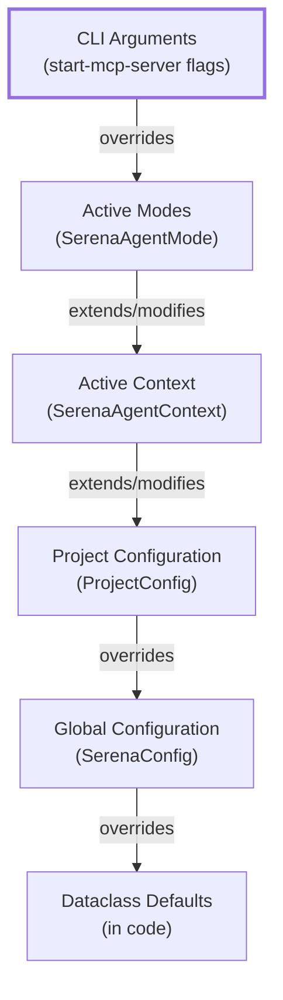
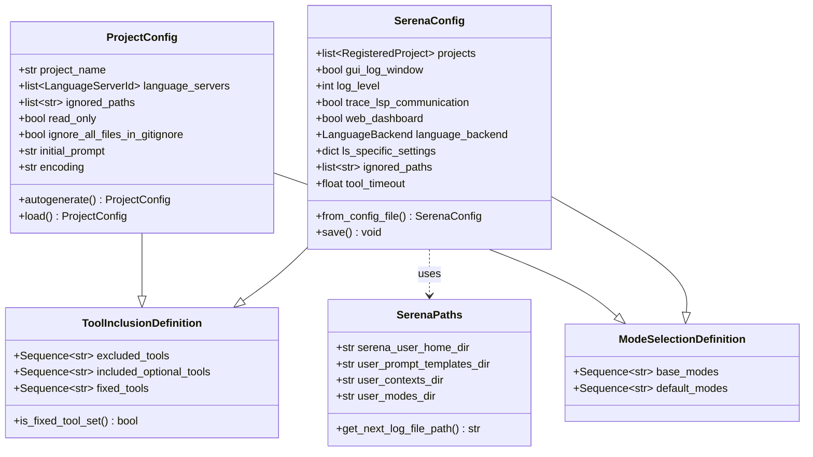
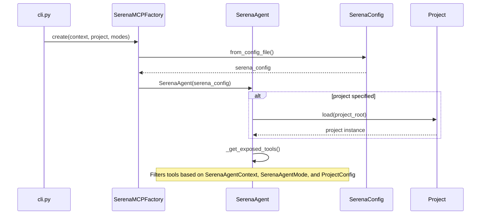

<!-- source: DeepWiki mcp.deepwiki.com · repo oraios/serena · page 4 Configuration Management · fetched 2026-10-29 -->

# Configuration Management

Relevant source files

The following files were used as context for generating this wiki page:

- [.serena/project.yml](.serena/project.yml)
- [docs/01-about/050_acknowledgements.md](docs/01-about/050_acknowledgements.md)
- [docs/02-usage/020_running.md](docs/02-usage/020_running.md)
- [docs/02-usage/025_jetbrains_plugin.md](docs/02-usage/025_jetbrains_plugin.md)
- [docs/02-usage/030_clients.md](docs/02-usage/030_clients.md)
- [docs/02-usage/040_workflow.md](docs/02-usage/040_workflow.md)
- [docs/02-usage/050_configuration.md](docs/02-usage/050_configuration.md)
- [docs/02-usage/999_additional-usage.md](docs/02-usage/999_additional-usage.md)
- [src/serena/agent.py](src/serena/agent.py)
- [src/serena/config/serena_config.py](src/serena/config/serena_config.py)
- [src/serena/project.py](src/serena/project.py)
- [src/serena/resources/project.template.yml](src/serena/resources/project.template.yml)
- [src/serena/resources/serena_config.template.yml](src/serena/resources/serena_config.template.yml)
- [test/serena/config/test_serena_config.py](test/serena/config/test_serena_config.py)

## Purpose and Scope

This page documents Serena's multi-layered configuration management system, which controls how settings cascade from global defaults through project-specific configurations to runtime overrides. It covers the architecture of configuration classes, file loading mechanisms, and the precedence rules that determine which settings apply in different contexts.

For details on specific configuration files and their parameters, see [Global Configuration](#4.4) and [Project Configuration](#4.3). For information on contexts and modes as configuration mechanisms, see [Contexts and Modes](#4.2). For CLI-based configuration overrides, see [Command Line Interface](#4.5).

## Configuration Architecture Overview

Serena's configuration system implements a hierarchical cascade with five distinct layers, each capable of overriding or extending settings from layers below it. The system is designed to balance global defaults, project-specific requirements, operational contexts, task-specific modes, and ad-hoc runtime adjustments.

### Configuration Hierarchy

**Precedence Order** (highest to lowest):
1. **CLI Arguments**: Flags passed to `start-mcp-server` command in `cli.py`. [docs/02-usage/050_configuration.md:15-16]()
2. **Modes**: Active `SerenaAgentMode` configurations (applied composably). [docs/02-usage/050_configuration.md:107-108]()
3. **Context**: Operational `SerenaAgentContext` (e.g., `ide`, `desktop-app`, `claude-code`). [docs/02-usage/050_configuration.md:66-68]()
4. **Project Configuration**: Settings in `ProjectConfig` loaded from `.serena/project.yml`. [src/serena/config/serena_config.py:382-411]()
5. **Global Configuration**: Settings in `SerenaConfig` loaded from `~/.serena/serena_config.yml`. [src/serena/config/serena_config.py:618-632]()
6. **Dataclass Defaults**: Hardcoded defaults in `serena_config.py`. [src/serena/config/serena_config.py:254-315]()

Sources: [src/serena/config/serena_config.py:254-411](), [docs/02-usage/050_configuration.md:10-18]()

### Configuration Class Structure

Both `SerenaConfig` and `ProjectConfig` inherit from `ToolInclusionDefinition` and `ModeSelectionDefinition`, allowing tool and mode configuration at both global and project levels. [src/serena/config/serena_config.py:254-411]()

Sources: [src/serena/config/serena_config.py:57-124](), [src/serena/config/serena_config.py:143-169](), [src/serena/config/serena_config.py:181-187](), [src/serena/config/serena_config.py:254-411]()

## Configuration File Management

### File Locations and Discovery

Configuration files reside in well-defined locations following platform conventions. The `SerenaPaths` singleton class provides centralized path resolution. [src/serena/config/serena_config.py:57-118]()

| Configuration Type | Path | Environment Override |
|-------------------|------|---------------------|
| Global Config | `~/.serena/serena_config.yml` | `SERENA_HOME` |
| Project Config | `<project>/.serena/project.yml` | None |
| User Contexts | `~/.serena/contexts/*.yml` | `SERENA_HOME` |
| User Modes | `~/.serena/modes/*.yml` | `SERENA_HOME` |

Sources: [src/serena/config/serena_config.py:63-92](), [src/serena/constants.py:25-34]()

### Configuration Loading Mechanism

#### Global Configuration Loading
The loading process in `SerenaConfig.from_config_file` handles auto-generation from a template (`SERENA_CONFIG_TEMPLATE_FILE`) if the file is missing, and uses `ruamel.yaml` via `load_yaml` to preserve user comments. [src/serena/config/serena_config.py:618-703]()

Sources: [src/serena/config/serena_config.py:618-703](), [src/serena/util/yaml.py:37-37]()

#### Project Configuration Loading
`ProjectConfig.load` merges settings from `.serena/project.yml` and optional local overrides in `.serena/project.local.yml`. [src/serena/config/serena_config.py:382-411]() If no config exists, `ProjectConfig.autogenerate` uses logic to detect the project's primary languages. [src/serena/config/serena_config.py:456-575]()

Sources: [src/serena/config/serena_config.py:382-411](), [src/serena/config/serena_config.py:456-575](), [test/serena/config/test_serena_config.py:40-46]()

## Tool and Mode Selection Mechanics

### Tool Inclusion Filtering Pipeline

The `ToolInclusionDefinition` class provides two modes:
*   **Incremental Mode**: Applies `excluded_tools` and `included_optional_tools` to the default set. [src/serena/config/serena_config.py:151-158]()
*   **Fixed Mode**: Uses only the tools listed in `fixed_tools`. [src/serena/config/serena_config.py:159-162]()

The `SerenaAgent` computes the final set of active tools by combining these definitions from the active context, modes, and project configuration using `ToolSet.apply`. [src/serena/agent.py:137-183]()

Sources: [src/serena/config/serena_config.py:143-169](), [src/serena/agent.py:137-183](), [docs/02-usage/050_configuration.md:107-120]()

### Mode Selection and Composition

`ModeSelectionDefinition` distinguishes between:
*   **Base Modes**: Modes that are always active (e.g., `interactive`, `editing`). [src/serena/config/serena_config.py:187-187]()
*   **Default Modes**: Modes active by default but overridable via CLI flags like `--mode`. [src/serena/config/serena_config.py:182-182]()

The final set of active modes is the union of base modes, default modes (unless overridden), and added modes. [docs/02-usage/050_configuration.md:133-135]()

Sources: [src/serena/config/serena_config.py:181-186](), [docs/02-usage/050_configuration.md:124-135]()

## Configuration Propagation Flow

### Initialization Sequence

Sources: [src/serena/agent.py:192-250](), [docs/02-usage/030_clients.md:78-85]()

### Memory and Ignore Pattern Merge

The `MemoryManager` (referenced via `Project`) handles project-local and global memories, respecting `read_only_memory_patterns` and `ignored_memory_patterns` defined in the configuration hierarchy. [src/serena/project.py:48-54]() These patterns are merged from both `SerenaConfig` and `ProjectConfig`. [src/serena/project.py:48-49]()

Sources: [src/serena/project.py:45-54](), [src/serena/config/serena_config.py:320-330](), [docs/02-usage/045_memories.md:108-123]()

## Advanced Configuration Topics

### Language Server-Specific Settings
The `ls_specific_settings` map in `SerenaConfig` and `ProjectConfig` allows passing advanced parameters to individual language servers, such as custom binary paths or specific initialization options for `SolidLanguageServer` implementations. [src/serena/config/serena_config.py:311-311]()

Sources: [src/serena/config/serena_config.py:311-311](), [src/serena/resources/serena_config.template.yml:97-101]()

### Configuration Auto-Generation
When a project is created via the CLI or activated for the first time, Serena detects the primary programming languages and generates a `.serena/project.yml` based on `PROJECT_TEMPLATE_FILE`. [src/serena/config/serena_config.py:456-575]()

Sources: [src/serena/config/serena_config.py:456-575](), [src/serena/constants.py:28-30](), [test/serena/config/test_serena_config.py:88-103]()

---

