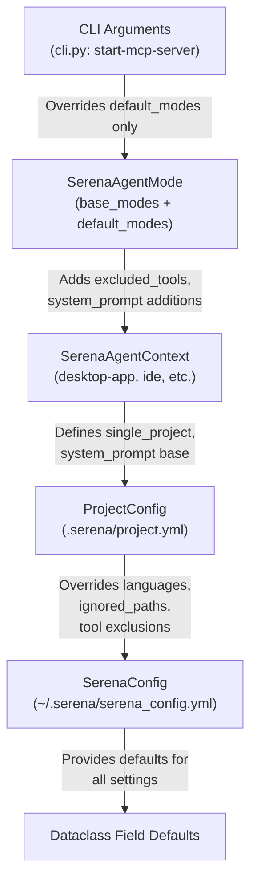
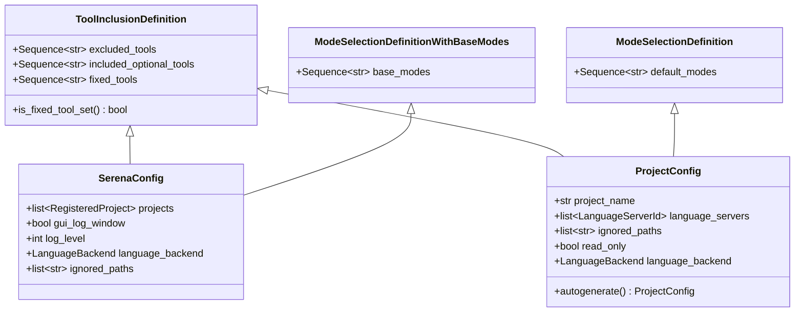
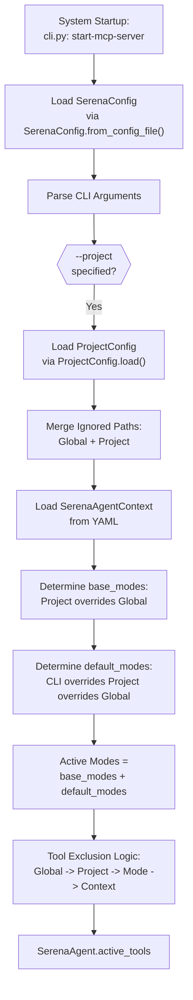
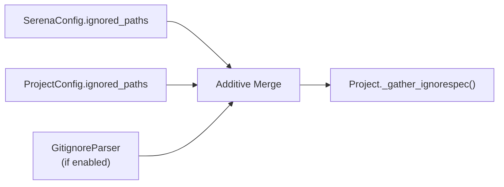
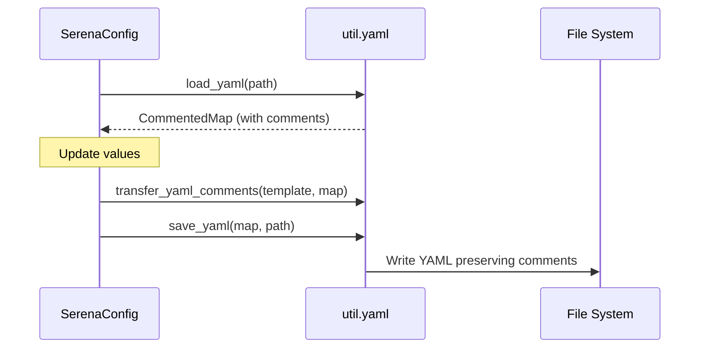

<!-- source: DeepWiki mcp.deepwiki.com · repo oraios/serena · page 4.1 Configuration Hierarchy · fetched 2026-10-29 -->

# Configuration Hierarchy

Relevant source files

The following files were used as context for generating this wiki page:

- [.serena/project.yml](.serena/project.yml)
- [docs/01-about/050_acknowledgements.md](docs/01-about/050_acknowledgements.md)
- [docs/02-usage/020_running.md](docs/02-usage/020_running.md)
- [docs/02-usage/025_jetbrains_plugin.md](docs/02-usage/025_jetbrains_plugin.md)
- [docs/02-usage/030_clients.md](docs/02-usage/030_clients.md)
- [docs/02-usage/040_workflow.md](docs/02-usage/040_workflow.md)
- [docs/02-usage/050_configuration.md](docs/02-usage/050_configuration.md)
- [docs/02-usage/999_additional-usage.md](docs/02-usage/999_additional-usage.md)
- [scripts/gen_prompt_factory.py](scripts/gen_prompt_factory.py)
- [src/serena/agent.py](src/serena/agent.py)
- [src/serena/config/context_mode.py](src/serena/config/context_mode.py)
- [src/serena/config/serena_config.py](src/serena/config/serena_config.py)
- [src/serena/constants.py](src/serena/constants.py)
- [src/serena/project.py](src/serena/project.py)
- [src/serena/prompt_factory.py](src/serena/prompt_factory.py)
- [src/serena/resources/config/contexts/agent.yml](src/serena/resources/config/contexts/agent.yml)
- [src/serena/resources/config/contexts/context.template.yml](src/serena/resources/config/contexts/context.template.yml)
- [src/serena/resources/config/contexts/desktop-app.yml](src/serena/resources/config/contexts/desktop-app.yml)
- [src/serena/resources/config/modes/mode.template.yml](src/serena/resources/config/modes/mode.template.yml)
- [src/serena/resources/project.template.yml](src/serena/resources/project.template.yml)
- [src/serena/resources/serena_config.template.yml](src/serena/resources/serena_config.template.yml)
- [test/serena/config/test_serena_config.py](test/serena/config/test_serena_config.py)

## Purpose and Scope

This document describes Serena's multi-layered configuration system and the precedence rules that govern how settings are applied. Serena employs a hierarchical approach where global defaults are progressively specialized by project-specific settings, operational contexts, and active agent modes.

The configuration is managed primarily through the `SerenaConfig` and `ProjectConfig` dataclasses, which handle loading, validation, and persistence of settings using `ruamel.yaml` to preserve user comments. [src/serena/config/serena_config.py:18-20](), [src/serena/config/serena_config.py:37-37]()

---

## Configuration Layer Architecture

Serena's configuration system consists of five distinct layers. Higher layers typically override or augment lower layers to determine the final state of the `SerenaAgent`.

Title: Serena Configuration Layering

Sources: [src/serena/config/serena_config.py:143-162](), [docs/02-usage/050_configuration.md:10-15](), [docs/02-usage/050_configuration.md:124-138]()

---

## Configuration Class Hierarchy

The configuration system is implemented through a set of dataclasses that inherit from `ToolInclusionDefinition` to provide a consistent interface for managing tool sets across different configuration levels.

Title: Configuration Class Diagram

Sources: [src/serena/config/serena_config.py:143-162](), [src/serena/config/serena_config.py:181-183](), [src/serena/config/serena_config.py:186-189](), [src/serena/config/serena_config.py:258-258](), [src/serena/config/serena_config.py:535-535]()

---

## Precedence Resolution Flow

The following flow illustrates how configuration values are resolved during system initialization. The `SerenaAgent` uses these layers to compute the active tools and the final system prompt.

Title: Precedence Resolution Flow

Sources: [src/serena/resources/serena_config.template.yml:123-132](), [docs/02-usage/050_configuration.md:124-138](), [src/serena/config/serena_config.py:186-195]()

---

## Precedence Rules by Configuration Type

### Tool Inclusion/Exclusion

Tool configuration follows an **additive exclusion** model. Exclusions from all layers are combined to filter the available tools in the `ToolRegistry`. The final `ToolSet` is computed by applying inclusion definitions in sequence. [src/serena/agent.py:137-183]()

| Layer | Setting | Precedence | Logic |
|-------|---------|------------|-------|
| Global | `excluded_tools` | Lowest | Added to exclusion set [src/serena/resources/serena_config.template.yml:138-139]() |
| Project | `excluded_tools` | Medium | Added to exclusion set [src/serena/resources/project.template.yml:115-118]() |
| Mode | `excluded_tools` | High | Added to exclusion set via YAML mode definition [src/serena/config/context_mode.py:59-60]() |
| Context | `single_project` | Highest | If `True`, disables `activate_project` tool [src/serena/config/context_mode.py:178-184]() |

**Fixed Tool Sets:** If `fixed_tools` is defined in any layer, it replaces the default tool set. A `fixed_tools` definition in a higher layer (e.g., `ProjectConfig`) overrides one in a lower layer (e.g., `SerenaConfig`). [src/serena/agent.py:158-164]()

### Mode Selection

Modes are resolved using the `ModeSelectionDefinition` logic, allowing both "always-on" base modes and "user-selectable" default modes.

| Mode Type | Configured In | Overridden By |
|-----------|---------------|---------------|
| `base_modes` | Global config [src/serena/resources/serena_config.template.yml:123-126]() | Project config `base_modes` [src/serena/resources/project.template.yml:107-113]() |
| `default_modes` | Global config [src/serena/resources/serena_config.template.yml:128-132]() | Project config `default_modes` [src/serena/resources/project.template.yml:115-122]() OR CLI `--mode` |

The final set of active modes is the union of `base_modes`, `default_modes`, and `added_modes`. [src/serena/resources/serena_config.template.yml:118-121](), [docs/02-usage/050_configuration.md:133-135]()

### Ignored Paths and Memories

Ignored paths are merged **additively**. Serena combines global patterns with project-specific patterns and `.gitignore` rules. [src/serena/project.py:83-96]()

Title: Ignored Path Resolution

Memory access also follows a hierarchy where `read_only_memory_patterns` and `ignored_memory_patterns` from `SerenaConfig` are combined with those in `ProjectConfig`. [src/serena/project.py:48-54]()

Sources: [src/serena/project.py:80-111](), [src/serena/resources/serena_config.template.yml:103-106](), [src/serena/resources/project.template.yml:98-108]()

---

## Configuration Persistence

### Path Resolution

Path resolution for all configuration and data files is handled by the `SerenaPaths` singleton.

*   **Serena Home:** Defined by `SERENA_HOME` environment variable or defaults to `~/.serena`. [src/serena/config/serena_config.py:63-72]()
*   **User Overrides:** User-defined `contexts`, `modes`, and `prompt_templates` stored in `~/.serena/` take precedence over built-in package resources. [src/serena/config/serena_config.py:77-93]()
*   **Project Config:** Typically located at `{project_root}/.serena/project.yml`. [src/serena/project.py:65-71]()

### YAML Handling

Serena uses `ruamel.yaml` to ensure that when the configuration is updated programmatically (e.g., via CLI), user comments and formatting are preserved. [src/serena/config/serena_config.py:20-20]()

Title: YAML Update Sequence

Sources: [src/serena/util/yaml.py:37-37](), [src/serena/config/serena_config.py:18-20]()

---

## Summary of Key Precedence Rules

| Feature | Precedence (Lowest to Highest) |
| :--- | :--- |
| **Language Backend** | `SerenaConfig` [src/serena/resources/serena_config.template.yml:8]() -> `ProjectConfig` [src/serena/resources/project.template.yml:60-65]() -> CLI `--language-backend` [docs/02-usage/020_running.md:100-100]() |
| **Active Tools** | Registry Defaults -> `SerenaConfig` -> `ProjectConfig` -> `SerenaAgentMode` -> `SerenaAgentContext` |
| **System Prompt** | `SerenaAgentContext.prompt` -> `SerenaAgentMode.prompt` [src/serena/config/context_mode.py:41-45]() |
| **Ignored Paths** | Additive merge of Global + Project + `.gitignore` [src/serena/project.py:83-96]() |
| **Encoding** | `DEFAULT_SOURCE_FILE_ENCODING` (utf-8) [src/serena/config/serena_config.py:26]() -> `ProjectConfig.encoding` [src/serena/resources/project.template.yml:38-40]() |

Sources: [src/serena/resources/serena_config.template.yml:8-14](), [src/serena/resources/project.template.yml:55-66](), [docs/02-usage/050_configuration.md:124-138]()

---

