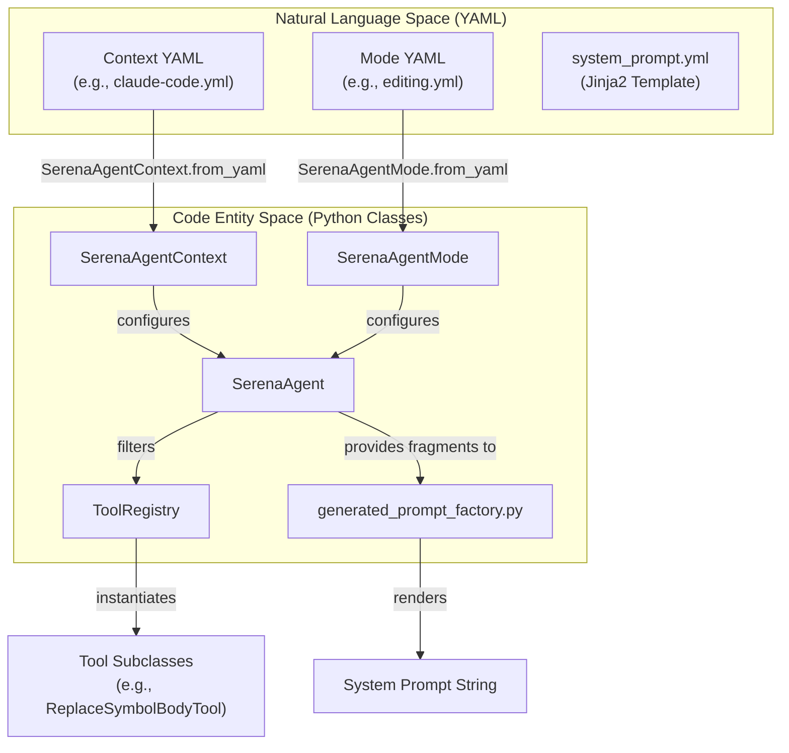
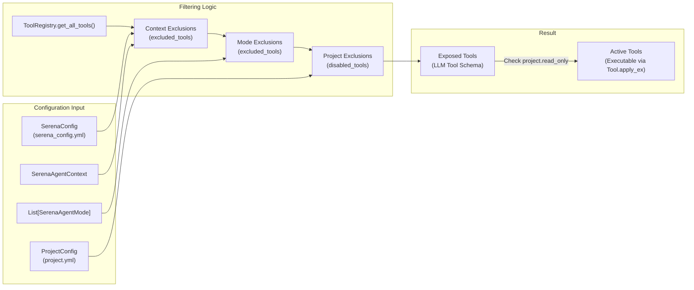

<!-- source: DeepWiki mcp.deepwiki.com · repo oraios/serena · page 4.2 Contexts and Modes · fetched 2026-10-29 -->

# Contexts and Modes

<details>
<summary>Relevant source files</summary>

The following files were used as context for generating this wiki page:

- [scripts/gen_prompt_factory.py](scripts/gen_prompt_factory.py)
- [src/serena/config/context_mode.py](src/serena/config/context_mode.py)
- [src/serena/constants.py](src/serena/constants.py)
- [src/serena/prompt_factory.py](src/serena/prompt_factory.py)
- [src/serena/resources/config/contexts/agent.yml](src/serena/resources/config/contexts/agent.yml)
- [src/serena/resources/config/contexts/antigravity.yml](src/serena/resources/config/contexts/antigravity.yml)
- [src/serena/resources/config/contexts/chatgpt.yml](src/serena/resources/config/contexts/chatgpt.yml)
- [src/serena/resources/config/contexts/claude-code.yml](src/serena/resources/config/contexts/claude-code.yml)
- [src/serena/resources/config/contexts/codex.yml](src/serena/resources/config/contexts/codex.yml)
- [src/serena/resources/config/contexts/context.template.yml](src/serena/resources/config/contexts/context.template.yml)
- [src/serena/resources/config/contexts/copilot-cli.yml](src/serena/resources/config/contexts/copilot-cli.yml)
- [src/serena/resources/config/contexts/desktop-app.yml](src/serena/resources/config/contexts/desktop-app.yml)
- [src/serena/resources/config/contexts/ide.yml](src/serena/resources/config/contexts/ide.yml)
- [src/serena/resources/config/contexts/jb-ai-assistant.yml](src/serena/resources/config/contexts/jb-ai-assistant.yml)
- [src/serena/resources/config/contexts/junie.yml](src/serena/resources/config/contexts/junie.yml)
- [src/serena/resources/config/contexts/vscode.yml](src/serena/resources/config/contexts/vscode.yml)
- [src/serena/resources/config/modes/editing.yml](src/serena/resources/config/modes/editing.yml)
- [src/serena/resources/config/modes/interactive.yml](src/serena/resources/config/modes/interactive.yml)
- [src/serena/resources/config/modes/mode.template.yml](src/serena/resources/config/modes/mode.template.yml)
- [src/serena/resources/config/modes/no-memories.yml](src/serena/resources/config/modes/no-memories.yml)
- [src/serena/resources/config/modes/no-onboarding.yml](src/serena/resources/config/modes/no-onboarding.yml)
- [src/serena/resources/config/modes/onboarding.yml](src/serena/resources/config/modes/onboarding.yml)
- [src/serena/resources/config/modes/one-shot.yml](src/serena/resources/config/modes/one-shot.yml)
- [src/serena/resources/config/modes/planning.yml](src/serena/resources/config/modes/planning.yml)
- [src/serena/resources/config/prompt_templates/system_prompt.yml](src/serena/resources/config/prompt_templates/system_prompt.yml)
- [test/resources/repos/typescript/test_repo/.serena/project.yml](test/resources/repos/typescript/test_repo/.serena/project.yml)

</details>


## Purpose and Scope

This document describes Serena's context and mode system, which provides composable configuration layers that influence tool availability, system prompts, and runtime behavior. Contexts define the fixed operational environment for a session (e.g., whether Serena is running inside an IDE or as a standalone desktop app), while modes enable dynamic behavior refinement during execution (e.g., switching from planning to editing). Serena uses a multi-layered approach where global configuration, project configuration, and CLI parameters interact with these contexts and modes to determine the agent's active capabilities.

**Sources:** [src/serena/config/context_mode.py:1-41](), [src/serena/config/serena_config.py:1-20]()

---

## Contexts

### Definition and Purpose

A **context** represents the general environment in which Serena operates. It is defined in a YAML file and loaded into a `SerenaAgentContext` instance. Contexts are set at startup via the `SerenaAgent` constructor and cannot be changed during an active session [src/serena/config/context_mode.py:150-154]().

Contexts influence:
- The initial system prompt via Jinja2 templates formatted by the agent [src/serena/config/context_mode.py:159-163]().
- The base set of available tools via `excluded_tools` and `included_optional_tools` [src/serena/config/context_mode.py:150-154]().
- Tool description overrides (mapping tool names to custom descriptions via `tool_description_overrides`) [src/serena/config/context_mode.py:167-170]().
- Whether the agent is restricted to a single project via the `single_project` flag [src/serena/config/context_mode.py:178-184]().

### Built-in Contexts

Serena provides several pre-defined contexts located in `src/serena/resources/config/contexts/` [src/serena/constants.py:13-13]():

| Context Name | Description | Single Project |
| :--- | :--- | :--- |
| `desktop-app` | Default context for standalone chat apps. Full toolset provided. [src/serena/resources/config/contexts/desktop-app.yml:1-15]() | `False` |
| `ide` | For IDE assistants (VSCode, Cursor). Assumes file/shell ops handled by IDE. | `True` |
| `claude-code` | Optimized for Claude Code; disables redundant built-in capabilities like `read_file`. [src/serena/resources/config/contexts/claude-code.yml:1-57]() | `True` |
| `codex` | Optimized for OpenAI Codex; excludes non-symbolic editing tools. [src/serena/resources/config/contexts/codex.yml:1-23]() | `False` |
| `agent` | Designed for autonomous scenarios (e.g., with Agno). | `False` |
| `chatgpt` | Specific for ChatGPT; handles tool limits (max 30) and provides short descriptions. [src/serena/resources/config/contexts/chatgpt.yml:1-27]() | `False` |

**Sources:** [src/serena/resources/config/contexts/claude-code.yml:1-57](), [src/serena/resources/config/contexts/codex.yml:1-23](), [src/serena/resources/config/contexts/chatgpt.yml:1-27](), [src/serena/constants.py:24-24]()

### Single-Project Contexts
Contexts like `claude-code` set `single_project: true` [src/serena/resources/config/contexts/claude-code.yml:52-52](). When this flag is active and a project is provided at startup:
- The toolset is limited to those required by the project's concrete configuration [src/serena/config/context_mode.py:182-184]().
- The `activate_project` tool is disabled because switching projects is not allowed [src/serena/config/context_mode.py:184-185]().
- Tools explicitly disabled by the project configuration will not be available at all [src/serena/resources/config/contexts/claude-code.yml:50-51]().

**Sources:** [src/serena/config/context_mode.py:178-185](), [src/serena/resources/config/contexts/claude-code.yml:46-52]()

---

## Modes

### Definition and Purpose

**Modes** further refine Serena's behavior for specific tasks. Unlike contexts, multiple modes can be active simultaneously, and they can be adjusted while the agent is running [src/serena/config/context_mode.py:34-38](). Modes are represented by the `SerenaAgentMode` class.

Modes influence:
- The system prompt via Jinja2 fragments appended to the main prompt [src/serena/config/context_mode.py:41-45]().
- Tool availability (primarily through `excluded_tools`) [src/serena/config/context_mode.py:59-60]().

**Sources:** [src/serena/config/context_mode.py:34-45]()

### Built-In Modes

Common modes found in `src/serena/resources/config/modes/` [src/serena/constants.py:15-15]():

| Mode | Purpose | Key Behavior |
| :--- | :--- | :--- |
| `planning` | Analysis and planning. | Excludes writing tools like `replace_symbol_body` and `replace_content` [src/serena/resources/config/modes/planning.yml:5-15](). |
| `editing` | Code modification. | Detailed instructions for symbolic editing and refactoring [src/serena/resources/config/modes/editing.yml:1-41](). |
| `interactive` | Conversational style. | Encourages high-level thinking and summarization of edits. |
| `onboarding` | Project familiarization. | Used during the initial project scan and memory creation. |
| `no-onboarding` | Skip startup. | Skips the initial onboarding workflow. |
| `one-shot` | Single-turn tasks. | Optimized for tasks that don't require multi-turn dialogue. |

**Sources:** [src/serena/resources/config/modes/planning.yml:1-15](), [src/serena/resources/config/modes/editing.yml:1-41](), [src/serena/config/context_mode.py:15-21]()

---

## Technical Implementation

### YAML Schema and Data Flow

Both `SerenaAgentContext` and `SerenaAgentMode` inherit from `ToolInclusionDefinition`. This common base handles the logic for `excluded_tools`, `included_optional_tools`, and `fixed_tools` [src/serena/config/context_mode.py:34-150]().

**Mode/Context Resolution Diagram**
This diagram shows how YAML definitions in the "Natural Language Space" (instructions and descriptions) are mapped to "Code Entity Space" (Tool classes and Prompt factories).


**Sources:** [src/serena/config/context_mode.py:69-75](), [src/serena/config/context_mode.py:186-192](), [scripts/gen_prompt_factory.py:15-20](), [src/serena/resources/config/prompt_templates/system_prompt.yml:7-60]()

### Tool Filtering Logic

The agent computes the active toolset by applying inclusions and exclusions in a specific order. The final set of `active_tools` is derived from the `ToolRegistry` based on the intersection of project-allowed tools, context-allowed tools, and mode-allowed tools.

**Tool Availability Pipeline**
This diagram maps how system-level configuration choices filter the available Python Tool classes.


**Sources:** [src/serena/config/context_mode.py:150-184](), [src/serena/resources/config/contexts/claude-code.yml:36-42](), [src/serena/resources/config/modes/planning.yml:5-15]()

### Customization

Users can create custom contexts and modes by placing YAML files in their Serena user directory. Serena resolves these before falling back to built-in versions [src/serena/config/context_mode.py:89-100]().

- **Contexts**: `~/.serena/contexts/<name>.yml` (Resolves via `SerenaPaths().user_contexts_dir`) [src/serena/config/context_mode.py:210-212]().
- **Modes**: `~/.serena/modes/<name>.yml` (Resolves via `SerenaPaths().user_modes_dir`) [src/serena/config/context_mode.py:90-92]().

**Custom Mode Template:**
```yaml
# See Serena's documentation for more details on concept of modes.
description: Description of the mode (meta-information only)
prompt: |
  Provide a prompt that will form part of the instructions sent to the model when this mode is activated.
excluded_tools: []
included_optional_tools: []
```

**Sources:** [src/serena/config/context_mode.py:89-100](), [src/serena/config/context_mode.py:125-127](), [src/serena/resources/config/modes/mode.template.yml:1-8]()

---

## Summary of Built-in Directories

Serena categorizes YAML definitions into three primary internal directories:

- **Contexts**: `src/serena/resources/config/contexts/` - Shipped default contexts [src/serena/constants.py:13]().
- **Modes**: `src/serena/resources/config/modes/` - Shipped default modes [src/serena/constants.py:15]().
- **Internal Modes**: `src/serena/resources/config/internal_modes/` - Modes that are never overridden by user-defined YAMLs, such as internal logic for specific backends [src/serena/constants.py:17]().

**Sources:** [src/serena/constants.py:13-17](), [src/serena/config/context_mode.py:109-114]()

---

