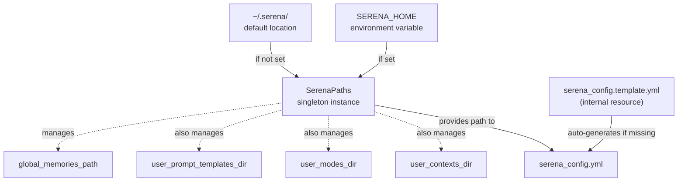
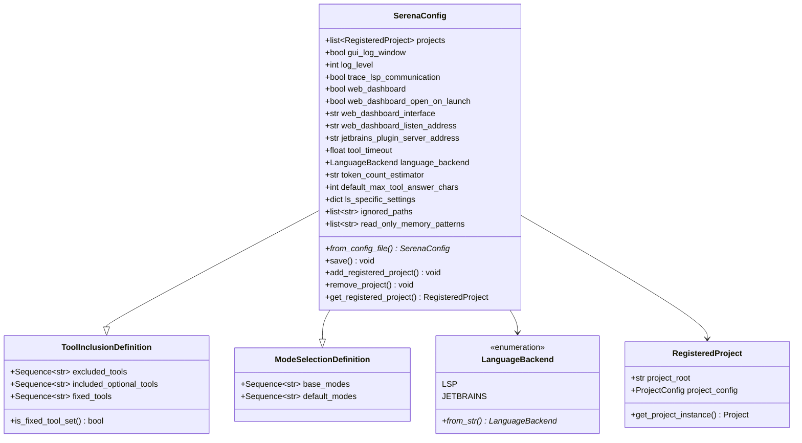
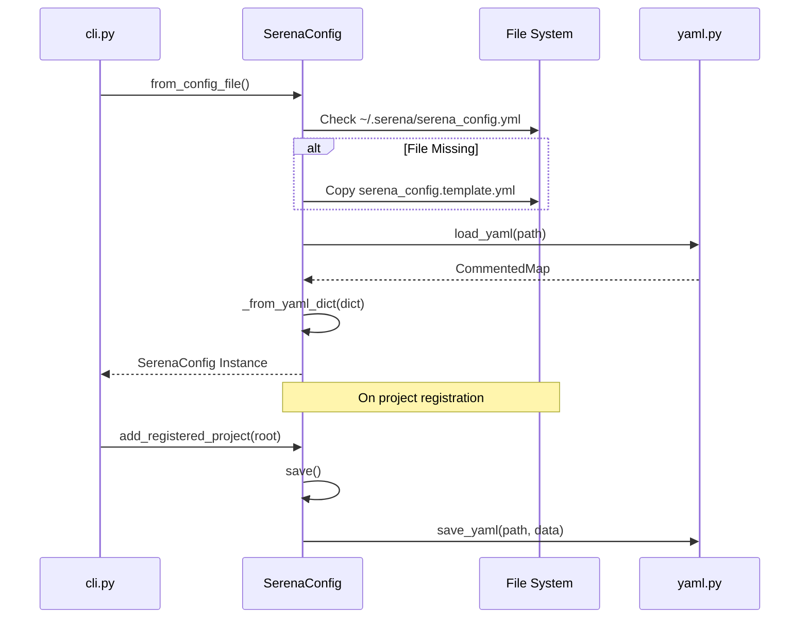

<!-- source: DeepWiki mcp.deepwiki.com · repo oraios/serena · page 4.4 Global Configuration · fetched 2026-10-29 -->

# Global Configuration

Relevant source files

The following files were used as context for generating this wiki page:

- [.serena/.gitignore](.serena/.gitignore)
- [.serena/project.yml](.serena/project.yml)
- [docs/01-about/050_acknowledgements.md](docs/01-about/050_acknowledgements.md)
- [docs/02-usage/020_running.md](docs/02-usage/020_running.md)
- [docs/02-usage/025_jetbrains_plugin.md](docs/02-usage/025_jetbrains_plugin.md)
- [docs/02-usage/030_clients.md](docs/02-usage/030_clients.md)
- [docs/02-usage/040_workflow.md](docs/02-usage/040_workflow.md)
- [docs/02-usage/045_memories.md](docs/02-usage/045_memories.md)
- [docs/02-usage/050_configuration.md](docs/02-usage/050_configuration.md)
- [docs/02-usage/999_additional-usage.md](docs/02-usage/999_additional-usage.md)
- [src/serena/agent.py](src/serena/agent.py)
- [src/serena/config/serena_config.py](src/serena/config/serena_config.py)
- [src/serena/memories/memory_manager.py](src/serena/memories/memory_manager.py)
- [src/serena/memories/memory_reference_analysis.py](src/serena/memories/memory_reference_analysis.py)
- [src/serena/project.py](src/serena/project.py)
- [src/serena/resources/project.template.yml](src/serena/resources/project.template.yml)
- [src/serena/resources/serena_config.template.yml](src/serena/resources/serena_config.template.yml)
- [src/serena/tools/memory_tools.py](src/serena/tools/memory_tools.py)
- [src/serena/util/dataclass.py](src/serena/util/dataclass.py)
- [src/serena/util/yaml.py](src/serena/util/yaml.py)
- [test/serena/config/test_serena_config.py](test/serena/config/test_serena_config.py)
- [test/serena/test_memories_manager.py](test/serena/test_memories_manager.py)
- [test/serena/util/test_yaml.py](test/serena/util/test_yaml.py)

## Purpose and Scope

The global configuration system manages Serena's system-wide settings through the `serena_config.yml` file. This configuration defines defaults that apply across all projects, including UI settings, tool selection, language backend preferences, and logging behavior. 

For project-specific configuration, see [Project Configuration](4.3). For runtime configuration via contexts and modes, see [Contexts and Modes](4.2). For command-line overrides, see [Command Line Interface](4.5).

## Configuration File Location

The global configuration file is stored in the Serena user home directory and managed by the `SerenaPaths` singleton [src/serena/config/serena_config.py:57-124]().

### SerenaPaths Architecture
Title: SerenaPaths Directory Management

Sources: [src/serena/config/serena_config.py:57-124](), [src/serena/config/serena_config.py:581-595]()

The configuration file path is determined by the `SERENA_HOME` environment variable. If unset, it defaults to `~/.serena/` (the `SERENA_MANAGED_DIR_NAME`) [src/serena/config/serena_config.py:61-75]().

| Priority | Location Source | Description |
|----------|----------------|-------------|
| 1 | `SERENA_HOME` env var | User-specified override [src/serena/config/serena_config.py:62-66]() |
| 2 | `~/.serena/` | Default location [src/serena/config/serena_config.py:64-75]() |

## Configuration Data Model

The `SerenaConfig` dataclass holds all global settings and is the central configuration object used throughout the system.

### Configuration Class Diagram
Title: SerenaConfig and Supporting Dataclasses

Sources: [src/serena/config/serena_config.py:477-532](), [src/serena/config/serena_config.py:143-171](), [src/serena/config/serena_config.py:181-187](), [src/serena/config/serena_config.py:410-473]()

## Configuration Settings Categories

### UI and Monitoring Settings

| Setting | Type | Default | Description |
|---------|------|---------|-------------|
| `gui_log_window` | `bool` | `False` | Enable GUI log window [src/serena/resources/serena_config.template.yml:30]() |
| `web_dashboard` | `bool` | `True` | Enable web dashboard [src/serena/resources/serena_config.template.yml:38]() |
| `web_dashboard_open_on_launch` | `bool` | `True` | Auto-open browser to dashboard [src/serena/resources/serena_config.template.yml:49]() |
| `web_dashboard_interface` | `str` | `None` | Application mode (browser, app, tray_manager) [src/serena/resources/serena_config.template.yml:67]() |
| `web_dashboard_listen_address` | `str` | `"127.0.0.1"` | Dashboard bind address [src/serena/resources/serena_config.template.yml:69]() |
| `log_level` | `int` | `20` (INFO) | Minimum log level [src/serena/resources/serena_config.template.yml:91]() |
| `trace_lsp_communication` | `bool` | `False` | Log LSP protocol messages [src/serena/resources/serena_config.template.yml:95]() |

### Language Backend and Advanced Settings

| Setting | Type | Default | Description |
|---------|------|---------|-------------|
| `language_backend` | `LanguageBackend` | `LSP` | `LSP` or `JETBRAINS` [src/serena/resources/serena_config.template.yml:8]() |
| `jetbrains_plugin_server_address` | `str` | `"127.0.0.1"` | IDE plugin address [src/serena/resources/serena_config.template.yml:81]() |
| `ls_specific_settings` | `dict` | `{}` | Per-language LS configuration [src/serena/resources/serena_config.template.yml:101]() |
| `trusted_project_path_patterns` | `list[str]` | `[]` | Patterns for projects allowed to use custom LS settings [src/serena/config/serena_config.py:521]() |

Sources: [src/serena/config/serena_config.py:198-209](), [src/serena/resources/serena_config.template.yml:1-101]()

### Tool and Memory Settings

| Setting | Type | Default | Description |
|---------|------|---------|-------------|
| `tool_timeout` | `float` | `240` | Execution timeout in seconds [src/serena/resources/serena_config.template.yml:120]() |
| `default_max_tool_answer_chars` | `int` | `150000` | Max tool output length [src/serena/config/serena_config.py:523]() |
| `token_count_estimator` | `str` | `"CHAR_COUNT"` | Estimator for usage stats [src/serena/config/serena_config.py:526]() |
| `read_only_memory_patterns` | `list[str]` | `[]` | Regex patterns for RO memories [src/serena/resources/serena_config.template.yml:111]() |
| `ignored_memory_patterns` | `list[str]` | `[]` | Patterns to completely hide memories [src/serena/resources/serena_config.template.yml:120]() |
| `ignored_paths` | `list[str]` | `[]` | Global gitignore-style ignore rules [src/serena/resources/serena_config.template.yml:106]() |

Sources: [src/serena/config/serena_config.py:477-532](), [src/serena/resources/serena_config.template.yml:103-120]()

## Tool and Mode Configuration

Serena uses a tiered system for enabling tools and modes.

### Tool Selection
Tool selection uses `ToolInclusionDefinition` logic [src/serena/config/serena_config.py:143-171]().
- **Incremental**: Uses `excluded_tools` and `included_optional_tools` to modify the default set [src/serena/config/serena_config.py:151-158]().
- **Fixed**: If `fixed_tools` is non-empty, it replaces the entire toolset [src/serena/config/serena_config.py:159-162]().

### Mode Selection
Managed by `ModeSelectionDefinition` [src/serena/config/serena_config.py:181-187]().
- `base_modes`: Modes that are always active (default: `interactive`, `editing`) [src/serena/resources/serena_config.template.yml:133-135]().
- `default_modes`: Modes active by default (default: empty in template) [src/serena/resources/serena_config.template.yml:138]().

## Configuration Lifecycle

### Loading and Saving
Configuration is loaded via `SerenaConfig.from_config_file()` [src/serena/config/serena_config.py:598-680]() and saved via `save()` [src/serena/config/serena_config.py:806-835]().

### Configuration Flow
Title: Global Configuration Data Flow

Sources: [src/serena/config/serena_config.py:598-680](), [src/serena/config/serena_config.py:806-835](), [src/serena/util/yaml.py:63-75]()

## YAML Processing and Normalization

Serena uses `ruamel.yaml` to preserve user comments in configuration files [src/serena/util/yaml.py:15-22](). The `YamlCommentNormalisation` enum defines how comments are associated with keys during loading [src/serena/util/yaml.py:25-54]().

### Comment Association
- `LEADING`: Associates comments with the following key [src/serena/util/yaml.py:41-45]().
- `LEADING_WITH_CONVERSION_FROM_TRAILING`: Converts trailing comments (after a value) into leading comments for the next key [src/serena/util/yaml.py:46-50]().

Sources: [src/serena/util/yaml.py:25-54](), [src/serena/util/yaml.py:78-150]()

## Project Management

The global configuration maintains the `projects` list, which contains `RegisteredProject` objects [src/serena/config/serena_config.py:486]().

### RegisteredProject Capabilities
- `get_project_instance()`: Creates a `Project` object, merging global settings [src/serena/config/serena_config.py:451-473]().
- `from_project_root()`: Factory method to create a registration from a directory path [src/serena/config/serena_config.py:424-449]().

Sources: [src/serena/config/serena_config.py:410-473](), [src/serena/project.py:12-17]()

## Migration and Compatibility

The `SerenaConfig` loader handles legacy configuration formats during initialization:
- Migrates `jetbrains: bool` to `language_backend` enum [src/serena/config/serena_config.py:661-666]().
- Migrates `gui_log_level` to `log_level` [src/serena/config/serena_config.py:669-673]().
- Handles conversion of deprecated tool names and settings [src/serena/config/serena_config.py:657-678]().

Sources: [src/serena/config/serena_config.py:657-678]()

---

