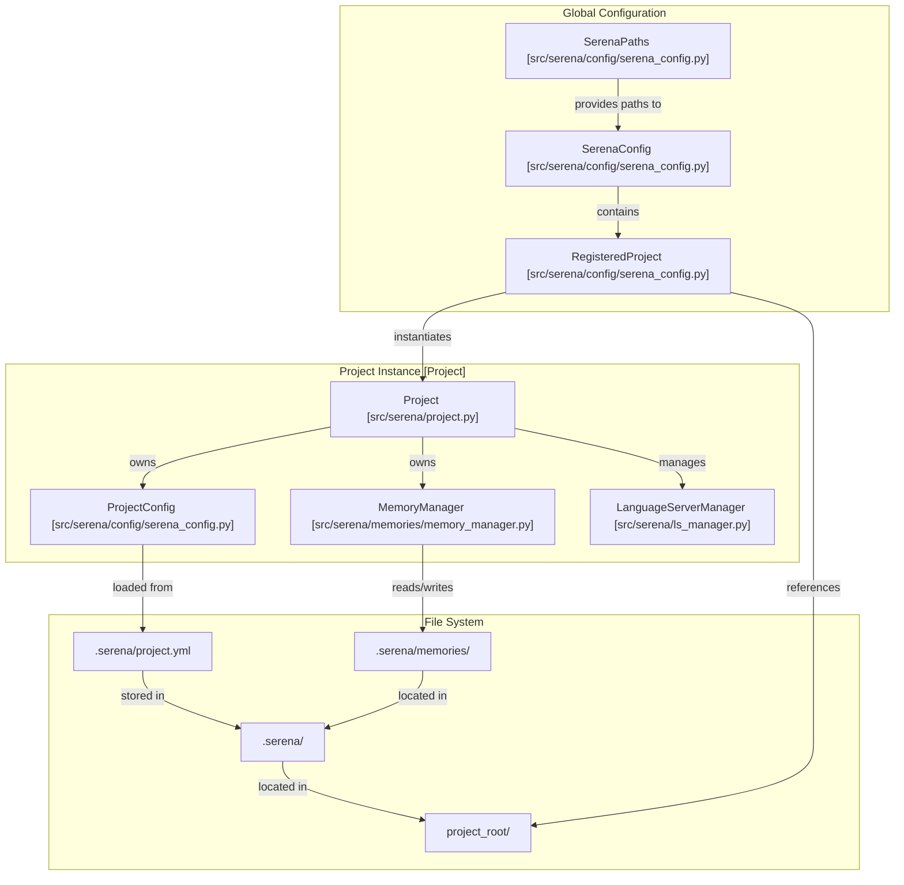

<!-- source: DeepWiki mcp.deepwiki.com · repo oraios/serena · page 5 Project System · fetched 2026-10-29 -->

# Project System

Relevant source files

The following files were used as context for generating this wiki page:

- [.serena/project.yml](.serena/project.yml)
- [src/serena/agent.py](src/serena/agent.py)
- [src/serena/config/serena_config.py](src/serena/config/serena_config.py)
- [src/serena/project.py](src/serena/project.py)
- [src/serena/resources/project.template.yml](src/serena/resources/project.template.yml)
- [src/serena/resources/serena_config.template.yml](src/serena/resources/serena_config.template.yml)
- [src/serena/util/file_system.py](src/serena/util/file_system.py)
- [src/serena/util/inspection.py](src/serena/util/inspection.py)
- [test/serena/config/test_serena_config.py](test/serena/config/test_serena_config.py)
- [test/serena/util/test_file_system.py](test/serena/util/test_file_system.py)
- [test/serena/util/test_inspection.py](test/serena/util/test_inspection.py)

This document provides a high-level overview of how Serena manages software projects through the `Project` abstraction. The Project system is responsible for managing file operations, path validation, memory storage, and the lifecycle of language servers. It serves as the foundational layer that all Serena tools use to interact with a codebase.

## Overview

The Project system is composed of three primary classes that handle configuration, registration, and runtime execution.

| Component | File | Purpose |
|-----------|------|---------|
| `ProjectConfig` | [src/serena/config/serena_config.py:234-237]() | Dataclass for project-specific settings (languages, ignores, encoding). |
| `RegisteredProject` | [src/serena/config/serena_config.py:353-398]() | A wrapper in the global configuration that tracks known project roots. |
| `Project` | [src/serena/project.py:32-32]() | The active runtime instance managing files, memories, and language servers. |

A project is defined by its root directory and a `.serena/project.yml` configuration file. Projects can be explicitly registered in the global `serena_config.yml` or discovered dynamically by the CLI using `find_project_root` [src/serena/cli.py:65-102]().

**Sources:** [src/serena/project.py:32-455](), [src/serena/config/serena_config.py:234-398](), [src/serena/cli.py:65-102]()

---

## Project Architecture

The following diagram illustrates the relationship between a `Project` instance, its configuration, and the underlying file system.

**Project Class Architecture Diagram**

**Sources:** [src/serena/project.py:32-59](), [src/serena/config/serena_config.py:57-120](), [src/serena/config/serena_config.py:353-398](), [src/serena/memories/memory_manager.py:25-50]()

---

## Project Lifecycle

The lifecycle of a project involves discovery, configuration autogeneration, loading, and eventual activation.

- **Discovery:** Serena finds project roots by walking up from the current working directory, looking for `.serena/project.yml` or `.git` markers via `find_project_root` [src/serena/cli.py:65-102]().
- **Loading:** `Project.load()` initializes the project by loading its `ProjectConfig` and setting up the `MemoryManager` [src/serena/project.py:137-149]().
- **Activation:** When a `SerenaAgent` activates a project, it initializes the `LanguageServerManager`. This starts the appropriate language servers (e.g., Pyright for Python) based on the project's `language_servers` list [src/serena/project.py:59-62]().
- **Maintenance:** The project creates a `.gitignore` in the `.serena/` folder to ensure local caches (like `SolidLanguageServer.CACHE_FOLDER_NAME`) and local configs are not committed to the repository [src/serena/project.py:65-72]().

For details, see [Project Lifecycle](#5.1).

**Sources:** [src/serena/project.py:137-149](), [src/serena/cli.py:65-102](), [src/serena/project.py:65-72]()

---

## Memory Management

Serena uses a "Memory" system to store persistent project context that the LLM can reference. This is managed by the `MemoryManager` [src/serena/memories/memory_manager.py:25-50]().

- **Project Memories:** Stored in the project's `.serena/` data folder as Markdown files [src/serena/project.py:45-54]().
- **Global Memories:** Stored in the Serena user home (e.g., `~/.serena/memories/global/`) and shared across all projects [src/serena/config/serena_config.py:114-119]().
- **Referential Integrity:** Serena supports renaming memories and automatically updating `mem:` references within other memory files [src/serena/memories/memory_manager.py:123-149]().
- **Tools:** The agent interacts with these via tools like `ReadMemoryTool`, `WriteMemoryTool`, and `EditMemoryTool` [src/serena/agent.py:55-60]().

For details, see [Memory Management](#5.2).

**Sources:** [src/serena/memories/memory_manager.py:25-50](), [src/serena/project.py:45-54](), [src/serena/config/serena_config.py:114-119]()

---

## File Operations and Ignore Patterns

The Project system provides a safe interface for file operations, ensuring the agent respects ignore rules.

- **Ignore System:** Serena merges patterns from the global `SerenaConfig`, the project's `ProjectConfig`, and any `.gitignore` files found in the repository via `GitignoreParser` [src/serena/project.py:79-97]().
- **Asynchronous Processing:** Ignore patterns are gathered in a background thread `_gather_ignorespec` to ensure immediate project activation without waiting for a full file system scan [src/serena/project.py:73-77]().
- **Composition Detection:** `compute_language_server_support_composition` is used to identify the dominant languages in the codebase to assist in autogeneration [src/serena/util/inspection.py:30-45]().

For details, see [File Operations and Ignore Patterns](#5.3).

**Sources:** [src/serena/project.py:73-111](), [src/serena/util/file_system.py:130-146](), [src/serena/util/inspection.py:30-74]()

---

## Project Configuration

The `ProjectConfig` dataclass defines how Serena behaves within a specific codebase.

| Field | Purpose |
|-------|---------|
| `language_servers` | List of `LanguageServerId` enums (e.g., `python`, `typescript`) for which to start LSPs [src/serena/resources/project.template.yml:4-36](). |
| `ignored_paths` | Additional glob patterns to ignore beyond `.gitignore` [src/serena/resources/project.template.yml:98-108](). |
| `language_backend` | Selection between `LSP` or `JetBrains` backends [src/serena/resources/project.template.yml:60-65](). |
| `read_only` | If true, disables all editing tools for safety [src/serena/resources/project.template.yml:110-113](). |

**Autogeneration:** If no config exists, `ProjectConfig.autogenerate()` scans the root to detect languages and creates a default `.serena/project.yml` [test/serena/config/test_serena_config.py:40-66]().

**Sources:** [src/serena/config/serena_config.py:234-237](), [src/serena/resources/project.template.yml:1-130](), [test/serena/config/test_serena_config.py:40-157]()

---

## Cross-Project Querying

Serena supports querying symbols from projects other than the currently active one. This allows an agent working in one repository to "look up" definitions in a dependency or related project.

- **ProjectServer:** A service that exposes project information to other Serena instances via the `start-project-server` command [src/serena/cli.py:1-45]().
- **Querying:** Agents use the `QueryProjectTool` to perform symbolic searches in remote projects registered in the global configuration.

For details, see [Cross-Project Querying](#5.4).

**Sources:** [src/serena/cli.py:1-45]()

---

